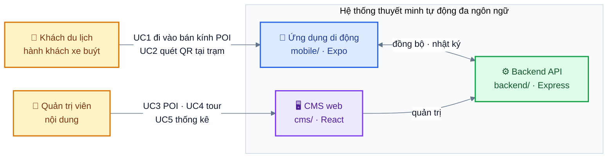
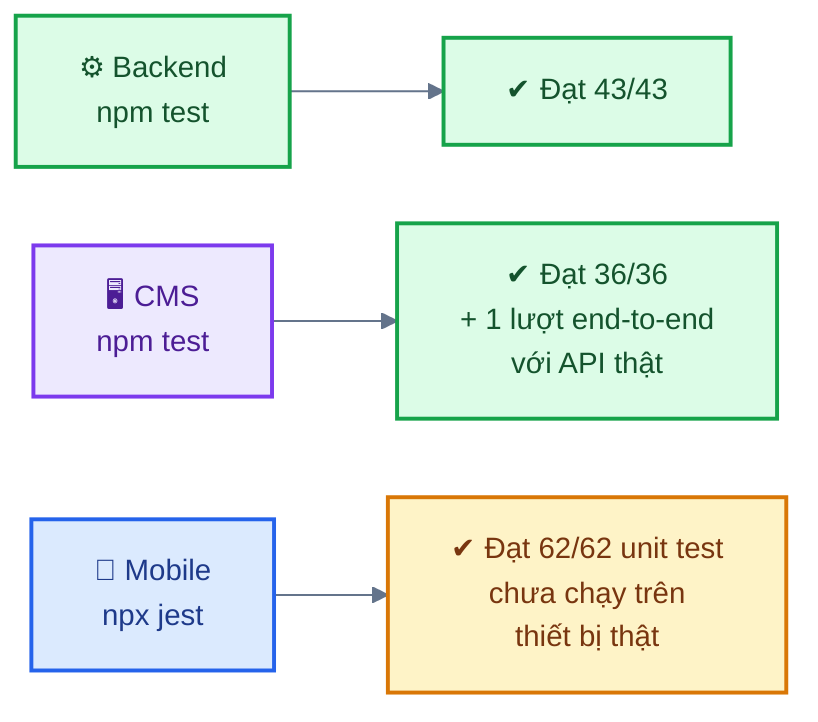
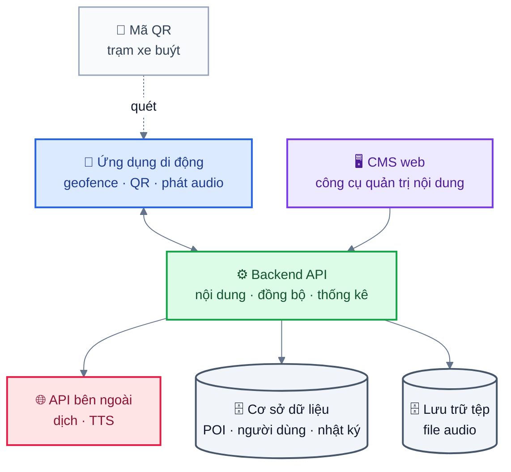
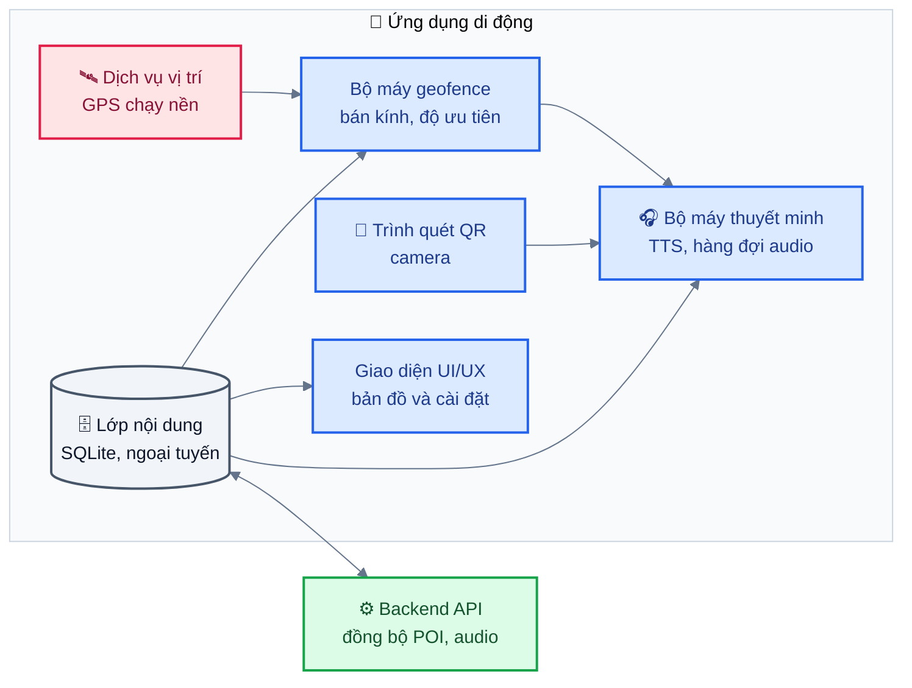
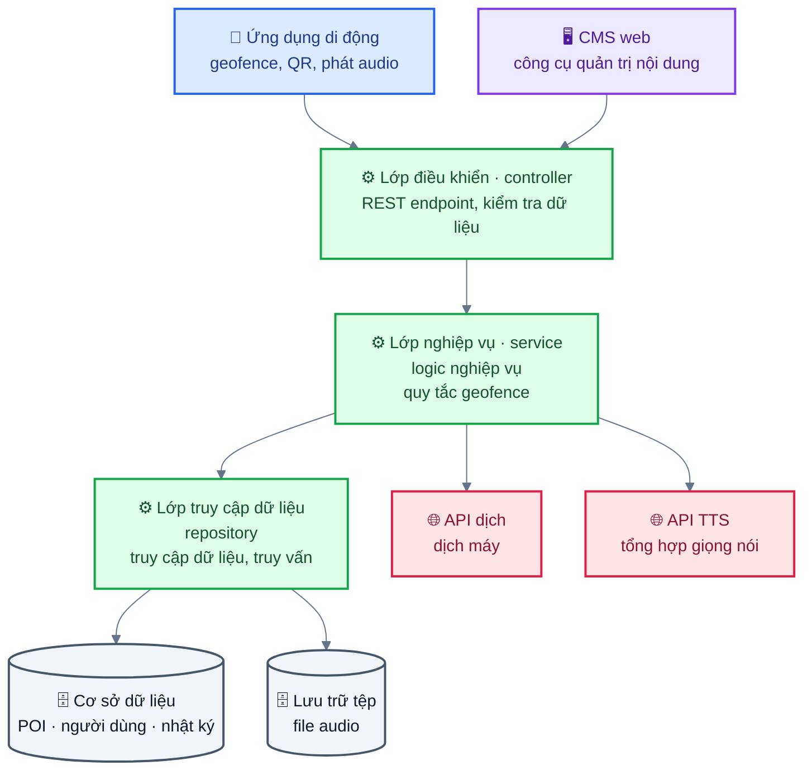
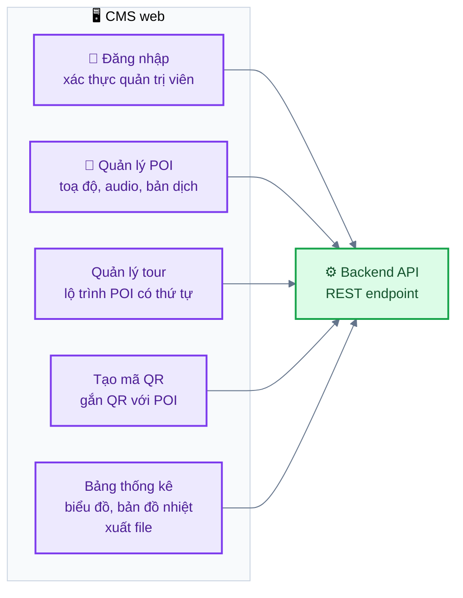
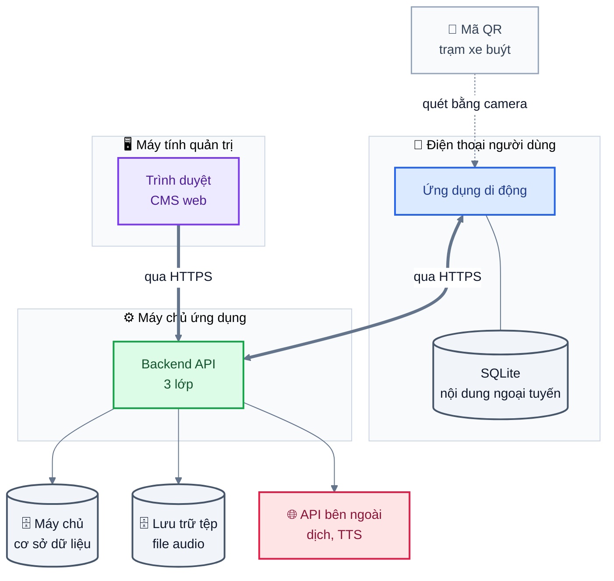
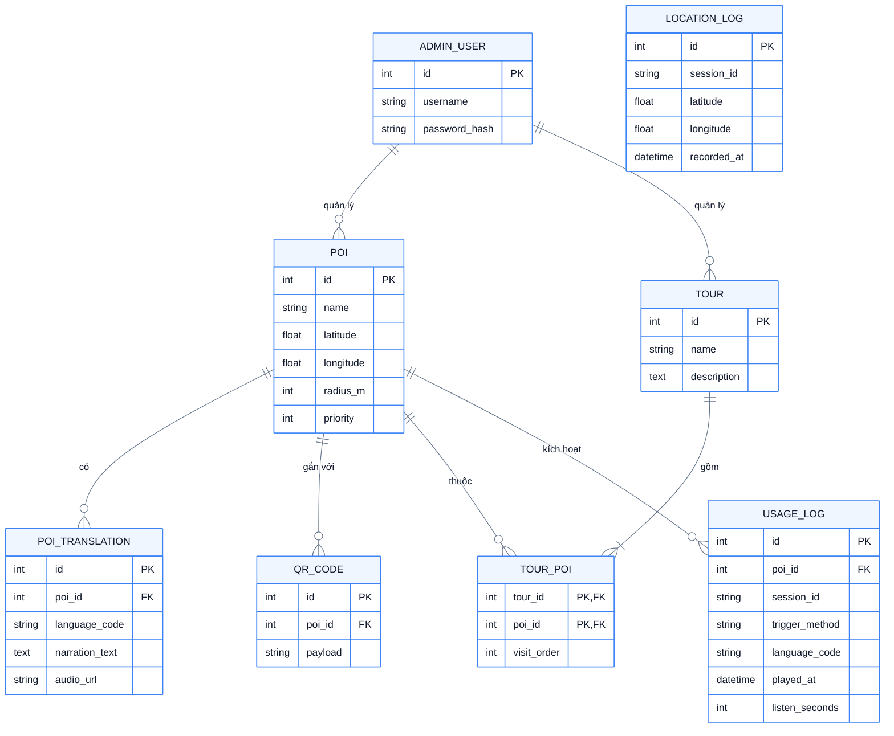

# CongNghePhanMem_Project

# Hệ thống thuyết minh tự động đa ngôn ngữ

*Multilingual Automatic Narration System*

Khách du lịch (tourist) và hành khách xe buýt (bus passenger) tại Quận 4, TP. Hồ Chí Minh (các phường Khánh Hội, Vĩnh Hội, Xóm Chiếu) được nghe thuyết minh (narration) tự động bằng ngôn ngữ của mình về các điểm tham quan (POI) ở gần. Thuyết minh bắt đầu khi người dùng đi vào bán kính (radius) GPS của một điểm hoặc quét mã QR tại trạm xe buýt (bus stop). Quản trị viên nội dung (content administrator) quản lý điểm tham quan, bản dịch (translation), audio, tour và mã QR trên CMS web, đồng thời xem thống kê (analytics) sử dụng ẩn danh.

| Thành phần | Thư mục | Công nghệ |
|---|---|---|
| Backend API (3 lớp) | [`backend/`](backend/) | Node.js ≥ 22.13, Express 5, SQLite (`node:sqlite`), JWT |
| CMS web | [`cms/`](cms/) | Vite, React, TypeScript, Leaflet, Chart.js |
| Ứng dụng di động | [`mobile/`](mobile/) | Expo SDK 58 (React Native, TypeScript), SQLite ngoại tuyến (offline) |
| Tài liệu báo cáo | [`docs/`](docs/) | SRS, thiết kế, kế hoạch kiểm thử (test plan), cài đặt, hướng dẫn sử dụng, API |

Ca sử dụng (use case) được mô tả trong tài liệu Đặc tả ca sử dụng (Focused Use Cases UC1–UC5, v1.0, 20/09/2026).



*Hình: Hai nhóm người dùng, năm ca sử dụng UC1–UC5 và ba thành phần của dự án*


## Bắt đầu nhanh

### Cách dễ nhất: bấm đúp file (không cần gõ lệnh)

1. Bấm đúp **`CHAY-WEBSITE.bat`** ở thư mục gốc dự án.
   - Lần đầu chạy sẽ tự cài thư viện và nạp dữ liệu (cần mạng, chờ khoảng 1–2 phút).
   - Cửa sổ đen hiện ra là server đang chạy — **giữ cửa sổ đó mở**. Trình duyệt tự mở trang web.
2. Muốn vào trang quản trị: mở <http://localhost:4000/admin> (tài khoản `admin`).
   Mật khẩu mặc định khi nạp dữ liệu mới là `admin123`; trên máy này mật khẩu đã được đổi,
   xem `cloudflare/THONG-TIN-DANG-NHAP.txt`.
3. Tắt website: bấm đúp **`TAT-WEBSITE.bat`** (hoặc đóng cửa sổ đen).

Yêu cầu duy nhất: máy đã cài **Node.js** (bản LTS, tải ở <https://nodejs.org>). Nếu chưa có, file `.bat` sẽ báo và dừng.

### Cho người khác truy cập qua tên miền (không cần chung Wi-Fi)

Hệ thống **đã được cấu hình sẵn** và đang chạy tại:

- Website: <https://cnpm.dpdns.org>
- Quản trị: <https://cnpm.dpdns.org/admin>

Cách dùng hằng ngày:

1. Bấm đúp **`CHAY-CONG-KHAI.bat`** — script tự bật server, kiểm tra `JWT_SECRET`, rồi mở Cloudflare Tunnel.
   Lần chạy đầu đã lưu cấu hình vào `cloudflare/config.yml` nên **không hỏi token nữa**.
2. Giữ cửa sổ đen mở. Muốn tắt: bấm đúp **`TAT-CONG-KHAI.bat`**.
3. Gửi link `https://cnpm.dpdns.org` cho người khác.

Thông tin đăng nhập CMS, tên tunnel, khóa bí mật… nằm trong `cloudflare/THONG-TIN-DANG-NHAP.txt`
(thư mục `cloudflare/` đã nằm trong `.gitignore`, không bị đẩy lên git).

Kiến trúc: tên miền `cnpm.dpdns.org` (DigitalPlat) → nameserver Cloudflare → Cloudflare Tunnel →
`http://localhost:4000` trên máy này. Không cần mở port router, không cần IP tĩnh.

Hướng dẫn từng bước, cách làm lại từ đầu, bảo vệ CMS, xử lý sự cố, phương án VPS:
[`docs/dua-len-domain.md`](docs/dua-len-domain.md).

> Máy tính phải **bật và có mạng** thì website mới online. Nếu chạy `npm run seed:demo` lại,
> mật khẩu admin lấy từ `ADMIN_PASSWORD` trong `backend/.env` (đã đặt sẵn), không quay về `admin123`.

### Sửa code xong thì có phải khởi động lại không?

Phần lớn **có** — server đang chạy bằng `npm start` nên đã nạp code vào bộ nhớ, sửa file trên đĩa
mà chỉ bấm F5 thì chưa thấy thay đổi:

| Bạn sửa | Bấm F5 là thấy? | Cần làm thêm |
|---|---|---|
| File trong `web/` (bản build đang phục vụ) | ✅ | Không (file cùng tên thì Ctrl+F5) |
| Nội dung nhập trong CMS (POI, tour, giá, QR) | ✅ | Không — lưu là ghi thẳng vào SQLite |
| `backend/src/**` (API, thanh toán, đếm live…) | ❌ | Bấm đúp **`KHOI-DONG-LAI-SERVER.bat`** |
| `backend/.env` (ví dụ đổi `LIVE_DEMO_FACTOR`) | ❌ | Bấm đúp **`KHOI-DONG-LAI-SERVER.bat`** |
| `cms/src/**` (giao diện quản trị) | ❌ | Build lại rồi chép vào `web/admin/` (xem `docs/code-map.md` mục 6) |
| `cloudflare/config.yml` | ❌ | Tắt rồi mở lại `CHAY-CONG-KHAI.bat` |

**`KHOI-DONG-LAI-SERVER.bat`** chỉ tắt/mở lại server cổng 4000, **giữ nguyên tunnel** nên website
chỉ gián đoạn khoảng 3 giây. Muốn tắt hết (cả tunnel) thì dùng `TAT-CONG-KHAI.bat`.

Khi đang sửa nhiều, có thể chạy chế độ tự nạp lại thay vì bấm file:

```powershell
cd backend
$env:PORT=4001; npm run dev    # cổng 4001 để không đụng server đang chạy
```


### Cách dùng dòng lệnh

```bash
# 1. Backend: http://localhost:4000/api
cd backend && npm install && npm run seed:demo && npm run dev

# 2. CMS: http://localhost:5173  (đăng nhập admin / admin123, chỉ dùng cho demo trên máy)
cd cms && npm install && npm run dev

# 3. Ứng dụng di động: dùng Expo Go quét mã QR mà Expo hiển thị
cd mobile && npm install && npx expo start
```

## Bản sao đầy đủ của website đang chạy (local)

Thư mục [`web/`](web/) chứa bản build của <https://thuyetminh.hmarketing.vn/> (website công khai) và CMS `/admin/`. Backend phục vụ luôn hai bản này nên chỉ cần **một cổng** là chạy được toàn bộ hệ thống, giống bản deploy:

```bash
cd backend
npm install
npm run seed:demo     # 9 POI, 3 tour, 6 QR, 6 ngôn ngữ, audio, giá và đơn demo
npm start             # website: http://localhost:4000
                      # CMS:     http://localhost:4000/admin/  (admin / admin123)
```

- **Thanh toán**: 4 điểm có phí 5.000đ (Bến Nhà Rồng, Vĩnh Khánh, Cảng Sài Gòn, Công viên Khánh Hội). Khách bấm mua → nhận mã đơn + VietQR → bấm “Tôi đã chuyển khoản” là nghe được ngay; CMS vào **Thanh toán** để xác nhận hoặc huỷ (huỷ sẽ thu hồi quyền nghe).
- **Đếm người trực tuyến**: hiện đang báo **số thật** (`LIVE_DEMO_FACTOR=1` trong `backend/.env`). Muốn nhân đôi để demo thì đổi thành `2` rồi khởi động lại server. TTL phiên và nhịp heartbeat giữ đúng bản deploy (45 giây / 15 giây).
- **Tài khoản nhận tiền** mặc định giống bản deploy; đổi bằng `PAYMENT_BANK_BIN`, `PAYMENT_BANK_NAME`, `PAYMENT_ACCOUNT`, `PAYMENT_ACCOUNT_NAME`. Đặt `PAYMENT_ACCOUNT=''` để tắt thanh toán ở local.
- **Nội dung snapshot**: `backend/src/db/deployed-snapshot.json` (POI, bản dịch, tour, QR, giá, audio của cả điểm trả phí). Nếu thiếu file audio, chạy `cd backend && node scripts/fetch-deployed.mjs` khi có mạng để tải lại toàn bộ asset + audio.
- **Dữ liệu mẫu tối giản** (8 POI, 2 tour, 5 QR) dùng cho test: `npm run seed:sample`.
- **Tìm code theo chức năng**: xem [`docs/code-map.md`](docs/code-map.md) — bản đồ file/hàm và bảng “muốn đổi X thì sửa ở đâu”.
- `web/` là bundle đã build/minify nên muốn sửa giao diện phải dùng mã nguồn gốc của website; backend chỉ phục vụ nguyên trạng.

```mermaid
%%{init: {"theme":"base","fontFamily":"Helvetica Neue, Arial, sans-serif","themeVariables":{"fontFamily":"Helvetica Neue, Arial, sans-serif","fontSize":"15px","primaryColor":"#EFF6FF","primaryBorderColor":"#3B82F6","primaryTextColor":"#0F172A","lineColor":"#64748B","secondaryColor":"#F0FDF4","tertiaryColor":"#FFFFFF","clusterBkg":"#F8FAFC","clusterBorder":"#CBD5E1","edgeLabelBackground":"#FFFFFF","noteBkgColor":"#FEF9C3","noteBorderColor":"#EAB308","actorBkg":"#DBEAFE","actorBorder":"#2563EB","actorTextColor":"#1E3A8A","signalColor":"#475569","signalTextColor":"#0F172A","labelBoxBkgColor":"#F1F5F9","labelBoxBorderColor":"#94A3B8","activationBkgColor":"#E0F2FE","activationBorderColor":"#0284C7","sequenceNumberColor":"#FFFFFF","pie1":"#16A34A","pie2":"#F59E0B","pie3":"#94A3B8","pie4":"#DC2626","pie5":"#2563EB","pie6":"#7C3AED","pieStrokeColor":"#FFFFFF","pieSectionTextColor":"#FFFFFF","quadrant1Fill":"#FEE2E2","quadrant2Fill":"#FEF3C7","quadrant3Fill":"#DCFCE7","quadrant4Fill":"#FEF3C7","quadrantPointFill":"#1E3A8A","quadrantPointTextFill":"#0F172A","git0":"#1E3A8A","gitBranchLabel0":"#FFFFFF","cScale0":"#DBEAFE","cScale1":"#DCFCE7","cScale2":"#EDE9FE","cScale3":"#FEF3C7","cScale4":"#FFE4E6","cScale5":"#E0F2FE","cScale6":"#F1F5F9"},"flowchart":{"curve":"basis","padding":16,"nodeSpacing":40,"rankSpacing":50},"sequence":{"showSequenceNumbers":true,"mirrorActors":false}}}%%
flowchart LR
    B["⚙️ 1. Backend<br/>npm run seed:demo<br/>npm run dev<br/>localhost:4000/api"]:::backend
    C["🖥️ 2. CMS<br/>npm run dev<br/>localhost:5173<br/>admin / admin123"]:::cms
    M["📱 3. Ứng dụng di động<br/>npx expo start<br/>mở bằng Expo Go"]:::mobile
    SIM["🛰️ Mô phỏng vị trí<br/>chạm bản đồ hoặc<br/>tự đi bộ theo tour"]:::ext
    B --> C --> M
    M -. "Cài đặt: IP LAN của máy<br/>cổng 4000" .-> B
    M -. "demo trên lớp" .-> SIM
    classDef mobile fill:#DBEAFE,stroke:#2563EB,stroke-width:2px,color:#1E3A8A
    classDef cms fill:#EDE9FE,stroke:#7C3AED,stroke-width:2px,color:#4C1D95
    classDef backend fill:#DCFCE7,stroke:#16A34A,stroke-width:2px,color:#14532D
    classDef ext fill:#FFE4E6,stroke:#E11D48,stroke-width:2px,color:#881337
```



*Hình: Thứ tự chạy thử trên máy: backend trước, rồi CMS, rồi ứng dụng di động trỏ về IP LAN của máy*


Trên điện thoại thật, đặt địa chỉ máy chủ trong màn hình **Cài đặt** của ứng dụng (hoặc biến `EXPO_PUBLIC_API_URL`) thành IP LAN của máy tính, ví dụ `http://192.168.1.10:4000`. Khi demo trên lớp mà không cần đi bộ, bật chế độ **Mô phỏng vị trí** rồi chạm vào bản đồ hoặc cho ứng dụng tự đi bộ theo một tour. Chi tiết: [`docs/04-installation.md`](docs/04-installation.md).

## Kiểm thử

| Thành phần | Lệnh | Kết quả |
|---|---|---|
| Backend | `cd backend && npm test` | Đạt 43/43 (chạy lại 01/11/2026) |
| CMS | `cd cms && npm test` | Đạt 36/36, kèm một lượt chạy end-to-end trên trình duyệt với API thật |
| Mobile | `cd mobile && npx jest` | Đạt 62/62 kiểm thử đơn vị (unit test); chưa chạy trên thiết bị thật |

> Số liệu CMS (36/36) và Mobile (62/62) đo ngày 18/10/2026; sau đó mã hai phần này chỉ được
> bổ sung chú thích, không đổi logic. Backend được chạy lại và xác nhận 43/43 ngày 01/11/2026.



*Hình: Kết quả kiểm thử ngày 18/10/2026: xanh là đạt đủ, vàng là đạt nhưng còn thiếu kiểm thử trên thiết bị*


---

# Sơ đồ thiết kế ban đầu

## 1. Tổng quan hệ thống (sơ đồ thành phần)



*Hình: Sơ đồ thành phần ban đầu: hai client dùng chung một backend*

## 2. Bên trong ứng dụng di động



*Hình: Các khối bên trong ứng dụng di động theo thiết kế ban đầu*

## 3. Bên trong Backend (3 lớp)



*Hình: Backend ba lớp theo thiết kế ban đầu (xanh lá); repository truy cập cả cơ sở dữ liệu và lưu trữ tệp*

## 4. Bên trong CMS web



*Hình: Năm chức năng chính của CMS web, tất cả gọi Backend API*

## 5. Sơ đồ triển khai



*Hình: Sơ đồ triển khai ban đầu: máy chủ ứng dụng, cơ sở dữ liệu và lưu trữ tệp tách riêng*

## 6. ERD



*Hình: ERD ban đầu của nhóm (lược đồ thực tế xem docs/02-design.md §6.1)*
