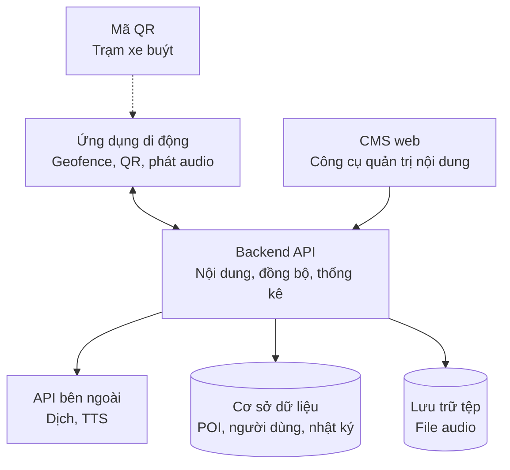
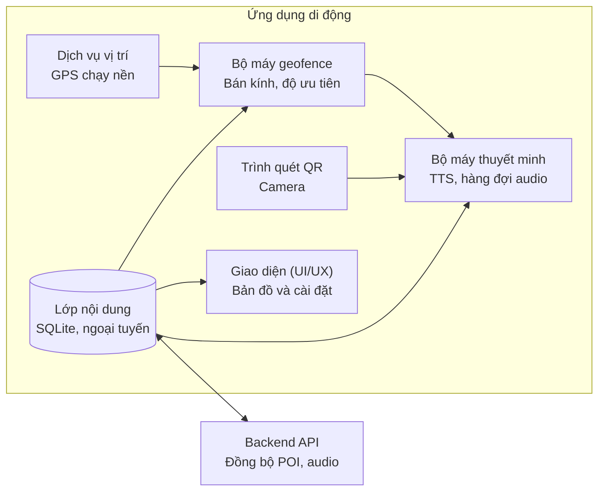
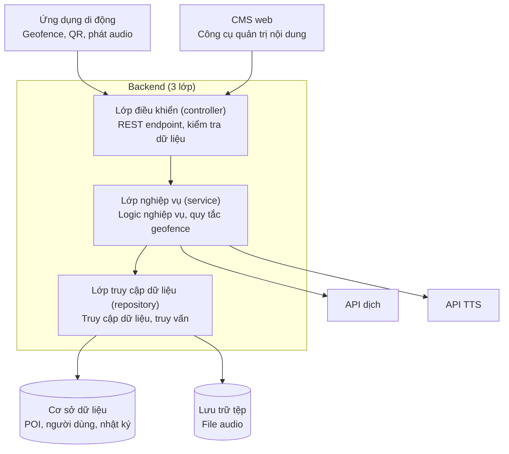
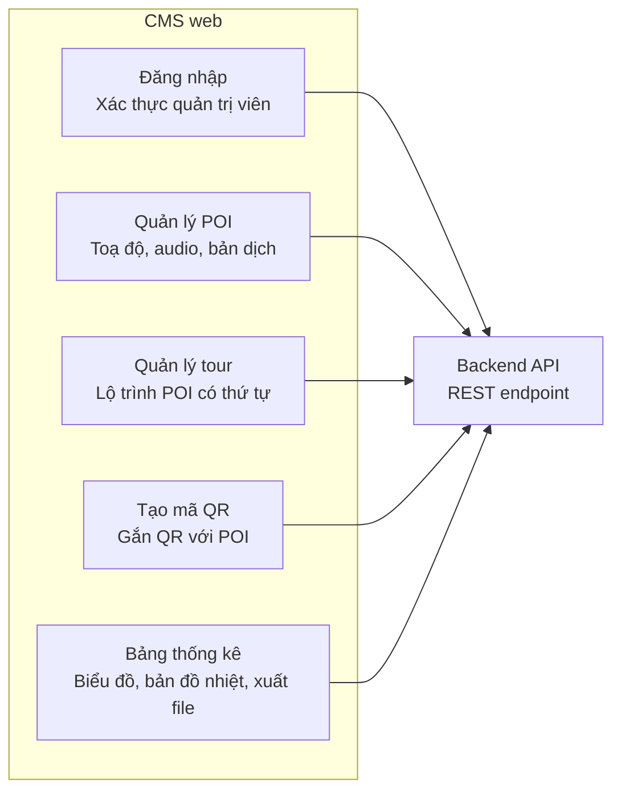
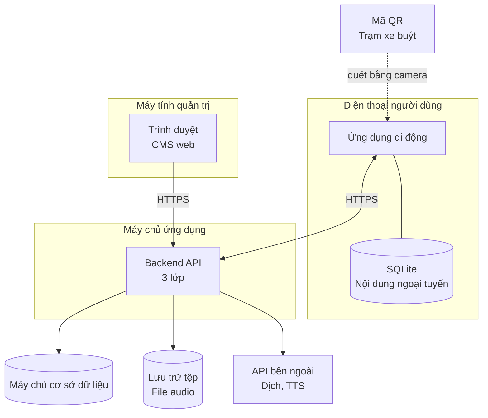
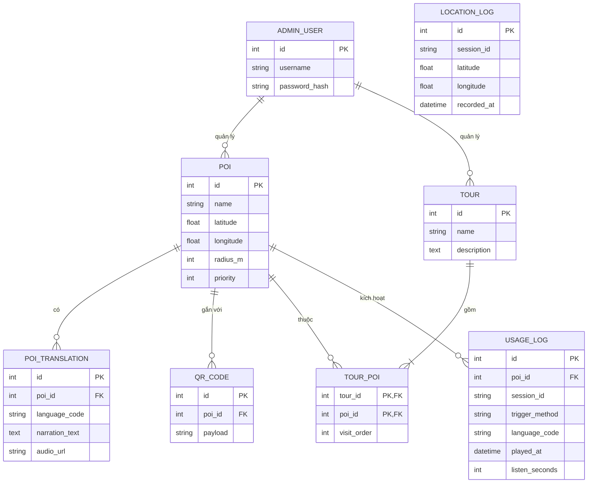

# CongNghePhanMem_Project

# Hệ thống thuyết minh tự động đa ngôn ngữ

*Multilingual Automatic Narration System*

Khách du lịch (tourist) và hành khách xe buýt (bus passenger) tại Quận 4, TP. Hồ Chí Minh (các phường Khánh Hội, Vĩnh Hội, Xóm Chiếu) được nghe thuyết minh (narration) tự động bằng ngôn ngữ của mình về các điểm tham quan (POI) ở gần. Thuyết minh bắt đầu khi người dùng đi vào bán kính (radius) GPS của một điểm hoặc quét mã QR tại trạm xe buýt (bus stop). Quản trị viên nội dung (content administrator) quản lý điểm tham quan, bản dịch (translation), audio, tour và mã QR trên CMS web, đồng thời xem thống kê (analytics) sử dụng ẩn danh.

| Thành phần | Thư mục | Công nghệ |
|---|---|---|
| Backend API (3 lớp) | [`backend/`](backend/) | Node.js ≥ 22.13, Express 5, SQLite (`node:sqlite`), JWT |
| CMS web | [`cms/`](cms/) | Vite, React, TypeScript, Leaflet, Chart.js |
| Ứng dụng di động | [`mobile/`](mobile/) | Expo SDK 58 (React Native, TypeScript), SQLite ngoại tuyến (offline) |
| Tài liệu báo cáo | [`docs/`](docs/) | SRS, thiết kế, kế hoạch kiểm thử (test plan), cài đặt, hướng dẫn sử dụng, API |

Ca sử dụng (use case) được mô tả trong tài liệu Đặc tả ca sử dụng (Focused Use Cases UC1–UC5, v1.0, 20/09/2026).

## Bắt đầu nhanh

```bash
# 1. Backend: http://localhost:4000/api
cd backend && npm install && npm run seed:demo && npm run dev

# 2. CMS: http://localhost:5173  (đăng nhập admin / admin123, chỉ dùng cho demo trên máy)
cd cms && npm install && npm run dev

# 3. Ứng dụng di động: dùng Expo Go quét mã QR mà Expo hiển thị
cd mobile && npm install && npx expo start
```

Trên điện thoại thật, đặt địa chỉ máy chủ trong màn hình **Cài đặt** của ứng dụng (hoặc biến `EXPO_PUBLIC_API_URL`) thành IP LAN của máy tính, ví dụ `http://192.168.1.10:4000`. Khi demo trên lớp mà không cần đi bộ, bật chế độ **Mô phỏng vị trí** rồi chạm vào bản đồ hoặc cho ứng dụng tự đi bộ theo một tour. Chi tiết: [`docs/04-installation.md`](docs/04-installation.md).

## Kiểm thử

| Thành phần | Lệnh | Kết quả (18/10/2026) |
|---|---|---|
| Backend | `cd backend && npm test` | Đạt 43/43 |
| CMS | `cd cms && npm test` | Đạt 36/36, kèm một lượt chạy end-to-end trên trình duyệt với API thật |
| Mobile | `cd mobile && npx jest` | Đạt 62/62 kiểm thử đơn vị (unit test); chưa chạy trên thiết bị thật |

---

# Sơ đồ thiết kế ban đầu

## 1. Tổng quan hệ thống (sơ đồ thành phần)



## 2. Bên trong ứng dụng di động



## 3. Bên trong Backend (3 lớp)



## 4. Bên trong CMS web



## 5. Sơ đồ triển khai



## 6. ERD


