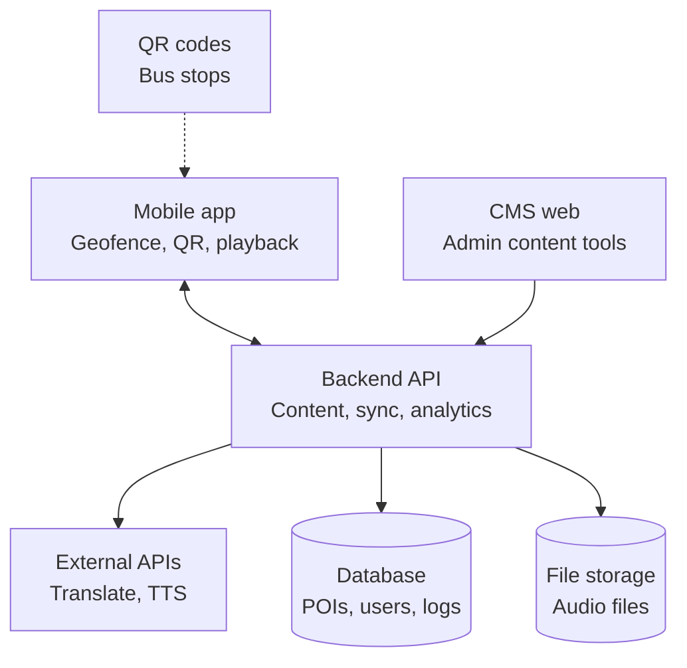
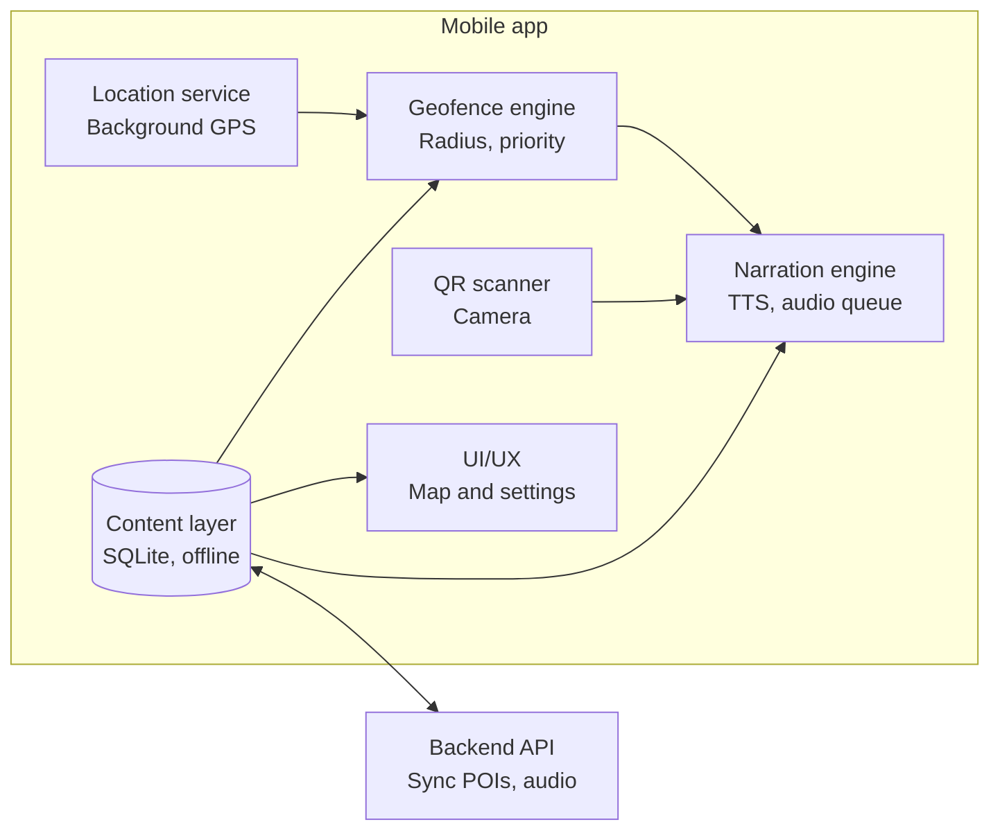
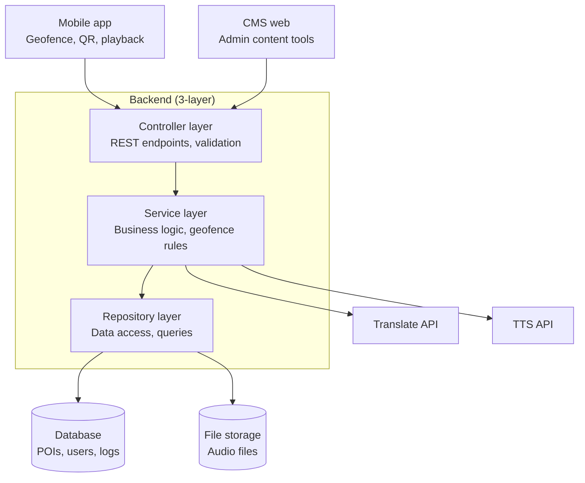
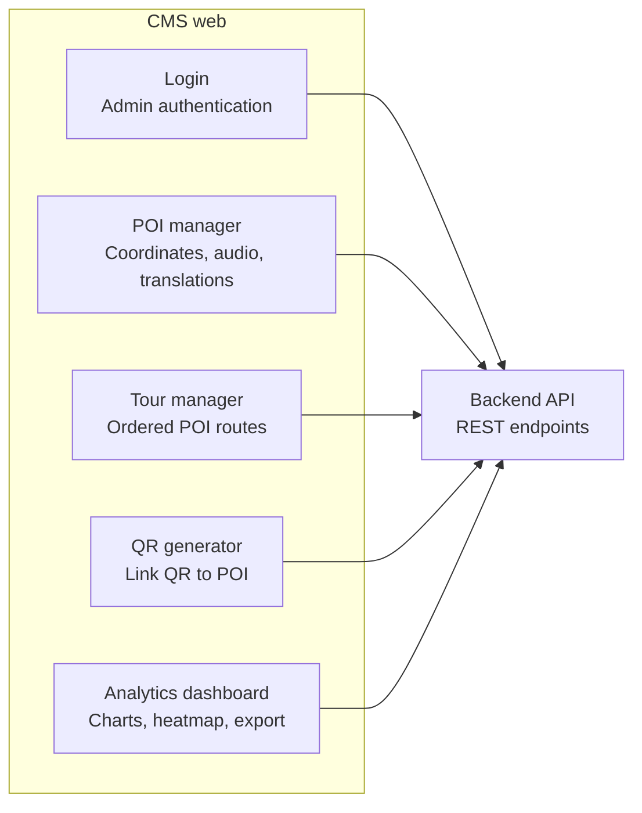
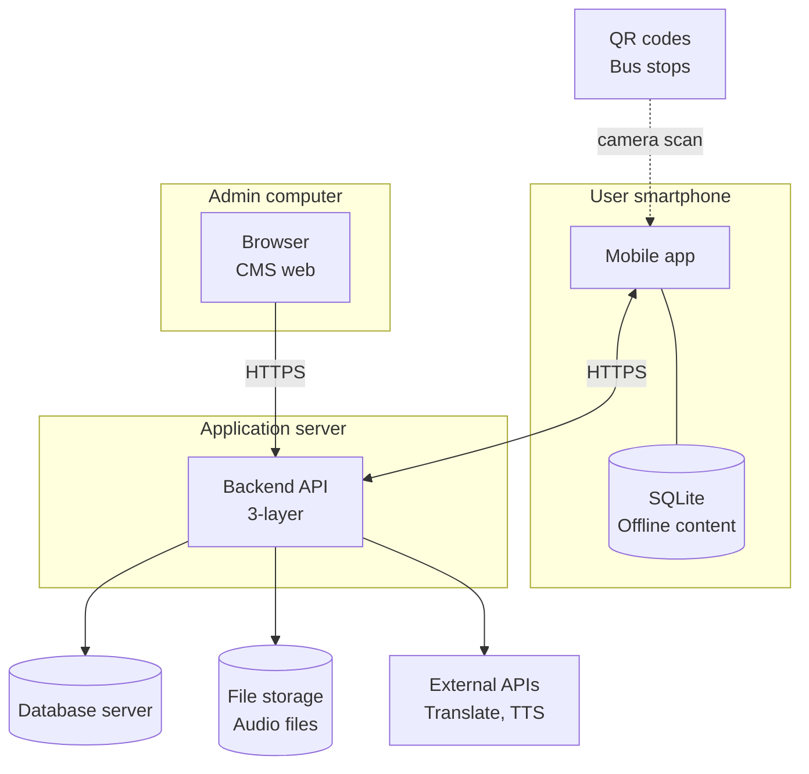
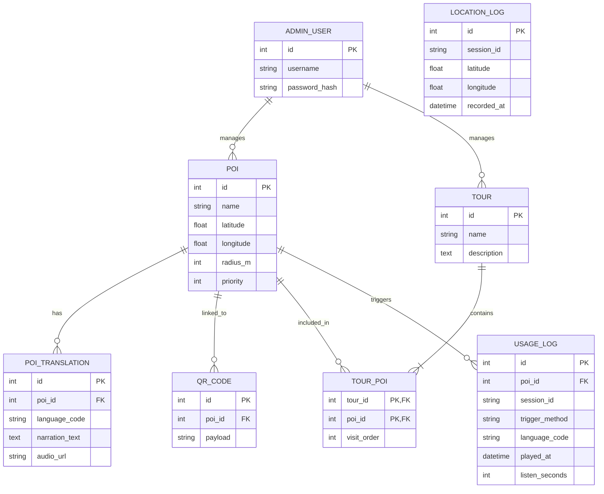

# CongNghePhanMem_Project

# Multilingual Automatic Narration System

## 1. System overview (component diagram)

## 2. Inside the Mobile app

## 3. Inside the Backend (3-layer)

## 4. Inside the CMS web

## 5. Deployment diagram

## 6. ERD

