# TÀI LIỆU PRD – HỆ THỐNG THUYẾT MINH TỰ ĐỘNG ĐA NGÔN NGỮ

**Đồ án môn Công nghệ phần mềm** · Phiên bản 2.0 (20/10/2026)

| Mã SV | Họ tên | Lớp | Link Google Doc |
|---|---|---|---|
| 3120410225 | Phạm Văn Hưng | DCT1203 | (dán link sau khi tải lên Google Docs) |

Tài liệu theo đúng yêu cầu PRD của môn học: (1) Product Backlog gồm các user story mô tả theo trình tự general – specific – diagram, (2) Component diagram, (3) Deployment diagram, (4) Lược đồ ERD và quan hệ dữ liệu. Các con số, quy tắc và tên bảng đều lấy từ mã nguồn đang chạy. Đặc tả chi tiết từng yêu cầu (FR, NFR) nằm ở `01-SRS.md`.

## 0. Giới thiệu hệ thống

Hệ thống phát bài thuyết minh về các điểm tham quan ở phường Khánh Hội, Vĩnh Hội, Xóm Chiếu (TP. Hồ Chí Minh) bằng 6 ngôn ngữ: Việt, Anh, Trung, Hàn, Nhật, Pháp. Khách nghe theo hai cách: đi tới gần một điểm thì app tự phát theo vị trí GPS, hoặc quét mã QR dán ở trạm xe buýt để mở trang nghe trên web mà không cần cài app.

Phía quản lý dùng trang quản trị (CMS) để nhập điểm, viết bài tiếng Việt, để hệ thống tự dịch và tạo giọng đọc, ghép tour, in mã QR, thu phí nghe ở một số điểm và xem thống kê ẩn danh, kể cả số người đang dùng ngay lúc này. Hệ thống đang chạy tại https://thuyetminh.hmarketing.vn (CMS: /admin).

**Bảng 0.1. Tác nhân**

| Tác nhân | Loại | Vai trò |
|---|---|---|
| Khách du lịch, người đi bộ | Chính | Đi dạo trong khu vực, nghe thuyết minh tự phát hoặc nghe trên web |
| Hành khách xe buýt | Chính | Quét mã QR ở trạm, nghe trong lúc chờ xe |
| Quản trị viên nội dung | Chính | Quản lý điểm, bài thuyết minh, giọng đọc, tour, mã QR, đơn thanh toán |
| Lãnh đạo, đại diện đơn vị quản lý | Chính | Xem thống kê và số người đang dùng |
| GPS của điện thoại | Phụ | Cung cấp vị trí cho app |
| Dịch vụ dịch, dịch vụ giọng đọc | Phụ | Google Translate; ElevenLabs hoặc Google TTS |
| Ngân hàng (SePay/Casso) | Phụ | Gọi webhook báo tiền về tài khoản |

**Bảng 0.2. Tóm tắt nghiệp vụ**

| Bước | Nghiệp vụ | Nội dung |
|---|---|---|
| B1 | Chuẩn bị nội dung | Quản trị viên nhập điểm, bài tiếng Việt; hệ thống tự dịch, tạo giọng đọc; ghép tour, tạo và in mã QR. |
| B2 | Phân phối nội dung | App tải toàn bộ nội dung về máy, sau đó chỉ cập nhật khi có phiên bản mới; website đọc nội dung trực tiếp. |
| B3 | Kích hoạt và nghe | Đi vào vùng GPS hoặc quét QR; phát MP3 hoặc giọng đọc của thiết bị bằng ngôn ngữ của khách. |
| B4 | Thanh toán (điểm có phí) | Nghe thử đoạn đầu, chuyển khoản VietQR, ngân hàng báo về qua webhook, mở khoá trọn bài. |
| B5 | Theo dõi và báo cáo | Ghi lượt nghe ẩn danh, thống kê, xuất báo cáo, xem số người đang dùng trực tiếp. |

## 1. Product Backlog

Backlog chia thành 8 epic (general), mỗi epic gồm các user story (specific) và một sơ đồ use case (diagram). User story viết theo mẫu "Là <vai trò>, tôi muốn <chức năng> để <lợi ích>"; ưu tiên theo MoSCoW (Must, Should, Could, Won't); điểm ước lượng theo dãy Fibonacci (1, 2, 3, 5, 8).

### 1.1. Tổng quan backlog

**Bảng 1.1. Danh sách epic**

| Mã | Epic | Bước nghiệp vụ | Ưu tiên | Số story | Tổng điểm |
|---|---|---|---|---|---|
| E1 | Quản lý điểm thuyết minh và nội dung đa ngôn ngữ | B1 | Must | 3 | 13 |
| E2 | Tour và mã QR ở trạm xe buýt | B1 | Must | 3 | 8 |
| E3 | Đồng bộ nội dung và dùng khi mất mạng | B2 | Must | 3 | 10 |
| E4 | Tự phát thuyết minh theo vị trí GPS | B3 | Must | 3 | 18 |
| E5 | Quét mã QR và nghe trên web | B3 | Must | 3 | 9 |
| E6 | Thanh toán cho điểm có phí | B4 | Should | 3 | 10 |
| E7 | Thống kê và số người đang dùng | B5 | Should | 3 | 12 |
| E8 | Tài khoản, bảo mật và quyền riêng tư | Nền tảng | Must | 3 | 9 |
| | **Tổng** | | | **24** | **89** |

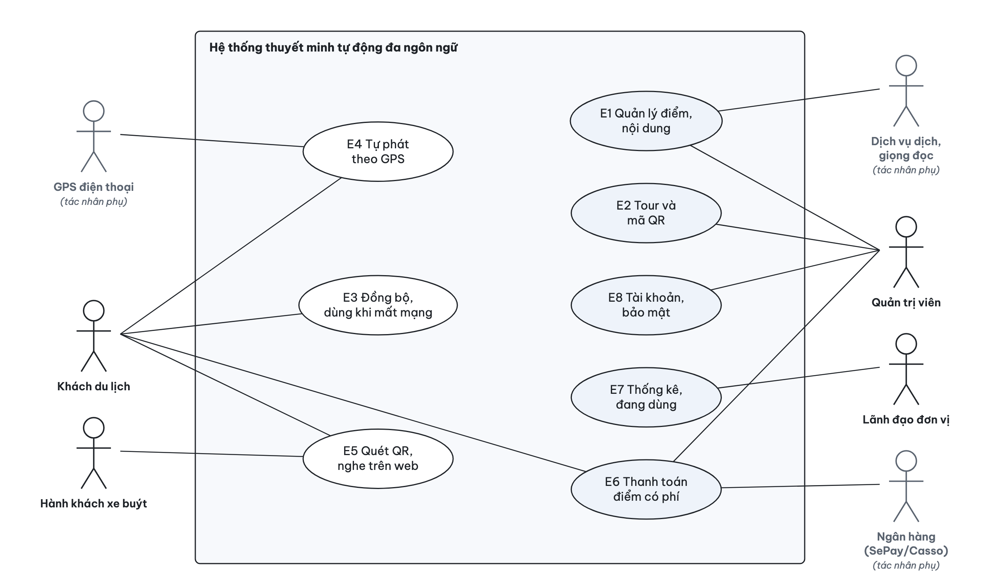

*Hình 1.1. Sơ đồ use case tổng quát (mỗi ca sử dụng là một epic)*

### 1.2. Epic E1 – Quản lý điểm thuyết minh và nội dung đa ngôn ngữ

**General:** Quản trị viên tạo điểm thuyết minh (POI) với toạ độ, bán kính kích hoạt, mức ưu tiên và ảnh, rồi viết bài tiếng Việt (bắt buộc). Lưu xong, hệ thống chạy nền: dịch bài sang 5 ngôn ngữ còn thiếu và tạo file giọng đọc MP3 cho từng ngôn ngữ, không ghi đè bản quản trị viên tự sửa hay file tự thu âm. Mỗi lần thay đổi, phiên bản nội dung (content_version) tăng lên để app biết cần cập nhật.

**Specific:**

**Bảng 1.2. User story epic E1**

| ID | User story | Tiêu chí chấp nhận | Ưu tiên | Điểm |
|---|---|---|---|---|
| US-1.1 | Là quản trị viên, tôi muốn tạo điểm bằng cách cắm ghim trên bản đồ và đặt bán kính để app biết khi nào khách đã tới nơi. | – Bán kính > 0 và ≤ 5000 m, mức ưu tiên 0–100, toạ độ hợp lệ – Thiếu toạ độ hoặc bài tiếng Việt thì báo lỗi ngay dưới ô nhập, không lưu – Ảnh JPG, PNG, WebP tối đa 15 MB; các điểm khác hiện mờ trên bản đồ để thấy chỗ chồng nhau | Must | 5 |
| US-1.2 | Là quản trị viên, tôi muốn hệ thống tự dịch bài tiếng Việt sang 5 ngôn ngữ khi lưu để không phải dịch tay từng bản. | – Dịch chạy nền sau khi lưu, lần lượt từng điểm; lỗi tạm thời (429, 5xx) thì tự thử lại – Bản quản trị viên đã sửa tay (is_auto = 0) không bị ghi đè – Bài tiếng Việt đổi thì bản dịch máy cũ được dịch lại (so sánh source_hash) | Must | 5 |
| US-1.3 | Là quản trị viên, tôi muốn mỗi ngôn ngữ có file giọng đọc để khách nghe giọng tự nhiên thay vì giọng máy của điện thoại. | – Tự tạo MP3 cho bản chưa có audio hoặc chữ đã đổi (so sánh audio_hash) – Cho tải file thu âm mp3, m4a, aac, wav, ogg, webm tối đa 15 MB; file tự tải lên không bị thay – Nghe thử và gỡ audio ngay trong trang sửa điểm | Must | 3 |

**Diagram:**

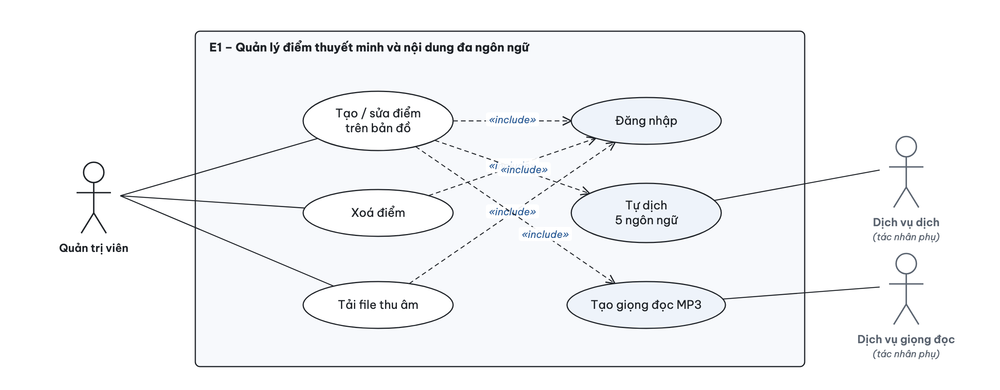

*Hình 1.2. Use case epic E1 – Quản lý điểm thuyết minh và nội dung đa ngôn ngữ*

### 1.3. Epic E2 – Tour và mã QR ở trạm xe buýt

**General:** Quản trị viên ghép các điểm thành tour theo thứ tự đi, và tạo mã QR cho từng trạm xe buýt gần điểm. Mã QR chứa đường link https://thuyetminh.hmarketing.vn/q/<mã>, nên quét bằng camera thường là mở được trang nghe. Mã được in hàng loạt để dán ở trạm và gỡ khi trạm dời hoặc mã hỏng.

**Specific:**

**Bảng 1.3. User story epic E2**

| ID | User story | Tiêu chí chấp nhận | Ưu tiên | Điểm |
|---|---|---|---|---|
| US-2.1 | Là quản trị viên, tôi muốn tạo tour bằng cách chọn điểm và kéo thả thứ tự để khách đi theo một lộ trình hợp lý. | – Tour phải có ít nhất 1 điểm – Sắp thứ tự bằng kéo thả hoặc nút lên/xuống (dùng được bằng bàn phím); bản đồ vẽ lộ trình có đánh số – Xoá một điểm thì điểm đó tự gỡ khỏi mọi tour | Must | 3 |
| US-2.2 | Là quản trị viên, tôi muốn tạo mã QR có nhãn tên trạm cho một điểm để hành khách ở trạm quét là nghe được. | – Mã ngẫu nhiên 12 ký tự, không trùng; nội dung mã là link /q/<mã> – Một điểm có nhiều mã (nhiều trạm) – Tải ảnh PNG của từng mã | Must | 3 |
| US-2.3 | Là quản trị viên, tôi muốn in bảng mã QR và gỡ mã hỏng để quản lý mã dán ngoài thực tế. | – In khổ A4, 4 mã mỗi trang, kèm nhãn trạm, tên điểm và dòng hướng dẫn quét – Mã đã gỡ khi quét lại báo "Mã QR không còn hiệu lực" – Trang Tổng quan cảnh báo điểm chưa có mã QR | Should | 2 |

**Diagram:**

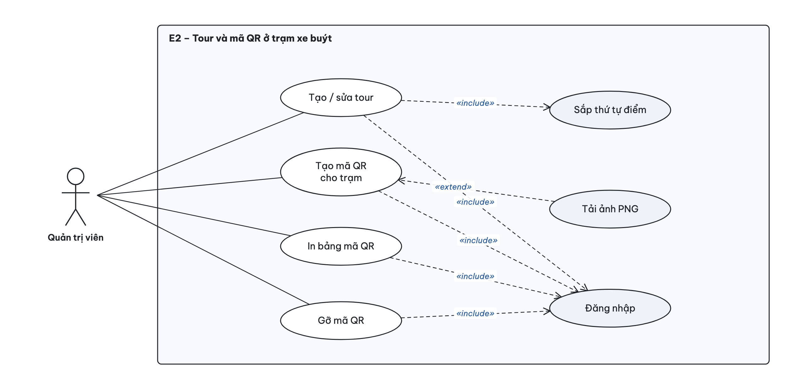

*Hình 1.3. Use case epic E2 – Tour và mã QR ở trạm xe buýt*

### 1.4. Epic E3 – Đồng bộ nội dung và dùng khi mất mạng

**General:** App tải toàn bộ nội dung (điểm, bản dịch, đường dẫn audio, tour, mã QR) một lần và lưu vào SQLite trong máy. Sau đó app chỉ hỏi số phiên bản nội dung; khác phiên bản mới tải lại. Nhờ vậy app vẫn tự phát thuyết minh và nhận mã QR đã lưu khi mất mạng; lượt nghe được giữ lại và gửi sau.

**Specific:**

**Bảng 1.4. User story epic E3**

| ID | User story | Tiêu chí chấp nhận | Ưu tiên | Điểm |
|---|---|---|---|---|
| US-3.1 | Là du khách, tôi muốn app tải nội dung về máy ở lần mở đầu để đi dạo không cần mạng. | – Mở lần đầu khi có mạng: tải /api/sync và lưu vào SQLite – Chưa từng đồng bộ mà không có mạng: báo cần kết nối một lần – Có tuỳ chọn tải toàn bộ audio để nghe khi mất mạng | Must | 5 |
| US-3.2 | Là du khách, tôi muốn nội dung tự cập nhật khi quản trị viên sửa để luôn nghe bản mới nhất. | – Hỏi /api/sync/version khi mở app, mỗi 5 phút, khi quay lại app và khi có mạng lại – Chỉ tải lại toàn bộ khi phiên bản khác; tải lỗi thì giữ dữ liệu cũ | Must | 3 |
| US-3.3 | Là đơn vị quản lý, tôi muốn lượt nghe lúc mất mạng vẫn được gửi về sau để số liệu không bị thiếu. | – App lưu lượt nghe trong máy, có mạng thì gửi theo lô tới /api/logs/usage – Lượt nghe của điểm đã bị xoá thì máy chủ bỏ qua; ghi theo lô trong một giao dịch | Should | 2 |

**Diagram:**

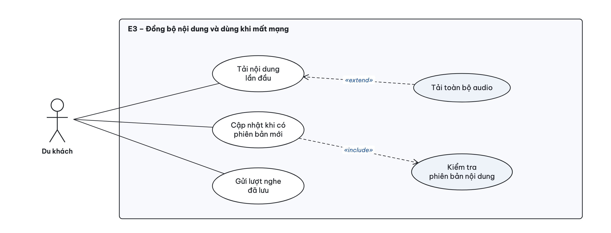

*Hình 1.4. Use case epic E3 – Đồng bộ nội dung và dùng khi mất mạng*

### 1.5. Epic E4 – Tự phát thuyết minh theo vị trí GPS

**General:** App theo dõi vị trí, tính khoảng cách haversine tới từng điểm; vào trong bán kính thì phát. App bỏ qua tín hiệu GPS kém, dùng vùng thoát rộng hơn vùng vào để không phát lặp ở mép vùng, có thời gian chờ 10 phút, và chọn điểm ưu tiên cao nhất khi nhiều vùng chồng nhau.

**Specific:**

**Bảng 1.5. User story epic E4**

| ID | User story | Tiêu chí chấp nhận | Ưu tiên | Điểm |
|---|---|---|---|---|
| US-4.1 | Là khách du lịch, tôi muốn thuyết minh tự phát khi tôi đi tới gần một điểm để không phải thao tác điện thoại. | – Vào vùng khi khoảng cách ≤ radius_m; bỏ qua tín hiệu có sai số trên 60 m – Bắt đầu phát trong ≤ 2 giây khi nội dung đã có trong máy – Từ chối quyền vị trí: app giải thích, có nút "Mở Cài đặt" và "Thử lại"; QR và phát tay vẫn dùng được | Must | 8 |
| US-4.2 | Là khách du lịch, tôi muốn không bị phát lặp cùng một điểm để không khó chịu khi đứng ở mép vùng. | – Chỉ coi là đã ra khỏi vùng khi khoảng cách > 1,2 × bán kính – Cùng một điểm không tự phát lại trong 10 phút (chỉnh được; 0 là tắt) – Đang phát bài khác thì bỏ qua lượt tự phát, không xếp hàng | Must | 5 |
| US-4.3 | Là khách du lịch, tôi muốn nghe đúng điểm quan trọng nhất khi nhiều vùng chồng nhau và nghe được cả khi tắt màn hình. | – Chọn điểm có priority cao nhất, bằng nhau thì chọn điểm gần nhất – Bật "Chạy nền" và cấp quyền vị trí "Luôn luôn" trên bản cài (Expo Go không hỗ trợ) | Should | 5 |

**Diagram:**

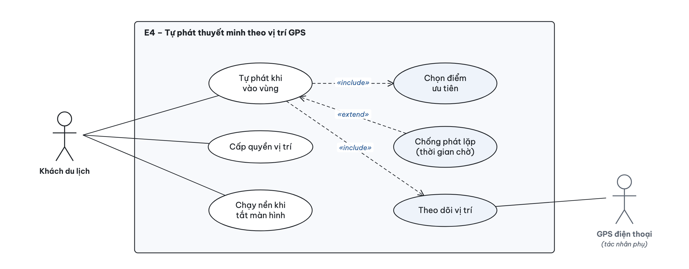

*Hình 1.5. Use case epic E4 – Tự phát thuyết minh theo vị trí GPS*

### 1.6. Epic E5 – Quét mã QR và nghe trên web

**General:** Hành khách quét mã ở trạm bằng camera điện thoại; đường link mở trang nghe trên website công khai, không cần cài app. Trang hiện tên điểm, ảnh, bài thuyết minh, trình phát và nút chọn ngôn ngữ. Điểm có file audio thì phát MP3, không có thì đọc bằng giọng của trình duyệt. Website còn có danh sách điểm, tour và mã QR các trạm để nghe trước chuyến đi.

**Specific:**

**Bảng 1.6. User story epic E5**

| ID | User story | Tiêu chí chấp nhận | Ưu tiên | Điểm |
|---|---|---|---|---|
| US-5.1 | Là hành khách xe buýt, tôi muốn quét mã ở trạm là nghe ngay mà không cần cài app để tận dụng vài phút chờ xe. | – Link /q/<mã> mở trang nghe của đúng điểm; mã sai hoặc đã gỡ thì báo "Mã QR không còn hiệu lực" kèm link danh sách điểm – Trong app có ô "Nhập mã thủ công" khi camera không dùng được – Lượt nghe được ghi với trigger_method = qr | Must | 3 |
| US-5.2 | Là khách nước ngoài, tôi muốn chọn một trong 6 ngôn ngữ để nghe bằng tiếng của mình. | – Việt, Anh, Trung, Hàn, Nhật, Pháp; mặc định theo ngôn ngữ thiết bị – Ngôn ngữ chưa có bài thì phát tiếng Việt và báo cho khách – Có audio thì phát MP3, không thì dùng giọng đọc của trình duyệt hoặc điện thoại | Must | 3 |
| US-5.3 | Là du khách, tôi muốn xem danh sách điểm, tour và nghe thử trên website để lên kế hoạch trước chuyến đi. | – Trang chủ có nút nghe thử, lưới điểm có ảnh, tour, mã QR các trạm – Trang mỗi điểm hiện mã QR ở trạm gần điểm đó – Trình phát tua ±15 giây, đổi tốc độ 0,75–1,5× | Should | 3 |

**Diagram:**

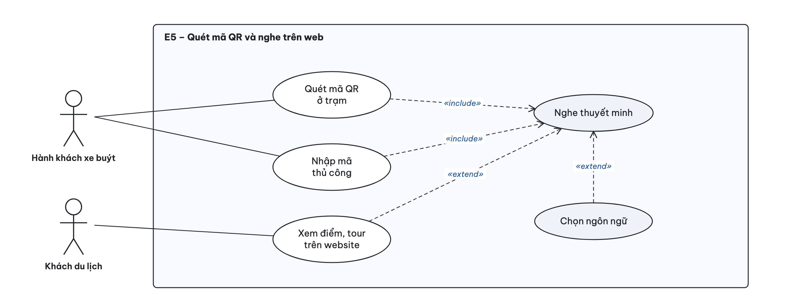

*Hình 1.6. Use case epic E5 – Quét mã QR và nghe trên web*

### 1.7. Epic E6 – Thanh toán cho điểm có phí

**General:** Một số điểm thu phí nghe (ví dụ 5.000đ). Khách được nghe đoạn đầu miễn phí; muốn nghe trọn bài thì tạo đơn và quét VietQR để chuyển khoản, nội dung chuyển khoản là mã đơn. Ngân hàng (qua SePay hoặc Casso) gọi webhook báo tiền về thì đơn tự chuyển sang đã thanh toán; quản trị viên có thể đối chiếu sao kê và xác nhận hoặc huỷ đơn bằng tay.

**Specific:**

**Bảng 1.7. User story epic E6**

| ID | User story | Tiêu chí chấp nhận | Ưu tiên | Điểm |
|---|---|---|---|---|
| US-6.1 | Là du khách, tôi muốn nghe thử đoạn đầu của điểm có phí để biết có đáng trả tiền không. | – Điểm có price > 0 chỉ trả câu đầu (tối đa khoảng 180 ký tự), không trả audio đầy đủ – Giá hiện trên thẻ điểm và trang nghe | Should | 2 |
| US-6.2 | Là du khách, tôi muốn trả tiền bằng cách quét VietQR để mở khoá trọn bài ngay trên điện thoại. | – Tạo đơn: mã TMxxxxxx (bỏ các ký tự dễ nhầm I, O, 0, 1), số tiền đúng giá, QR điền sẵn số tiền và nội dung – Webhook nhận giao dịch có mã đơn và đủ tiền thì đơn chuyển sang paid; giao dịch trùng không xử lý hai lần – Mở khoá bằng token riêng của người tạo đơn; chưa trả thì /pois/:id/full trả mã 402 | Should | 5 |
| US-6.3 | Là quản trị viên, tôi muốn xem danh sách đơn và giao dịch ngân hàng để đối soát tiền về. | – Lọc đơn theo trạng thái: chờ, đã báo chuyển, đã thanh toán, đã huỷ – Xác nhận hoặc huỷ đơn bằng tay; lưu người xác nhận – Xem các giao dịch đã nhận và kết quả khớp đơn (khớp, thiếu tiền, không tìm thấy mã) | Should | 3 |

**Diagram:**

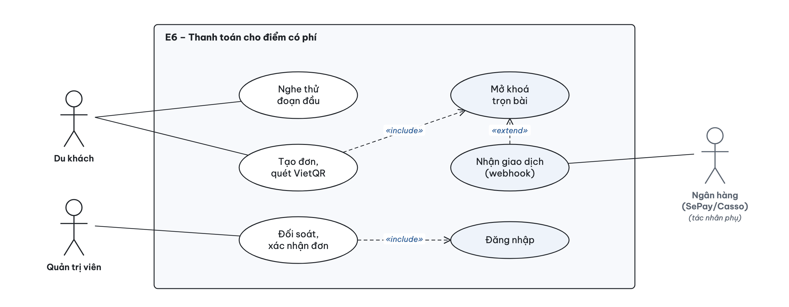

*Hình 1.7. Use case epic E6 – Thanh toán cho điểm có phí*

### 1.8. Epic E7 – Thống kê và số người đang dùng

**General:** Lượt nghe ẩn danh được tổng hợp thành báo cáo cho đơn vị quản lý. Ngoài ra CMS hiện số người đang dùng ngay lúc này: web gửi nhịp tim về máy chủ, máy chủ giữ trong RAM (không ghi cơ sở dữ liệu) và đẩy số mới sang CMS bằng Server-Sent Events.

**Specific:**

**Bảng 1.8. User story epic E7**

| ID | User story | Tiêu chí chấp nhận | Ưu tiên | Điểm |
|---|---|---|---|---|
| US-7.1 | Là lãnh đạo đơn vị, tôi muốn xem thống kê lượt nghe theo điểm, ngày, giờ và ngôn ngữ để biết nội dung nào được quan tâm. | – Chọn 7, 30 hoặc 90 ngày, lọc theo tour; chỉ số: lượt nghe, phiên, thời gian nghe trung bình, tổng thời gian – Biểu đồ theo điểm, ngày, cách kích hoạt, ngôn ngữ, giờ (giờ Việt Nam) và bản đồ nhiệt – Không có dữ liệu thì hiện "Không có dữ liệu" | Should | 5 |
| US-7.2 | Là lãnh đạo đơn vị, tôi muốn xuất báo cáo Excel và PDF để nộp báo cáo định kỳ. | – Excel nhiều sheet – PDF qua trang in đã tối ưu, giữ đúng dấu tiếng Việt | Should | 2 |
| US-7.3 | Là quản trị viên, tôi muốn thấy số người đang dùng và đang nghe ngay lúc này để theo dõi trực tiếp. | – Web gửi nhịp tim 15 giây/lần và ngay khi phát hoặc dừng; ẩn trang thì báo rời đi – Quá 45 giây không có tín hiệu thì không tính; nhiều tab cùng một trình duyệt tính là 1 người – CMS nhận số mới qua SSE (khoảng 0,15 giây trên máy chủ thật); luồng im 20 giây thì tự hỏi lại 3 giây/lần | Should | 5 |

**Diagram:**

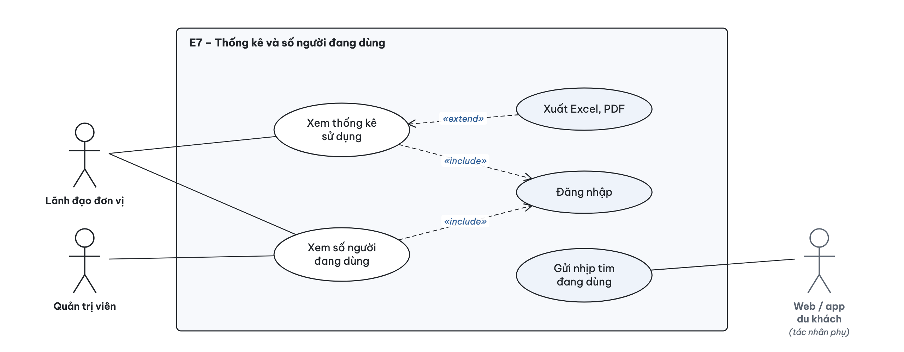

*Hình 1.8. Use case epic E7 – Thống kê và số người đang dùng*

### 1.9. Epic E8 – Tài khoản, bảo mật và quyền riêng tư

**General:** CMS chỉ dành cho quản trị viên đã đăng nhập; du khách không có tài khoản. Hệ thống không thu thông tin cá nhân của du khách, làm tròn toạ độ trước khi lưu, giới hạn tần suất gọi API và áp các biện pháp bảo mật web cơ bản khi chạy trên Internet.

**Specific:**

**Bảng 1.9. User story epic E8**

| ID | User story | Tiêu chí chấp nhận | Ưu tiên | Điểm |
|---|---|---|---|---|
| US-8.1 | Là quản trị viên, tôi muốn đăng nhập an toàn và tự đổi mật khẩu để bảo vệ nội dung. | – Mật khẩu lưu bằng bcrypt; phiên (JWT) hết hạn sau 8 giờ, hết hạn thì về trang đăng nhập rồi mở lại đúng trang đang làm – Sai 20 lần trong 15 phút từ một mạng thì khoá đăng nhập 15 phút – Đổi mật khẩu cần mật khẩu hiện tại; mật khẩu mới từ 8 ký tự | Must | 3 |
| US-8.2 | Là du khách, tôi muốn dùng hệ thống mà không cung cấp thông tin cá nhân để yên tâm về quyền riêng tư. | – Không đăng ký; chỉ gửi mã phiên ngẫu nhiên, đổi mỗi lần mở app – Toạ độ làm tròn 4 chữ số thập phân (khoảng 11 m); báo cáo chỉ hiện số gộp, không trả mã phiên – Tắt được "Gửi dữ liệu ẩn danh" trong Cài đặt | Must | 3 |
| US-8.3 | Là đơn vị vận hành, tôi muốn máy chủ chống lạm dụng và chạy an toàn trên Internet. | – HTTPS (Let's Encrypt) qua OpenLiteSpeed; chạy production mà thiếu JWT_SECRET thì máy chủ không khởi động – Giới hạn tần suất: ghi log 120 lần/phút/IP, nhịp tim 600 lần/phút/IP, tạo đơn 30 lần/10 phút – Tệp tải lên bị giới hạn loại và 15 MB, tên tệp do máy chủ đặt; có header bảo mật (helmet) | Must | 3 |

**Diagram:**

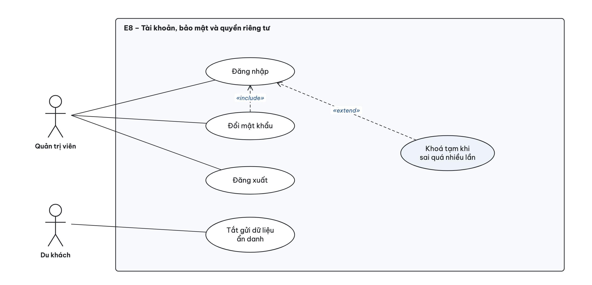

*Hình 1.9. Use case epic E8 – Tài khoản, bảo mật và quyền riêng tư*

## 2. Component diagram

Hệ thống gồm ba thành phần phía người dùng (app, website, CMS) cùng gọi một backend chia ba lớp (controller, service, repository). Backend cung cấp hai giao diện: REST `/api` (JSON) cho mọi chức năng và luồng Server-Sent Events `/api/admin/live/stream` cho số người đang dùng. Mũi tên nét đứt là quan hệ phụ thuộc (bên trái dùng bên phải).

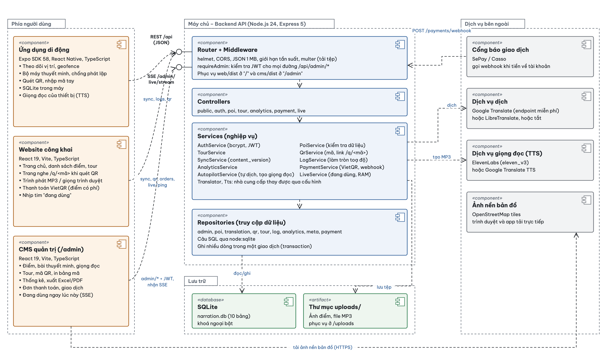

*Hình 2.1. Component diagram*

**Bảng 2.1. Mô tả thành phần**

| Thành phần | Công nghệ | Trách nhiệm | Giao tiếp |
|---|---|---|---|
| Ứng dụng di động | Expo SDK 58, React Native, TypeScript | Theo dõi vị trí, tự phát theo vùng, quét QR, lưu nội dung và lượt nghe trong SQLite, đọc bằng giọng của thiết bị khi không có MP3 | Gọi REST /api/sync, /sync/version, /qr/:mã, /logs/usage |
| Website công khai | React 19, Vite, TypeScript | Trang chủ, danh sách điểm, tour, trang nghe /q/<mã> khi quét QR, trình phát, thanh toán VietQR, gửi nhịp tim "đang dùng" | Gọi REST /api/sync, /qr/:mã, /orders, /pois/:id/full, /live/ping |
| CMS quản trị | React 19, Vite, TypeScript, phục vụ ở /admin | Quản lý điểm, bản dịch, giọng đọc, tour, mã QR, đơn thanh toán; thống kê và xuất Excel/PDF; ô "Đang dùng ngay lúc này" | Gọi REST /api/admin/* kèm JWT; nhận SSE /api/admin/live/stream |
| Router + Middleware | Express 5 | Định tuyến, helmet, CORS, giới hạn kích thước và tần suất, multer, kiểm tra JWT; phục vụ tệp tĩnh của website và CMS | Cung cấp REST /api và SSE |
| Controllers | public, auth, poi, tour, analytics, payment, live | Nhận request, gọi service, trả JSON hoặc luồng SSE | Dùng Services |
| Services | 11 service nghiệp vụ | Kiểm tra dữ liệu, quy tắc nghiệp vụ, tự dịch và tạo giọng đọc (Autopilot), thanh toán, số người đang dùng (Live, giữ trong RAM) | Dùng Repositories; gọi dịch vụ dịch, TTS |
| Repositories | node:sqlite | Toàn bộ câu SQL; ghi nhiều dòng trong một giao dịch | Đọc/ghi SQLite |
| SQLite + uploads/ | narration.db, thư mục tệp | 10 bảng dữ liệu; ảnh điểm và file MP3 | Gắn ổ đĩa /data trong container |
| Dịch vụ bên ngoài | Google Translate; ElevenLabs hoặc Google TTS; SePay/Casso; OpenStreetMap | Dịch tự động, tạo giọng đọc, báo giao dịch ngân hàng, ảnh nền bản đồ | HTTPS |

## 3. Deployment diagram

Toàn bộ hệ thống chạy trên một VPS. OpenLiteSpeed nhận HTTPS ở cổng 443 rồi chuyển tiếp vào một Docker container duy nhất; container vừa là API vừa phục vụ website (`/`) và CMS (`/admin`). Dữ liệu nằm trên volume gắn ngoài container nên build lại không mất dữ liệu. Triển khai bằng `deploy-vps2.sh` (đóng gói mã đã commit, build image, chạy lại container, cấu hình vhost và SSL).

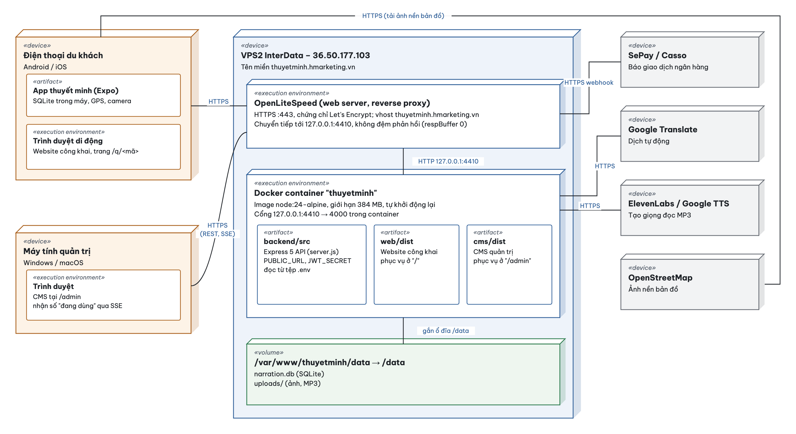

*Hình 3.1. Deployment diagram*

**Bảng 3.1. Các nút triển khai**

| Nút | Loại | Nội dung | Kết nối |
|---|---|---|---|
| Điện thoại du khách | «device» | App thuyết minh (Expo) hoặc trình duyệt di động | HTTPS tới thuyetminh.hmarketing.vn; HTTPS tới OpenStreetMap |
| Máy tính quản trị | «device» | Trình duyệt chạy CMS tại /admin | HTTPS (REST, SSE) |
| VPS2 InterData (36.50.177.103) | «device» | Máy chủ chạy toàn bộ hệ thống | Nhận HTTPS cổng 443 |
| OpenLiteSpeed | «execution environment» | Web server, chứng chỉ Let's Encrypt, reverse proxy, không đệm phản hồi để SSE tới ngay | HTTP tới 127.0.0.1:4410 |
| Docker container "thuyetminh" | «execution environment» | node:24-alpine, giới hạn 384 MB, tự khởi động lại; chứa backend/src, web/dist, cms/dist | HTTPS ra dịch vụ dịch, TTS |
| Volume /data | «volume» | narration.db và uploads/; giữ nguyên khi build lại container | Gắn từ /var/www/thuyetminh/data |
| Dịch vụ bên ngoài | «device» | Google Translate, ElevenLabs/Google TTS, SePay/Casso, OpenStreetMap | HTTPS; SePay/Casso gọi webhook vào OpenLiteSpeed |

## 4. Lược đồ ERD và quan hệ dữ liệu

Cơ sở dữ liệu SQLite gồm 10 bảng. Kiểu dữ liệu theo SQLite (INTEGER, REAL, TEXT); thời gian lưu dạng chuỗi ISO 8601; khoá ngoại được bật. Ký hiệu chân quạ: `||` đúng một, `|o` không hoặc một, `o{` không hoặc nhiều, `|{` một hoặc nhiều.

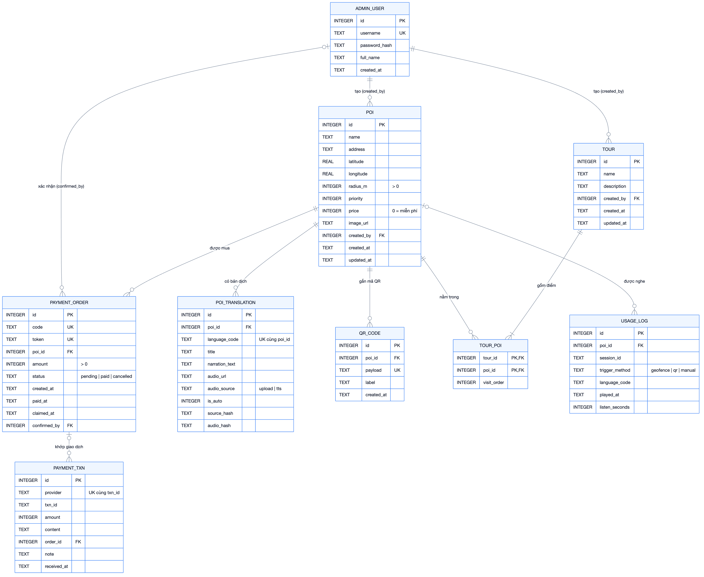

*Hình 4.1. Lược đồ ERD (8 bảng có quan hệ)*

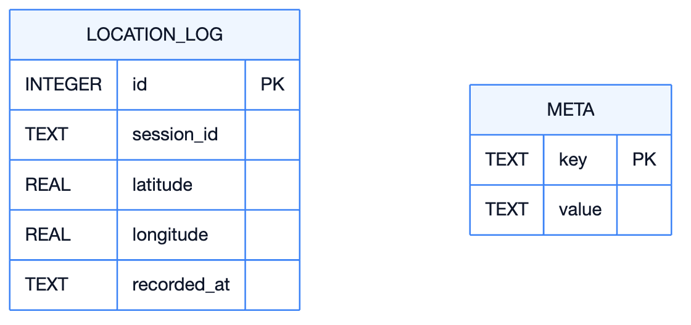

*Hình 4.2. Hai bảng độc lập, không có khoá ngoại: LOCATION_LOG (vị trí ẩn danh, nối lỏng với lượt nghe qua session_id) và META (phiên bản nội dung)*

### 4.1. Lược đồ quan hệ

Khoá chính in **đậm**, khoá ngoại in *nghiêng* kèm bảng được tham chiếu.

- **ADMIN_USER**(**id**, username, password_hash, full_name, created_at)  
  Tài khoản quản trị; mật khẩu băm bcrypt
- **POI**(**id**, name, address, latitude, longitude, radius_m, priority, price, image_url, *created_by* → ADMIN_USER, created_at, updated_at)  
  Điểm thuyết minh; radius_m > 0, price = 0 là miễn phí
- **POI_TRANSLATION**(**id**, *poi_id* → POI, language_code, title, narration_text, audio_url, audio_source, is_auto, source_hash, audio_hash)  
  Bài thuyết minh theo ngôn ngữ; UNIQUE(poi_id, language_code)
- **QR_CODE**(**id**, *poi_id* → POI, payload, label, created_at)  
  Mã dán ở trạm; nội dung mã là link /q/<payload>
- **TOUR**(**id**, name, description, *created_by* → ADMIN_USER, created_at, updated_at)  
  Lộ trình tham quan
- **TOUR_POI**(***tour_id*** → TOUR, ***poi_id*** → POI, visit_order)  
  Bảng nối n–n giữa TOUR và POI, kèm thứ tự đi
- **USAGE_LOG**(**id**, *poi_id* → POI, session_id, trigger_method, language_code, played_at, listen_seconds)  
  Lượt nghe ẩn danh; trigger_method ∈ {geofence, qr, manual}
- **LOCATION_LOG**(**id**, session_id, latitude, longitude, recorded_at)  
  Vị trí ẩn danh (làm tròn ~11 m) cho bản đồ nhiệt; không có khoá ngoại
- **META**(**key**, value)  
  Cấu hình hệ thống, ví dụ content_version
- **PAYMENT_ORDER**(**id**, code, token, *poi_id* → POI, amount, status, created_at, paid_at, claimed_at, *confirmed_by* → ADMIN_USER)  
  Đơn mua quyền nghe điểm có phí; status ∈ {pending, paid, cancelled}
- **PAYMENT_TXN**(**id**, provider, txn_id, amount, content, *order_id* → PAYMENT_ORDER, note, received_at)  
  Giao dịch ngân hàng nhận qua webhook; UNIQUE(provider, txn_id)

### 4.2. Quan hệ giữa các bảng

**Bảng 4.1. Quan hệ và ràng buộc khoá ngoại**

| Bảng cha | Bảng con | Khoá ngoại | Bản số | Khi xoá bảng cha | Ý nghĩa |
|---|---|---|---|---|---|
| ADMIN_USER | POI | created_by | 1 – n | SET NULL | Quản trị viên tạo điểm |
| ADMIN_USER | TOUR | created_by | 1 – n | SET NULL | Quản trị viên tạo tour |
| ADMIN_USER | PAYMENT_ORDER | confirmed_by | 0..1 – n | SET NULL | Người xác nhận đơn (rỗng nếu webhook tự xác nhận) |
| POI | POI_TRANSLATION | poi_id | 1 – n (tối đa 6) | CASCADE | Mỗi ngôn ngữ một bản |
| POI | QR_CODE | poi_id | 1 – n | CASCADE | Một điểm gắn mã ở nhiều trạm |
| TOUR, POI | TOUR_POI | tour_id, poi_id | n – n | CASCADE | Tour gồm nhiều điểm, điểm thuộc nhiều tour |
| POI | USAGE_LOG | poi_id | 0..1 – n | SET NULL | Xoá điểm vẫn giữ số liệu thống kê cũ |
| POI | PAYMENT_ORDER | poi_id | 1 – n | CASCADE | Đơn mua quyền nghe một điểm |
| PAYMENT_ORDER | PAYMENT_TXN | order_id | 0..1 – n | SET NULL | Giao dịch khớp với đơn (rỗng nếu không tìm thấy mã đơn) |

Mã Mermaid của ERD

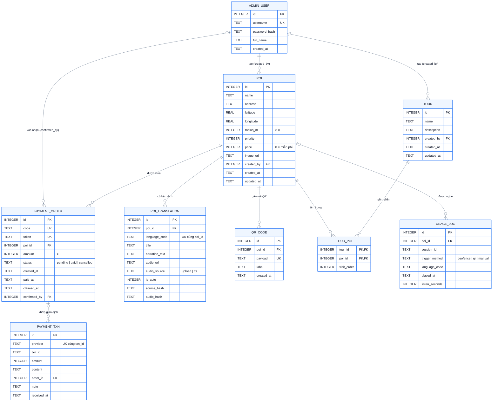

