# Tài liệu yêu cầu sản phẩm (PRD)

**Sản phẩm:** Hệ thống thuyết minh tự động đa ngôn ngữ
**Khu vực áp dụng:** phường Khánh Hội, Vĩnh Hội, Xóm Chiếu (Quận 4 cũ, TP. Hồ Chí Minh)
**Phiên bản tài liệu:** 1.0 (20/10/2026)
**Tài liệu liên quan:** `01-SRS.md` (yêu cầu chi tiết), `02-design.md` (thiết kế), `03-test-plan.md` (kiểm thử), `07-van-hanh-va-tham-gia.md` (sơ đồ vận hành)

PRD trả lời câu hỏi *làm sản phẩm này để làm gì, cho ai, thế nào là thành công*. Còn hệ thống phải làm *chính xác những gì* thì xem SRS. Mỗi tính năng dưới đây đều ghi mã yêu cầu (FR) tương ứng trong SRS để tra cứu.

| Phiên bản | Ngày | Mô tả |
|---|---|---|
| 1.0 | 20/10/2026 | Bản PRD đầu tiên, tổng hợp từ đặc tả ca sử dụng UC1–UC5, SRS và mã nguồn đã hoàn thành |

---

## 1. Bài toán

Khánh Hội, Vĩnh Hội và Xóm Chiếu có nhiều địa điểm có câu chuyện riêng: bến cảng, nhà thờ, chợ, các con phố cũ. Người đi ngang qua, kể cả người dân lẫn khách du lịch, thường không biết những câu chuyện đó. Khu vực này hiện:

- không có hướng dẫn viên thường trực, bảng thông tin tại chỗ rất ít và chỉ có tiếng Việt;
- khách nước ngoài không đọc được tiếng Việt, cũng không biết nên dừng ở đâu;
- hành khách chờ xe buýt có vài phút rảnh nhưng không có gì để tìm hiểu về nơi mình đang đứng;
- phường và đơn vị quản lý du lịch không biết địa điểm nào được quan tâm, nên khó quyết định đầu tư nội dung vào đâu.

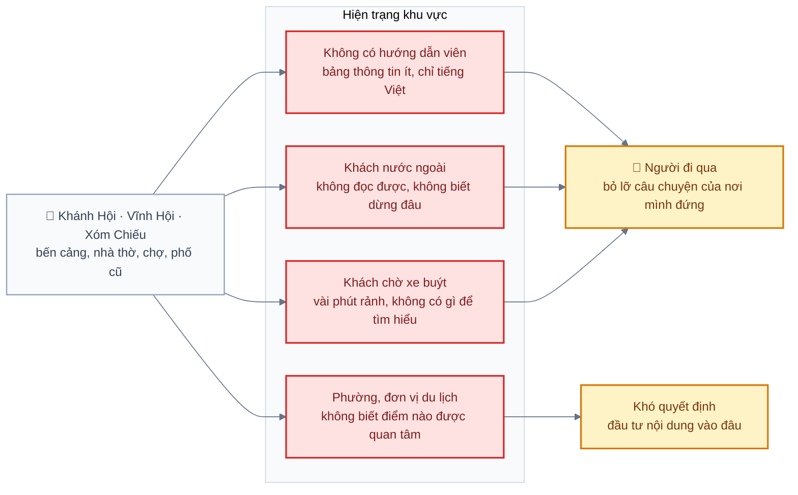
*Hình: Bốn vấn đề hiện tại của khu vực và hệ quả với người tham quan lẫn đơn vị quản lý*

## 2. Giải pháp tóm tắt

Một ứng dụng điện thoại **tự phát bài thuyết minh khi người dùng đi tới gần một địa điểm**, bằng ngôn ngữ của họ. Ứng dụng không cần tài khoản và vẫn chạy khi mất mạng. Ở trạm xe buýt có dán **mã QR**: quét là nghe ngay, không cần GPS.

Phía quản lý có một **trang web quản trị (CMS)** để nhập địa điểm, viết bài, dịch tự động sang 5 ngôn ngữ, tạo giọng đọc, ghép tour, in mã QR và xem **thống kê ẩn danh** về lượt nghe.

```mermaid
%%{init: {"theme":"base","fontFamily":"Helvetica Neue, Arial, sans-serif","themeVariables":{"fontFamily":"Helvetica Neue, Arial, sans-serif","fontSize":"15px","primaryColor":"#EFF6FF","primaryBorderColor":"#3B82F6","primaryTextColor":"#0F172A","lineColor":"#64748B","secondaryColor":"#F0FDF4","tertiaryColor":"#FFFFFF","clusterBkg":"#F8FAFC","clusterBorder":"#CBD5E1","edgeLabelBackground":"#FFFFFF","noteBkgColor":"#FEF9C3","noteBorderColor":"#EAB308","actorBkg":"#DBEAFE","actorBorder":"#2563EB","actorTextColor":"#1E3A8A","signalColor":"#475569","signalTextColor":"#0F172A","labelBoxBkgColor":"#F1F5F9","labelBoxBorderColor":"#94A3B8","activationBkgColor":"#E0F2FE","activationBorderColor":"#0284C7","sequenceNumberColor":"#FFFFFF","pie1":"#16A34A","pie2":"#F59E0B","pie3":"#94A3B8","pie4":"#DC2626","pie5":"#2563EB","pie6":"#7C3AED","pieStrokeColor":"#FFFFFF","pieSectionTextColor":"#FFFFFF","quadrant1Fill":"#FEE2E2","quadrant2Fill":"#FEF3C7","quadrant3Fill":"#DCFCE7","quadrant4Fill":"#FEF3C7","quadrantPointFill":"#1E3A8A","quadrantPointTextFill":"#0F172A","git0":"#1E3A8A","gitBranchLabel0":"#FFFFFF","cScale0":"#DBEAFE","cScale1":"#DCFCE7","cScale2":"#EDE9FE","cScale3":"#FEF3C7","cScale4":"#FFE4E6","cScale5":"#E0F2FE","cScale6":"#F1F5F9"},"flowchart":{"curve":"basis","padding":16,"nodeSpacing":40,"rankSpacing":50},"sequence":{"showSequenceNumbers":true,"mirrorActors":false}}}%%
flowchart LR
    QTV(["👤 Quản trị viên"]):::actor
    LD(["👤 Lãnh đạo,<br/>đơn vị quản lý"]):::actor
    CMS["🖥️ Trang quản trị CMS<br/>địa điểm · bài viết · dịch 5 ngôn ngữ<br/>giọng đọc · tour · mã QR"]:::cms
    BE["⚙️ Máy chủ<br/>lưu nội dung và lượt nghe"]:::backend
    APP["📱 App du khách<br/>tải nội dung về máy<br/>chạy cả khi mất mạng"]:::mobile
    GPS["🛰️ Đi vào vùng<br/>của địa điểm"]:::ext
    QR["📍 Quét mã QR<br/>ở trạm xe buýt"]:::ext
    NGHE(["🎧 Phát thuyết minh<br/>bằng ngôn ngữ của khách"]):::startend
    QTV -->|"nhập, dịch, tạo giọng"| CMS
    LD -->|"📊 xem thống kê ẩn danh"| CMS
    CMS <--> BE
    BE -->|"đồng bộ nội dung"| APP
    GPS --> APP
    QR --> APP
    APP --> NGHE
    APP -.->|"lượt nghe ẩn danh"| BE
classDef actor fill:#FEF3C7,stroke:#D97706,stroke-width:2px,color:#78350F
classDef backend fill:#DCFCE7,stroke:#16A34A,stroke-width:2px,color:#14532D
classDef cms fill:#EDE9FE,stroke:#7C3AED,stroke-width:2px,color:#4C1D95
classDef ext fill:#FFE4E6,stroke:#E11D48,stroke-width:2px,color:#881337
classDef mobile fill:#DBEAFE,stroke:#2563EB,stroke-width:2px,color:#1E3A8A
classDef startend fill:#1E3A8A,stroke:#1E3A8A,stroke-width:2px,color:#FFFFFF
```
*Hình: Giải pháp gồm app tự phát theo vị trí hoặc mã QR và CMS cho phía quản lý, nối qua máy chủ*

## 3. Người dùng

| Nhóm | Họ là ai | Họ cần gì | Ca sử dụng |
|---|---|---|---|
| Khách du lịch, người đi bộ | Khách trong nước và nước ngoài dạo quanh khu vực | Nghe giới thiệu đúng lúc đi qua, bằng ngôn ngữ của mình, không phải thao tác nhiều | UC1 |
| Hành khách xe buýt | Người đang chờ ở trạm | Nghe nhanh về khu vực quanh trạm, chỉ cần quét một mã | UC2 |
| Quản trị viên nội dung | Cán bộ phường hoặc đơn vị du lịch, quen dùng biểu mẫu web, không phải lập trình viên | Nhập và sửa nội dung nhanh, có bản dịch sẵn, biết điểm nào còn thiếu | UC3, UC4 |
| Lãnh đạo, đại diện đơn vị quản lý | Người ra quyết định | Số liệu: điểm nào được nghe, nghe bao lâu, ngôn ngữ nào, giờ nào đông | UC5 |

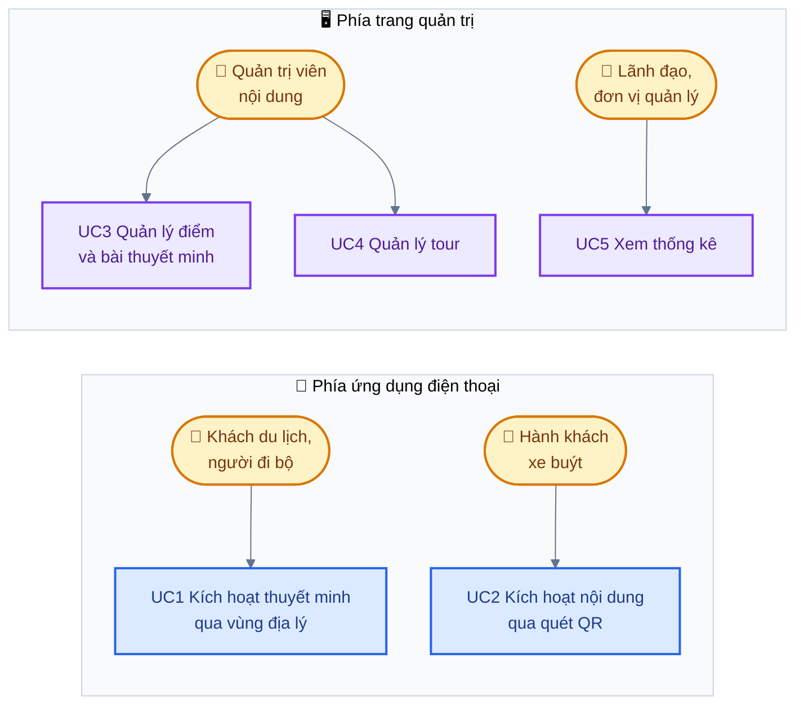
*Hình: Bốn nhóm người dùng và ca sử dụng tương ứng*

### Chân dung tiêu biểu

- **Chị Mai, 34 tuổi, khách Hàn Quốc.** Đi bộ từ Quận 1 qua cầu Khánh Hội. Điện thoại để tiếng Hàn, mạng 4G chập chờn. Chị không muốn cài thêm tài khoản và không muốn cầm điện thoại suốt.
- **Anh Tuấn, 52 tuổi, cán bộ văn hoá phường.** Biết dùng Word, Excel và Google Maps. Cần nhập khoảng 10 điểm trong tuần đầu và cuối tháng phải có số liệu báo cáo.

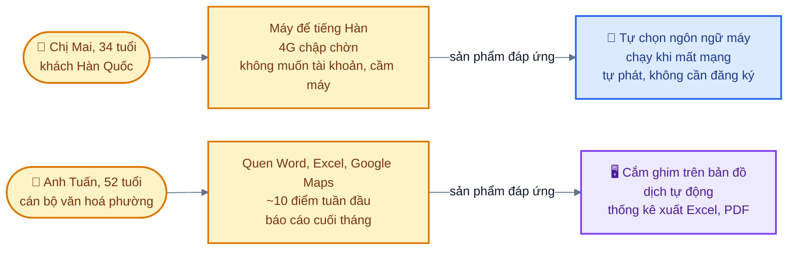
*Hình: Hai chân dung tiêu biểu: hoàn cảnh của họ và tính năng đáp ứng*

## 4. Mục tiêu

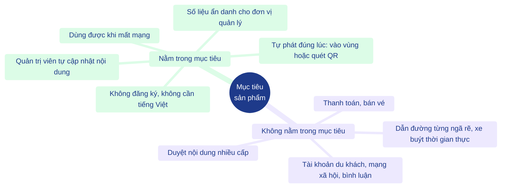
*Hình: Năm mục tiêu sản phẩm và bốn thứ cố ý để ngoài phạm vi*

### 4.1 Mục tiêu sản phẩm

1. Người dùng nghe được thuyết minh **mà không cần đăng ký, không cần biết tiếng Việt**.
2. Thuyết minh **tự đến đúng lúc**: khi đi vào vùng của địa điểm, hoặc ngay khi quét mã QR ở trạm.
3. **Vẫn dùng được khi mất mạng** sau lần mở đầu tiên.
4. Quản trị viên **tự cập nhật nội dung** mà không cần nhóm kỹ thuật.
5. Đơn vị quản lý có **số liệu ẩn danh** để đánh giá và cải thiện nội dung.

### 4.2 Không nằm trong mục tiêu

- Tài khoản cho du khách, mạng xã hội, đánh giá hay bình luận.
- Thanh toán, bán vé.
- Dẫn đường từng ngã rẽ, theo dõi xe buýt theo thời gian thực.
- Quy trình duyệt nội dung nhiều cấp.

## 5. Chỉ số thành công

Hệ thống chưa chạy với người dùng thật, nên các con số dưới đây là **mục tiêu đề xuất** để đo trong đợt thử thực địa (FT-01 đến FT-09 trong `03-test-plan.md`), chưa phải kết quả.

| Chỉ số | Mục tiêu | Cách đo |
|---|---|---|
| Thời gian từ lúc vào vùng hoặc quét mã đến lúc bắt đầu phát | ≤ 2 giây khi nội dung đã có trong máy | Bấm giờ khi thử thực địa (NFR-02) |
| Tỉ lệ kích hoạt đúng khi đi qua địa điểm | ≥ 90 % số lần đi qua | Đi qua mỗi điểm nhiều lượt, đếm số lần phát đúng (FT-01, FT-02) |
| Kích hoạt nhầm | Không phát lặp lại cùng điểm trong 10 phút | Đứng ở mép vùng, quan sát (FR-07, FR-08) |
| Quét mã QR thành công | ≥ 95 % ở điều kiện ánh sáng ban ngày | Quét thử mọi mã đã dán |
| Thời gian quản trị viên nhập một điểm đủ 6 ngôn ngữ và có giọng đọc | ≤ 10 phút | Bấm giờ với người chưa từng dùng CMS |
| Thời gian nghe trung bình mỗi lượt | Theo dõi, chưa đặt mục tiêu | Trang Thống kê trong CMS |
| Tỉ lệ điểm có đủ audio và đủ ngôn ngữ | 100 % trước khi đưa vào dùng thật | Danh sách *Việc cần làm* ở trang Tổng quan |

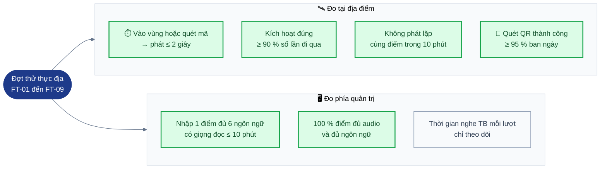
*Hình: Các chỉ số thành công theo nơi đo; tất cả là mục tiêu đề xuất, chưa phải kết quả*

## 6. Tính năng

Mức ưu tiên: **Phải có** (bắt buộc cho bản đầu), **Nên có**, **Có thể có**.

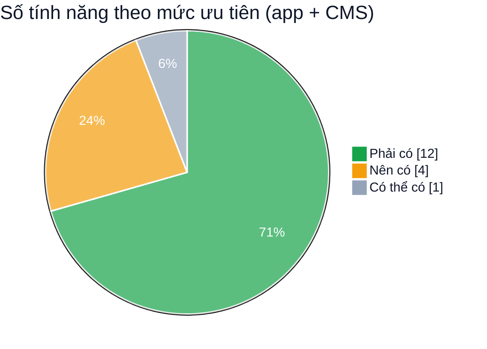
*Hình: Phân bố 17 tính năng trong mục 6.1 và 6.2 theo mức ưu tiên*

### 6.1 Ứng dụng điện thoại (cho du khách)

| Tính năng | Mô tả ngắn | Ưu tiên | Yêu cầu SRS |
|---|---|---|---|
| Tự phát theo vị trí | Đi vào vùng của địa điểm thì tự phát. Nhiều điểm chồng nhau thì phát điểm ưu tiên cao hơn | Phải có | FR-04 đến FR-08 |
| Quét mã QR | Quét mã ở trạm xe buýt, phát ngay, không cần GPS; có ô nhập mã tay khi không dùng được camera | Phải có | UC2 |
| 6 ngôn ngữ | Việt, Anh, Trung, Hàn, Nhật, Pháp. Tự chọn theo ngôn ngữ máy, thiếu bản dịch thì phát tiếng Việt và báo cho người dùng | Phải có | FR-09, NFR-14 |
| Dùng khi mất mạng | Tải nội dung về máy ở lần mở đầu, sau đó chạy không cần mạng | Phải có | FR-02, FR-03, NFR-04 |
| Không cần tài khoản | Không hỏi tên, số điện thoại, email | Phải có | NFR-06 |
| Đi theo tour | Chọn tour, app chỉ điểm kế tiếp và khoảng cách | Nên có | UC4 |
| Chạy khi tắt màn hình | GPS chạy nền, cần bản cài riêng và quyền vị trí "Luôn luôn" | Nên có | FR-04 |
| Chế độ mô phỏng vị trí | Bấm lên bản đồ để giả vị trí, hoặc cho app tự "đi" theo tour, phục vụ demo | Có thể có | FR-12 |

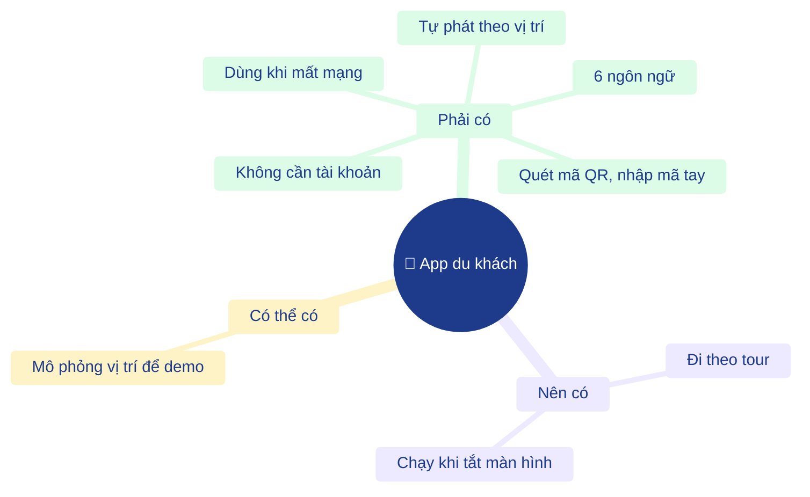
*Hình: Tính năng ứng dụng điện thoại nhóm theo mức ưu tiên*

### 6.2 Trang web quản trị (CMS)

| Tính năng | Mô tả ngắn | Ưu tiên | Yêu cầu SRS |
|---|---|---|---|
| Quản lý địa điểm | Cắm ghim trên bản đồ, chỉnh bán kính và mức ưu tiên, tải ảnh | Phải có | UC3 |
| Bài thuyết minh đa ngôn ngữ | Bài tiếng Việt bắt buộc. Nút dịch tự động sang 5 ngôn ngữ còn lại | Phải có | UC3 |
| Giọng đọc | Tạo file MP3 từ văn bản, hoặc tải file ghi âm lên | Phải có | UC3 |
| Mã QR | Tạo mã cho từng trạm, tải PNG, in bảng 4 mã mỗi tờ A4 | Phải có | UC3 (A2) |
| Tour | Ghép điểm thành lộ trình, kéo thả để sắp thứ tự | Phải có | UC4 |
| Thống kê | Lượt nghe theo điểm, ngày, giờ, ngôn ngữ, cách kích hoạt; bản đồ nhiệt; xuất Excel và PDF | Phải có | UC5 |
| Trang Tổng quan | Liệt kê điểm thiếu audio, thiếu ngôn ngữ, chưa có mã QR | Nên có | |
| Đổi mật khẩu | Quản trị viên tự đổi mật khẩu | Phải có | |
| Thêm quản trị viên, lấy lại mật khẩu | **Chưa làm.** Hiện phải nhờ nhóm kỹ thuật | Nên có | Đưa vào bản sau |

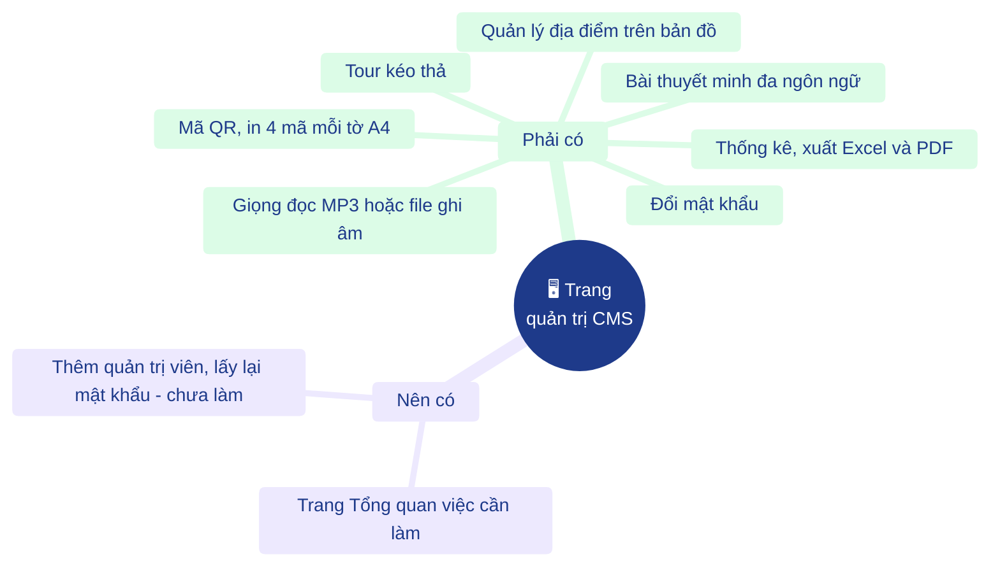
*Hình: Tính năng trang quản trị nhóm theo mức ưu tiên; mục thêm quản trị viên chưa làm, để bản sau*

## 7. Hành trình người dùng chính

Sơ đồ chi tiết nằm ở `07-van-hanh-va-tham-gia.md`. Tóm tắt:

**Du khách:** cài app → mở lần đầu khi có mạng → cho phép vị trí (hoặc không) → đi dạo hoặc quét QR → nghe → lượt nghe ẩn danh được gửi về khi có mạng.

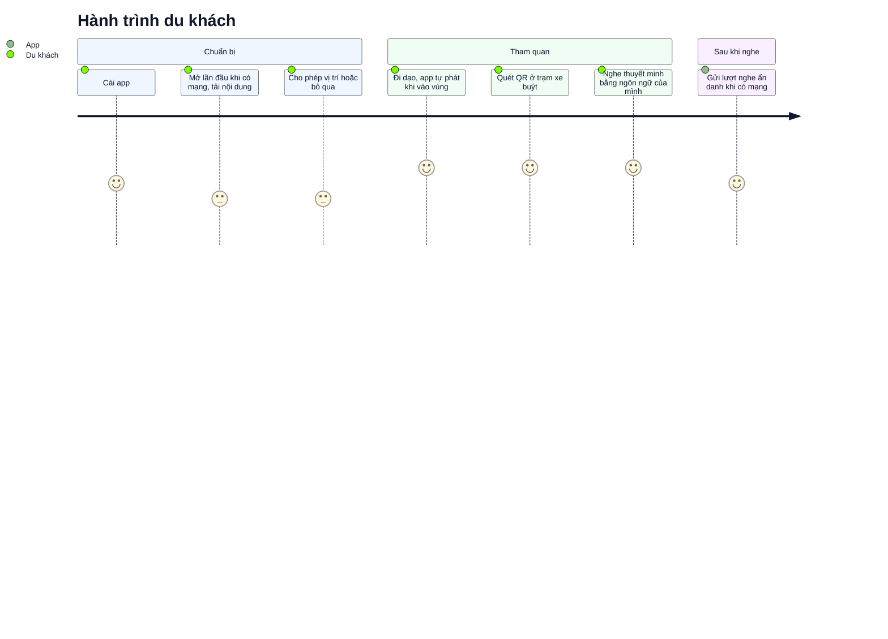
*Hình: Hành trình du khách; điểm 1–5 là mức thuận tiện ước lượng để minh hoạ, không phải số đo*

**Quản trị viên:** nhận tài khoản → đăng nhập → đổi mật khẩu → nhập điểm, dịch, tạo giọng đọc → tạo tour, in và dán mã QR → xem thống kê → sửa lại điểm ít người nghe.

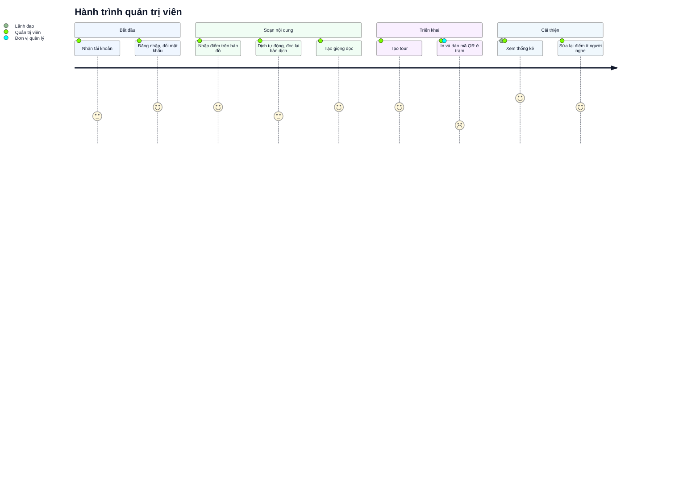
*Hình: Hành trình quản trị viên; điểm 1–5 là mức thuận tiện ước lượng để minh hoạ, không phải số đo*

## 8. Ràng buộc và giả định

- Chỉ dùng dịch vụ miễn phí (đồ án sinh viên, không có ngân sách). Dịch và đọc thành tiếng dùng endpoint không chính thức của Google nên có thể bị giới hạn hoặc ngừng. Vì vậy app luôn có giọng đọc của điện thoại làm phương án dự phòng.
- Việc in, dán và bảo quản mã QR ở trạm do đơn vị quản lý làm, nằm ngoài phần mềm.
- Toạ độ các điểm trong dữ liệu mẫu chỉ gần đúng, phải kiểm tra tại chỗ trước khi dùng thật.
- GPS nền bị iOS và Android giới hạn để tiết kiệm pin. Chế độ chạy khi màn hình đang mở là phương án chắc chắn hoạt động.

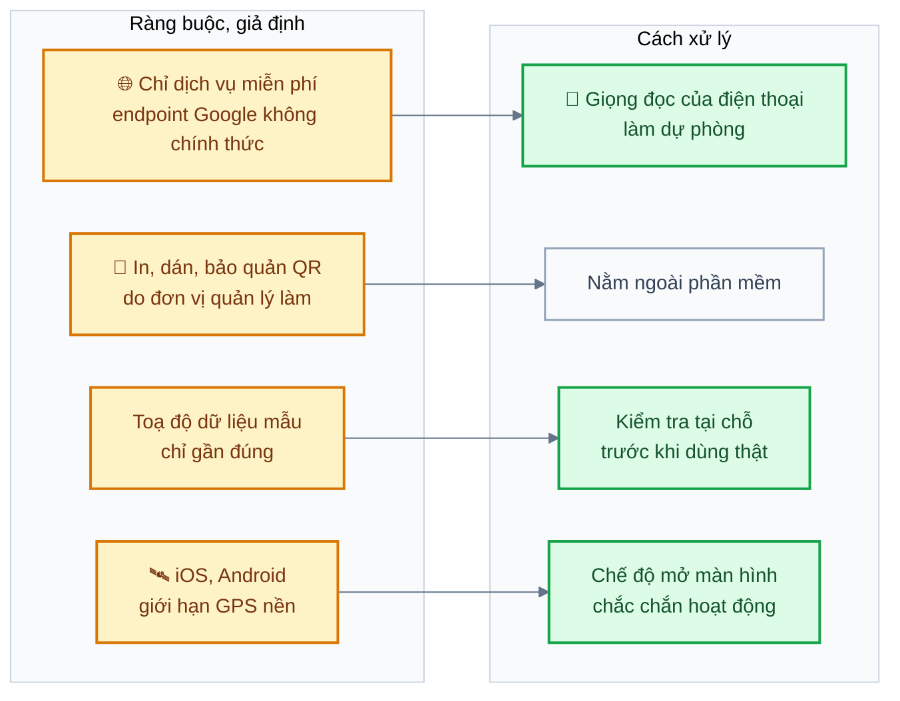
*Hình: Mỗi ràng buộc, giả định và cách sản phẩm xử lý tương ứng*

## 9. Quyền riêng tư

- Không có tài khoản du khách. Mỗi lần mở app tạo một mã phiên ngẫu nhiên mới.
- Toạ độ được làm tròn đến khoảng 11 m trước khi lưu. Báo cáo chỉ hiện số liệu gộp.
- Không thu mã thiết bị, tên, số điện thoại hay mã quảng cáo.
- Người dùng tắt được việc gửi dữ liệu ẩn danh trong Cài đặt.

```mermaid
%%{init: {"theme":"base","fontFamily":"Helvetica Neue, Arial, sans-serif","themeVariables":{"fontFamily":"Helvetica Neue, Arial, sans-serif","fontSize":"15px","primaryColor":"#EFF6FF","primaryBorderColor":"#3B82F6","primaryTextColor":"#0F172A","lineColor":"#64748B","secondaryColor":"#F0FDF4","tertiaryColor":"#FFFFFF","clusterBkg":"#F8FAFC","clusterBorder":"#CBD5E1","edgeLabelBackground":"#FFFFFF","noteBkgColor":"#FEF9C3","noteBorderColor":"#EAB308","actorBkg":"#DBEAFE","actorBorder":"#2563EB","actorTextColor":"#1E3A8A","signalColor":"#475569","signalTextColor":"#0F172A","labelBoxBkgColor":"#F1F5F9","labelBoxBorderColor":"#94A3B8","activationBkgColor":"#E0F2FE","activationBorderColor":"#0284C7","sequenceNumberColor":"#FFFFFF","pie1":"#16A34A","pie2":"#F59E0B","pie3":"#94A3B8","pie4":"#DC2626","pie5":"#2563EB","pie6":"#7C3AED","pieStrokeColor":"#FFFFFF","pieSectionTextColor":"#FFFFFF","quadrant1Fill":"#FEE2E2","quadrant2Fill":"#FEF3C7","quadrant3Fill":"#DCFCE7","quadrant4Fill":"#FEF3C7","quadrantPointFill":"#1E3A8A","quadrantPointTextFill":"#0F172A","git0":"#1E3A8A","gitBranchLabel0":"#FFFFFF","cScale0":"#DBEAFE","cScale1":"#DCFCE7","cScale2":"#EDE9FE","cScale3":"#FEF3C7","cScale4":"#FFE4E6","cScale5":"#E0F2FE","cScale6":"#F1F5F9"},"flowchart":{"curve":"basis","padding":16,"nodeSpacing":40,"rankSpacing":50},"sequence":{"showSequenceNumbers":true,"mirrorActors":false}}}%%
flowchart LR
    S(["📱 Mở app"]):::startend
    SID["Tạo mã phiên ngẫu nhiên mới<br/>không tài khoản"]:::mobile
    Q{"Cài đặt cho phép<br/>gửi dữ liệu ẩn danh?"}:::decision
    N(["Không gửi gì"]):::neutral
    G["Gửi lượt nghe<br/>không tên, SĐT,<br/>mã thiết bị, mã quảng cáo"]:::mobile
    R["⚙️ Máy chủ làm tròn toạ độ<br/>còn khoảng 11 m"]:::backend
    DB[("🗄️ Lưu lượt nghe")]:::data
    BC["📊 Báo cáo chỉ hiện<br/>số liệu gộp"]:::cms
    S --> SID --> Q
    Q -->|"Tắt"| N
    Q -->|"Bật"| G --> R --> DB --> BC
classDef backend fill:#DCFCE7,stroke:#16A34A,stroke-width:2px,color:#14532D
classDef cms fill:#EDE9FE,stroke:#7C3AED,stroke-width:2px,color:#4C1D95
classDef data fill:#F1F5F9,stroke:#475569,stroke-width:2px,color:#0F172A
classDef decision fill:#FFF7ED,stroke:#EA580C,stroke-width:2px,color:#7C2D12
classDef mobile fill:#DBEAFE,stroke:#2563EB,stroke-width:2px,color:#1E3A8A
classDef neutral fill:#F8FAFC,stroke:#94A3B8,stroke-width:1.5px,color:#334155
classDef startend fill:#1E3A8A,stroke:#1E3A8A,stroke-width:2px,color:#FFFFFF
```
*Hình: Dữ liệu lượt nghe đi từ app tới báo cáo, với các lớp bảo vệ quyền riêng tư*

## 10. Rủi ro chính

| Rủi ro | Ảnh hưởng | Cách giảm |
|---|---|---|
| GPS sai lệch ở phố hẹp, nhà cao | Phát trễ, bỏ sót hoặc phát nhầm | Bỏ qua tín hiệu sai số trên 60 m, vùng thoát rộng hơn 1,2 lần, chỉnh bán kính sau khi thử thực địa, có QR làm đường thay thế |
| Điện thoại chặn GPS nền | Tắt màn hình thì không phát | Thông báo chạy nền trên Android, hướng dẫn cấp quyền, chế độ mở màn hình luôn dùng được |
| Dịch vụ dịch và đọc miễn phí bị chặn | Không dịch hoặc tạo giọng được | Đổi nhà cung cấp trong cấu hình; giọng đọc chỉ tạo một lần rồi lưu; app có giọng đọc riêng của máy |
| Bản dịch máy sai nghĩa | Khách nghe nội dung sai | Quản trị viên phải đọc lại bản dịch trước khi lưu |
| App chưa chạy thử trên điện thoại thật | Lỗi bản đồ, camera, âm thanh phát hiện muộn | Chạy các ca kiểm thử trên máy thật trước khi demo |

Danh sách đầy đủ R1–R8 nằm ở `06-project-management.md` §5.

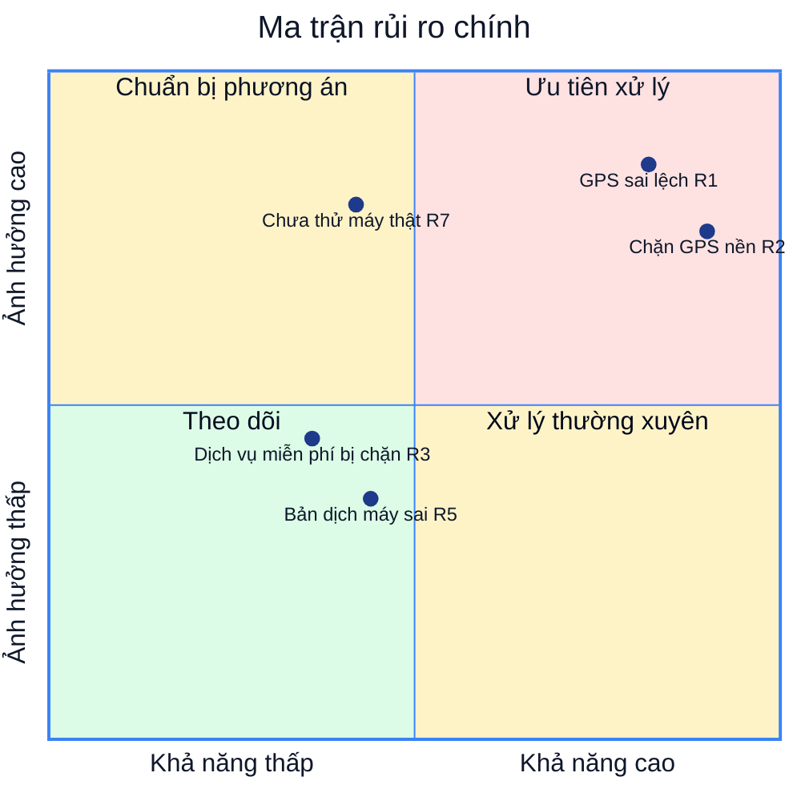
*Hình: Vị trí theo mức Khả năng xảy ra và Ảnh hưởng (Thấp, Trung bình, Cao) ghi trong `06-project-management.md` §5*

## 11. Phát hành

| Giai đoạn | Nội dung | Trạng thái (20/10/2026) |
|---|---|---|
| Bản 1: code hoàn chỉnh | Backend, CMS, app, bộ tài liệu, kiểm thử tự động | Xong |
| Bản 1: thử trên máy | Chạy các ca kiểm thử *Pending (device)* trên Android và iOS | Chưa bắt đầu |
| Bản 1: thử thực địa | FT-01 đến FT-09 tại địa điểm và trạm xe buýt thật | Chưa bắt đầu |
| Bản 1: triển khai | Máy chủ có HTTPS, nhập nội dung thật | Chưa bắt đầu |
| Bản 2 (đề xuất) | Quản lý nhiều quản trị viên, lấy lại mật khẩu, phân quyền soạn và duyệt | Chưa lên kế hoạch |

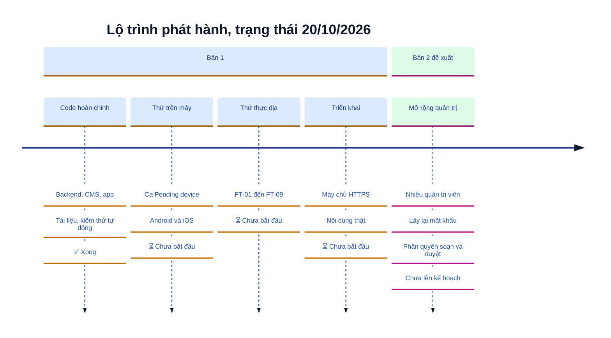
*Hình: Các giai đoạn phát hành và trạng thái tại ngày 20/10/2026*

## 12. Câu hỏi còn mở

1. Đơn vị nào sở hữu nội dung và chịu trách nhiệm kiểm tra bản dịch?
2. Lưu dữ liệu vị trí ẩn danh trong bao lâu thì xoá?
3. Có phát hành app lên Google Play và App Store không, hay chỉ dùng trong phạm vi đồ án?
4. Có cần phân quyền (người soạn và người duyệt) ngay từ bản đầu không?

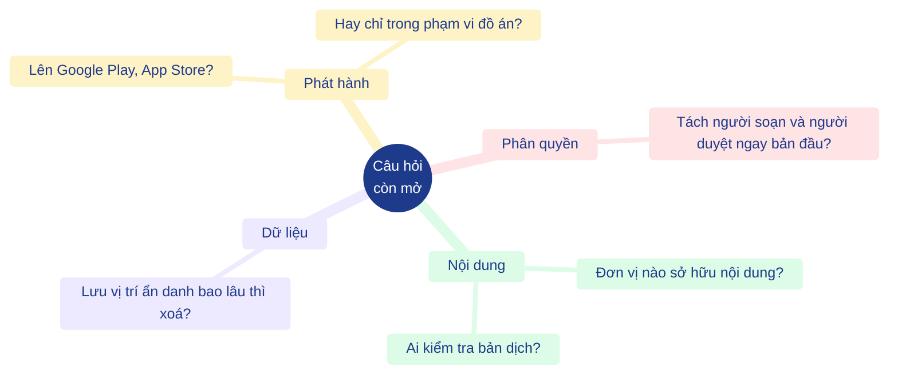
*Hình: Bốn nhóm câu hỏi cần đơn vị quản lý trả lời trước khi dùng thật*
