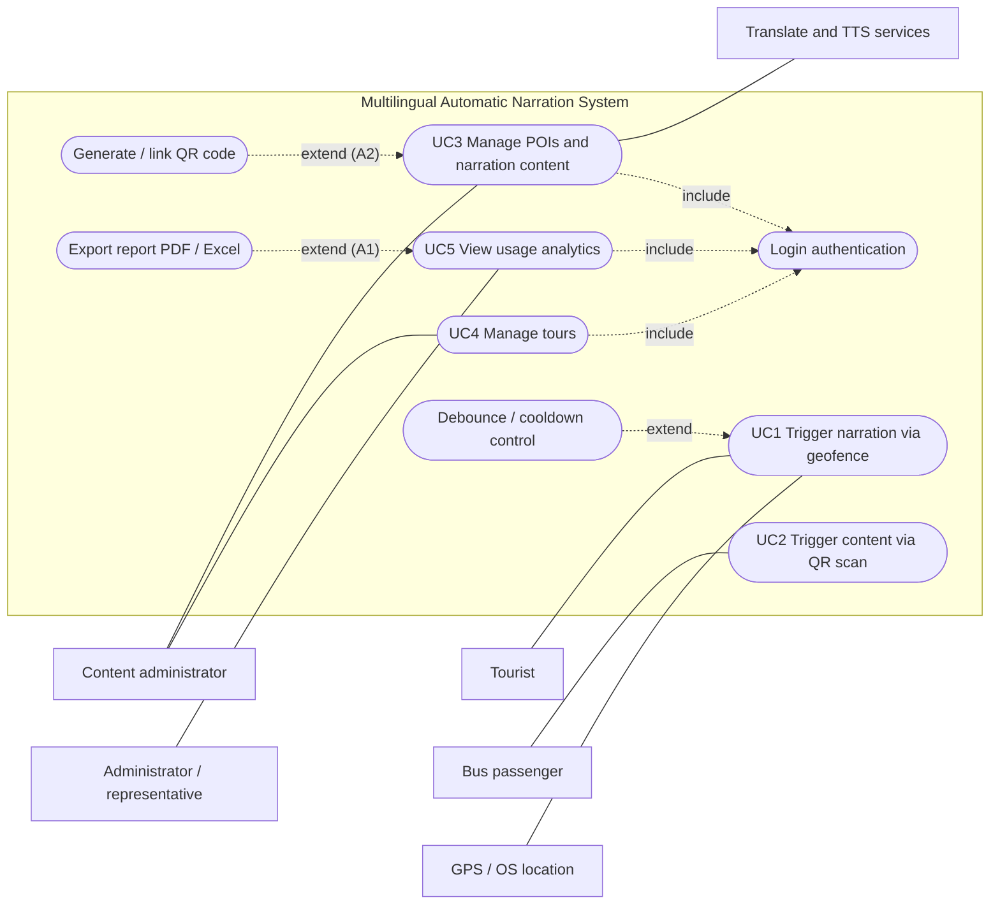

# Software Requirements Specification

**Project:** Multilingual Automatic Narration System
**Document version:** 1.0 (18/10/2026)
**Basis:** Focused Use Cases v1.0 (20/09/2026), README architecture diagrams, backend implementation in `backend/`
**Format:** condensed IEEE 830

| Version | Date | Description |
|---|---|---|
| 1.0 | 18/10/2026 | First SRS derived from UC1–UC5 and the implemented backend |

---

## 1. Introduction

### 1.1 Purpose
This document specifies the functional and non-functional requirements of the Multilingual Automatic Narration System. It is the reference for design (`02-design.md`), testing (`03-test-plan.md`) and acceptance of the capstone project. Readers: lecturer/reviewers, the development team, and the content-owning organisation.

### 1.2 Scope
The system plays location-based narration about Points of Interest (POIs) to tourists and bus passengers in Khanh Hoi, Vinh Hoi and Xom Chieu wards (Ho Chi Minh City). It consists of:

- **Mobile app** (Expo / React Native): plays narration automatically when the user enters a POI's geofence, or immediately after scanning a QR code at a bus stop. Works offline after the first sync.
- **CMS web** (React): lets administrators manage POIs, multilingual narration, audio, QR codes and tours, and view anonymous usage analytics.
- **Backend API** (Node.js, Express, SQLite): stores content, serves a versioned sync snapshot, resolves QR codes, receives anonymous logs and computes reports.

Out of scope: user accounts for tourists, payments, turn-by-turn navigation, real-time bus tracking, content moderation workflows with multiple approval roles.

### 1.3 Definitions and abbreviations

| Term | Meaning |
|---|---|
| POI | Point of Interest: a location with coordinates, activation radius, priority and narration content |
| Geofence | Circular area of radius `radius_m` around a POI; entering it triggers narration |
| Narration | Text of a POI in one language, played as an audio file or read by on-device TTS |
| TTS | Text-to-speech |
| Tour | Ordered list of POIs representing a sightseeing route or bus line |
| Session ID | Random identifier generated per app launch; not linked to a person or device |
| Content version | Integer (`meta.content_version`) incremented on every content change; drives sync |
| Cooldown | Minimum time before the same POI may be narrated again (default 10 minutes) |

### 1.4 References
- `FocusedUseCases.docx`: Focused Use Cases UC1–UC5, v1.0, 20/09/2026
- `README.md`: team architecture diagrams and original ERD
- `docs/api.md`: REST API contract
- IEEE Std 830-1998, Recommended Practice for Software Requirements Specifications

---

## 2. Overall description

### 2.1 Product perspective
A new, self-contained system with three deployable parts (mobile app, CMS web, backend API) plus two external free services: Google Translate (unofficial `translate_a/single` endpoint, or optionally LibreTranslate) and Google Translate TTS (`translate_tts`). See the component diagram in `02-design.md` §1.

### 2.2 Stakeholders and actors

| Actor / stakeholder | Type | Description | Use cases |
|---|---|---|---|
| Tourist / pedestrian | Primary actor | Walks or rides around the area with the app running | UC1 |
| Bus passenger | Primary actor | Scans a QR code at a bus stop | UC2 |
| Content administrator | Primary actor | Maintains POIs, narration, QR codes and tours in the CMS | UC3, UC4 |
| Administrator / administration representative | Primary actor | Reviews usage reports | UC5 |
| GPS / OS location service | Secondary actor | Provides location updates | UC1 |
| Translate and TTS services | Secondary actor | Machine translation and speech synthesis for the CMS | UC3 |
| Ward / tourism office | Stakeholder | Owns the content and uses the analytics | UC5 |
| Lecturer | Stakeholder | Evaluates the capstone | none |

### 2.3 Use-case diagram

Dotted arrows follow UML convention: an included use case is pointed to by its base; an extending use case points to the base it extends. "Debounce / cooldown control" is the extension point declared in UC1.

### 2.4 Product functions (summary)
1. Sync POI and tour content to the device and keep it for offline use.
2. Track location in the background and trigger narration on geofence entry.
3. Scan bus-stop QR codes and play the linked narration immediately.
4. Play narration in the user's chosen language, from audio file or on-device TTS.
5. Manage POIs, translations, audio, QR codes and tours in a web CMS.
6. Collect anonymous usage and location data and present analytics with export.

### 2.5 User characteristics
- Tourists and passengers: no training; may be foreign visitors; use the app one-handed while moving; limited data connectivity.
- Administrators: office staff comfortable with web forms and maps; not developers.

### 2.6 Constraints
- C-01 Backend: Node.js ≥ 22.13 (built-in `node:sqlite`), Express 5, single SQLite database file.
- C-02 Mobile: Expo SDK 58 (React Native 0.88, TypeScript, Expo Router); background location requires a development or store build (not Expo Go) and is subject to iOS/Android policies.
- C-03 CMS: Vite 8 + React 19 + TypeScript, runs in a modern browser (usable down to 375 px width).
- C-04 Only free external services may be used (student project without a budget); their availability and rate limits are not guaranteed.
- C-05 Supported narration languages are fixed in configuration: `vi` (default), `en`, `zh`, `ko`, `ja`, `fr`.
- C-06 Development period ends with the capstone schedule (see `06-project-management.md`).

### 2.7 Assumptions and dependencies
- A-01 POIs, narration and QR codes are created by an administrator before field use (UC1/UC2 assumptions).
- A-02 QR codes are printed and installed at bus stops by the administration; physical installation is outside the software.
- A-03 Devices have GPS and a camera; the user grants permissions.
- A-04 Devices have an on-device TTS engine; voice availability per language depends on the OS.
- A-05 The device has network access at least once to perform the first sync.
- A-06 Sample POI coordinates in the seed data are approximate and must be checked on a map before real use.

---

## 3. Specific requirements

Priority: **M** = must, **S** = should, **C** = could. All requirements are implemented in the code base as of 18/10/2026; verification status is given per test case in `03-test-plan.md` (device-level behaviour of the mobile app is not yet verified).

### 3.1 Functional requirements

#### UC1: Trigger automatic narration via geofence

| ID | Requirement | Priority |
|---|---|---|
| FR-01 | The app shall request location permission. If permission is denied, it shall explain that location is required for automatic narration, offer "Open Settings" and "Retry", and keep QR scanning and manual play available (UC1 E1). | M |
| FR-02 | The app shall download the full content snapshot (POIs with coordinates, radius, priority, translations, audio URLs; QR codes; tours) and store it in a local SQLite database. | M |
| FR-03 | The app shall check `GET /sync/version` on launch, every 5 minutes, when returning to the foreground and when connectivity returns, and re-download the snapshot only when the server version differs from the local version (or no local data exists). A failed sync shall keep the previous data. | M |
| FR-04 | The app shall track location in the foreground and, when the user enables it and grants "Always" permission in a development or store build, in the background. | M |
| FR-05 | The geofence engine shall compute the haversine distance from the current fix to each POI and treat a POI as entered when distance ≤ `radius_m`. Fixes with reported accuracy worse than about 60 m shall be ignored. | M |
| FR-06 | Among the POIs the user is inside, the engine shall select the one with the highest `priority`, then the nearest, and trigger it at most once per visit (a visit ends when the user exits). | M |
| FR-07 | A POI shall be considered exited only when distance > `radius_m × 1.2` (hysteresis), so that GPS jitter at the boundary does not create repeated entries. | M |
| FR-08 | For geofence triggers the narration engine shall discard (not queue) the trigger when another narration is playing, or when the same POI started playing within the cooldown window (default 10 minutes, configurable) (UC1 A1). Manual and QR plays bypass the cooldown and stop the current narration. | M |
| FR-09 | The narration engine shall play, in order of preference: the downloaded audio file of the selected language, the server audio file when online, or `narration_text` read by on-device TTS. If the selected language has no content it shall fall back to Vietnamese and tell the user. If audio playback fails it shall switch to TTS. | M |
| FR-10 | Each playback shall be recorded locally (POI, time, trigger method, language, seconds listened) and uploaded in batches to `POST /logs/usage` when online. Records for POIs deleted in the meantime are skipped by the server. | M |
| FR-11 | If no content has ever been synced and the device is offline, the app shall inform the user that automatic narration is unavailable and suggest connecting to sync (UC1 E2). | M |
| FR-12 | The app shall provide a location simulation mode: tapping the map sets a fake position, or the app walks a tour automatically at adjustable speed, so UC1 can be demonstrated without walking to POIs. | S |

#### UC2: Trigger content via QR code scan

| ID | Requirement | Priority |
|---|---|---|
| FR-13 | The app shall provide a QR scanner using the camera, after requesting camera permission, plus manual code entry for devices without a usable camera. | M |
| FR-14 | The system shall accept QR content in the forms `NARR:<code>`, `<code>`, or a URL ending in `/q/<code>`, and resolve it to a POI: first from the QR codes in the synced snapshot (offline), then from previously resolved codes, then online via `GET /qr/:payload`. | M |
| FR-15 | On a valid code, the app shall play the POI narration immediately without waiting for GPS, interrupting any current narration, in the selected language (UC2 A1), using the same audio/TTS/fallback rules as FR-09. | M |
| FR-16 | An unknown or malformed code shall produce the message "Invalid QR code" (UC2 E1). | M |
| FR-17 | If the code is not stored on the device and the server cannot be reached, the app shall say that the content cannot be played now and suggest retrying when connected (UC2 E2). | M |
| FR-18 | QR-triggered playbacks shall be logged with `trigger_method = qr`. | M |
| FR-19 | The user shall be able to choose the narration language among the supported languages in Settings (initially the device language if supported, else Vietnamese); the choice persists on the device. | M |

#### UC3: Manage POIs and narration content

| ID | Requirement | Priority |
|---|---|---|
| FR-20 | Administrators shall log in with username and password; the backend issues a JWT (default lifetime 8 h). All `/admin` endpoints require a valid token. Login attempts are limited to 20 per 15 minutes per IP. Administrators can change their password (≥ 8 characters). | M |
| FR-21 | The CMS shall list POIs with name, address, radius, priority, available languages, audio languages and QR count, with text search by name or address. | M |
| FR-22 | The administrator shall create and edit a POI: name, address, coordinates (picked on a map or typed), activation radius, priority, optional image. | M |
| FR-23 | The administrator shall enter title and narration text per supported language, and may request machine translation from the default language into another language. | M |
| FR-24 | The administrator shall upload an audio file per language (mp3, m4a, aac, wav, ogg, webm; ≤ 15 MB), generate audio from the saved text with server TTS, or remove the audio. | M |
| FR-25 | The system shall validate POI input: name required; latitude in [−90, 90]; longitude in [−180, 180]; 0 < radius ≤ 5000 m; priority integer 0–100; supported, non-duplicated languages; Vietnamese narration text required. Errors are reported per field and nothing is saved (UC3 E1). | M |
| FR-26 | Deleting a POI shall require confirmation in the CMS and shall remove its translations, audio and image files, QR codes and its membership in tours; historical usage logs are kept without the POI reference (UC3 A1). | M |
| FR-27 | The administrator shall create, label, list, download (PNG), print and delete QR codes linked to a POI. Each code carries a random, non-guessable payload (UC3 A2). | M |
| FR-28 | Every change to POIs, translations, audio, QR codes or tours shall increment the content version so that devices pick up the change at next sync (UC3 step 9). | M |

#### UC4: Manage tours

| ID | Requirement | Priority |
|---|---|---|
| FR-29 | The CMS shall list tours with name, description and number of POIs. | M |
| FR-30 | The administrator shall create and edit a tour with name, description and an ordered list of existing POIs; the CMS shows the route as a polyline on a map. | M |
| FR-31 | A tour shall contain at least one POI, no POI twice, and only existing POIs; otherwise saving is rejected (UC4 E1). | M |
| FR-32 | Deleting a tour shall require confirmation (UC4 A1). | M |
| FR-33 | Tours shall be included in the sync snapshot and shown in the app as ordered lists of POIs that the user can follow (next stop and distance). | S |

#### UC5: View usage analytics

| ID | Requirement | Priority |
|---|---|---|
| FR-34 | The app shall sample the device location (about every 30 s, or after 25 m of movement) and upload samples in batches to `POST /logs/location` with the session ID only. The user can turn anonymous data off, which stops logging and clears the queue. | M |
| FR-35 | The report shall be filterable by date range and by tour. | M |
| FR-36 | The backend shall compute: total plays, distinct sessions, average and total listening time; plays and average listening time per POI (ranked); plays by trigger method and by language; plays per day and per hour; location heatmap; up to 30 anonymous movement routes. | M |
| FR-37 | The CMS shall display the report as KPIs, charts (hourly chart in Vietnam time), a per-POI table and a heatmap with optional anonymous routes. When there is no data for the filter it shall show "No data available" (UC5 E1). | M |
| FR-38 | The administrator shall export the report to Excel (multi-sheet workbook) and to PDF via a print-optimised report page and the browser's "Save as PDF" (UC5 A1). | S |
| FR-39 | Report generation shall not modify stored data (UC5 post-condition). | M |

### 3.2 Non-functional requirements

| ID | Category | Requirement |
|---|---|---|
| NFR-01 | Performance | Geofence evaluation for up to 200 POIs shall complete within 50 ms per location fix on a mid-range phone (linear scan is sufficient at this size). |
| NFR-02 | Performance | Narration shall start within 2 s of a geofence entry or a successful QR resolution when content is stored locally. |
| NFR-03 | Performance | Backend API responses (excluding external translate/TTS calls) shall complete within 500 ms for the seeded data set on a single small server. |
| NFR-04 | Offline | After one successful sync, geofence narration (TTS or downloaded audio) shall work with no network. Logs shall be queued locally and uploaded later. |
| NFR-05 | Offline | Sync shall transfer the full snapshot only when the content version changed. |
| NFR-06 | Privacy | Tourists shall not register or log in. The only identifier sent is a random session ID regenerated on each app launch. |
| NFR-07 | Privacy | The server shall round location coordinates to 4 decimal places (about 11 m) before storage; reports aggregate locations into cells of that size and never return session IDs. |
| NFR-08 | Privacy | The app shall not send device identifiers, names, phone numbers or advertising IDs, and shall let the user switch anonymous data collection off. |
| NFR-09 | Security | Admin passwords are stored as bcrypt hashes; JWTs are signed with a server secret that must be set in production (the server refuses to start in production with the default secret). |
| NFR-10 | Security | Uploads are restricted by MIME type and size (15 MB); file names are generated by the server. Request bodies are limited to 1 MB. Standard security headers are applied (helmet). |
| NFR-11 | Security | Public log endpoints are rate-limited (120 requests/min/IP) and validate every field; production traffic uses HTTPS through a reverse proxy. |
| NFR-12 | Usability | The app is usable without reading instructions: narration plays automatically; QR scanning is one tap from the home screen; text sizes and controls follow platform guidelines. |
| NFR-13 | Usability | CMS forms show field-level error messages and require confirmation before destructive actions. |
| NFR-14 | i18n | Narration content supports six languages (`vi`, `en`, `zh`, `ko`, `ja`, `fr`) with Vietnamese as mandatory default and fallback. |
| NFR-15 | i18n | All text is stored and transferred as UTF-8; Vietnamese diacritics and CJK characters are preserved end-to-end. |
| NFR-16 | Maintainability | The backend follows a 3-layer structure (controllers, services, repositories) with injectable translate/TTS providers so tests run without network. |
| NFR-17 | Portability | The mobile app targets Android and iOS from one Expo code base. |
| NFR-18 | Reliability | Multi-row writes (POI with translations, tour with POIs, log batches) are atomic (single SQLite transaction). |

### 3.3 Business rules

| ID | Rule | Source |
|---|---|---|
| BR-01 | The same POI must not be replayed repeatedly in a short period; a trigger during playback or cooldown is discarded. | UC1 business rule, A1 |
| BR-02 | Every POI must have valid coordinates, an activation radius greater than 0 and narration in the default language. | UC3 business rule |
| BR-03 | A tour must contain at least one POI. | UC4 E1 |
| BR-04 | Location and route data must be stored and processed anonymously, without personal identification. | UC5 business rule |
| BR-05 | Destructive actions (delete POI, delete tour) require confirmation. | UC3 A1, UC4 A1 |
| BR-06 | A QR code is linked to exactly one POI; a POI may have several QR codes (one per bus stop). | UC2, UC3 A2 |
| BR-07 | When the selected language has no narration, Vietnamese is played. | Design decision supporting UC1/UC2 A1 |

---

## 4. Requirements traceability matrix

Implementation paths are relative to the repository root. Client paths are relative to `mobile/src/` and `cms/src/`. Test IDs refer to `03-test-plan.md` (TC = test case, automated or manual; FT = field test).

| FR | UC | Implementation module | Test cases |
|---|---|---|---|
| FR-01 | UC1 E1 | Mobile: `services/bootstrap.ts`, `services/location/`, `app/(tabs)/index.tsx` | TC-44, FT-01 |
| FR-02 | UC1 | Backend: `syncService.snapshot`, `GET /sync`; Mobile: `data/sync.ts`, `data/db.ts` | TC-29, TC-45, TC-46 |
| FR-03 | UC1 | Backend: `syncService.version`, `metaRepository`; Mobile: `data/syncLogic.ts` (`planSync`), `services/bootstrap.ts` | TC-09, TC-45, TC-47 |
| FR-04 | UC1 | Mobile: `services/location/index.ts`, `backgroundTask.ts`, `mobile/index.js` | TC-48, FT-03 |
| FR-05 | UC1 | Mobile: `engine/geofence.ts`, `engine/geo.ts` | TC-49, TC-50, FT-02 |
| FR-06 | UC1 | Mobile: `engine/geofence.ts` (`pickBest`) | TC-51, FT-08 |
| FR-07 | UC1 | Mobile: `engine/geofence.ts` | TC-52, FT-04 |
| FR-08 | UC1 A1 | Mobile: `engine/cooldown.ts`, `engine/narration.ts` | TC-53, TC-54, TC-57, FT-05 |
| FR-09 | UC1 | Mobile: `engine/narration.ts`, `engine/language.ts`, `services/audioOutput.ts`, `data/audioCache.ts` | TC-55, TC-56 |
| FR-10 | UC1 | Backend: `logService.recordUsage`; Mobile: `services/analytics.ts` | TC-31, TC-32, TC-43, TC-58, TC-59 |
| FR-11 | UC1 E2 | Mobile: `app/(tabs)/index.tsx`, `data/sync.ts` | TC-60 |
| FR-12 | UC1 | Mobile: `services/simulation.ts`, `services/pipeline.ts` | TC-61, TC-62 |
| FR-13 | UC2 | Mobile: `app/(tabs)/scan.tsx` (expo-camera) | TC-65 |
| FR-14 | UC2 | Backend: `qrService.extractPayload/resolve`, `syncService` (`qrcodes`); Mobile: `engine/qr.ts`, `services/qrResolver.ts` | TC-21, TC-23, TC-29, TC-63, TC-64, TC-68 |
| FR-15 | UC2, A1 | Mobile: `services/qrResolver.ts`, `engine/narration.ts` | TC-57, TC-66, FT-06 |
| FR-16 | UC2 E1 | Backend: `qrService.resolve` (404); Mobile: `engine/qr.ts`, `scan.tsx` | TC-22, TC-63, TC-64, TC-67 |
| FR-17 | UC2 E2 | Mobile: `services/qrResolver.ts`, `scan.tsx` | TC-68 |
| FR-18 | UC2 | Backend: `logService.recordUsage`; Mobile: `services/analytics.ts` | TC-31, TC-66 |
| FR-19 | UC2 A1 | Mobile: `app/(tabs)/settings.tsx`, `data/settings.ts`, `i18n/` | TC-69 |
| FR-20 | UC3–UC5 | Backend: `authService`, `middleware/auth.js`; CMS: `auth/AuthContext.tsx`, `lib/api.ts`, `pages/LoginPage.tsx`, `pages/AccountPage.tsx` | TC-01 to TC-06, TC-72, TC-73, TC-90 |
| FR-21 | UC3 | Backend: `poiService.list`; CMS: `pages/PoiListPage.tsx` | TC-07, TC-08, TC-74 |
| FR-22 | UC3 | Backend: `poiService.create/update`, `POST /admin/images`; CMS: `pages/PoiEditPage.tsx`, `components/maps.tsx` | TC-09, TC-14, TC-74, TC-78 |
| FR-23 | UC3 | Backend: `translateService`, `POST /admin/translate`; CMS: `PoiEditPage` language tabs | TC-20, TC-40, TC-41, TC-76 |
| FR-24 | UC3 | Backend: `poiService.attachAudio/removeAudio`, `ttsService`, `middleware/upload.js`; CMS: `PoiEditPage` audio panel | TC-17, TC-18, TC-19, TC-39, TC-77 |
| FR-25 | UC3 E1 | Backend: `validatePoiInput`; CMS: `lib/validation.ts` | TC-10 to TC-13, TC-16, TC-42, TC-75 |
| FR-26 | UC3 A1 | Backend: `poiService.delete`, FK cascades; CMS: `components/ConfirmDialog.tsx` | TC-15, TC-30, TC-79 |
| FR-27 | UC3 A2 | Backend: `qrService.create/delete/listAll`; CMS: `PoiEditPage` QR section, `pages/QrPage.tsx`, `components/QrImage.tsx` | TC-21, TC-24, TC-81, TC-82 |
| FR-28 | UC3 | Backend: `metaRepository.bumpContentVersion` (POI, tour, QR services) | TC-09 |
| FR-29 | UC4 | Backend: `tourService.list`; CMS: `pages/TourListPage.tsx` | TC-25, TC-83 |
| FR-30 | UC4 | Backend: `tourService.create/update`, `tourRepository.setPois`; CMS: `pages/TourEditPage.tsx` | TC-25, TC-28, TC-83 |
| FR-31 | UC4 E1 | Backend: `tourService.validate`; CMS: `lib/validation.ts` | TC-26, TC-27, TC-84 |
| FR-32 | UC4 A1 | Backend: `tourService.delete`; CMS: `ConfirmDialog` | TC-28, TC-85 |
| FR-33 | UC4 | Backend: `syncService.snapshot` (tours); Mobile: `app/(tabs)/tours.tsx`, `app/tour/[id].tsx` | TC-29, TC-70 |
| FR-34 | UC5 | Backend: `logService.recordLocations`; Mobile: `services/analytics.ts`, `analyticsPolicy.ts` | TC-33, TC-58, TC-59 |
| FR-35 | UC5 | Backend: `analyticsService.parseFilters`; CMS: `pages/AnalyticsPage.tsx` | TC-35, TC-37, TC-86 |
| FR-36 | UC5 | Backend: `analyticsService.report`, `analyticsRepository` | TC-34, TC-35, TC-38 |
| FR-37 | UC5, E1 | Backend: `has_data`; CMS: `AnalyticsPage`, `components/charts.tsx`, `components/maps.tsx` | TC-36, TC-86, TC-87 |
| FR-38 | UC5 A1 | CMS: `lib/exportExcel.ts`, `pages/AnalyticsReportPage.tsx` | TC-88, TC-89 |
| FR-39 | UC5 | Backend: analytics uses SELECT only | TC-34 (inspection) |

Non-functional requirements are verified as follows: NFR-07 by TC-33 and TC-34; NFR-09 by TC-01 to TC-05; NFR-10 by TC-18; NFR-14 by TC-12 and TC-13; NFR-18 by code inspection of `transaction()` usage plus TC-31 and TC-32; NFR-01, NFR-02, NFR-04 by FT-02 to FT-08; NFR-12 by TC-62 to TC-70 (device, pending); NFR-13 by TC-75, TC-79 and TC-80; NFR-03 by measurement during integration testing (not yet recorded).
