# Đặc tả yêu cầu phần mềm

**Dự án:** Hệ thống thuyết minh tự động đa ngôn ngữ
**Phiên bản tài liệu:** 1.1 (20/10/2026)
**Căn cứ:** Đặc tả ca sử dụng (Focused Use Cases UC1–UC5, v1.0, 20/09/2026), các sơ đồ kiến trúc trong README, mã nguồn backend trong `backend/`
**Định dạng:** IEEE 830 rút gọn

| Phiên bản | Ngày | Mô tả |
|---|---|---|
| 1.0 | 18/10/2026 | Bản SRS đầu tiên, xây dựng từ UC1–UC5 và backend đã cài đặt |
| 1.1 | 20/10/2026 | Chuyển tài liệu sang tiếng Việt |

---

## 1. Giới thiệu

### 1.1 Mục đích
Tài liệu này đặc tả các yêu cầu chức năng (functional requirement) và yêu cầu phi chức năng (non-functional requirement) của Hệ thống thuyết minh tự động đa ngôn ngữ. Đây là tài liệu tham chiếu cho thiết kế (`02-design.md`), kiểm thử (`03-test-plan.md`) và nghiệm thu đồ án. Người đọc: giảng viên/người phản biện, nhóm phát triển và đơn vị sở hữu nội dung.

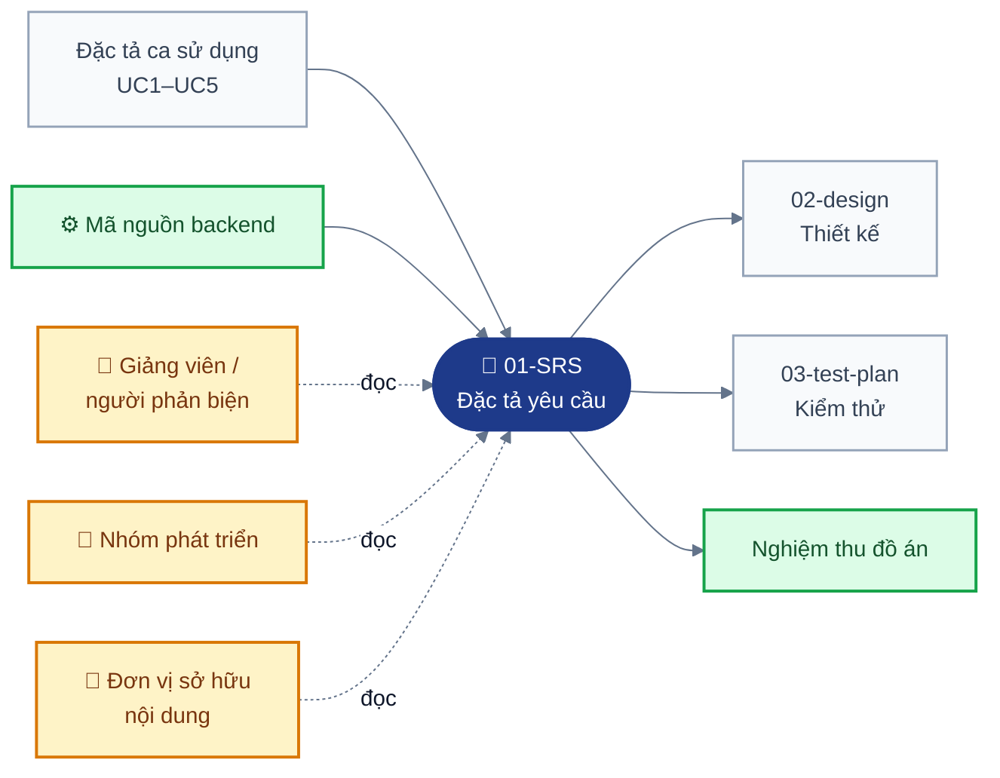

*Hình: Vị trí của SRS: đầu vào, tài liệu dùng SRS làm căn cứ và người đọc*


### 1.2 Phạm vi
Hệ thống phát thuyết minh (narration) theo vị trí về các điểm tham quan (point of interest, POI) cho khách du lịch (tourist) và hành khách xe buýt (bus passenger) tại các phường Khánh Hội, Vĩnh Hội và Xóm Chiếu (TP. Hồ Chí Minh). Hệ thống gồm:

- **Ứng dụng di động** (Expo / React Native): tự phát thuyết minh khi người dùng đi vào vùng kích hoạt (geofence) của một điểm tham quan, hoặc phát ngay sau khi quét mã QR tại trạm xe buýt (bus stop). Hoạt động ngoại tuyến (offline) sau lần đồng bộ đầu tiên.
- **CMS web** (React): cho phép quản trị viên quản lý điểm tham quan, thuyết minh đa ngôn ngữ, audio, mã QR và tour, đồng thời xem thống kê sử dụng ẩn danh.
- **Backend API** (Node.js, Express, SQLite): lưu nội dung, cung cấp bản chụp đồng bộ có đánh số phiên bản, phân giải mã QR, nhận nhật ký ẩn danh và tính toán báo cáo.

Ngoài phạm vi: tài khoản người dùng cho khách du lịch, thanh toán, dẫn đường từng chặng, theo dõi xe buýt theo thời gian thực, quy trình kiểm duyệt nội dung với nhiều vai trò phê duyệt.

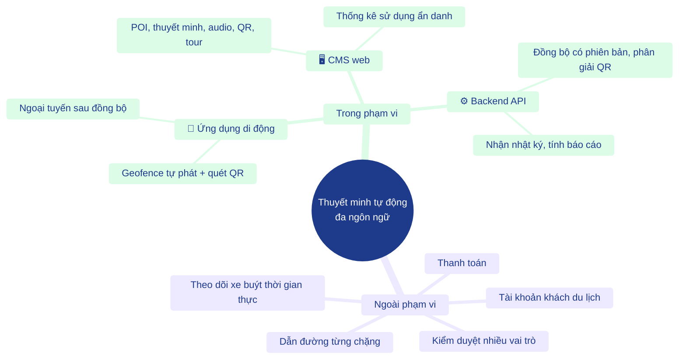

*Hình: Phạm vi hệ thống: ba thành phần trong phạm vi và các hạng mục bị loại trừ*


### 1.3 Định nghĩa và từ viết tắt

| Thuật ngữ | Ý nghĩa |
|---|---|
| POI | Điểm tham quan: một địa điểm có toạ độ, bán kính kích hoạt, độ ưu tiên và nội dung thuyết minh |
| Geofence | Vùng tròn bán kính `radius_m` quanh một điểm tham quan; đi vào vùng này sẽ kích hoạt thuyết minh |
| Thuyết minh | Văn bản về một điểm tham quan bằng một ngôn ngữ, được phát dưới dạng file audio hoặc đọc bằng TTS trên thiết bị |
| TTS | Chuyển văn bản thành giọng nói (text-to-speech) |
| Tour | Danh sách có thứ tự các điểm tham quan, biểu diễn một lộ trình tham quan hoặc một tuyến xe buýt |
| Session ID | Định danh ngẫu nhiên sinh ra mỗi lần mở ứng dụng; không gắn với cá nhân hay thiết bị |
| Phiên bản nội dung | Số nguyên (`meta.content_version`) tăng lên sau mỗi thay đổi nội dung; dùng để điều khiển đồng bộ |
| Thời gian chờ phát lại (cooldown) | Khoảng thời gian tối thiểu trước khi cùng một điểm tham quan được thuyết minh lại (mặc định 10 phút) |

### 1.4 Tài liệu tham khảo
- Đặc tả ca sử dụng (Focused Use Cases UC1–UC5, v1.0, 20/09/2026)
- `README.md`: sơ đồ kiến trúc của nhóm và ERD ban đầu
- `docs/api.md`: hợp đồng REST API
- IEEE Std 830-1998, Recommended Practice for Software Requirements Specifications

---

## 2. Mô tả tổng quan

### 2.1 Bối cảnh sản phẩm
Một hệ thống mới, độc lập, gồm ba thành phần triển khai riêng (ứng dụng di động, CMS web, backend API) cùng hai dịch vụ miễn phí bên ngoài: Google Translate (endpoint không chính thức `translate_a/single`, hoặc tuỳ chọn LibreTranslate) và Google Translate TTS (`translate_tts`). Xem sơ đồ thành phần trong `02-design.md` §1.

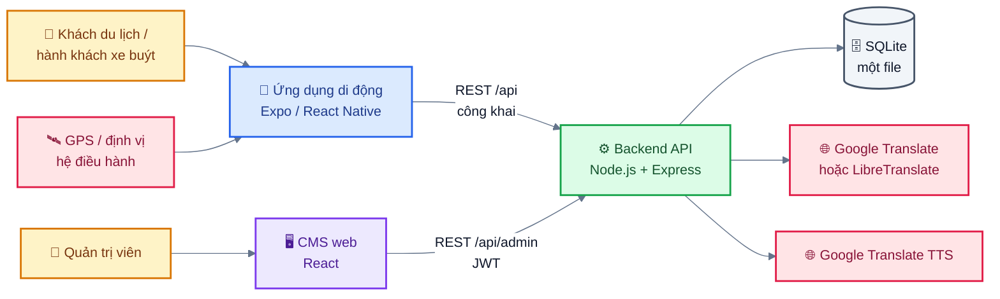

*Hình: Bối cảnh sản phẩm: ba thành phần triển khai riêng và hai dịch vụ miễn phí bên ngoài*


### 2.2 Bên liên quan và tác nhân

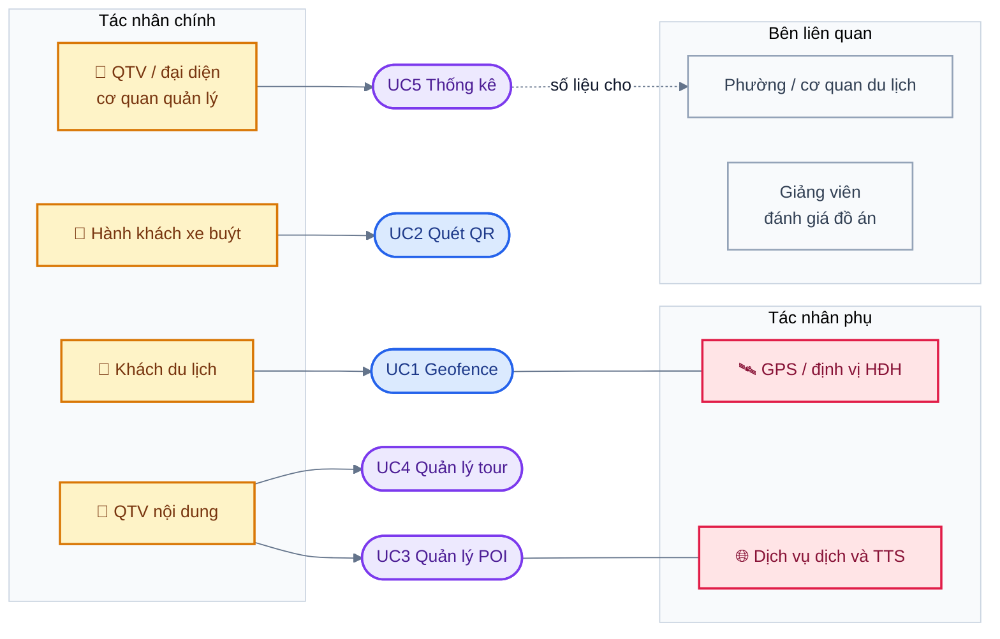

*Hình: Tác nhân chính, tác nhân phụ, bên liên quan và ca sử dụng tương ứng*


| Tác nhân / bên liên quan (stakeholder) | Loại | Mô tả | Ca sử dụng |
|---|---|---|---|
| Khách du lịch / người đi bộ | Tác nhân chính | Đi bộ hoặc đi xe quanh khu vực khi ứng dụng đang chạy | UC1 |
| Hành khách xe buýt | Tác nhân chính | Quét mã QR tại trạm xe buýt | UC2 |
| Quản trị viên nội dung (content administrator) | Tác nhân chính | Duy trì điểm tham quan, thuyết minh, mã QR và tour trên CMS | UC3, UC4 |
| Quản trị viên / đại diện cơ quan quản lý | Tác nhân chính | Xem báo cáo sử dụng | UC5 |
| GPS / dịch vụ định vị của hệ điều hành | Tác nhân phụ | Cung cấp cập nhật vị trí | UC1 |
| Dịch vụ dịch và TTS | Tác nhân phụ | Dịch máy và tổng hợp giọng nói cho CMS | UC3 |
| Phường / cơ quan du lịch | Bên liên quan | Sở hữu nội dung và sử dụng số liệu thống kê | UC5 |
| Giảng viên | Bên liên quan | Đánh giá đồ án | không có |

### 2.3 Sơ đồ ca sử dụng (use case)

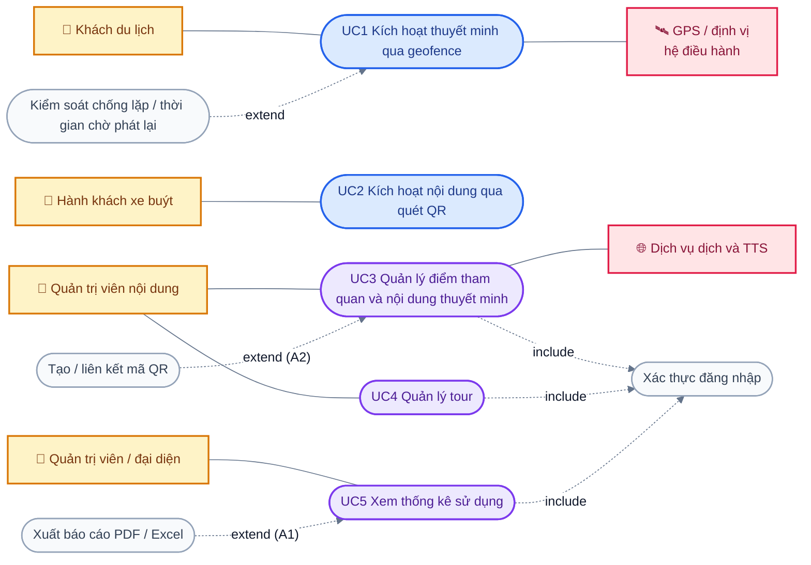

*Hình: Sơ đồ ca sử dụng dạng flowchart: tác nhân, năm ca sử dụng chính và các quan hệ include/extend*

Bản vẽ cùng nội dung theo ký hiệu UML (hình người, hình elip), dùng cho báo cáo:

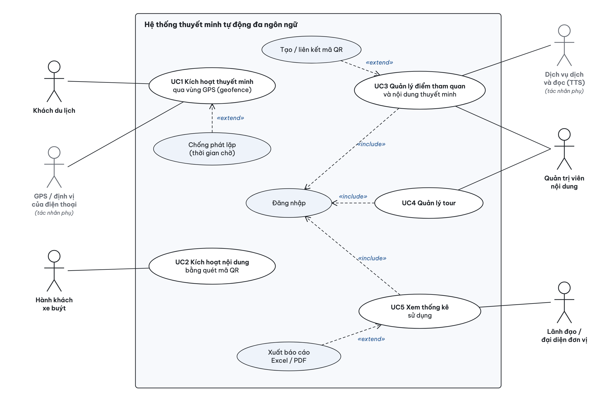

Mũi tên nét đứt theo quy ước UML: ca sử dụng được bao hàm (include) được ca cơ sở trỏ tới; ca sử dụng mở rộng (extend) trỏ tới ca cơ sở mà nó mở rộng. "Kiểm soát chống lặp / thời gian chờ phát lại" là điểm mở rộng được khai báo trong UC1.

### 2.4 Chức năng sản phẩm (tóm tắt)

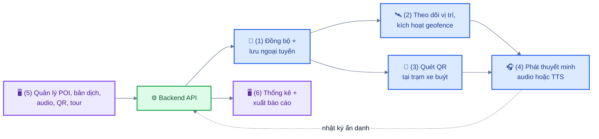

*Hình: Sáu chức năng chính nối thành một vòng: quản lý nội dung, đồng bộ, kích hoạt, phát, thống kê*

1. Đồng bộ (sync) nội dung điểm tham quan và tour xuống thiết bị và lưu lại để dùng ngoại tuyến.
2. Theo dõi vị trí ở chế độ nền và kích hoạt (trigger) thuyết minh khi đi vào vùng kích hoạt.
3. Quét mã QR tại trạm xe buýt và phát ngay thuyết minh được liên kết.
4. Phát thuyết minh bằng ngôn ngữ người dùng chọn, từ file audio hoặc TTS trên thiết bị.
5. Quản lý điểm tham quan, bản dịch (translation), audio, mã QR và tour trên CMS web.
6. Thu thập dữ liệu sử dụng và vị trí ẩn danh, trình bày thống kê (analytics) và cho phép xuất báo cáo.

### 2.5 Đặc điểm người dùng

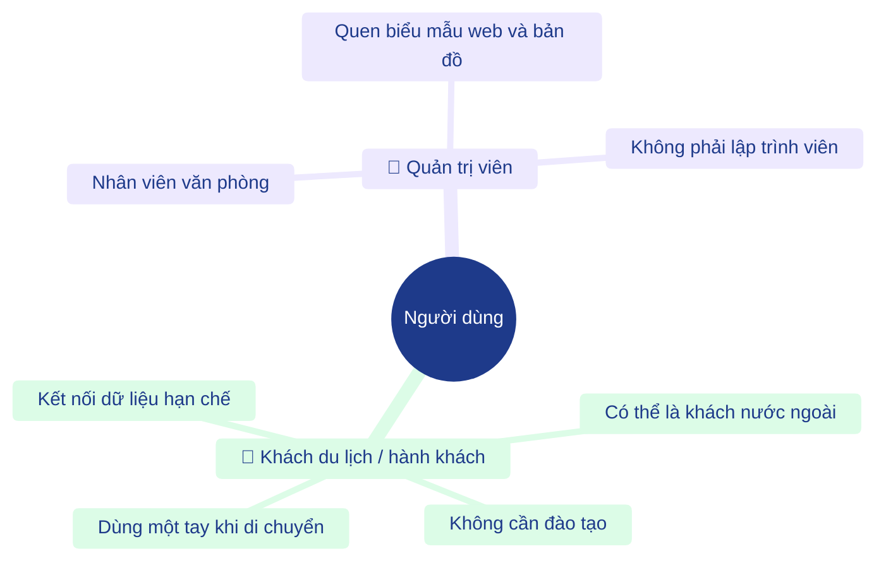

*Hình: Đặc điểm hai nhóm người dùng*

- Khách du lịch và hành khách: không cần đào tạo; có thể là khách nước ngoài; dùng ứng dụng bằng một tay khi đang di chuyển; kết nối dữ liệu hạn chế.
- Quản trị viên: nhân viên văn phòng quen dùng biểu mẫu web và bản đồ; không phải lập trình viên.

### 2.6 Ràng buộc

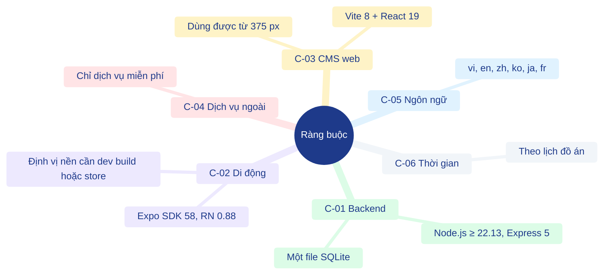

*Hình: Sáu ràng buộc kỹ thuật và quản lý của hệ thống*

- C-01 Backend: Node.js ≥ 22.13 (có sẵn `node:sqlite`), Express 5, một file cơ sở dữ liệu SQLite duy nhất.
- C-02 Di động: Expo SDK 58 (React Native 0.88, TypeScript, Expo Router); định vị nền (background location) cần bản development build hoặc bản phát hành trên store (không chạy được trên Expo Go) và chịu ràng buộc chính sách của iOS/Android.
- C-03 CMS: Vite 8 + React 19 + TypeScript, chạy trên trình duyệt hiện đại (dùng được ở độ rộng tối thiểu 375 px).
- C-04 Chỉ được dùng dịch vụ bên ngoài miễn phí (đồ án sinh viên không có ngân sách); không đảm bảo tính sẵn sàng và giới hạn tần suất gọi của các dịch vụ này.
- C-05 Các ngôn ngữ thuyết minh được hỗ trợ cố định trong cấu hình: `vi` (mặc định), `en`, `zh`, `ko`, `ja`, `fr`.
- C-06 Thời gian phát triển kết thúc theo lịch đồ án (xem `06-project-management.md`).

### 2.7 Giả định và phụ thuộc

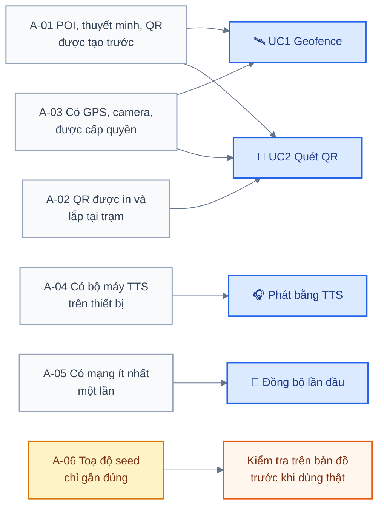

*Hình: Mỗi giả định và phần chức năng phụ thuộc vào nó*

- A-01 Điểm tham quan, thuyết minh và mã QR được quản trị viên tạo trước khi dùng thực tế (giả định của UC1/UC2).
- A-02 Mã QR do cơ quan quản lý in và lắp đặt tại trạm xe buýt; việc lắp đặt vật lý nằm ngoài phạm vi phần mềm.
- A-03 Thiết bị có GPS và camera; người dùng cấp quyền.
- A-04 Thiết bị có bộ máy TTS; giọng đọc sẵn có cho từng ngôn ngữ phụ thuộc vào hệ điều hành.
- A-05 Thiết bị có kết nối mạng ít nhất một lần để thực hiện đồng bộ lần đầu.
- A-06 Toạ độ các điểm tham quan mẫu trong dữ liệu seed chỉ là gần đúng và phải được kiểm tra trên bản đồ trước khi dùng thực tế.

---

## 3. Yêu cầu cụ thể

Độ ưu tiên (priority): **M** = bắt buộc (must), **S** = nên có (should), **C** = có thể có (could). Tất cả yêu cầu đã được cài đặt trong mã nguồn tính đến 18/10/2026; trạng thái kiểm chứng được ghi theo từng ca kiểm thử trong `03-test-plan.md` (hành vi của ứng dụng di động trên thiết bị thật chưa được kiểm chứng).

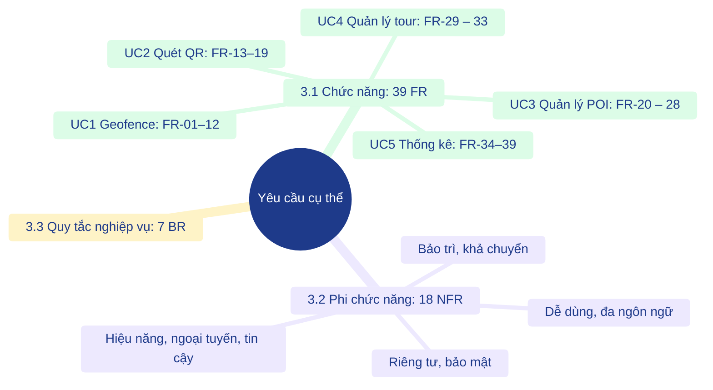

*Hình: Cấu trúc mục 3: yêu cầu chức năng theo ca sử dụng, phi chức năng theo nhóm và quy tắc nghiệp vụ*

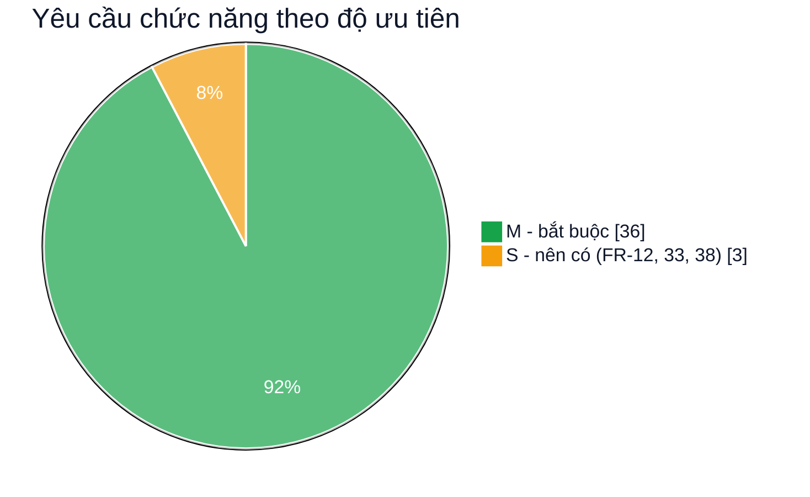

*Hình: Độ ưu tiên của 39 yêu cầu chức năng; không có yêu cầu mức C*


### 3.1 Yêu cầu chức năng

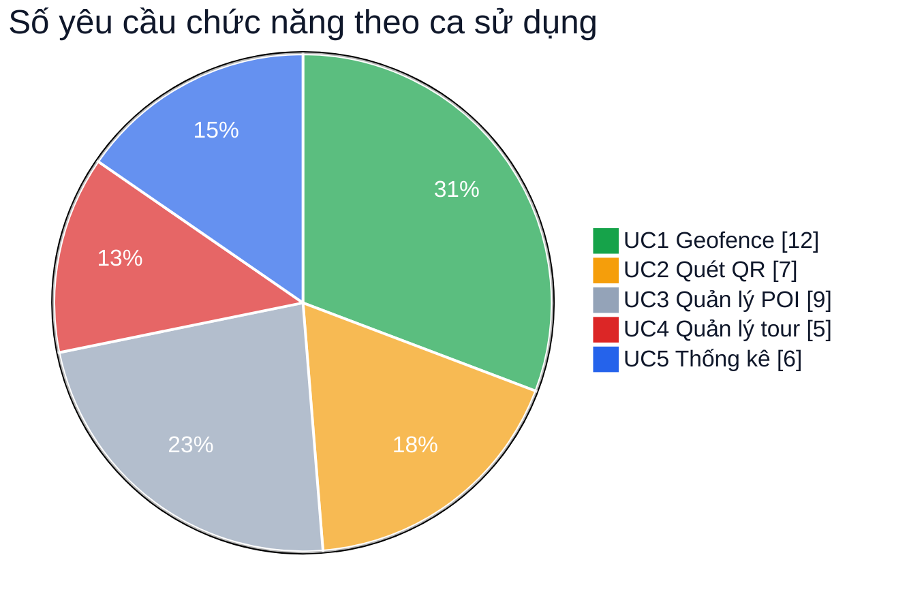

*Hình: Phân bố 39 yêu cầu chức năng FR-01 đến FR-39 theo năm ca sử dụng*


#### UC1: Kích hoạt thuyết minh tự động qua geofence

```mermaid
%%{init: {"theme":"base","fontFamily":"Helvetica Neue, Arial, sans-serif","themeVariables":{"fontFamily":"Helvetica Neue, Arial, sans-serif","fontSize":"15px","primaryColor":"#EFF6FF","primaryBorderColor":"#3B82F6","primaryTextColor":"#0F172A","lineColor":"#64748B","secondaryColor":"#F0FDF4","tertiaryColor":"#FFFFFF","clusterBkg":"#F8FAFC","clusterBorder":"#CBD5E1","edgeLabelBackground":"#FFFFFF","noteBkgColor":"#FEF9C3","noteBorderColor":"#EAB308","actorBkg":"#DBEAFE","actorBorder":"#2563EB","actorTextColor":"#1E3A8A","signalColor":"#475569","signalTextColor":"#0F172A","labelBoxBkgColor":"#F1F5F9","labelBoxBorderColor":"#94A3B8","activationBkgColor":"#E0F2FE","activationBorderColor":"#0284C7","sequenceNumberColor":"#FFFFFF","pie1":"#16A34A","pie2":"#F59E0B","pie3":"#94A3B8","pie4":"#DC2626","pie5":"#2563EB","pie6":"#7C3AED","pieStrokeColor":"#FFFFFF","pieSectionTextColor":"#FFFFFF","quadrant1Fill":"#FEE2E2","quadrant2Fill":"#FEF3C7","quadrant3Fill":"#DCFCE7","quadrant4Fill":"#FEF3C7","quadrantPointFill":"#1E3A8A","quadrantPointTextFill":"#0F172A","git0":"#1E3A8A","gitBranchLabel0":"#FFFFFF","cScale0":"#DBEAFE","cScale1":"#DCFCE7","cScale2":"#EDE9FE","cScale3":"#FEF3C7","cScale4":"#FFE4E6","cScale5":"#E0F2FE","cScale6":"#F1F5F9"},"flowchart":{"curve":"basis","padding":16,"nodeSpacing":40,"rankSpacing":50},"sequence":{"showSequenceNumbers":true,"mirrorActors":false}}}%%
flowchart LR
    EV(["Khởi động, mỗi 5 phút,<br/>về foreground, có mạng lại"]):::startend --> V["⚙️ GET /sync/version"]:::backend
    V --> CMP{"Khác phiên bản cục bộ<br/>hoặc chưa có dữ liệu?"}:::decision
    CMP -- "Không" --> KEEP["Giữ dữ liệu hiện có"]:::neutral
    CMP -- "Có" --> SNAP["⚙️ GET /sync<br/>bản chụp đầy đủ"]:::backend
    SNAP -- "Lỗi" --> KEEP
    SNAP -- "Thành công" --> DB[("🗄️ SQLite cục bộ<br/>POI, bản dịch, QR, tour")]:::data
    classDef backend fill:#DCFCE7,stroke:#16A34A,stroke-width:2px,color:#14532D
    classDef data fill:#F1F5F9,stroke:#475569,stroke-width:2px,color:#0F172A
    classDef decision fill:#FFF7ED,stroke:#EA580C,stroke-width:2px,color:#7C2D12
    classDef neutral fill:#F8FAFC,stroke:#94A3B8,stroke-width:1.5px,color:#334155
    classDef startend fill:#1E3A8A,stroke:#1E3A8A,stroke-width:2px,color:#FFFFFF
```

*Hình: Đồng bộ nội dung xuống thiết bị (FR-02, FR-03)*

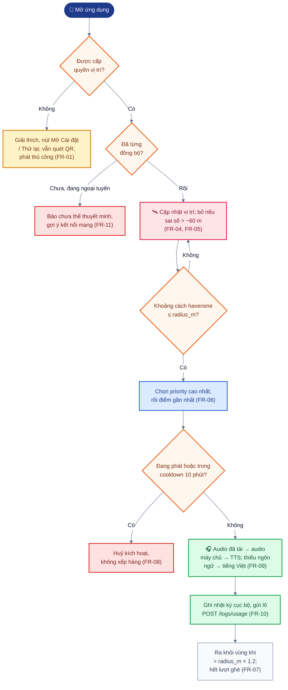

*Hình: Luồng kích hoạt thuyết minh qua geofence và các nhánh ngoại lệ của UC1 (FR-01 đến FR-11)*


| ID | Yêu cầu | Độ ưu tiên |
|---|---|---|
| FR-01 | Ứng dụng phải xin quyền vị trí. Nếu bị từ chối, ứng dụng phải giải thích rằng cần vị trí để thuyết minh tự động, cung cấp nút "Mở Cài đặt" và "Thử lại", đồng thời vẫn cho phép quét QR và phát thủ công (UC1 E1). | M |
| FR-02 | Ứng dụng phải tải toàn bộ bản chụp nội dung (điểm tham quan kèm toạ độ, bán kính, độ ưu tiên, bản dịch, URL audio; mã QR; tour) và lưu vào cơ sở dữ liệu SQLite cục bộ. | M |
| FR-03 | Ứng dụng phải gọi `GET /sync/version` khi khởi động, mỗi 5 phút, khi quay lại foreground và khi có kết nối trở lại; chỉ tải lại bản chụp khi phiên bản trên máy chủ khác phiên bản cục bộ (hoặc chưa có dữ liệu cục bộ). Đồng bộ thất bại thì giữ nguyên dữ liệu cũ. | M |
| FR-04 | Ứng dụng phải theo dõi vị trí khi chạy foreground, và chạy nền khi người dùng bật tính năng này và cấp quyền "Luôn luôn" trên bản development build hoặc bản phát hành trên store. | M |
| FR-05 | Bộ máy geofence (geofence engine) phải tính khoảng cách haversine từ vị trí hiện tại tới từng điểm tham quan và coi là đã vào điểm khi khoảng cách ≤ `radius_m`. Các vị trí có độ chính xác báo về kém hơn khoảng 60 m bị bỏ qua. | M |
| FR-06 | Trong các điểm tham quan mà người dùng đang ở bên trong, bộ máy phải chọn điểm có `priority` cao nhất, sau đó là điểm gần nhất, và kích hoạt nhiều nhất một lần mỗi lượt ghé (một lượt ghé kết thúc khi người dùng ra khỏi vùng). | M |
| FR-07 | Một điểm tham quan chỉ được coi là đã ra khỏi khi khoảng cách > `radius_m × 1.2` (trễ, hysteresis), để dao động GPS tại biên không tạo ra nhiều lần đi vào lặp lại. | M |
| FR-08 | Với kích hoạt từ geofence, bộ máy thuyết minh (narration engine) phải huỷ bỏ (không xếp hàng) lần kích hoạt khi đang phát một thuyết minh khác, hoặc khi cùng điểm tham quan đó vừa bắt đầu phát trong khoảng thời gian chờ phát lại (mặc định 10 phút, cấu hình được) (UC1 A1). Phát thủ công và phát qua QR bỏ qua thời gian chờ phát lại và dừng thuyết minh đang phát. | M |
| FR-09 | Bộ máy thuyết minh phải phát theo thứ tự ưu tiên: file audio đã tải của ngôn ngữ được chọn, file audio trên máy chủ khi có mạng, hoặc `narration_text` đọc bằng TTS trên thiết bị. Nếu ngôn ngữ được chọn không có nội dung thì chuyển sang tiếng Việt và báo cho người dùng. Nếu phát audio lỗi thì chuyển sang TTS. | M |
| FR-10 | Mỗi lần phát phải được ghi cục bộ (điểm tham quan, thời gian, cách kích hoạt, ngôn ngữ, số giây đã nghe) và gửi theo lô lên `POST /logs/usage` khi có mạng. Bản ghi của các điểm tham quan đã bị xoá trong thời gian đó sẽ được máy chủ bỏ qua. | M |
| FR-11 | Nếu chưa từng đồng bộ nội dung và thiết bị đang ngoại tuyến, ứng dụng phải thông báo rằng chưa thể thuyết minh tự động và gợi ý kết nối mạng để đồng bộ (UC1 E2). | M |
| FR-12 | Ứng dụng phải có chế độ mô phỏng vị trí (simulation mode): chạm vào bản đồ để đặt vị trí giả, hoặc ứng dụng tự đi bộ theo một tour với tốc độ điều chỉnh được, để trình diễn UC1 mà không cần đi bộ tới các điểm tham quan. | S |

#### UC2: Kích hoạt nội dung qua quét mã QR

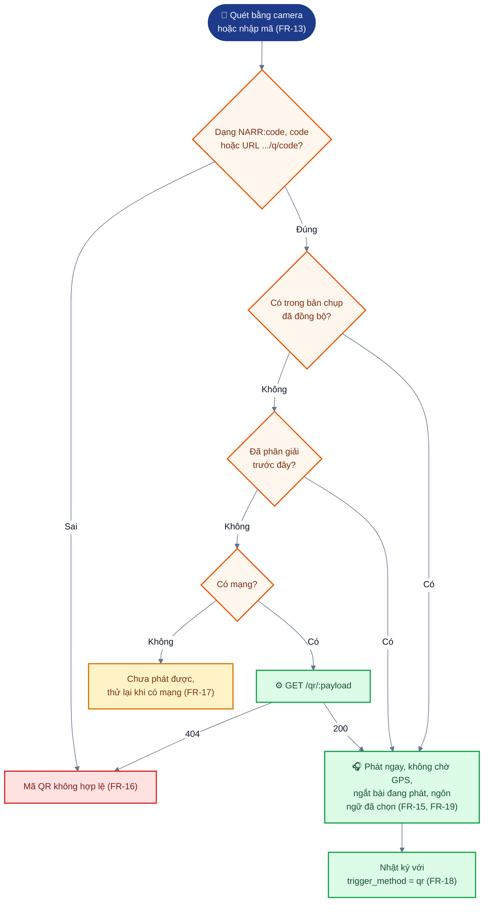

*Hình: Thứ tự phân giải mã QR: bản chụp ngoại tuyến, bộ nhớ đệm, rồi máy chủ (FR-13 đến FR-18)*


| ID | Yêu cầu | Độ ưu tiên |
|---|---|---|
| FR-13 | Ứng dụng phải có trình quét QR dùng camera, sau khi xin quyền camera, kèm ô nhập mã thủ công cho thiết bị không dùng được camera. | M |
| FR-14 | Hệ thống phải chấp nhận nội dung QR ở các dạng `NARR:<code>`, `<code>`, hoặc URL kết thúc bằng `/q/<code>`, và phân giải thành một điểm tham quan: trước tiên từ các mã QR trong bản chụp đã đồng bộ (ngoại tuyến), sau đó từ các mã đã phân giải trước đây, cuối cùng là trực tuyến qua `GET /qr/:payload`. | M |
| FR-15 | Với mã hợp lệ, ứng dụng phải phát ngay thuyết minh của điểm tham quan mà không chờ GPS, ngắt thuyết minh đang phát (nếu có), bằng ngôn ngữ được chọn (UC2 A1), theo cùng quy tắc audio/TTS/dự phòng như FR-09. | M |
| FR-16 | Mã không xác định hoặc sai định dạng phải hiển thị thông báo "Mã QR không hợp lệ" (UC2 E1). | M |
| FR-17 | Nếu mã chưa được lưu trên thiết bị và không kết nối được máy chủ, ứng dụng phải báo rằng hiện chưa phát được nội dung và gợi ý thử lại khi có mạng (UC2 E2). | M |
| FR-18 | Các lần phát kích hoạt bằng QR phải được ghi nhật ký với `trigger_method = qr`. | M |
| FR-19 | Người dùng phải chọn được ngôn ngữ thuyết minh trong số các ngôn ngữ được hỗ trợ tại màn hình Cài đặt (ban đầu là ngôn ngữ của thiết bị nếu được hỗ trợ, ngược lại là tiếng Việt); lựa chọn được lưu trên thiết bị. | M |

#### UC3: Quản lý điểm tham quan và nội dung thuyết minh

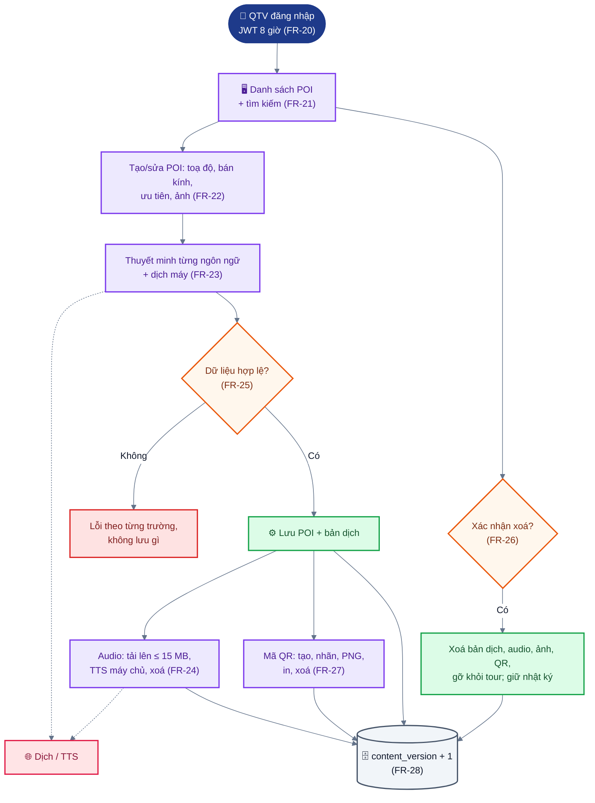

*Hình: Luồng quản lý điểm tham quan và nội dung thuyết minh trên CMS (FR-20 đến FR-28)*


| ID | Yêu cầu | Độ ưu tiên |
|---|---|---|
| FR-20 | Quản trị viên đăng nhập bằng tên đăng nhập và mật khẩu; backend cấp JWT (thời hạn mặc định 8 giờ). Mọi endpoint `/admin` đều yêu cầu token hợp lệ. Số lần đăng nhập bị giới hạn 20 lần mỗi 15 phút trên mỗi IP. Quản trị viên đổi được mật khẩu (≥ 8 ký tự). | M |
| FR-21 | CMS phải liệt kê điểm tham quan kèm tên, địa chỉ, bán kính, độ ưu tiên, các ngôn ngữ có sẵn, các ngôn ngữ có audio và số mã QR, có tìm kiếm văn bản theo tên hoặc địa chỉ. | M |
| FR-22 | Quản trị viên tạo và sửa được điểm tham quan: tên, địa chỉ, toạ độ (chọn trên bản đồ hoặc nhập tay), bán kính kích hoạt, độ ưu tiên, ảnh (tuỳ chọn). | M |
| FR-23 | Quản trị viên nhập tiêu đề và nội dung thuyết minh cho từng ngôn ngữ được hỗ trợ, và có thể yêu cầu dịch máy từ ngôn ngữ mặc định sang ngôn ngữ khác. | M |
| FR-24 | Quản trị viên tải lên file audio cho từng ngôn ngữ (mp3, m4a, aac, wav, ogg, webm; ≤ 15 MB), tạo audio từ văn bản đã lưu bằng TTS phía máy chủ, hoặc xoá audio. | M |
| FR-25 | Hệ thống phải kiểm tra dữ liệu nhập của điểm tham quan: bắt buộc có tên; vĩ độ trong [−90, 90]; kinh độ trong [−180, 180]; 0 < bán kính ≤ 5000 m; độ ưu tiên là số nguyên 0–100; ngôn ngữ được hỗ trợ và không trùng lặp; bắt buộc có nội dung thuyết minh tiếng Việt. Lỗi được báo theo từng trường và không lưu gì (UC3 E1). | M |
| FR-26 | Xoá điểm tham quan phải được xác nhận trên CMS và phải xoá các bản dịch, file audio và ảnh, mã QR và tư cách thành viên của điểm đó trong các tour; nhật ký sử dụng (usage log) cũ được giữ lại nhưng không còn tham chiếu tới điểm tham quan (UC3 A1). | M |
| FR-27 | Quản trị viên tạo, đặt nhãn, liệt kê, tải về (PNG), in và xoá được mã QR liên kết với một điểm tham quan. Mỗi mã mang một payload ngẫu nhiên, không đoán được (UC3 A2). | M |
| FR-28 | Mọi thay đổi đối với điểm tham quan, bản dịch, audio, mã QR hoặc tour phải làm tăng phiên bản nội dung để thiết bị nhận được thay đổi ở lần đồng bộ kế tiếp (UC3 bước 9). | M |

#### UC4: Quản lý tour

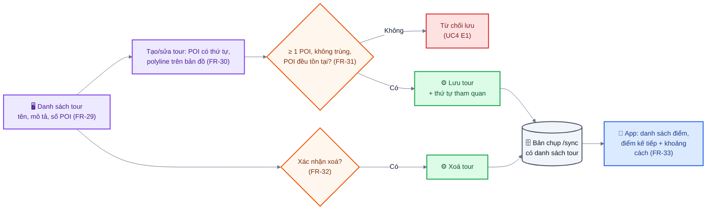

*Hình: Luồng quản lý tour từ CMS tới ứng dụng (FR-29 đến FR-33)*


| ID | Yêu cầu | Độ ưu tiên |
|---|---|---|
| FR-29 | CMS phải liệt kê tour kèm tên, mô tả và số điểm tham quan. | M |
| FR-30 | Quản trị viên tạo và sửa được tour với tên, mô tả và danh sách có thứ tự các điểm tham quan đã có; CMS hiển thị lộ trình dạng đường nối (polyline) trên bản đồ. | M |
| FR-31 | Tour phải chứa ít nhất một điểm tham quan, không có điểm nào lặp lại và chỉ gồm các điểm đã tồn tại; nếu không thì từ chối lưu (UC4 E1). | M |
| FR-32 | Xoá tour phải được xác nhận (UC4 A1). | M |
| FR-33 | Tour phải được đưa vào bản chụp đồng bộ và hiển thị trong ứng dụng dưới dạng danh sách có thứ tự các điểm tham quan để người dùng đi theo (điểm kế tiếp và khoảng cách). | S |

#### UC5: Xem thống kê sử dụng

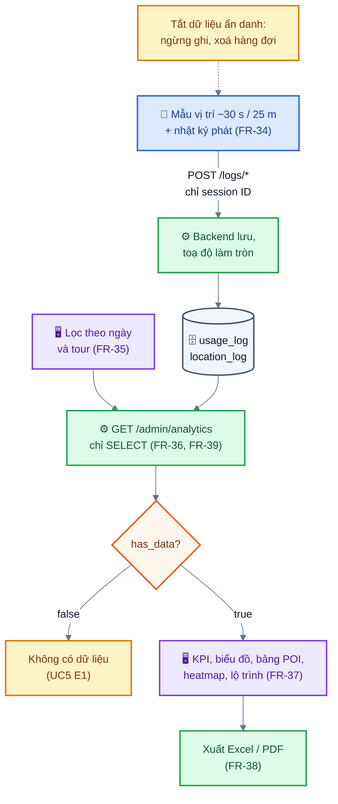

*Hình: Dòng dữ liệu thống kê: thu thập ẩn danh trên app, tính báo cáo ở backend, hiển thị và xuất trên CMS (FR-34 đến FR-39)*


| ID | Yêu cầu | Độ ưu tiên |
|---|---|---|
| FR-34 | Ứng dụng phải lấy mẫu vị trí thiết bị (khoảng mỗi 30 giây, hoặc sau khi di chuyển 25 m) và gửi theo lô lên `POST /logs/location` chỉ kèm session ID. Người dùng có thể tắt dữ liệu ẩn danh; khi đó ứng dụng ngừng ghi nhật ký và xoá hàng đợi. | M |
| FR-35 | Báo cáo phải lọc được theo khoảng ngày và theo tour. | M |
| FR-36 | Backend phải tính: tổng lượt phát, số phiên khác nhau, thời gian nghe trung bình và tổng; lượt phát và thời gian nghe trung bình theo từng điểm tham quan (có xếp hạng); lượt phát theo cách kích hoạt và theo ngôn ngữ; lượt phát theo ngày và theo giờ; bản đồ nhiệt (heatmap) vị trí; tối đa 30 lộ trình di chuyển ẩn danh. | M |
| FR-37 | CMS phải hiển thị báo cáo dưới dạng các chỉ số KPI, biểu đồ (biểu đồ theo giờ dùng giờ Việt Nam), bảng theo từng điểm tham quan và bản đồ nhiệt, có thể kèm các lộ trình ẩn danh. Khi không có dữ liệu cho bộ lọc, CMS phải hiển thị "Không có dữ liệu" (UC5 E1). | M |
| FR-38 | Quản trị viên xuất được báo cáo ra Excel (workbook nhiều sheet) và ra PDF thông qua trang báo cáo tối ưu cho in và chức năng "Lưu thành PDF" của trình duyệt (UC5 A1). | S |
| FR-39 | Việc tạo báo cáo không được thay đổi dữ liệu đã lưu (hậu điều kiện của UC5). | M |

### 3.2 Yêu cầu phi chức năng

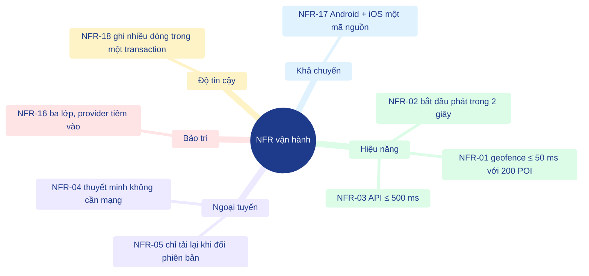

*Hình: Nhóm yêu cầu phi chức năng về vận hành: hiệu năng, ngoại tuyến, tin cậy, bảo trì, khả chuyển*

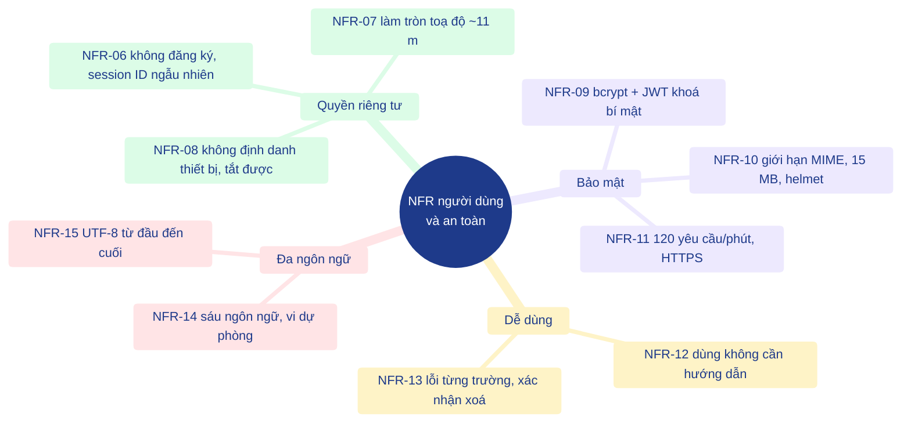

*Hình: Nhóm yêu cầu phi chức năng về người dùng và an toàn: riêng tư, bảo mật, dễ dùng, đa ngôn ngữ*


| ID | Nhóm | Yêu cầu |
|---|---|---|
| NFR-01 | Hiệu năng | Việc đánh giá geofence cho tối đa 200 điểm tham quan phải hoàn tất trong 50 ms cho mỗi lần cập nhật vị trí trên điện thoại tầm trung (quét tuyến tính là đủ với quy mô này). |
| NFR-02 | Hiệu năng | Thuyết minh phải bắt đầu trong vòng 2 giây kể từ khi đi vào vùng kích hoạt hoặc phân giải QR thành công, khi nội dung đã được lưu cục bộ. |
| NFR-03 | Hiệu năng | Phản hồi của backend API (không tính các lệnh gọi dịch/TTS bên ngoài) phải hoàn tất trong 500 ms với bộ dữ liệu seed trên một máy chủ nhỏ duy nhất. |
| NFR-04 | Ngoại tuyến | Sau một lần đồng bộ thành công, thuyết minh qua geofence (TTS hoặc audio đã tải) phải hoạt động khi không có mạng. Nhật ký được xếp hàng cục bộ và gửi lên sau. |
| NFR-05 | Ngoại tuyến | Đồng bộ chỉ truyền toàn bộ bản chụp khi phiên bản nội dung thay đổi. |
| NFR-06 | Quyền riêng tư | Khách du lịch không phải đăng ký hay đăng nhập. Định danh duy nhất được gửi đi là session ID ngẫu nhiên, sinh lại mỗi lần mở ứng dụng. |
| NFR-07 | Quyền riêng tư | Máy chủ phải làm tròn toạ độ vị trí đến 4 chữ số thập phân (khoảng 11 m) trước khi lưu; báo cáo gộp vị trí thành các ô có kích thước đó và không bao giờ trả về session ID. |
| NFR-08 | Quyền riêng tư | Ứng dụng không gửi định danh thiết bị, họ tên, số điện thoại hay ID quảng cáo, và phải cho phép người dùng tắt thu thập dữ liệu ẩn danh. |
| NFR-09 | Bảo mật | Mật khẩu quản trị được lưu dưới dạng băm bcrypt; JWT được ký bằng khoá bí mật phía máy chủ, bắt buộc phải đặt khi chạy production (máy chủ từ chối khởi động ở production nếu dùng khoá mặc định). |
| NFR-10 | Bảo mật | File tải lên bị giới hạn theo kiểu MIME và dung lượng (15 MB); tên file do máy chủ sinh ra. Thân yêu cầu giới hạn 1 MB. Áp dụng các header bảo mật tiêu chuẩn (helmet). |
| NFR-11 | Bảo mật | Các endpoint nhật ký công khai bị giới hạn tần suất (120 yêu cầu/phút/IP) và kiểm tra mọi trường; lưu lượng production dùng HTTPS qua reverse proxy. |
| NFR-12 | Tính dễ dùng | Ứng dụng dùng được mà không cần đọc hướng dẫn: thuyết minh tự phát; quét QR chỉ cách màn hình chính một lần chạm; cỡ chữ và các nút điều khiển tuân theo hướng dẫn của từng nền tảng. |
| NFR-13 | Tính dễ dùng | Biểu mẫu CMS hiển thị thông báo lỗi theo từng trường và yêu cầu xác nhận trước các thao tác phá huỷ dữ liệu. |
| NFR-14 | Đa ngôn ngữ (i18n) | Nội dung thuyết minh hỗ trợ sáu ngôn ngữ (`vi`, `en`, `zh`, `ko`, `ja`, `fr`), trong đó tiếng Việt là ngôn ngữ mặc định bắt buộc và là ngôn ngữ dự phòng. |
| NFR-15 | Đa ngôn ngữ (i18n) | Mọi văn bản được lưu và truyền dưới dạng UTF-8; dấu tiếng Việt và ký tự CJK được giữ nguyên từ đầu đến cuối. |
| NFR-16 | Khả năng bảo trì | Backend theo cấu trúc 3 lớp (lớp điều khiển (controller), lớp nghiệp vụ (service), lớp truy cập dữ liệu (repository)) với các provider dịch/TTS có thể tiêm vào, để kiểm thử chạy được mà không cần mạng. |
| NFR-17 | Tính khả chuyển | Ứng dụng di động nhắm tới Android và iOS từ cùng một mã nguồn Expo. |
| NFR-18 | Độ tin cậy | Các thao tác ghi nhiều dòng (điểm tham quan kèm bản dịch, tour kèm điểm tham quan, lô nhật ký) là nguyên tử (một transaction SQLite duy nhất). |

### 3.3 Quy tắc nghiệp vụ

```mermaid
%%{init: {"theme":"base","fontFamily":"Helvetica Neue, Arial, sans-serif","themeVariables":{"fontFamily":"Helvetica Neue, Arial, sans-serif","fontSize":"15px","primaryColor":"#EFF6FF","primaryBorderColor":"#3B82F6","primaryTextColor":"#0F172A","lineColor":"#64748B","secondaryColor":"#F0FDF4","tertiaryColor":"#FFFFFF","clusterBkg":"#F8FAFC","clusterBorder":"#CBD5E1","edgeLabelBackground":"#FFFFFF","noteBkgColor":"#FEF9C3","noteBorderColor":"#EAB308","actorBkg":"#DBEAFE","actorBorder":"#2563EB","actorTextColor":"#1E3A8A","signalColor":"#475569","signalTextColor":"#0F172A","labelBoxBkgColor":"#F1F5F9","labelBoxBorderColor":"#94A3B8","activationBkgColor":"#E0F2FE","activationBorderColor":"#0284C7","sequenceNumberColor":"#FFFFFF","pie1":"#16A34A","pie2":"#F59E0B","pie3":"#94A3B8","pie4":"#DC2626","pie5":"#2563EB","pie6":"#7C3AED","pieStrokeColor":"#FFFFFF","pieSectionTextColor":"#FFFFFF","quadrant1Fill":"#FEE2E2","quadrant2Fill":"#FEF3C7","quadrant3Fill":"#DCFCE7","quadrant4Fill":"#FEF3C7","quadrantPointFill":"#1E3A8A","quadrantPointTextFill":"#0F172A","git0":"#1E3A8A","gitBranchLabel0":"#FFFFFF","cScale0":"#DBEAFE","cScale1":"#DCFCE7","cScale2":"#EDE9FE","cScale3":"#FEF3C7","cScale4":"#FFE4E6","cScale5":"#E0F2FE","cScale6":"#F1F5F9"},"flowchart":{"curve":"basis","padding":16,"nodeSpacing":40,"rankSpacing":50},"sequence":{"showSequenceNumbers":true,"mirrorActors":false}}}%%
flowchart LR
    B1["BR-01 Chống phát lặp<br/>trong cooldown"]:::warn
    B7["BR-07 Thiếu ngôn ngữ<br/>→ phát tiếng Việt"]:::warn
    B6["BR-06 Một QR → đúng<br/>một POI; một POI<br/>→ nhiều QR"]:::warn
    B2["BR-02 POI: toạ độ hợp lệ,<br/>bán kính > 0, có<br/>thuyết minh mặc định"]:::warn
    B5["BR-05 Xác nhận trước<br/>khi xoá"]:::warn
    B3["BR-03 Tour có<br/>≥ 1 POI"]:::warn
    B4["BR-04 Vị trí, lộ trình<br/>ẩn danh"]:::warn
    U1(["UC1 Geofence"]):::mobile
    U2(["UC2 Quét QR"]):::mobile
    U3(["UC3 Quản lý POI"]):::cms
    U4(["UC4 Quản lý tour"]):::cms
    U5(["UC5 Thống kê"]):::cms
    B1 --> U1
    B7 --> U1
    B7 --> U2
    B6 --> U2
    B6 --> U3
    B2 --> U3
    B5 --> U3
    B5 --> U4
    B3 --> U4
    B4 --> U5
    classDef cms fill:#EDE9FE,stroke:#7C3AED,stroke-width:2px,color:#4C1D95
    classDef mobile fill:#DBEAFE,stroke:#2563EB,stroke-width:2px,color:#1E3A8A
    classDef warn fill:#FEF3C7,stroke:#D97706,stroke-width:2px,color:#78350F
```

*Hình: Bảy quy tắc nghiệp vụ và ca sử dụng chịu ràng buộc của từng quy tắc*


| ID | Quy tắc (business rule) | Nguồn |
|---|---|---|
| BR-01 | Không được phát lại cùng một điểm tham quan nhiều lần trong thời gian ngắn; lần kích hoạt xảy ra khi đang phát hoặc trong thời gian chờ phát lại sẽ bị huỷ bỏ. | Quy tắc nghiệp vụ của UC1, A1 |
| BR-02 | Mọi điểm tham quan phải có toạ độ hợp lệ, bán kính kích hoạt lớn hơn 0 và có thuyết minh bằng ngôn ngữ mặc định. | Quy tắc nghiệp vụ của UC3 |
| BR-03 | Tour phải chứa ít nhất một điểm tham quan. | UC4 E1 |
| BR-04 | Dữ liệu vị trí và lộ trình phải được lưu và xử lý ẩn danh, không định danh cá nhân. | Quy tắc nghiệp vụ của UC5 |
| BR-05 | Các thao tác phá huỷ dữ liệu (xoá điểm tham quan, xoá tour) phải được xác nhận. | UC3 A1, UC4 A1 |
| BR-06 | Mỗi mã QR liên kết với đúng một điểm tham quan; một điểm tham quan có thể có nhiều mã QR (mỗi trạm xe buýt một mã). | UC2, UC3 A2 |
| BR-07 | Khi ngôn ngữ được chọn không có thuyết minh thì phát tiếng Việt. | Quyết định thiết kế hỗ trợ UC1/UC2 A1 |

---

## 4. Ma trận truy vết yêu cầu

Đường dẫn cài đặt tính từ thư mục gốc của repository. Đường dẫn phía client tính từ `mobile/src/` và `cms/src/`. Mã kiểm thử tham chiếu tới `03-test-plan.md` (TC = ca kiểm thử (test case), tự động hoặc thủ công; FT = kiểm thử thực địa (field test)).

```mermaid
%%{init: {"theme":"base","fontFamily":"Helvetica Neue, Arial, sans-serif","themeVariables":{"fontFamily":"Helvetica Neue, Arial, sans-serif","fontSize":"15px","primaryColor":"#EFF6FF","primaryBorderColor":"#3B82F6","primaryTextColor":"#0F172A","lineColor":"#64748B","secondaryColor":"#F0FDF4","tertiaryColor":"#FFFFFF","clusterBkg":"#F8FAFC","clusterBorder":"#CBD5E1","edgeLabelBackground":"#FFFFFF","noteBkgColor":"#FEF9C3","noteBorderColor":"#EAB308","actorBkg":"#DBEAFE","actorBorder":"#2563EB","actorTextColor":"#1E3A8A","signalColor":"#475569","signalTextColor":"#0F172A","labelBoxBkgColor":"#F1F5F9","labelBoxBorderColor":"#94A3B8","activationBkgColor":"#E0F2FE","activationBorderColor":"#0284C7","sequenceNumberColor":"#FFFFFF","pie1":"#16A34A","pie2":"#F59E0B","pie3":"#94A3B8","pie4":"#DC2626","pie5":"#2563EB","pie6":"#7C3AED","pieStrokeColor":"#FFFFFF","pieSectionTextColor":"#FFFFFF","quadrant1Fill":"#FEE2E2","quadrant2Fill":"#FEF3C7","quadrant3Fill":"#DCFCE7","quadrant4Fill":"#FEF3C7","quadrantPointFill":"#1E3A8A","quadrantPointTextFill":"#0F172A","git0":"#1E3A8A","gitBranchLabel0":"#FFFFFF","cScale0":"#DBEAFE","cScale1":"#DCFCE7","cScale2":"#EDE9FE","cScale3":"#FEF3C7","cScale4":"#FFE4E6","cScale5":"#E0F2FE","cScale6":"#F1F5F9"},"flowchart":{"curve":"basis","padding":16,"nodeSpacing":40,"rankSpacing":50},"sequence":{"showSequenceNumbers":true,"mirrorActors":false}}}%%
flowchart TB
    U1["UC1 Geofence<br/>FR-01–12"]:::mobile
    U2["UC2 Quét QR<br/>FR-13–19"]:::mobile
    U3["UC3 Quản lý POI<br/>FR-20–28"]:::cms
    U4["UC4 Quản lý tour<br/>FR-29–33"]:::cms
    U5["UC5 Thống kê<br/>FR-34–39"]:::cms
    M["📱 mobile/src"]:::mobile
    B["⚙️ backend/src"]:::backend
    C["🖥️ cms/src"]:::cms
    T["✅ 03-test-plan<br/>TC-01 – TC-90<br/>FT-01 – FT-08"]:::ok
    U1 --> M
    U1 -. "FR-02, 03, 10" .-> B
    U2 --> M
    U2 -. "FR-14, 16, 18" .-> B
    U3 --> B
    U3 --> C
    U4 --> B
    U4 --> C
    U4 -. "FR-33" .-> M
    U5 --> B
    U5 --> C
    U5 -. "FR-34" .-> M
    M --> T
    B --> T
    C --> T
    classDef backend fill:#DCFCE7,stroke:#16A34A,stroke-width:2px,color:#14532D
    classDef cms fill:#EDE9FE,stroke:#7C3AED,stroke-width:2px,color:#4C1D95
    classDef mobile fill:#DBEAFE,stroke:#2563EB,stroke-width:2px,color:#1E3A8A
    classDef ok fill:#DCFCE7,stroke:#16A34A,stroke-width:2px,color:#14532D
```

*Hình: Truy vết ca sử dụng → nhóm FR → mã nguồn từng thành phần → ca kiểm thử (nét đứt: chỉ một số FR của nhóm)*


| FR | UC | Module cài đặt | Ca kiểm thử |
|---|---|---|---|
| FR-01 | UC1 E1 | Mobile: `services/bootstrap.ts`, `services/location/`, `app/(tabs)/index.tsx` | TC-44, FT-01 |
| FR-02 | UC1 | Backend: `syncService.snapshot`, `GET /sync`; Mobile: `data/sync.ts`, `data/db.ts` | TC-29, TC-45, TC-46 |
| FR-03 | UC1 | Backend: `syncService.version`, `metaRepository`; Mobile: `data/syncLogic.ts` (`planSync`), `services/bootstrap.ts` | TC-09, TC-45, TC-47 |
| FR-04 | UC1 | Mobile: `services/location/index.ts`, `backgroundTask.ts`, `mobile/index.js` | TC-48, FT-03 |
| FR-05 | UC1 | Mobile: `engine/geofence.ts`, `engine/geo.ts` | TC-49, TC-50, FT-02 |
| FR-06 | UC1 | Mobile: `engine/geofence.ts` (`pickBest`) | TC-51, FT-08 |
| FR-07 | UC1 | Mobile: `engine/geofence.ts` | TC-52, FT-04 |
| FR-08 | UC1 A1 | Mobile: `engine/cooldown.ts`, `engine/narration.ts` | TC-53, TC-54, TC-57, FT-05 |
| FR-09 | UC1 | Mobile: `engine/narration.ts`, `engine/language.ts`, `services/audioOutput.ts`, `data/audioCache.ts` | TC-55, TC-56 |
| FR-10 | UC1 | Backend: `logService.recordUsage`; Mobile: `services/analytics.ts` | TC-31, TC-32, TC-43, TC-58, TC-59 |
| FR-11 | UC1 E2 | Mobile: `app/(tabs)/index.tsx`, `data/sync.ts` | TC-60 |
| FR-12 | UC1 | Mobile: `services/simulation.ts`, `services/pipeline.ts` | TC-61, TC-62 |
| FR-13 | UC2 | Mobile: `app/(tabs)/scan.tsx` (expo-camera) | TC-65 |
| FR-14 | UC2 | Backend: `qrService.extractPayload/resolve`, `syncService` (`qrcodes`); Mobile: `engine/qr.ts`, `services/qrResolver.ts` | TC-21, TC-23, TC-29, TC-63, TC-64, TC-68 |
| FR-15 | UC2, A1 | Mobile: `services/qrResolver.ts`, `engine/narration.ts` | TC-57, TC-66, FT-06 |
| FR-16 | UC2 E1 | Backend: `qrService.resolve` (404); Mobile: `engine/qr.ts`, `scan.tsx` | TC-22, TC-63, TC-64, TC-67 |
| FR-17 | UC2 E2 | Mobile: `services/qrResolver.ts`, `scan.tsx` | TC-68 |
| FR-18 | UC2 | Backend: `logService.recordUsage`; Mobile: `services/analytics.ts` | TC-31, TC-66 |
| FR-19 | UC2 A1 | Mobile: `app/(tabs)/settings.tsx`, `data/settings.ts`, `i18n/` | TC-69 |
| FR-20 | UC3–UC5 | Backend: `authService`, `middleware/auth.js`; CMS: `auth/AuthContext.tsx`, `lib/api.ts`, `pages/LoginPage.tsx`, `pages/AccountPage.tsx` | TC-01 đến TC-06, TC-72, TC-73, TC-90 |
| FR-21 | UC3 | Backend: `poiService.list`; CMS: `pages/PoiListPage.tsx` | TC-07, TC-08, TC-74 |
| FR-22 | UC3 | Backend: `poiService.create/update`, `POST /admin/images`; CMS: `pages/PoiEditPage.tsx`, `components/maps.tsx` | TC-09, TC-14, TC-74, TC-78 |
| FR-23 | UC3 | Backend: `translateService`, `POST /admin/translate`; CMS: các tab ngôn ngữ trong `PoiEditPage` | TC-20, TC-40, TC-41, TC-76 |
| FR-24 | UC3 | Backend: `poiService.attachAudio/removeAudio`, `ttsService`, `middleware/upload.js`; CMS: khung audio trong `PoiEditPage` | TC-17, TC-18, TC-19, TC-39, TC-77 |
| FR-25 | UC3 E1 | Backend: `validatePoiInput`; CMS: `lib/validation.ts` | TC-10 đến TC-13, TC-16, TC-42, TC-75 |
| FR-26 | UC3 A1 | Backend: `poiService.delete`, xoá dây chuyền theo khoá ngoại (FK cascade); CMS: `components/ConfirmDialog.tsx` | TC-15, TC-30, TC-79 |
| FR-27 | UC3 A2 | Backend: `qrService.create/delete/listAll`; CMS: mục QR trong `PoiEditPage`, `pages/QrPage.tsx`, `components/QrImage.tsx` | TC-21, TC-24, TC-81, TC-82 |
| FR-28 | UC3 | Backend: `metaRepository.bumpContentVersion` (các service POI, tour, QR) | TC-09 |
| FR-29 | UC4 | Backend: `tourService.list`; CMS: `pages/TourListPage.tsx` | TC-25, TC-83 |
| FR-30 | UC4 | Backend: `tourService.create/update`, `tourRepository.setPois`; CMS: `pages/TourEditPage.tsx` | TC-25, TC-28, TC-83 |
| FR-31 | UC4 E1 | Backend: `tourService.validate`; CMS: `lib/validation.ts` | TC-26, TC-27, TC-84 |
| FR-32 | UC4 A1 | Backend: `tourService.delete`; CMS: `ConfirmDialog` | TC-28, TC-85 |
| FR-33 | UC4 | Backend: `syncService.snapshot` (tour); Mobile: `app/(tabs)/tours.tsx`, `app/tour/[id].tsx` | TC-29, TC-70 |
| FR-34 | UC5 | Backend: `logService.recordLocations`; Mobile: `services/analytics.ts`, `analyticsPolicy.ts` | TC-33, TC-58, TC-59 |
| FR-35 | UC5 | Backend: `analyticsService.parseFilters`; CMS: `pages/AnalyticsPage.tsx` | TC-35, TC-37, TC-86 |
| FR-36 | UC5 | Backend: `analyticsService.report`, `analyticsRepository` | TC-34, TC-35, TC-38 |
| FR-37 | UC5, E1 | Backend: `has_data`; CMS: `AnalyticsPage`, `components/charts.tsx`, `components/maps.tsx` | TC-36, TC-86, TC-87 |
| FR-38 | UC5 A1 | CMS: `lib/exportExcel.ts`, `pages/AnalyticsReportPage.tsx` | TC-88, TC-89 |
| FR-39 | UC5 | Backend: phần thống kê chỉ dùng SELECT | TC-34 (rà soát mã) |

Các yêu cầu phi chức năng được kiểm chứng như sau: NFR-07 bằng TC-33 và TC-34; NFR-09 bằng TC-01 đến TC-05; NFR-10 bằng TC-18; NFR-14 bằng TC-12 và TC-13; NFR-18 bằng rà soát mã việc dùng `transaction()` cùng TC-31 và TC-32; NFR-01, NFR-02, NFR-04 bằng FT-02 đến FT-08; NFR-12 bằng TC-62 đến TC-70 (trên thiết bị, chưa thực hiện); NFR-13 bằng TC-75, TC-79 và TC-80; NFR-03 bằng đo đạc trong kiểm thử tích hợp (chưa ghi nhận kết quả).

```mermaid
%%{init: {"theme":"base","fontFamily":"Helvetica Neue, Arial, sans-serif","themeVariables":{"fontFamily":"Helvetica Neue, Arial, sans-serif","fontSize":"15px","primaryColor":"#EFF6FF","primaryBorderColor":"#3B82F6","primaryTextColor":"#0F172A","lineColor":"#64748B","secondaryColor":"#F0FDF4","tertiaryColor":"#FFFFFF","clusterBkg":"#F8FAFC","clusterBorder":"#CBD5E1","edgeLabelBackground":"#FFFFFF","noteBkgColor":"#FEF9C3","noteBorderColor":"#EAB308","actorBkg":"#DBEAFE","actorBorder":"#2563EB","actorTextColor":"#1E3A8A","signalColor":"#475569","signalTextColor":"#0F172A","labelBoxBkgColor":"#F1F5F9","labelBoxBorderColor":"#94A3B8","activationBkgColor":"#E0F2FE","activationBorderColor":"#0284C7","sequenceNumberColor":"#FFFFFF","pie1":"#16A34A","pie2":"#F59E0B","pie3":"#94A3B8","pie4":"#DC2626","pie5":"#2563EB","pie6":"#7C3AED","pieStrokeColor":"#FFFFFF","pieSectionTextColor":"#FFFFFF","quadrant1Fill":"#FEE2E2","quadrant2Fill":"#FEF3C7","quadrant3Fill":"#DCFCE7","quadrant4Fill":"#FEF3C7","quadrantPointFill":"#1E3A8A","quadrantPointTextFill":"#0F172A","git0":"#1E3A8A","gitBranchLabel0":"#FFFFFF","cScale0":"#DBEAFE","cScale1":"#DCFCE7","cScale2":"#EDE9FE","cScale3":"#FEF3C7","cScale4":"#FFE4E6","cScale5":"#E0F2FE","cScale6":"#F1F5F9"},"flowchart":{"curve":"basis","padding":16,"nodeSpacing":40,"rankSpacing":50},"sequence":{"showSequenceNumbers":true,"mirrorActors":false}}}%%
flowchart LR
    N1["NFR-07, 09, 10,<br/>13, 14"]:::neutral --> TC["✅ Ca kiểm thử TC<br/>tự động / thủ công"]:::ok
    N2["NFR-18<br/>độ tin cậy"]:::neutral --> CR["✅ Rà soát mã transaction()<br/>+ TC-31, TC-32"]:::ok
    N3["NFR-01, 02, 04"]:::neutral --> FT["Kiểm thử thực địa<br/>FT-02–08"]:::warn
    N4["NFR-12<br/>dễ dùng"]:::neutral --> DEV["TC-62–70 trên thiết bị<br/>chưa thực hiện"]:::warn
    N5["NFR-03<br/>hiệu năng API"]:::neutral --> MEAS["Đo trong kiểm thử tích hợp<br/>chưa ghi nhận kết quả"]:::warn
    classDef neutral fill:#F8FAFC,stroke:#94A3B8,stroke-width:1.5px,color:#334155
    classDef ok fill:#DCFCE7,stroke:#16A34A,stroke-width:2px,color:#14532D
    classDef warn fill:#FEF3C7,stroke:#D97706,stroke-width:2px,color:#78350F
```

*Hình: Cách kiểm chứng các yêu cầu phi chức năng được nêu trong đoạn trên*

