# Tài liệu mô tả thiết kế phần mềm

**Dự án:** Hệ thống thuyết minh tự động đa ngôn ngữ
**Phiên bản tài liệu:** 1.0 (18/10/2026)
**Tài liệu liên quan:** `01-SRS.md` (yêu cầu FR/NFR), `api.md` (hợp đồng REST), `03-test-plan.md`

Tài liệu này mô tả mã nguồn đã hiện thực: `backend/src` (API Express), `cms/src` (web quản trị) và `mobile/src` (ứng dụng Expo). Tên file và tên module dưới đây khớp với repository ngày 18/10/2026.

---

## 1. Kiến trúc

### 1.1 Ngữ cảnh hệ thống và các thành phần
Hệ thống theo kiến trúc khách–chủ (client–server), gồm hai client (ứng dụng di động, web CMS) dùng chung một backend REST. Ứng dụng di động ưu tiên hoạt động ngoại tuyến (offline): ứng dụng giữ một bản sao nội dung cục bộ (kể cả mã QR) và chỉ cần mạng để đồng bộ (sync), tải ô nền bản đồ, phát trực tuyến các file âm thanh chưa tải về và gửi nhật ký.

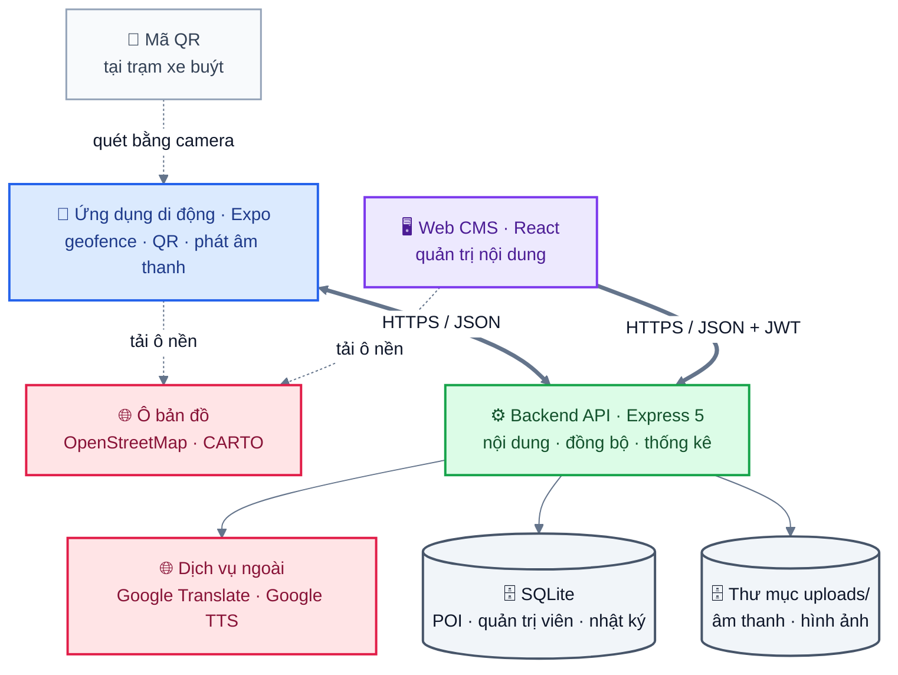

*Hình: Ngữ cảnh hệ thống: hai client dùng chung một backend REST; chỉ backend gọi dịch vụ dịch và TTS*

Các điểm chi tiết hoá so với sơ đồ thành phần ban đầu của nhóm (README §1): cơ sở dữ liệu là một file SQLite duy nhất, truy cập qua `node:sqlite`; nơi lưu file là thư mục cục bộ `uploads/`, phục vụ tĩnh tại `/uploads`; API dịch và chuyển văn bản thành giọng nói (TTS) chỉ được backend gọi thay cho CMS, ứng dụng di động không bao giờ gọi (ứng dụng dùng TTS trên thiết bị). Cả hai client tải ô nền bản đồ trực tiếp từ máy chủ ô bản đồ công cộng (CMS: OpenStreetMap; ứng dụng: CARTO Voyager).

### 1.2 Backend: kiến trúc phân lớp

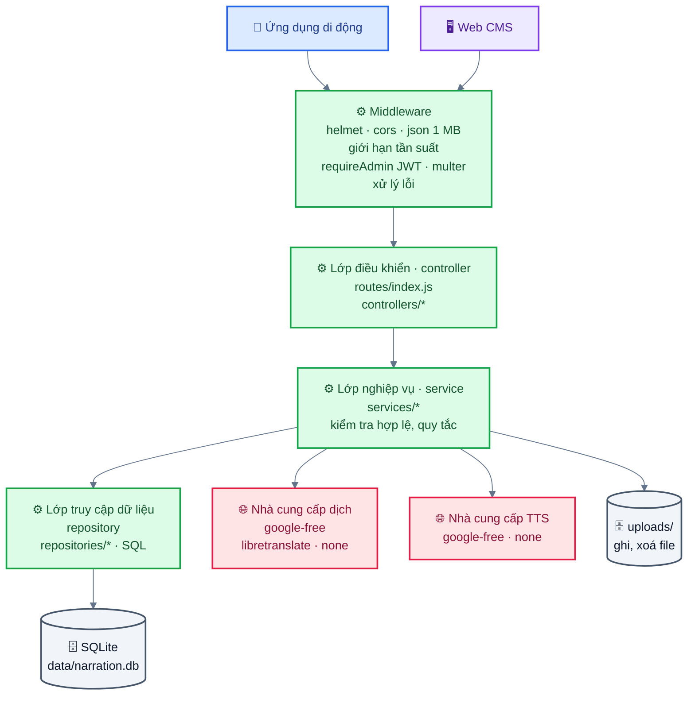

*Hình: Backend ba lớp (xanh lá) sau lớp middleware; nhà cung cấp dịch/TTS được tiêm vào lớp service, file do lớp service ghi*

Các quy tắc áp dụng:
- Controller chỉ đọc đầu vào HTTP (`idParam`, `req.body`, `req.file`) và định dạng phản hồi; controller không chứa quy tắc nghiệp vụ.
- Service đảm nhận kiểm tra hợp lệ và quy tắc nghiệp vụ (UC3 E1, UC4 E1, kiểm tra nhật ký, làm tròn toạ độ, đánh phiên bản nội dung) và mở transaction.
- Repository đảm nhận SQL và trả về object thuần. Repository không bao giờ ném lỗi nghiệp vụ.
- Việc lắp ghép các lớp diễn ra một lần trong `app.js` (`createRepositories(db)` → `createServices(repos, {translator, tts})` → `createRouter(services)`). Nhà cung cấp dịch và TTS được tiêm (inject) vào, nhờ đó kiểm thử có thể thay chúng bằng bản giả.
- Lỗi được tạo dưới dạng `AppError(status, code, message, details)` và được `middleware/error.js` chuyển thành JSON.

File được ghi bởi lớp service/middleware (multer disk storage, `saveBuffer`, `removeAudioFile`) chứ không phải repository; vì vậy cạnh "Repository → Lưu trữ file" của sơ đồ ban đầu được vẽ từ lớp service ở đây.

### 1.3 Danh sách module backend

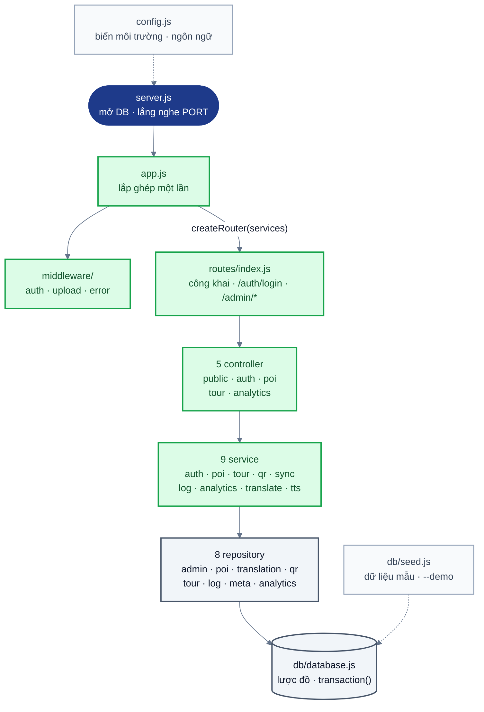

*Hình: Các nhóm module backend và thứ tự lắp ghép trong app.js: createRepositories → createServices → createRouter*


| Lớp | Module | Trách nhiệm | UC |
|---|---|---|---|
| Điểm vào | `server.js` | Mở DB, đảm bảo có thư mục upload, từ chối khởi động production khi dùng JWT secret mặc định, lắng nghe trên `PORT` | tất cả |
| Điểm vào | `app.js` | Nối các lớp, middleware bảo mật, `/uploads` tĩnh, router `/api` | tất cả |
| Cấu hình | `config.js` | Biến môi trường, danh sách ngôn ngữ, ngôn ngữ mặc định `vi` | tất cả |
| Route | `routes/index.js` | Route công khai, `/auth/login`, `/admin/*` được bảo vệ bởi `requireAdmin`, bộ giới hạn tần suất | tất cả |
| Controller | `publicController` | health, ngôn ngữ, đồng bộ, phân giải QR, nhận nhật ký | UC1, UC2, UC5 |
| Controller | `authController` | đăng nhập, me, đổi mật khẩu | UC3–UC5 |
| Controller | `poiController` | CRUD điểm tham quan (POI), tải lên/xoá âm thanh, TTS, hình ảnh, dịch, QR | UC3 |
| Controller | `tourController` | CRUD tour | UC4 |
| Controller | `analyticsController` | Báo cáo | UC5 |
| Service | `authService` | Xác minh bcrypt, cấp/xác minh JWT, đổi mật khẩu | UC3–UC5 |
| Service | `poiService` | `validatePoiInput`, tạo/sửa/xoá trong transaction, gắn/gỡ âm thanh, dọn file âm thanh và hình ảnh bị thay thế, tăng phiên bản | UC3 |
| Service | `tourService` | Kiểm tra hợp lệ tour (≥ 1 POI, không trùng, tồn tại), lưu theo thứ tự, tăng phiên bản | UC4 |
| Service | `qrService` | Sinh payload ngẫu nhiên, `extractPayload`, phân giải ra POI; tạo/xoá làm tăng phiên bản nội dung | UC2, UC3 A2 |
| Service | `syncService` | Phiên bản nội dung, bản chụp dữ liệu (snapshot) đầy đủ (POI kèm bản dịch, mã QR, tour) | UC1, UC2, UC4 |
| Service | `logService` | Kiểm tra và chèn các lô nhật ký sử dụng/vị trí; bỏ qua bản ghi sử dụng của POI đã xoá (`{inserted, skipped}`); làm tròn 4 chữ số thập phân | UC1, UC2, UC5 |
| Service | `analyticsService` | Đọc bộ lọc, khung bao của tour, lắp ráp báo cáo | UC5 |
| Service | `translateService` | Bộ chuyển đổi nhà cung cấp (endpoint miễn phí của Google, LibreTranslate, none), giới hạn đầu vào | UC3 |
| Service | `ttsService` | Chia văn bản thành đoạn (≤ 180 ký tự), gọi Google TTS, nối MP3 | UC3 |
| Repository | `adminRepository`, `poiRepository`, `translationRepository`, `qrRepository`, `tourRepository`, `logRepository`, `metaRepository`, `analyticsRepository` | SQL theo từng nhóm dữ liệu (aggregate) | tất cả |
| DB | `db/database.js` | DDL lược đồ, `openDatabase`, hàm hỗ trợ `transaction()` | tất cả |
| DB | `db/seed.js` | Dữ liệu mẫu (8 POI ở Quận 4, 2 tour, 5 mã QR trạm xe buýt); `--demo` thêm 30 ngày nhật ký mô phỏng | demo |
| Middleware | `auth.js`, `upload.js`, `error.js` | Bảo vệ bằng Bearer token; upload có kiểm tra MIME/kích thước, đặt tên ngẫu nhiên; ánh xạ lỗi | tất cả |

### 1.4 Ứng dụng di động (`mobile/`, Expo SDK 58, React Native 0.88, TypeScript, Expo Router)

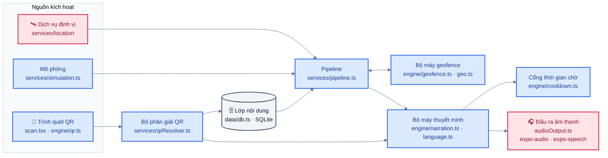

*Hình: Ứng dụng di động (a): luồng kích hoạt từ GPS, mô phỏng và QR tới bộ máy thuyết minh*

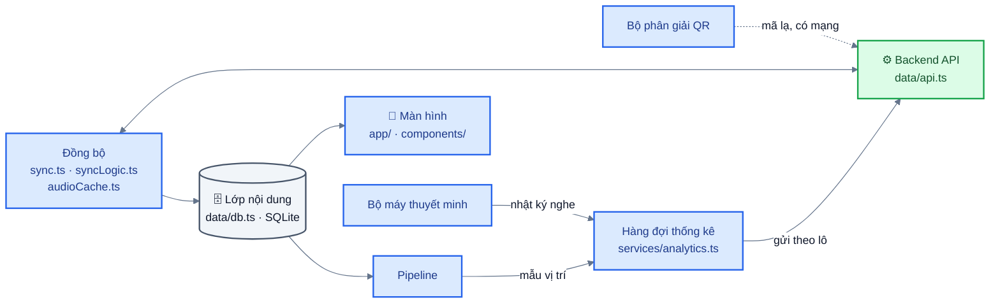

*Hình: Ứng dụng di động (b): luồng dữ liệu giữa nội dung cục bộ, đồng bộ, hàng đợi thống kê và backend*

| Module (file) | Thiết kế đã hiện thực |
|---|---|
| Điểm vào (`index.js`) | Định nghĩa tác vụ định vị nền (background location) trước khi nạp `expo-router/entry` (TaskManager yêu cầu như vậy). |
| Màn hình (`src/app/`) | Các tab `(tabs)/index.tsx` Bản đồ, `tours.tsx`, `scan.tsx`, `settings.tsx`; màn hình chi tiết `poi/[id].tsx`, `tour/[id].tsx`. Thành phần dùng chung `MiniPlayer`, `NoticeBanner`, `ui.tsx`. Chuỗi giao diện nằm trong `src/i18n` (giao diện tiếng Việt khi ngôn ngữ thuyết minh là `vi`, tiếng Anh trong các trường hợp còn lại). |
| Bản đồ (`src/components/map/`) | `LeafletMap.tsx`: `react-native-webview` chứa Leaflet, được nhúng sẵn trong bundle (`leafletAssets.generated.ts`), nên vòng tròn POI và vị trí người dùng hiển thị được khi ngoại tuyến (chỉ ô nền cần mạng). Chọn thay cho `react-native-maps` vì chạy giống nhau trên Expo Go, bản dev build và bản phát hành lên store, và không cần khoá Google Maps. |
| Dịch vụ định vị (`src/services/location/`) | Tiền cảnh: `watchPositionAsync`; nền: `startLocationUpdatesAsync` + `expo-task-manager` (`backgroundTask.ts`) khi người dùng bật "Tiếp tục khi chạy nền" và cấp quyền "Luôn luôn". Chế độ nền không dùng được trên Expo Go; khi đó ứng dụng quay về GPS tiền cảnh. |
| Pipeline (`src/services/pipeline.ts`) | Một đường xử lý duy nhất Vị trí → Geofence → Thuyết minh (kèm lấy mẫu vị trí), dùng chung cho GPS thật, GPS nền và mô phỏng. Giữ các thể hiện singleton `GeofenceEngine`, `CooldownGate`, `NarrationEngine`. |
| Bộ máy geofence (geofence engine) (`src/engine/geofence.ts`, `geo.ts`) | TypeScript thuần. Bỏ các điểm định vị có `accuracy > 60 m`; vào một POI khi khoảng cách haversine ≤ bán kính (radius, trường `radius_m`); chỉ ra khỏi khi khoảng cách > `radius_m × 1.2`; trong các POI mà người dùng đang ở bên trong, chọn POI có độ ưu tiên (priority, trường `priority`) cao nhất, sau đó gần nhất, sau đó id nhỏ nhất; mỗi POI chỉ được kích hoạt tối đa một lần cho mỗi lượt ghé (một lượt ghé kết thúc khi ra khỏi vùng). |
| Cổng thời gian chờ phát lại (`src/engine/cooldown.ts`) | Với kích hoạt (trigger) `geofence`: từ chối với lý do `busy` khi đang phát bất kỳ nội dung nào, và với lý do `cooldown` nếu cùng POI đó đã bắt đầu phát chưa quá thời gian chờ phát lại (cooldown, mặc định 10 phút, chỉnh được 0–240 trong Cài đặt). Kích hoạt `manual` và `qr` bỏ qua thời gian chờ và ngắt nội dung đang phát. |
| Bộ máy thuyết minh (narration engine) (`src/engine/narration.ts`, `language.ts`) | Chọn bản dịch: ngôn ngữ đã chọn → tiếng Việt → bất kỳ ngôn ngữ nào có nội dung (người dùng được thông báo khi phải dùng ngôn ngữ thay thế). Thứ tự nguồn: file đã tải về → `audio_url` trên máy chủ khi có mạng → TTS trên thiết bị (`expo-speech`, locale lấy từ `TTS_LOCALE`). Lỗi âm thanh thì chuyển sang TTS. Khi phát xong/dừng thì ghi `listen_seconds`. Âm thanh/giọng nói là các adapter được tiêm vào (`services/audioOutput.ts`), nên bộ máy được kiểm thử đơn vị mà không cần thiết bị. |
| QR (`src/engine/qr.ts`, `src/services/qrResolver.ts`, `app/(tabs)/scan.tsx`) | `expo-camera` chỉ đọc mã QR; ô "Nhập mã thủ công" hỗ trợ máy ảo. `parseQrPayload` chấp nhận `NARR:<code>`, mã trần và `.../q/<code>`. Thứ tự tra cứu: bảng `qr_code` đã đồng bộ (ngoại tuyến) → `qr_cache` (các mã đã phân giải trước đó) → `GET /api/qr/:payload`. 404/400 → "Mã QR không hợp lệ" (E1); không có cục bộ và đang ngoại tuyến → thông báo E2. POI do máy chủ trả về mà chưa có cục bộ sẽ được lưu lại để lần sau phát được khi ngoại tuyến. |
| Lớp nội dung (`src/data/db.ts`) | `expo-sqlite`, WAL. Các bảng nội dung được thay thế trong một transaction ở mỗi lần đồng bộ (§6.2). |
| Đồng bộ (`src/data/sync.ts`, `syncLogic.ts`, `audioCache.ts`) | Chạy khi mở ứng dụng, mỗi 5 phút, khi ứng dụng quay lại tiền cảnh và khi có mạng trở lại. Gọi `GET /api/sync/version`; nếu khác phiên bản cục bộ (hoặc chưa có dữ liệu / định dạng cục bộ cũ) thì tải `/api/sync`, kiểm tra (`validateBundle` loại POI sai cấu trúc và tour/QR trỏ tới POI không tồn tại) rồi thay nội dung một cách nguyên tử; khi lỗi thì giữ dữ liệu cũ. Sau đó dọn các file âm thanh không còn dùng và tải trước âm thanh của ngôn ngữ đã chọn; nút "Tải tất cả audio để nghe offline" trong Cài đặt tải phần còn lại. |
| Hàng đợi thống kê (`src/services/analytics.ts`, `analyticsPolicy.ts`) | `SESSION_ID` sinh bằng `expo-crypto` cho mỗi lần mở ứng dụng, chỉ giữ trong bộ nhớ. Bản ghi nhật ký sử dụng (usage log) và mẫu vị trí (khoảng mỗi 30 s, hoặc sau khi di chuyển ≥ 25 m nhưng không dày hơn 5 s một lần) được lưu vào `usage_queue` / `location_queue` và gửi đi mỗi 60 s theo lô 200 bản ghi. Nếu máy chủ từ chối một lô với mã 400 thì các bản ghi được gửi lần lượt từng cái và bản ghi không hợp lệ bị bỏ. Tắt "Gửi dữ liệu ẩn danh" sẽ ngừng ghi nhật ký và xoá các hàng đợi. |
| Mô phỏng (`src/services/simulation.ts`) | "Mô phỏng vị trí" trong Cài đặt bỏ qua GPS thật: chạm vào bản đồ để đặt vị trí giả, hoặc "Mô phỏng đi bộ theo tour" di chuyển một điểm đánh dấu qua các điểm dừng của tour với tốc độ ×1–×30, tạm dừng trong lúc phát thuyết minh. |
| Cấu hình (`src/config.ts`) | Thứ tự ưu tiên URL máy chủ: Cài đặt → `EXPO_PUBLIC_API_URL` → IP LAN của máy chạy Metro (`hostUri`) + cổng 4000 → mặc định theo nền tảng (`10.0.2.2` cho máy ảo Android, `localhost` cho trình giả lập iOS). |

Thuật toán geofence cho mỗi điểm định vị (theo `GeofenceEngine.update`):

```text
if fix.accuracy is known and > 60 m: ignore fix
for poi in pois:
    d = haversine(fix, poi)
    if poi not in inside and d <= poi.radius_m: inside.add(poi)
    else if poi in inside and d > poi.radius_m * 1.2:
        inside.remove(poi); triggeredThisVisit.remove(poi)
best = argmax over inside of (priority, -distance, -id)
if best exists and best not in triggeredThisVisit:
    triggeredThisVisit.add(best); emit trigger(best)      # cooldown/busy checked by the narration engine
```

Hệ quả của việc xét mọi POI mà người dùng đang ở bên trong (không chỉ các POI vừa vào): khi người dùng rời một POI có độ ưu tiên cao nhưng vẫn còn ở trong một POI có độ ưu tiên thấp hơn, POI thấp hơn sẽ được kích hoạt vào lúc đó.

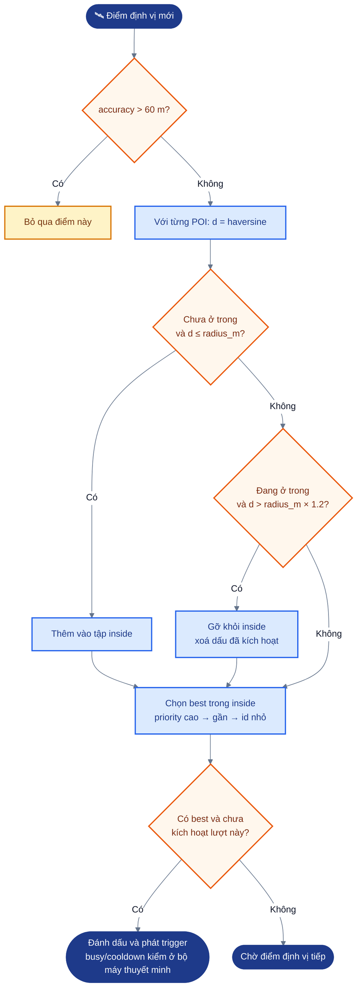

*Hình: Thuật toán GeofenceEngine.update cho mỗi điểm định vị: lọc độ chính xác, vào/ra có vùng trễ, chọn POI tốt nhất*


### 1.5 Web CMS (`cms/`, Vite 8, React 19, TypeScript)

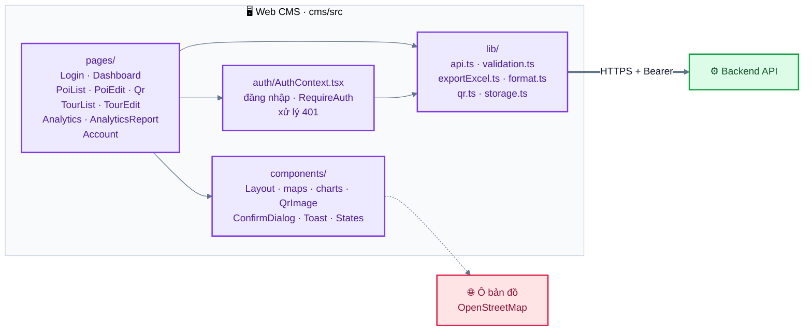

*Hình: Cấu trúc Web CMS: trang dùng thành phần và thư viện; mọi lời gọi API đi qua lib/api.ts*

| Module (file) | Thiết kế đã hiện thực |
|---|---|
| Định tuyến (`App.tsx`, react-router) | `/login`; layout được bảo vệ gồm `/` (bảng điều khiển), `/pois`, `/pois/:id` (`new` để tạo mới), `/tours`, `/tours/:id`, `/qr`, `/analytics`, `/account`; `/analytics/report` là layout in được bảo vệ, không có thanh bên. |
| API client (`lib/api.ts`) | URL gốc lấy từ `VITE_API_URL` (rỗng = cùng origin; khi phát triển, Vite proxy `/api` và `/uploads`). Thêm `Authorization: Bearer`, chuyển lỗi thành `ApiError` kèm trường `details`, gọi `onUnauthorized` khi API quản trị trả 401 (không áp dụng cho đăng nhập), ánh xạ lỗi mạng thành `NETWORK_ERROR`. `fileUrl` thêm origin của backend vào trước `/uploads/...`. |
| Xác thực (`auth/AuthContext.tsx`, `lib/storage.ts`) | Token được lưu qua lớp bọc localStorage an toàn (dự phòng bằng bộ nhớ trong). Khi gặp 401, người dùng được chuyển tới `/login?next=<trang hiện tại>`. |
| Kiểm tra hợp lệ (`lib/validation.ts`) | Phản chiếu quy tắc của backend (toạ độ, bán kính 0–5000, độ ưu tiên 0–100, bắt buộc có văn bản tiếng Việt, ngôn ngữ phụ có tiêu đề mà không có văn bản là lỗi, tour không được rỗng) và ánh xạ `details` của máy chủ vào các trường của form (`mapServerErrors`). |
| Trình sửa POI (`pages/PoiEditPage.tsx`, `components/maps.tsx`) | Bản đồ react-leaflet: bấm để đặt điểm, ghim kéo được, vòng tròn bán kính, các POI khác hiển thị mờ; ô nhập lat/lng thủ công; tải ảnh lên; sáu tab ngôn ngữ với "Dịch tự động từ tiếng Việt" và "Dịch tất cả ngôn ngữ còn trống"; âm thanh theo từng ngôn ngữ: tải file lên, "Tạo giọng đọc (TTS)" (yêu cầu lưu trước vì TTS dùng văn bản đã lưu), nghe thử, xoá; phần QR (tạo kèm nhãn, tải PNG, in, xoá). Cảnh báo khi có thay đổi chưa lưu (`useUnsavedWarning`). |
| QR (`pages/QrPage.tsx`, `components/QrImage.tsx`, `lib/qr.ts`) | Liệt kê mọi mã, có bộ lọc theo POI; chọn mã và in tờ A4 (4 mã mỗi trang) kèm nhãn trạm, tên POI và dòng chữ "Quét mã để nghe thuyết minh". Ảnh được sinh trong trình duyệt bằng `qrcode` từ `content` (`NARR:<payload>`). |
| Tour (`pages/TourEditPage.tsx`) | Thêm POI, sắp xếp lại bằng kéo-thả hoặc nút lên/xuống (dùng được bằng bàn phím, có thông báo cho trình đọc màn hình), đường lộ trình có đánh số; chặn tour rỗng (E1). |
| Thống kê (analytics) (`pages/AnalyticsPage.tsx`, `components/charts.tsx`) | Khoảng ngày đặt sẵn (7/30/90 ngày, mặc định 30) và bộ lọc tour; các chỉ số KPI; biểu đồ Chart.js (POI hàng đầu, thời gian nghe trung bình theo POI, theo ngày, cách kích hoạt, ngôn ngữ, theo giờ đã đổi từ UTC sang giờ Việt Nam); bản đồ nhiệt (heatmap) `leaflet.heat` có nút bật/tắt lộ trình ẩn danh; trạng thái "Không có dữ liệu" khi `has_data=false`. |
| Xuất báo cáo (`lib/exportExcel.ts`, `pages/AnalyticsReportPage.tsx`) | "Xuất Excel": workbook nhiều sheet bằng SheetJS (`xlsx` 0.20.3). "Xuất PDF": mở trang báo cáo tối ưu cho in và hộp thoại in của trình duyệt ("Lưu dưới dạng PDF"), vì jsPDF không hiển thị được dấu tiếng Việt nếu không nhúng font. |
| Bảng điều khiển / Tài khoản | Số lượng POI, tour, mã QR; số liệu 7 ngày gần nhất; danh sách việc cần làm (POI thiếu âm thanh, ngôn ngữ hoặc QR). Trang tài khoản hiển thị quản trị viên và cho đổi mật khẩu. |

## 2. Biểu đồ lớp (service và repository của backend)

Backend dùng các hàm factory trả về object thay vì class ES; mỗi factory được mô hình hoá thành một lớp dưới đây. Chỉ thể hiện các thao tác công khai chính.

```mermaid
%%{init: {"theme":"base","fontFamily":"Helvetica Neue, Arial, sans-serif","themeVariables":{"fontFamily":"Helvetica Neue, Arial, sans-serif","fontSize":"15px","primaryColor":"#EFF6FF","primaryBorderColor":"#3B82F6","primaryTextColor":"#0F172A","lineColor":"#64748B","secondaryColor":"#F0FDF4","tertiaryColor":"#FFFFFF","clusterBkg":"#F8FAFC","clusterBorder":"#CBD5E1","edgeLabelBackground":"#FFFFFF","noteBkgColor":"#FEF9C3","noteBorderColor":"#EAB308","actorBkg":"#DBEAFE","actorBorder":"#2563EB","actorTextColor":"#1E3A8A","signalColor":"#475569","signalTextColor":"#0F172A","labelBoxBkgColor":"#F1F5F9","labelBoxBorderColor":"#94A3B8","activationBkgColor":"#E0F2FE","activationBorderColor":"#0284C7","sequenceNumberColor":"#FFFFFF","pie1":"#16A34A","pie2":"#F59E0B","pie3":"#94A3B8","pie4":"#DC2626","pie5":"#2563EB","pie6":"#7C3AED","pieStrokeColor":"#FFFFFF","pieSectionTextColor":"#FFFFFF","quadrant1Fill":"#FEE2E2","quadrant2Fill":"#FEF3C7","quadrant3Fill":"#DCFCE7","quadrant4Fill":"#FEF3C7","quadrantPointFill":"#1E3A8A","quadrantPointTextFill":"#0F172A","git0":"#1E3A8A","gitBranchLabel0":"#FFFFFF","cScale0":"#DBEAFE","cScale1":"#DCFCE7","cScale2":"#EDE9FE","cScale3":"#FEF3C7","cScale4":"#FFE4E6","cScale5":"#E0F2FE","cScale6":"#F1F5F9"},"flowchart":{"curve":"basis","padding":16,"nodeSpacing":40,"rankSpacing":50},"sequence":{"showSequenceNumbers":true,"mirrorActors":false}}}%%
classDiagram
    direction TB
    class AuthService {
        +login(username, password) TokenResult
        +verify(token) Admin
        +changePassword(userId, current, next)
        +hashPassword(pw)
    }
    class PoiService {
        +list(q) PoiSummary[]
        +get(id) Poi
        +create(body, adminId) Poi
        +update(id, body) Poi
        +delete(id)
        +attachAudio(id, lang, file, source) Poi
        +removeAudio(id, lang) Poi
    }
    class TourService {
        +list() TourSummary[]
        +get(id) Tour
        +create(body, adminId) Tour
        +update(id, body) Tour
        +delete(id)
    }
    class QrService {
        +listAll() QrCode[]
        +listForPoi(poiId) QrCode[]
        +create(poiId, label) QrCode
        +delete(id)
        +resolve(raw) QrResolution
    }
    class SyncService {
        +version() int
        +snapshot() Snapshot
    }
    class AdminRepository {
        +findByUsername(username)
        +findById(id)
        +create(data)
        +updatePassword(id, hash)
    }
    class PoiRepository {
        +list(q)
        +findById(id)
        +listWithTranslations()
        +create(data, adminId)
        +update(id, data)
        +delete(id)
        +touch(id)
    }
    class TranslationRepository {
        +listForPoi(poiId)
        +find(poiId, lang)
        +upsertText(poiId, t)
        +deleteExcept(poiId, codes)
        +setAudio(poiId, lang, url, source)
        +clearAudio(poiId, lang)
    }
    class QrRepository {
        +listAll()
        +listForPoi(poiId)
        +findByPayload(payload)
        +create(poiId, payload, label)
        +delete(id)
    }
    class TourRepository {
        +list()
        +listWithPois()
        +findById(id)
        +create(data, adminId)
        +update(id, data)
        +setPois(id, poiIds)
        +delete(id)
    }
    class MetaRepository {
        +getContentVersion() int
        +bumpContentVersion() int
    }

    AuthService --> AdminRepository
    PoiService --> PoiRepository
    PoiService --> TranslationRepository
    PoiService --> QrRepository
    PoiService --> MetaRepository
    TourService --> TourRepository
    TourService --> PoiRepository
    TourService --> MetaRepository
    QrService --> QrRepository
    QrService --> PoiRepository
    SyncService --> PoiRepository
    SyncService --> TourRepository
    SyncService --> MetaRepository

    class AuthService:::backend
    class PoiService:::backend
    class TourService:::backend
    class QrService:::backend
    class SyncService:::backend
    class AdminRepository:::data
    class PoiRepository:::data
    class TranslationRepository:::data
    class QrRepository:::data
    class TourRepository:::data
    class MetaRepository:::data
    classDef backend fill:#DCFCE7,stroke:#16A34A,stroke-width:2px,color:#14532D
    classDef data fill:#F1F5F9,stroke:#475569,stroke-width:2px,color:#0F172A
```

*Hình: Biểu đồ lớp (a) nhóm nội dung: service (xanh lá) phụ thuộc repository (xám)*

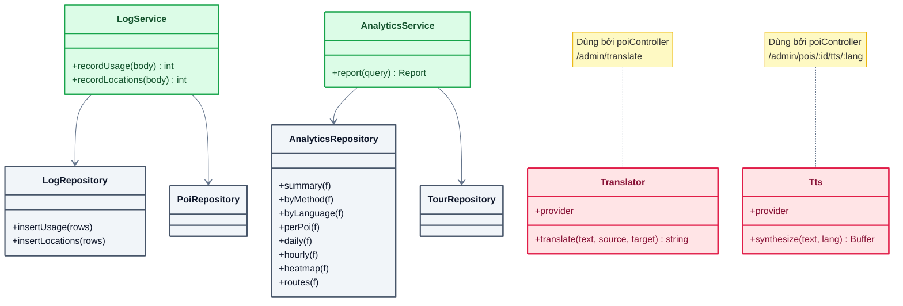

*Hình: Biểu đồ lớp (b) nhóm nhật ký, thống kê và nhà cung cấp dịch/TTS (hồng); PoiRepository, TourRepository xem chi tiết ở hình (a)*

`Translator` và `Tts` được `poiController` sử dụng (`/admin/translate`, `/admin/pois/:id/tts/:lang`); kết quả TTS sau đó được lưu qua `PoiService.attachAudio`.

---

## 3. Biểu đồ hoạt động

### 3.1 UC1: Kích hoạt thuyết minh tự động qua vùng kích hoạt (geofence)

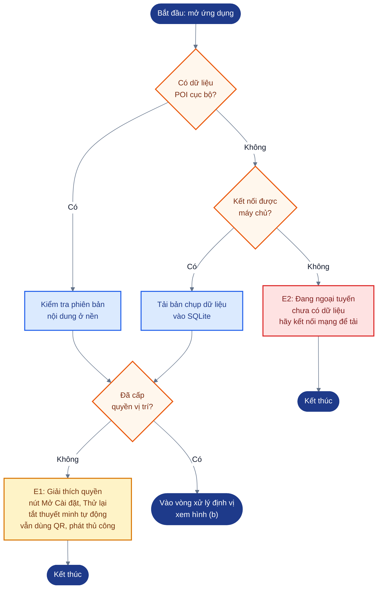

*Hình: UC1 (a): khởi động, kiểm tra dữ liệu cục bộ và quyền vị trí*

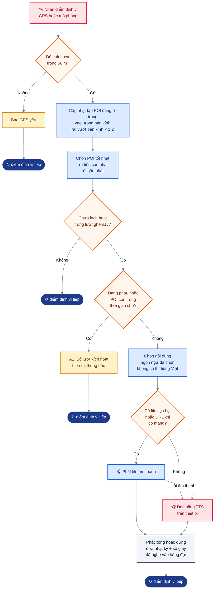

*Hình: UC1 (b): vòng xử lý mỗi điểm định vị, từ lọc độ chính xác tới phát thuyết minh và ghi nhật ký; nút ↻ nghĩa là quay lại chờ điểm định vị tiếp theo*

Ứng dụng đồng bộ trước khi xin quyền vị trí, nên E2 được kiểm tra trước; điều này không làm thay đổi kết quả của cả hai luồng ngoại lệ.

### 3.2 UC2: Kích hoạt nội dung bằng cách quét mã QR

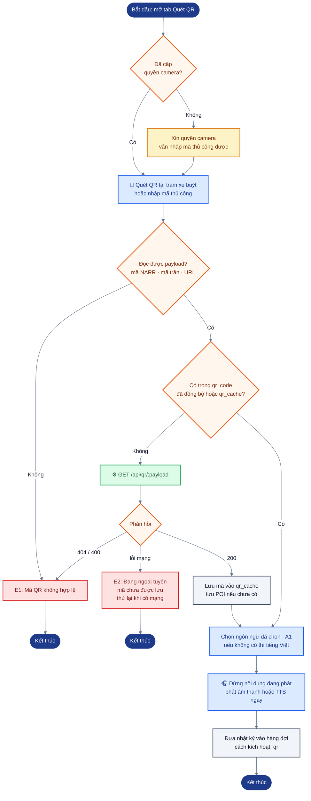

*Hình: UC2: phân giải mã QR theo thứ tự cục bộ trước, máy chủ sau; QR luôn phát ngay*

### 3.3 UC3: Quản lý POI và nội dung thuyết minh

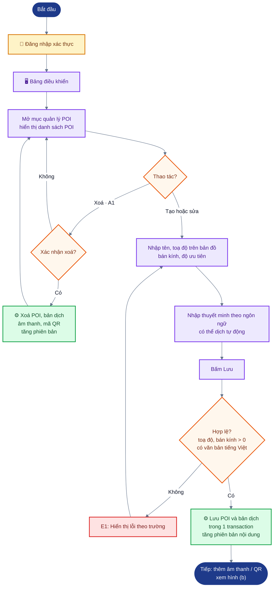

*Hình: UC3 (a): đăng nhập, xoá hoặc tạo/sửa POI và kiểm tra hợp lệ trước khi lưu*

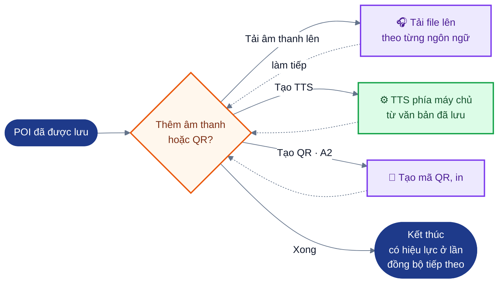

*Hình: UC3 (b): bổ sung âm thanh tải lên, giọng TTS hoặc mã QR cho POI đã lưu*

### 3.4 UC4: Quản lý tour

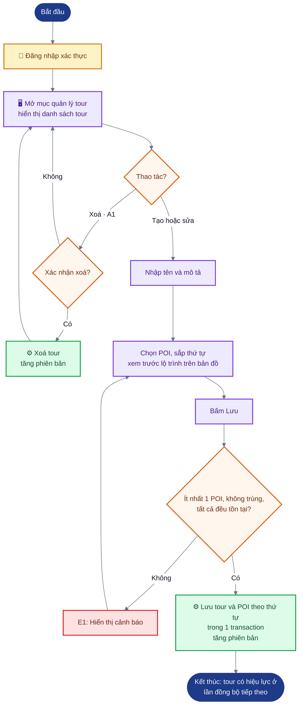

*Hình: UC4: tạo, sửa, xoá tour; chặn tour rỗng, trùng hoặc chứa POI không tồn tại*

### 3.5 UC5: Xem thống kê sử dụng

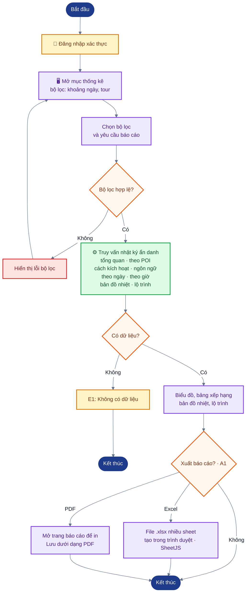

*Hình: UC5: lọc, xem và xuất báo cáo thống kê ẩn danh*

---

## 4. Biểu đồ tuần tự

### 4.1 UC1: Kích hoạt qua geofence

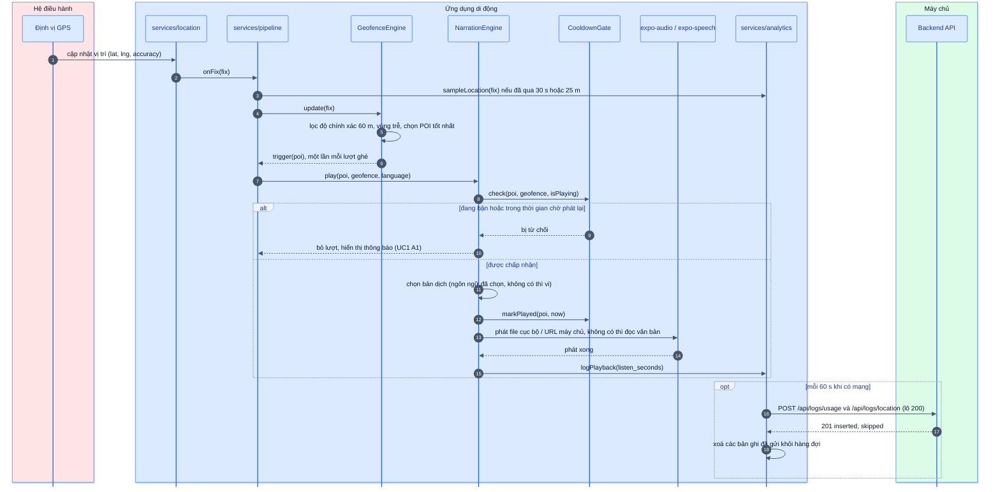

*Hình: Tuần tự UC1: từ điểm định vị GPS tới phát thuyết minh và gửi nhật ký theo lô*

### 4.2 UC2: Quét QR

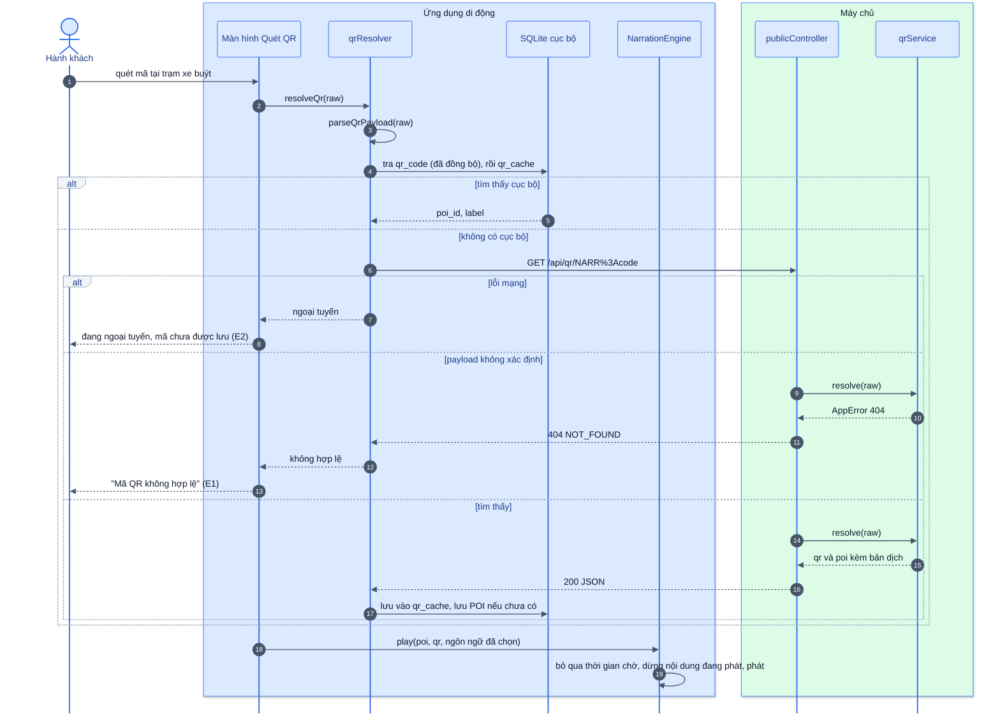

*Hình: Tuần tự UC2: phân giải mã QR cục bộ, gọi máy chủ khi cần và phát ngay*

### 4.3 UC3: Lưu POI và tạo âm thanh TTS

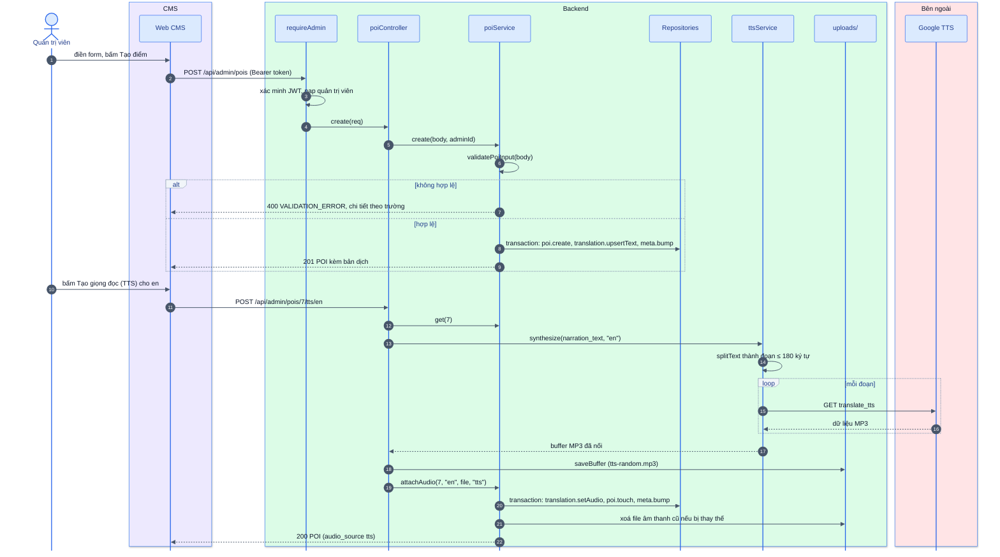

*Hình: Tuần tự UC3: lưu POI trong transaction rồi tạo giọng đọc TTS phía máy chủ*

### 4.4 Đồng bộ dữ liệu

Được kích hoạt khi mở ứng dụng, mỗi 5 phút, khi ứng dụng quay lại tiền cảnh và khi có mạng trở lại (`services/bootstrap.ts`), hoặc bằng nút "Đồng bộ ngay" trong Cài đặt.

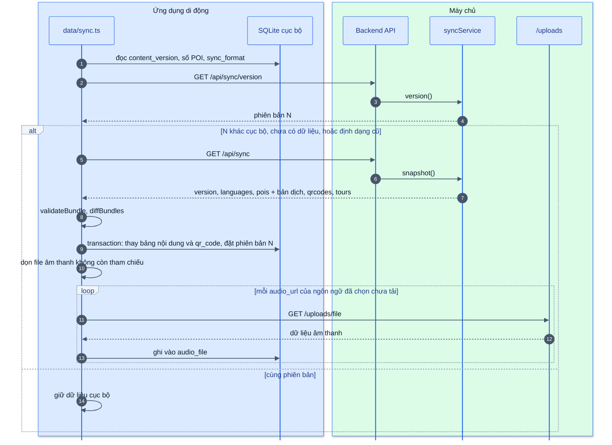

*Hình: Tuần tự đồng bộ: so phiên bản, tải bản chụp khi khác, thay nội dung nguyên tử rồi tải trước âm thanh*

### 4.5 UC5: Báo cáo thống kê

```mermaid
%%{init: {"theme":"base","fontFamily":"Helvetica Neue, Arial, sans-serif","themeVariables":{"fontFamily":"Helvetica Neue, Arial, sans-serif","fontSize":"15px","primaryColor":"#EFF6FF","primaryBorderColor":"#3B82F6","primaryTextColor":"#0F172A","lineColor":"#64748B","secondaryColor":"#F0FDF4","tertiaryColor":"#FFFFFF","clusterBkg":"#F8FAFC","clusterBorder":"#CBD5E1","edgeLabelBackground":"#FFFFFF","noteBkgColor":"#FEF9C3","noteBorderColor":"#EAB308","actorBkg":"#DBEAFE","actorBorder":"#2563EB","actorTextColor":"#1E3A8A","signalColor":"#475569","signalTextColor":"#0F172A","labelBoxBkgColor":"#F1F5F9","labelBoxBorderColor":"#94A3B8","activationBkgColor":"#E0F2FE","activationBorderColor":"#0284C7","sequenceNumberColor":"#FFFFFF","pie1":"#16A34A","pie2":"#F59E0B","pie3":"#94A3B8","pie4":"#DC2626","pie5":"#2563EB","pie6":"#7C3AED","pieStrokeColor":"#FFFFFF","pieSectionTextColor":"#FFFFFF","quadrant1Fill":"#FEE2E2","quadrant2Fill":"#FEF3C7","quadrant3Fill":"#DCFCE7","quadrant4Fill":"#FEF3C7","quadrantPointFill":"#1E3A8A","quadrantPointTextFill":"#0F172A","git0":"#1E3A8A","gitBranchLabel0":"#FFFFFF","cScale0":"#DBEAFE","cScale1":"#DCFCE7","cScale2":"#EDE9FE","cScale3":"#FEF3C7","cScale4":"#FFE4E6","cScale5":"#E0F2FE","cScale6":"#F1F5F9"},"flowchart":{"curve":"basis","padding":16,"nodeSpacing":40,"rankSpacing":50},"sequence":{"showSequenceNumbers":true,"mirrorActors":false}}}%%
sequenceDiagram
    autonumber
    actor A as Quản trị viên
    box rgb(237,233,254) CMS
        participant CMS as Bảng điều khiển CMS
    end
    box rgb(220,252,231) Backend
        participant C as analyticsController
        participant S as analyticsService
        participant TR as tourRepository
        participant AR as analyticsRepository
    end

    A->>CMS: chọn khoảng ngày và tour, bấm Xem báo cáo
    CMS->>C: GET /api/admin/analytics?from&to&tour_id
    C->>S: report(query)
    S->>S: parseFilters (ngày, from trước to)
    opt có tour_id
        S->>TR: findById(tour_id)
        S->>S: khung bao các POI của tour + khoảng 300 m
    end
    S->>AR: summary, byMethod, byLanguage, perPoi, daily, hourly
    S->>AR: heatmap(bbox), routes(bbox)
    AR-->>S: các dòng đã tổng hợp (không có session id)
    S-->>CMS: báo cáo kèm has_data
    alt has_data là false
        CMS-->>A: "Không có dữ liệu" (E1)
    else có dữ liệu
        CMS-->>A: biểu đồ, bảng xếp hạng, bản đồ nhiệt, lộ trình
        opt xuất báo cáo (A1)
            A->>CMS: Xuất Excel hoặc Xuất PDF
            CMS-->>A: file .xlsx, hoặc trang in để Lưu dưới dạng PDF
        end
    end
```

*Hình: Tuần tự UC5: lập báo cáo thống kê từ nhật ký đã tổng hợp, không lộ session id*

---

## 5. Biểu đồ trạng thái: bộ máy thuyết minh

Bộ máy có một trạng thái phát toàn cục (`NarrationEngine`) và một trạng thái theo từng POI, kết hợp lượt ghé geofence (`GeofenceEngine`) và thời gian chờ phát lại (`CooldownGate`). Thời gian chờ phát lại được tính từ thời điểm POI **bắt đầu** phát (`markPlayed` được gọi khi bắt đầu phát).

Trạng thái phát của bộ máy:

```mermaid
%%{init: {"theme":"base","fontFamily":"Helvetica Neue, Arial, sans-serif","themeVariables":{"fontFamily":"Helvetica Neue, Arial, sans-serif","fontSize":"15px","primaryColor":"#EFF6FF","primaryBorderColor":"#3B82F6","primaryTextColor":"#0F172A","lineColor":"#64748B","secondaryColor":"#F0FDF4","tertiaryColor":"#FFFFFF","clusterBkg":"#F8FAFC","clusterBorder":"#CBD5E1","edgeLabelBackground":"#FFFFFF","noteBkgColor":"#FEF9C3","noteBorderColor":"#EAB308","actorBkg":"#DBEAFE","actorBorder":"#2563EB","actorTextColor":"#1E3A8A","signalColor":"#475569","signalTextColor":"#0F172A","labelBoxBkgColor":"#F1F5F9","labelBoxBorderColor":"#94A3B8","activationBkgColor":"#E0F2FE","activationBorderColor":"#0284C7","sequenceNumberColor":"#FFFFFF","pie1":"#16A34A","pie2":"#F59E0B","pie3":"#94A3B8","pie4":"#DC2626","pie5":"#2563EB","pie6":"#7C3AED","pieStrokeColor":"#FFFFFF","pieSectionTextColor":"#FFFFFF","quadrant1Fill":"#FEE2E2","quadrant2Fill":"#FEF3C7","quadrant3Fill":"#DCFCE7","quadrant4Fill":"#FEF3C7","quadrantPointFill":"#1E3A8A","quadrantPointTextFill":"#0F172A","git0":"#1E3A8A","gitBranchLabel0":"#FFFFFF","cScale0":"#DBEAFE","cScale1":"#DCFCE7","cScale2":"#EDE9FE","cScale3":"#FEF3C7","cScale4":"#FFE4E6","cScale5":"#E0F2FE","cScale6":"#F1F5F9"},"flowchart":{"curve":"basis","padding":16,"nodeSpacing":40,"rankSpacing":50},"sequence":{"showSequenceNumbers":true,"mirrorActors":false}}}%%
stateDiagram-v2
    direction LR
    state "Rảnh" as Idle
    state "Đang phát" as Playing
    [*] --> Idle
    Idle --> Playing : kích hoạt được chấp nhận
    Playing --> Idle : phát xong hoặc bấm Dừng
    note left of Idle
        Vào Đang phát: markPlayed,
        phát âm thanh hoặc TTS
        Ở lại Rảnh: geofence cho POI
        còn trong thời gian chờ
        → bỏ lượt
    end note
    note right of Playing
        Ra Rảnh: ghi listen_seconds
        Ở lại Đang phát:
        • geofence → bỏ lượt,
          đang bận (A1)
        • thủ công / QR → dừng,
          ghi nhật ký nội dung cũ,
          phát nội dung mới
        • lỗi âm thanh → TTS
    end note
    class Idle neutral
    class Playing mobile
    classDef mobile fill:#DBEAFE,stroke:#2563EB,stroke-width:2px,color:#1E3A8A
    classDef neutral fill:#F8FAFC,stroke:#94A3B8,stroke-width:1.5px,color:#334155
```

*Hình: Trạng thái phát toàn cục của NarrationEngine*

Trạng thái theo từng POI (chỉ áp dụng cho kích hoạt geofence; phát thủ công và phát qua QR bỏ qua trạng thái này):

```mermaid
%%{init: {"theme":"base","fontFamily":"Helvetica Neue, Arial, sans-serif","themeVariables":{"fontFamily":"Helvetica Neue, Arial, sans-serif","fontSize":"15px","primaryColor":"#EFF6FF","primaryBorderColor":"#3B82F6","primaryTextColor":"#0F172A","lineColor":"#64748B","secondaryColor":"#F0FDF4","tertiaryColor":"#FFFFFF","clusterBkg":"#F8FAFC","clusterBorder":"#CBD5E1","edgeLabelBackground":"#FFFFFF","noteBkgColor":"#FEF9C3","noteBorderColor":"#EAB308","actorBkg":"#DBEAFE","actorBorder":"#2563EB","actorTextColor":"#1E3A8A","signalColor":"#475569","signalTextColor":"#0F172A","labelBoxBkgColor":"#F1F5F9","labelBoxBorderColor":"#94A3B8","activationBkgColor":"#E0F2FE","activationBorderColor":"#0284C7","sequenceNumberColor":"#FFFFFF","pie1":"#16A34A","pie2":"#F59E0B","pie3":"#94A3B8","pie4":"#DC2626","pie5":"#2563EB","pie6":"#7C3AED","pieStrokeColor":"#FFFFFF","pieSectionTextColor":"#FFFFFF","quadrant1Fill":"#FEE2E2","quadrant2Fill":"#FEF3C7","quadrant3Fill":"#DCFCE7","quadrant4Fill":"#FEF3C7","quadrantPointFill":"#1E3A8A","quadrantPointTextFill":"#0F172A","git0":"#1E3A8A","gitBranchLabel0":"#FFFFFF","cScale0":"#DBEAFE","cScale1":"#DCFCE7","cScale2":"#EDE9FE","cScale3":"#FEF3C7","cScale4":"#FFE4E6","cScale5":"#E0F2FE","cScale6":"#F1F5F9"},"flowchart":{"curve":"basis","padding":16,"nodeSpacing":40,"rankSpacing":50},"sequence":{"showSequenceNumbers":true,"mirrorActors":false}}}%%
stateDiagram-v2
    state "Sẵn sàng" as Ready
    state "Trong vùng" as Inside
    state "Chờ phát lại" as Cooldown
    [*] --> Ready
    Ready --> Inside : ① vào vùng
    Inside --> Cooldown : ② ra vùng, đã phát
    Inside --> Ready : ③ ra vùng, chưa phát
    Cooldown --> Inside : ④ vào lại vùng
    Cooldown --> Ready : ⑤ hết thời gian chờ
    note right of Inside
        ① trong bán kính, độ chính
        xác đạt, là POI tốt nhất
        → phát kích hoạt
        Ở lại: dao động trong
        vùng trễ, không kích hoạt
        ②③ ra = vượt bán kính × 1.2
        ② đã bắt đầu phát,
        chưa quá thời gian chờ
        ③ chưa phát, kích hoạt bị bỏ
        ④ kích hoạt bị cổng
        thời gian chờ từ chối
        ⑤ mặc định 10 phút
    end note
    class Ready ok
    class Inside mobile
    class Cooldown warn
    classDef mobile fill:#DBEAFE,stroke:#2563EB,stroke-width:2px,color:#1E3A8A
    classDef ok fill:#DCFCE7,stroke:#16A34A,stroke-width:2px,color:#14532D
    classDef warn fill:#FEF3C7,stroke:#D97706,stroke-width:2px,color:#78350F
```

*Hình: Trạng thái theo từng POI với kích hoạt geofence: vùng trễ và thời gian chờ phát lại*

Một POI không thể kích hoạt lại khi người dùng vẫn ở trong vùng trễ (hysteresis) của nó, nên đứng ở ranh giới chỉ tạo ra tối đa một lần kích hoạt; thời gian chờ phát lại còn xử lý thêm trường hợp đi ra rồi quay vào.

---

## 6. Thiết kế dữ liệu

### 6.1 ERD phía máy chủ (lược đồ thực tế, `backend/src/db/database.js`)

```mermaid
%%{init: {"theme":"base","fontFamily":"Helvetica Neue, Arial, sans-serif","themeVariables":{"fontFamily":"Helvetica Neue, Arial, sans-serif","fontSize":"15px","primaryColor":"#EFF6FF","primaryBorderColor":"#3B82F6","primaryTextColor":"#0F172A","lineColor":"#64748B","secondaryColor":"#F0FDF4","tertiaryColor":"#FFFFFF","clusterBkg":"#F8FAFC","clusterBorder":"#CBD5E1","edgeLabelBackground":"#FFFFFF","noteBkgColor":"#FEF9C3","noteBorderColor":"#EAB308","actorBkg":"#DBEAFE","actorBorder":"#2563EB","actorTextColor":"#1E3A8A","signalColor":"#475569","signalTextColor":"#0F172A","labelBoxBkgColor":"#F1F5F9","labelBoxBorderColor":"#94A3B8","activationBkgColor":"#E0F2FE","activationBorderColor":"#0284C7","sequenceNumberColor":"#FFFFFF","pie1":"#16A34A","pie2":"#F59E0B","pie3":"#94A3B8","pie4":"#DC2626","pie5":"#2563EB","pie6":"#7C3AED","pieStrokeColor":"#FFFFFF","pieSectionTextColor":"#FFFFFF","quadrant1Fill":"#FEE2E2","quadrant2Fill":"#FEF3C7","quadrant3Fill":"#DCFCE7","quadrant4Fill":"#FEF3C7","quadrantPointFill":"#1E3A8A","quadrantPointTextFill":"#0F172A","git0":"#1E3A8A","gitBranchLabel0":"#FFFFFF","cScale0":"#DBEAFE","cScale1":"#DCFCE7","cScale2":"#EDE9FE","cScale3":"#FEF3C7","cScale4":"#FFE4E6","cScale5":"#E0F2FE","cScale6":"#F1F5F9"},"flowchart":{"curve":"basis","padding":16,"nodeSpacing":40,"rankSpacing":50},"sequence":{"showSequenceNumbers":true,"mirrorActors":false}}}%%
erDiagram
    ADMIN_USER {
        int id PK
        string username UK
        string password_hash
        string full_name
        datetime created_at
    }
    POI {
        int id PK
        string name
        string address
        float latitude
        float longitude
        int radius_m
        int priority
        string image_url
        int created_by FK
        datetime created_at
        datetime updated_at
    }
    POI_TRANSLATION {
        int id PK
        int poi_id FK
        string language_code
        string title
        text narration_text
        string audio_url
        string audio_source
    }
    QR_CODE {
        int id PK
        int poi_id FK
        string payload UK
        string label
        datetime created_at
    }
    TOUR {
        int id PK
        string name
        text description
        int created_by FK
        datetime created_at
        datetime updated_at
    }
    TOUR_POI {
        int tour_id PK, FK
        int poi_id PK, FK
        int visit_order
    }
    USAGE_LOG {
        int id PK
        int poi_id FK
        string session_id
        string trigger_method
        string language_code
        datetime played_at
        int listen_seconds
    }
    LOCATION_LOG {
        int id PK
        string session_id
        float latitude
        float longitude
        datetime recorded_at
    }
    META {
        string key PK
        string value
    }

    ADMIN_USER |o--o{ POI : "tạo"
    ADMIN_USER |o--o{ TOUR : "tạo"
    POI ||--o{ POI_TRANSLATION : "có"
    POI ||--o{ QR_CODE : "gắn với"
    TOUR ||--|{ TOUR_POI : "chứa"
    POI ||--o{ TOUR_POI : "thuộc"
    POI |o--o{ USAGE_LOG : "kích hoạt"
```

*Hình: ERD phía máy chủ theo lược đồ thực tế trong backend/src/db/database.js*

Ràng buộc và chỉ mục:
- `poi.latitude` CHECK −90..90, `poi.longitude` CHECK −180..180, `poi.radius_m` CHECK > 0.
- `poi_translation` UNIQUE (`poi_id`, `language_code`); `audio_source` CHECK IN (`upload`, `tts`).
- `usage_log.trigger_method` CHECK IN (`geofence`, `qr`, `manual`).
- ON DELETE: bản dịch, mã QR và liên kết tour bị xoá dây chuyền (CASCADE) theo POI; `usage_log.poi_id` và `created_by` được đặt NULL (SET NULL).
- Chỉ mục: `usage_log(played_at)`, `usage_log(poi_id)`, `location_log(recorded_at)`.
- `PRAGMA foreign_keys = ON`; chế độ nhật ký WAL cho cơ sở dữ liệu dạng file.
- Mốc thời gian: `created_at`/`updated_at` là `datetime('now')` của SQLite (UTC, `YYYY-MM-DD HH:MM:SS`); mốc thời gian trong nhật ký là chuỗi ISO-8601 UTC.

Khác biệt so với ERD ban đầu của nhóm (README §6):

| Thay đổi | Lý do |
|---|---|
| Thêm `poi.address`, `poi.image_url` | Hiển thị trong danh sách CMS và màn hình chi tiết của ứng dụng |
| `poi.created_by`, `tour.created_by` (FK tới `admin_user`, cho phép null) | Hiện thực quan hệ "quản lý"; dùng SET NULL để xoá quản trị viên vẫn giữ được nội dung |
| `created_at` / `updated_at` trên `poi`, `tour`; `created_at` trên `admin_user`, `qr_code` | Phục vụ kiểm vết; `updated_at` có trong bản chụp dữ liệu |
| Thêm `admin_user.full_name` | Tên hiển thị trong CMS |
| Thêm `poi_translation.title` | Tên hiển thị của POI theo từng ngôn ngữ |
| Thêm `poi_translation.audio_source` (`upload` / `tts`) | CMS cho biết âm thanh là bản thu hay giọng tổng hợp |
| `qr_code.label`, `payload` UNIQUE | Xác định trạm xe buýt nơi dán mã; tra cứu theo payload phải không mơ hồ |
| Bảng `meta` với `content_version` | Điều khiển cơ chế đồng bộ theo phiên bản (§8, D1) |
| `usage_log.poi_id` cho phép null | Giữ lịch sử khi POI bị xoá |
| `location_log` không liên kết với bảng nào | Ẩn danh theo thiết kế; chỉ liên kết qua `session_id` ngẫu nhiên |

### 6.2 Cơ sở dữ liệu cục bộ trên di động (`mobile/src/data/db.ts`)

```mermaid
%%{init: {"theme":"base","fontFamily":"Helvetica Neue, Arial, sans-serif","themeVariables":{"fontFamily":"Helvetica Neue, Arial, sans-serif","fontSize":"15px","primaryColor":"#EFF6FF","primaryBorderColor":"#3B82F6","primaryTextColor":"#0F172A","lineColor":"#64748B","secondaryColor":"#F0FDF4","tertiaryColor":"#FFFFFF","clusterBkg":"#F8FAFC","clusterBorder":"#CBD5E1","edgeLabelBackground":"#FFFFFF","noteBkgColor":"#FEF9C3","noteBorderColor":"#EAB308","actorBkg":"#DBEAFE","actorBorder":"#2563EB","actorTextColor":"#1E3A8A","signalColor":"#475569","signalTextColor":"#0F172A","labelBoxBkgColor":"#F1F5F9","labelBoxBorderColor":"#94A3B8","activationBkgColor":"#E0F2FE","activationBorderColor":"#0284C7","sequenceNumberColor":"#FFFFFF","pie1":"#16A34A","pie2":"#F59E0B","pie3":"#94A3B8","pie4":"#DC2626","pie5":"#2563EB","pie6":"#7C3AED","pieStrokeColor":"#FFFFFF","pieSectionTextColor":"#FFFFFF","quadrant1Fill":"#FEE2E2","quadrant2Fill":"#FEF3C7","quadrant3Fill":"#DCFCE7","quadrant4Fill":"#FEF3C7","quadrantPointFill":"#1E3A8A","quadrantPointTextFill":"#0F172A","git0":"#1E3A8A","gitBranchLabel0":"#FFFFFF","cScale0":"#DBEAFE","cScale1":"#DCFCE7","cScale2":"#EDE9FE","cScale3":"#FEF3C7","cScale4":"#FFE4E6","cScale5":"#E0F2FE","cScale6":"#F1F5F9"},"flowchart":{"curve":"basis","padding":16,"nodeSpacing":40,"rankSpacing":50},"sequence":{"showSequenceNumbers":true,"mirrorActors":false}}}%%
flowchart LR
    SYNC["⚙️ GET /api/sync<br/>bản chụp dữ liệu"]:::backend
    QRAPI["⚙️ GET /api/qr/:payload<br/>mã ngoài bản chụp"]:::backend
    UPL["⚙️ /uploads/...<br/>file âm thanh"]:::backend
    SET["📱 Màn hình Cài đặt<br/>và bộ đồng bộ"]:::mobile
    QUEUE[("🗄️ usage_queue<br/>location_queue")]:::data

    CONTENT[("🗄️ poi · poi_translation<br/>tour · tour_poi · qr_code")]:::data
    QC[("🗄️ qr_cache")]:::data
    AF[("🗄️ audio_file")]:::data
    KV[("🗄️ kv<br/>cài đặt · content_version<br/>last_sync_at · sync_format")]:::data
    LOGS["⚙️ POST /api/logs/..."]:::backend

    SYNC -- "thay trong 1 transaction" --> CONTENT
    QRAPI -- "lưu mã đã phân giải" --> QC
    UPL -- "tải về" --> AF
    SET -- "ghi" --> KV
    QUEUE -- "gửi theo lô" --> LOGS
    classDef mobile fill:#DBEAFE,stroke:#2563EB,stroke-width:2px,color:#1E3A8A
    classDef backend fill:#DCFCE7,stroke:#16A34A,stroke-width:2px,color:#14532D
    classDef data fill:#F1F5F9,stroke:#475569,stroke-width:2px,color:#0F172A
```

*Hình: Các bảng cục bộ trên di động và nguồn ghi/đọc của từng nhóm bảng*


| Bảng | Mục đích |
|---|---|
| `poi`, `poi_translation`, `tour`, `tour_poi` | Bản sao của bản chụp dữ liệu; được thay thế trong một transaction ở mỗi lần đồng bộ |
| `qr_code(payload, poi_id, label)` | Mã QR từ bản chụp dữ liệu, dùng để phân giải khi ngoại tuyến |
| `qr_cache(code, poi_id, label, resolved_at)` | Các mã đã phân giải trực tuyến mà không có trong bản chụp dữ liệu |
| `audio_file(url, local_uri, bytes, downloaded_at)` | File âm thanh đã tải về để phát ngoại tuyến |
| `usage_queue`, `location_queue` | Bản ghi nhật ký ẩn danh đang chờ (payload JSON) cho tới khi được gửi lên |
| `kv(key, value)` | Cài đặt (ngôn ngữ, thuyết minh tự động, thời gian chờ phát lại, URL máy chủ, dữ liệu ẩn danh, chạy nền, mô phỏng), `content_version`, `last_sync_at`, `sync_format` |

Phiên bản lược đồ được theo dõi bằng `PRAGMA user_version`.

---

## 7. Triển khai (deployment)

```mermaid
%%{init: {"theme":"base","fontFamily":"Helvetica Neue, Arial, sans-serif","themeVariables":{"fontFamily":"Helvetica Neue, Arial, sans-serif","fontSize":"15px","primaryColor":"#EFF6FF","primaryBorderColor":"#3B82F6","primaryTextColor":"#0F172A","lineColor":"#64748B","secondaryColor":"#F0FDF4","tertiaryColor":"#FFFFFF","clusterBkg":"#F8FAFC","clusterBorder":"#CBD5E1","edgeLabelBackground":"#FFFFFF","noteBkgColor":"#FEF9C3","noteBorderColor":"#EAB308","actorBkg":"#DBEAFE","actorBorder":"#2563EB","actorTextColor":"#1E3A8A","signalColor":"#475569","signalTextColor":"#0F172A","labelBoxBkgColor":"#F1F5F9","labelBoxBorderColor":"#94A3B8","activationBkgColor":"#E0F2FE","activationBorderColor":"#0284C7","sequenceNumberColor":"#FFFFFF","pie1":"#16A34A","pie2":"#F59E0B","pie3":"#94A3B8","pie4":"#DC2626","pie5":"#2563EB","pie6":"#7C3AED","pieStrokeColor":"#FFFFFF","pieSectionTextColor":"#FFFFFF","quadrant1Fill":"#FEE2E2","quadrant2Fill":"#FEF3C7","quadrant3Fill":"#DCFCE7","quadrant4Fill":"#FEF3C7","quadrantPointFill":"#1E3A8A","quadrantPointTextFill":"#0F172A","git0":"#1E3A8A","gitBranchLabel0":"#FFFFFF","cScale0":"#DBEAFE","cScale1":"#DCFCE7","cScale2":"#EDE9FE","cScale3":"#FEF3C7","cScale4":"#FFE4E6","cScale5":"#E0F2FE","cScale6":"#F1F5F9"},"flowchart":{"curve":"basis","padding":16,"nodeSpacing":40,"rankSpacing":50},"sequence":{"showSequenceNumbers":true,"mirrorActors":false}}}%%
flowchart TB
    subgraph PHONE["📱 Điện thoại khách du lịch · Android / iOS"]
        APP["Ứng dụng di động<br/>bản build Expo"]:::mobile
        LDB[("SQLite<br/>nội dung · bộ nhớ đệm<br/>nhật ký chờ gửi")]:::data
        AFILES[("File âm thanh<br/>đã tải về")]:::data
    end
    STOP["📍 Mã QR đã in<br/>trạm xe buýt"]:::neutral
    subgraph ADMINPC["🖥️ Máy tính quản trị viên"]
        BROWSER["Trình duyệt web<br/>bundle tĩnh của CMS"]:::cms
    end

    subgraph SERVER["⚙️ Máy chủ ứng dụng · Linux VPS"]
        PROXY["Reverse proxy<br/>nginx hoặc Caddy<br/>kết thúc HTTPS<br/>phục vụ CMS dist/"]:::backend
        NODE["Node.js 22.13+<br/>backend/src/server.js · cổng 4000"]:::backend
        SDB[("data/narration.db<br/>SQLite WAL")]:::data
        UP[("uploads/<br/>âm thanh · hình ảnh")]:::data
    end
    GOOG["🌐 Endpoint Google<br/>Translate / TTS"]:::ext

    STOP -. "quét bằng camera" .-> APP
    APP --- LDB
    APP --- AFILES
    APP == "qua HTTPS" ==> PROXY
    BROWSER == "qua HTTPS" ==> PROXY
    PROXY -- "HTTP localhost" --> NODE
    NODE --> SDB
    NODE --> UP
    NODE -- "qua HTTPS" --> GOOG
    style PHONE fill:#F8FAFC,stroke:#CBD5E1
    style ADMINPC fill:#F8FAFC,stroke:#CBD5E1
    style SERVER fill:#F8FAFC,stroke:#CBD5E1
    classDef mobile fill:#DBEAFE,stroke:#2563EB,stroke-width:2px,color:#1E3A8A
    classDef cms fill:#EDE9FE,stroke:#7C3AED,stroke-width:2px,color:#4C1D95
    classDef backend fill:#DCFCE7,stroke:#16A34A,stroke-width:2px,color:#14532D
    classDef ext fill:#FFE4E6,stroke:#E11D48,stroke-width:2px,color:#881337
    classDef data fill:#F1F5F9,stroke:#475569,stroke-width:2px,color:#0F172A
    classDef neutral fill:#F8FAFC,stroke:#94A3B8,stroke-width:1.5px,color:#334155
```

*Hình: Sơ đồ triển khai: API, SQLite và thư mục uploads/ cùng nằm trên một VPS sau reverse proxy*

Máy chủ cơ sở dữ liệu và nơi lưu file trong sơ đồ triển khai ban đầu được hiện thực trên cùng máy chủ với API (SQLite nhúng, thư mục cục bộ). Cách này đáp ứng được tải dự kiến của một đợt thí điểm cấp phường; §8 D5 bàn về sự đánh đổi này.

---

## 8. Các quyết định thiết kế chính

```mermaid
%%{init: {"theme":"base","fontFamily":"Helvetica Neue, Arial, sans-serif","themeVariables":{"fontFamily":"Helvetica Neue, Arial, sans-serif","fontSize":"15px","primaryColor":"#EFF6FF","primaryBorderColor":"#3B82F6","primaryTextColor":"#0F172A","lineColor":"#64748B","secondaryColor":"#F0FDF4","tertiaryColor":"#FFFFFF","clusterBkg":"#F8FAFC","clusterBorder":"#CBD5E1","edgeLabelBackground":"#FFFFFF","noteBkgColor":"#FEF9C3","noteBorderColor":"#EAB308","actorBkg":"#DBEAFE","actorBorder":"#2563EB","actorTextColor":"#1E3A8A","signalColor":"#475569","signalTextColor":"#0F172A","labelBoxBkgColor":"#F1F5F9","labelBoxBorderColor":"#94A3B8","activationBkgColor":"#E0F2FE","activationBorderColor":"#0284C7","sequenceNumberColor":"#FFFFFF","pie1":"#16A34A","pie2":"#F59E0B","pie3":"#94A3B8","pie4":"#DC2626","pie5":"#2563EB","pie6":"#7C3AED","pieStrokeColor":"#FFFFFF","pieSectionTextColor":"#FFFFFF","quadrant1Fill":"#FEE2E2","quadrant2Fill":"#FEF3C7","quadrant3Fill":"#DCFCE7","quadrant4Fill":"#FEF3C7","quadrantPointFill":"#1E3A8A","quadrantPointTextFill":"#0F172A","git0":"#1E3A8A","gitBranchLabel0":"#FFFFFF","cScale0":"#DBEAFE","cScale1":"#DCFCE7","cScale2":"#EDE9FE","cScale3":"#FEF3C7","cScale4":"#FFE4E6","cScale5":"#E0F2FE","cScale6":"#F1F5F9"},"flowchart":{"curve":"basis","padding":16,"nodeSpacing":40,"rankSpacing":50},"sequence":{"showSequenceNumbers":true,"mirrorActors":false}}}%%
mindmap
  root((Quyết định<br/>thiết kế))
    Dữ liệu và đồng bộ
      D1 Đồng bộ toàn bộ bản chụp theo phiên bản
      D5 SQLite nhúng, không dùng ORM
      D8 Payload QR ngẫu nhiên
    Kích hoạt thuyết minh
      D2 Bỏ, không xếp hàng kích hoạt đồng thời
      D3 Lọc 60 m và vùng trễ bán kính × 1.2
    Âm thanh và dịch
      D6 Hai đường TTS
      D7 Nhà cung cấp dịch/TTS thay được
    Bảo mật và chất lượng
      D4 Quyền riêng tư từ thiết kế
      D9 JWT không trạng thái, bcrypt
      D10 Kiểm tra hợp lệ ở backend, phản chiếu ở CMS
```

*Hình: Mười quyết định thiết kế D1–D10 xếp theo nhóm vấn đề*


| ID | Quyết định | Lý do | Hệ quả |
|---|---|---|---|
| D1 | **Đồng bộ toàn bộ bản chụp dữ liệu, dựa trên phiên bản.** Một số nguyên `content_version` được tăng trong cùng transaction với mọi thay đổi nội dung; ứng dụng so sánh phiên bản và tải toàn bộ bản chụp dữ liệu khi khác nhau. | Nội dung nhỏ (vài chục POI, mỗi POI vài KB văn bản). Bản chụp đầy đủ tránh phải theo dõi phần chênh lệch, đánh dấu bản ghi đã xoá và các vấn đề về đồng hồ. Yêu cầu kiểm tra rất nhỏ nên chạy được khi mở ứng dụng, mỗi 5 phút và khi kết nối lại. | Mỗi thay đổi dẫn tới tải lại toàn bộ (chấp nhận được ở kích thước này). File âm thanh được tải riêng theo URL nên JSON vẫn nhỏ. Nếu dữ liệu tăng lên hàng nghìn POI thì cần endpoint trả phần chênh lệch theo `updated_at`. |
| D2 | **Bỏ, không xếp hàng, các kích hoạt đồng thời** (UC1 A1). | UC1 A1 quy định lượt kích hoạt bị bỏ. Xếp hàng sẽ phát nội dung đã lỗi thời sau khi người dùng đi qua POI, và có thể nối liền nhiều đoạn thuyết minh. | POI đi qua trong lúc đang phát thuyết minh khác sẽ không được thuyết minh tự động; người dùng có thể mở POI đó từ bản đồ và bấm "Nghe thuyết minh" (`trigger_method = manual`). Phát thủ công và phát qua QR là thao tác chủ động của người dùng, nên ngắt thuyết minh hiện tại thay vì bị bỏ. |
| D3 | **Lọc độ chính xác (60 m) và vùng trễ khi ra (bán kính × 1.2)** bên cạnh thời gian chờ phát lại. | Điểm định vị GPS trong đô thị dao động hàng chục mét; không có vùng trễ thì người dùng đứng ở ranh giới sẽ liên tục vào rồi ra. Chỉ dùng thời gian chờ phát lại thì che được hiện tượng này nhưng không khắc phục được. | Phát hiện việc ra khỏi vùng chậm hơn một chút; thuyết minh có thể không bắt đầu khi độ chính xác kém (ví dụ dưới các toà nhà cao). Các ngưỡng cấu hình được và phải tinh chỉnh qua kiểm thử thực địa (field test). |
| D4 | **Bảo vệ quyền riêng tư ngay từ thiết kế.** Không có tài khoản khách du lịch; ID phiên ngẫu nhiên cho mỗi lần mở ứng dụng; toạ độ được làm tròn 4 chữ số thập phân khi nhận; bản đồ nhiệt tổng hợp theo ô ~11 m; lộ trình trả về không kèm ID phiên. | Quy tắc nghiệp vụ (business rule) của UC5 yêu cầu xử lý ẩn danh. Làm tròn ngay tại ranh giới máy chủ đảm bảo vị trí chính xác không bao giờ được lưu, kể cả khi client gửi lên. | Không thể liên kết lộ trình giữa các ngày hoặc các lần mở ứng dụng; thống kê đếm theo phiên, không theo số người thực. |
| D5 | **SQLite nhúng qua `node:sqlite`, không dùng ORM.** | Nhóm và giảng viên không phải cài máy chủ cơ sở dữ liệu riêng; transaction và khoá ngoại là đủ; không phụ thuộc build native. | Mô hình một tiến trình ghi và triển khai trên một máy. Sao lưu phải sao chép file DB một cách an toàn (xem `04-installation.md`). Chuyển sang PostgreSQL chỉ cần viết lại các repository. |
| D6 | **Hai đường TTS.** TTS phía máy chủ tạo file MP3 lưu cùng nội dung; ứng dụng dùng TTS trên thiết bị (`expo-speech`) khi không có âm thanh. | MP3 tạo sẵn cho chất lượng giọng đồng đều và dùng được ngoại tuyến sau khi tải; TTS trên thiết bị đảm bảo luôn có thuyết minh kể cả khi chưa tạo âm thanh hoặc dịch vụ TTS miễn phí không khả dụng. | Chất lượng giọng khác nhau giữa POI có và không có âm thanh. Một số điện thoại có thể thiếu giọng đọc cho vài ngôn ngữ. |
| D7 | **Nhà cung cấp dịch/TTS miễn phí có thể thay thế** (`TRANSLATE_PROVIDER`, `TTS_PROVIDER`, kể cả `none`). | Endpoint miễn phí không có cam kết dịch vụ (SLA) và có thể bị giới hạn tần suất. Nhà cung cấp được tiêm vào để có thể thay (LibreTranslate) hoặc tắt, và thay bằng bản giả khi kiểm thử. | Bản dịch máy chỉ là bản nháp; quản trị viên phải duyệt lại văn bản. Lỗi được trả về dưới dạng 502 `UPSTREAM_ERROR` và không bao giờ chặn việc lưu POI. |
| D8 | **Payload QR ngẫu nhiên, không mang ý nghĩa** (`NARR:` + 12 ký tự base64url từ 9 byte ngẫu nhiên) thay vì ID của POI. | Mã không thể bị liệt kê hay đoán; mã đã in có thể bị thu hồi (xoá) và cấp lại mà không đổi POI. Một POI có thể có một mã cho mỗi trạm xe buýt. | Ánh xạ nằm trên máy chủ; bản chụp dữ liệu `/sync` mang theo `qrcodes: [{payload, poi_id, label}]` để ứng dụng phân giải mã khi ngoại tuyến. |
| D9 | **JWT không trạng thái cho CMS** (hết hạn sau 8 giờ), băm mật khẩu bằng bcrypt, giới hạn tần suất đăng nhập. | Đơn giản cho hệ thống quản trị chỉ có một vai trò; không cần kho lưu phiên. | Không thể thu hồi token trước khi hết hạn, trừ khi đổi `JWT_SECRET`. Chấp nhận được với một nhóm quản trị nhỏ. |
| D10 | **Kiểm tra hợp lệ ở lớp nghiệp vụ, phản chiếu ở CMS.** | Backend là nơi quyết định (BR-02, BR-03); kiểm tra ở CMS cho phản hồi ngay. `details` theo tên trường giúp CMS đặt thông báo lỗi cạnh ô nhập. | Phải giữ quy tắc nhất quán ở hai nơi; kiểm thử backend là chuẩn tham chiếu. |

### 8.1 Các vấn đề thiết kế còn mở

```mermaid
%%{init: {"theme":"base","fontFamily":"Helvetica Neue, Arial, sans-serif","themeVariables":{"fontFamily":"Helvetica Neue, Arial, sans-serif","fontSize":"15px","primaryColor":"#EFF6FF","primaryBorderColor":"#3B82F6","primaryTextColor":"#0F172A","lineColor":"#64748B","secondaryColor":"#F0FDF4","tertiaryColor":"#FFFFFF","clusterBkg":"#F8FAFC","clusterBorder":"#CBD5E1","edgeLabelBackground":"#FFFFFF","noteBkgColor":"#FEF9C3","noteBorderColor":"#EAB308","actorBkg":"#DBEAFE","actorBorder":"#2563EB","actorTextColor":"#1E3A8A","signalColor":"#475569","signalTextColor":"#0F172A","labelBoxBkgColor":"#F1F5F9","labelBoxBorderColor":"#94A3B8","activationBkgColor":"#E0F2FE","activationBorderColor":"#0284C7","sequenceNumberColor":"#FFFFFF","pie1":"#16A34A","pie2":"#F59E0B","pie3":"#94A3B8","pie4":"#DC2626","pie5":"#2563EB","pie6":"#7C3AED","pieStrokeColor":"#FFFFFF","pieSectionTextColor":"#FFFFFF","quadrant1Fill":"#FEE2E2","quadrant2Fill":"#FEF3C7","quadrant3Fill":"#DCFCE7","quadrant4Fill":"#FEF3C7","quadrantPointFill":"#1E3A8A","quadrantPointTextFill":"#0F172A","git0":"#1E3A8A","gitBranchLabel0":"#FFFFFF","cScale0":"#DBEAFE","cScale1":"#DCFCE7","cScale2":"#EDE9FE","cScale3":"#FEF3C7","cScale4":"#FFE4E6","cScale5":"#E0F2FE","cScale6":"#F1F5F9"},"flowchart":{"curve":"basis","padding":16,"nodeSpacing":40,"rankSpacing":50},"sequence":{"showSequenceNumbers":true,"mirrorActors":false}}}%%
flowchart LR
    subgraph DONE["Đã xử lý"]
        I1["1. Phân giải QR ngoại tuyến<br/>/sync mang qrcodes<br/>✔ đã giải quyết"]:::ok
        I2["2. Quét QR khi đang phát<br/>QR, thủ công ngắt nội dung cũ<br/>✔ đã quyết định"]:::ok
    end
    subgraph OPEN["Còn mở"]
        I3["3. Giới hạn định vị nền<br/>lấy tiền cảnh làm chuẩn"]:::warn
        I4["4. Kiểm chứng trên thiết bị<br/>bản đồ, camera, âm thanh<br/>quyền, định vị nền"]:::bad
    end
    DONE ~~~ OPEN
    style DONE fill:#F8FAFC,stroke:#CBD5E1
    style OPEN fill:#F8FAFC,stroke:#CBD5E1
    classDef ok fill:#DCFCE7,stroke:#16A34A,stroke-width:2px,color:#14532D
    classDef warn fill:#FEF3C7,stroke:#D97706,stroke-width:2px,color:#78350F
    classDef bad fill:#FEE2E2,stroke:#DC2626,stroke-width:2px,color:#7F1D1D
```

*Hình: Tình trạng bốn vấn đề thiết kế: xanh là đã xử lý, vàng là có giới hạn đã biết, đỏ là chưa kiểm chứng*

1. **Phân giải QR khi ngoại tuyến (đã giải quyết).** `GET /sync` nay có `qrcodes: [{payload, poi_id, label}]` và việc tạo/xoá QR làm tăng `content_version`, nên mã được phân giải ngoại tuyến từ SQLite; tra cứu trực tuyến `/qr/:payload` vẫn giữ làm phương án dự phòng.
2. **Quét QR trong lúc đang phát (đã quyết định).** UC2 không nêu trường hợp này. Bản hiện thực cho phép phát qua QR và phát thủ công bỏ qua thời gian chờ phát lại và dừng thuyết minh hiện tại, vì đây là yêu cầu chủ động của người dùng; UC1 A1 (bỏ lượt) chỉ áp dụng cho kích hoạt geofence.
3. **Giới hạn của định vị nền.** iOS và Android có thể giảm tần suất hoặc dừng cập nhật nền; chế độ nền cũng cần bản development build hoặc bản phát hành lên store (không phải Expo Go). Thiết kế lấy hoạt động ở tiền cảnh làm hành vi chuẩn (xem phần rủi ro trong `06-project-management.md`).
4. **Kiểm chứng trên thiết bị.** Ứng dụng di động đã được kiểm chứng bằng kiểm thử đơn vị (unit test), kiểm thử với backend thật, kiểm tra kiểu và xuất bundle, nhưng chưa chạy trên điện thoại, máy ảo hay trình giả lập; bản đồ, camera, âm thanh, quyền truy cập và định vị nền vẫn cần kiểm thử trên thiết bị (`03-test-plan.md`).
