# Software Design Description

**Project:** Multilingual Automatic Narration System
**Document version:** 1.0 (18/10/2026)
**Related documents:** `01-SRS.md` (requirements FR/NFR), `api.md` (REST contract), `03-test-plan.md`

This document describes the implemented code: `backend/src` (Express API), `cms/src` (admin web) and `mobile/src` (Expo app). File and module names below match the repository on 18/10/2026.

---

## 1. Architecture

### 1.1 System context and components
The system follows a client–server architecture with two clients (mobile app, CMS web) sharing one REST backend. The mobile app is offline-first: it keeps a local copy of content (including QR codes) and only needs the network for sync, map background tiles, audio streaming of files not yet downloaded, and log upload.

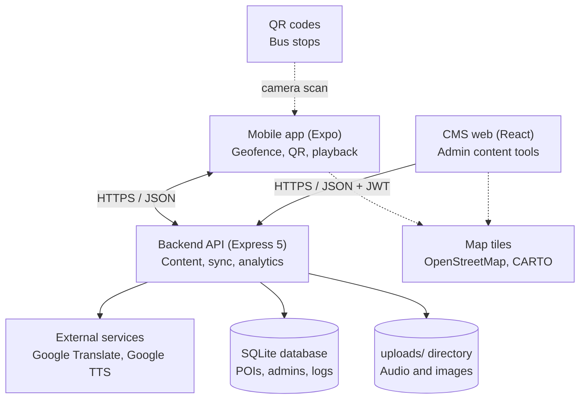

Refinements compared with the team's original component diagram (README §1): the database is a single SQLite file accessed through `node:sqlite`; file storage is a local `uploads/` directory served statically at `/uploads`; translate/TTS APIs are used only by the backend on behalf of the CMS, never by the mobile app (the app uses on-device TTS). Both clients load map background tiles directly from public tile servers (CMS: OpenStreetMap; app: CARTO Voyager).

### 1.2 Backend: layered architecture

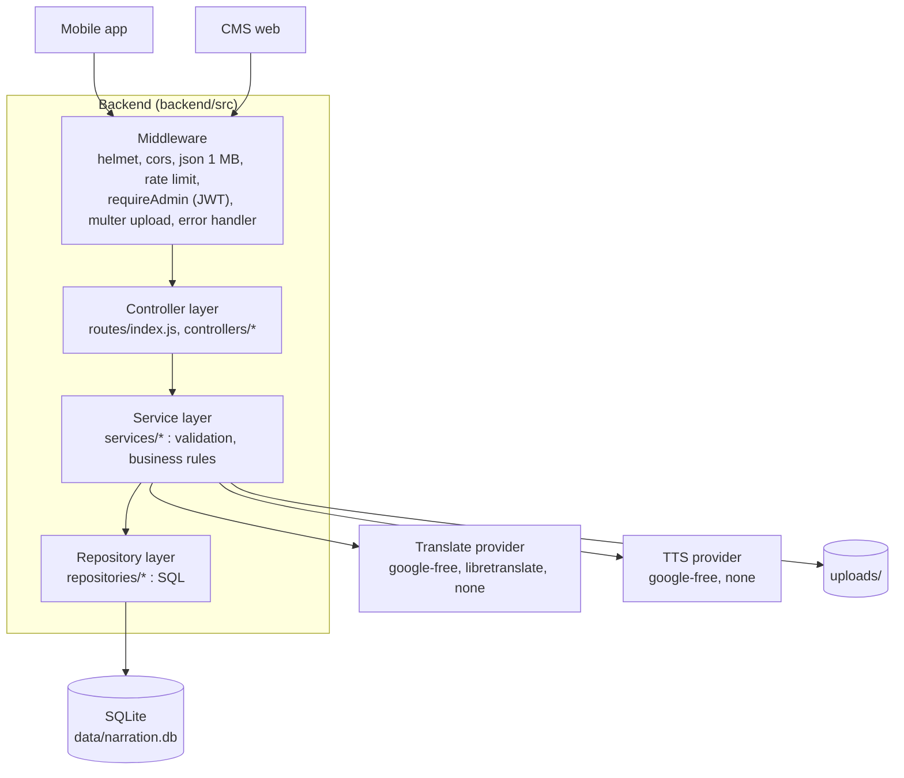

Rules applied:
- Controllers only parse HTTP input (`idParam`, `req.body`, `req.file`) and format responses; they contain no business rules.
- Services own validation and business rules (UC3 E1, UC4 E1, log validation, coordinate rounding, content versioning) and open transactions.
- Repositories own SQL and return plain objects. They never throw business errors.
- Composition happens once in `app.js` (`createRepositories(db)` → `createServices(repos, {translator, tts})` → `createRouter(services)`). Translate and TTS providers are injected, which lets tests replace them with fakes.
- Errors are raised as `AppError(status, code, message, details)` and converted to JSON by `middleware/error.js`.

Files are written by the service/middleware layer (multer disk storage, `saveBuffer`, `removeAudioFile`) rather than by repositories; the original diagram's "Repository → File storage" edge is therefore drawn from the service layer here.

### 1.3 Backend module list

| Layer | Module | Responsibility | UC |
|---|---|---|---|
| Entry | `server.js` | Opens DB, ensures upload dir, refuses production start with the default JWT secret, listens on `PORT` | all |
| Entry | `app.js` | Wires layers, security middleware, static `/uploads`, `/api` router | all |
| Config | `config.js` | Environment variables, language list, default language `vi` | all |
| Routes | `routes/index.js` | Public routes, `/auth/login`, `/admin/*` guarded by `requireAdmin`, rate limiters | all |
| Controller | `publicController` | health, languages, sync, QR resolve, log ingestion | UC1, UC2, UC5 |
| Controller | `authController` | login, me, change password | UC3–UC5 |
| Controller | `poiController` | POI CRUD, audio upload/remove, TTS, images, translate, QR | UC3 |
| Controller | `tourController` | Tour CRUD | UC4 |
| Controller | `analyticsController` | Report | UC5 |
| Service | `authService` | bcrypt verification, JWT issue/verify, password change | UC3–UC5 |
| Service | `poiService` | `validatePoiInput`, transactional create/update/delete, audio attach/remove, clean-up of replaced audio and image files, version bump | UC3 |
| Service | `tourService` | Tour validation (≥ 1 POI, unique, existing), ordered save, version bump | UC4 |
| Service | `qrService` | Random payload generation, `extractPayload`, resolve to POI; create/delete bump the content version | UC2, UC3 A2 |
| Service | `syncService` | Content version, full snapshot (POIs with translations, QR codes, tours) | UC1, UC2, UC4 |
| Service | `logService` | Validate and insert usage/location batches; skip usage records of deleted POIs (`{inserted, skipped}`); 4-decimal rounding | UC1, UC2, UC5 |
| Service | `analyticsService` | Filter parsing, tour bounding box, report assembly | UC5 |
| Service | `translateService` | Provider adapter (Google free endpoint, LibreTranslate, none), input limits | UC3 |
| Service | `ttsService` | Text chunking (≤ 180 chars), Google TTS calls, MP3 concatenation | UC3 |
| Repository | `adminRepository`, `poiRepository`, `translationRepository`, `qrRepository`, `tourRepository`, `logRepository`, `metaRepository`, `analyticsRepository` | SQL per aggregate | all |
| DB | `db/database.js` | Schema DDL, `openDatabase`, `transaction()` helper | all |
| DB | `db/seed.js` | Sample data (8 POIs in District 4, 2 tours, 5 bus-stop QR codes); `--demo` adds 30 days of simulated logs | demo |
| Middleware | `auth.js`, `upload.js`, `error.js` | Bearer token guard; MIME/size-checked uploads with random names; error mapping | all |

### 1.4 Mobile app (`mobile/`, Expo SDK 58, React Native 0.88, TypeScript, Expo Router)

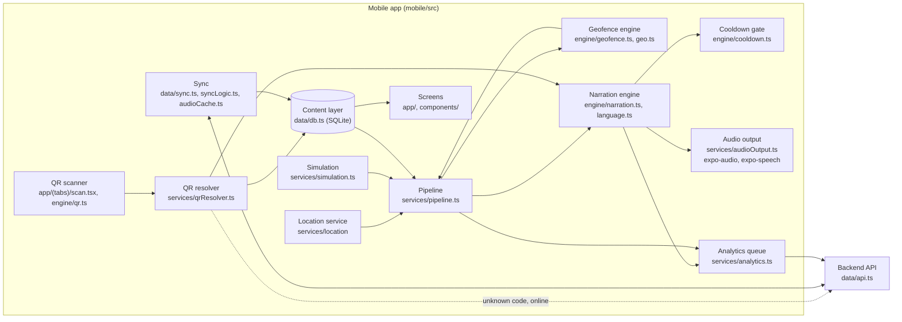

| Module (file) | Design as implemented |
|---|---|
| Entry (`index.js`) | Defines the background location task before loading `expo-router/entry` (required by TaskManager). |
| Screens (`src/app/`) | Tabs `(tabs)/index.tsx` Map, `tours.tsx`, `scan.tsx`, `settings.tsx`; detail screens `poi/[id].tsx`, `tour/[id].tsx`. Shared `MiniPlayer`, `NoticeBanner`, `ui.tsx`. UI strings in `src/i18n` (Vietnamese UI when the narration language is `vi`, English otherwise). |
| Map (`src/components/map/`) | `LeafletMap.tsx`: `react-native-webview` hosting Leaflet, which is embedded in the bundle (`leafletAssets.generated.ts`), so POI circles and the user position render offline (only background tiles need the network). Chosen over `react-native-maps` because it behaves the same in Expo Go, dev builds and store builds and needs no Google Maps key. |
| Location service (`src/services/location/`) | Foreground `watchPositionAsync`; background `startLocationUpdatesAsync` + `expo-task-manager` (`backgroundTask.ts`) when the user enables "Keep running in background" and grants "Always" permission. Background mode is unavailable in Expo Go; the app falls back to foreground GPS. |
| Pipeline (`src/services/pipeline.ts`) | Single path Location → Geofence → Narration (+ location sampling) used by real GPS, background GPS and simulation. Holds the singleton `GeofenceEngine`, `CooldownGate`, `NarrationEngine`. |
| Geofence engine (`src/engine/geofence.ts`, `geo.ts`) | Pure TypeScript. Drops fixes with `accuracy > 60 m`; enters a POI when haversine distance ≤ `radius_m`; exits only when distance > `radius_m × 1.2`; among all POIs the user is inside, picks highest `priority`, then nearest, then lowest id; triggers each POI at most once per visit (a visit ends on exit). |
| Cooldown gate (`src/engine/cooldown.ts`) | For `geofence` triggers: rejects with `busy` while anything is playing and with `cooldown` if the same POI started playing less than the cooldown ago (default 10 min, configurable 0–240 in Settings). `manual` and `qr` triggers bypass the cooldown and interrupt the current playback. |
| Narration engine (`src/engine/narration.ts`, `language.ts`) | Resolves the translation: selected language → Vietnamese → any language with content (user is notified of the fallback). Source order: downloaded file → server `audio_url` when online → on-device TTS (`expo-speech`, locale from `TTS_LOCALE`). An audio error switches to TTS. On finish/stop logs `listen_seconds`. Audio/speech are injected adapters (`services/audioOutput.ts`), so the engine is unit-tested without a device. |
| QR (`src/engine/qr.ts`, `src/services/qrResolver.ts`, `app/(tabs)/scan.tsx`) | `expo-camera` reads QR codes only; a "Enter code manually" field supports emulators. `parseQrPayload` accepts `NARR:<code>`, bare code and `.../q/<code>`. Lookup order: synced `qr_code` table (offline) → `qr_cache` (codes resolved before) → `GET /api/qr/:payload`. 404/400 → "Invalid QR code" (E1); not found locally and offline → E2 message. A POI returned by the server but missing locally is stored so it plays offline next time. |
| Content layer (`src/data/db.ts`) | `expo-sqlite`, WAL. Content tables are replaced in one transaction on each sync (§6.2). |
| Sync (`src/data/sync.ts`, `syncLogic.ts`, `audioCache.ts`) | Runs on launch, every 5 min, when the app returns to foreground and when connectivity returns. `GET /api/sync/version`; if it differs from the local version (or no data / old local format) downloads `/api/sync`, validates it (`validateBundle` drops malformed POIs and tours/QRs pointing to missing POIs) and replaces content atomically; on error the old data is kept. Afterwards prunes unused audio files and pre-downloads audio of the selected language; "Download all audio" in Settings fetches the rest. |
| Analytics queue (`src/services/analytics.ts`, `analyticsPolicy.ts`) | `SESSION_ID` generated with `expo-crypto` per launch, kept in memory. Usage records and location samples (every ~30 s, or after ≥ 25 m but not more often than every 5 s) are stored in `usage_queue` / `location_queue` and flushed every 60 s in batches of 200. If the server rejects a batch with 400 the records are sent one by one and invalid ones dropped. Turning off "Send anonymous data" stops logging and clears the queues. |
| Simulation (`src/services/simulation.ts`) | "Location simulation" in Settings ignores real GPS: tap the map to place a fake position, or "Simulate walking this tour" moves a marker through the tour stops at ×1–×30 speed, pausing while narration plays. |
| Configuration (`src/config.ts`) | Server URL priority: Settings → `EXPO_PUBLIC_API_URL` → LAN IP of the Metro host (`hostUri`) + port 4000 → platform default (`10.0.2.2` Android emulator, `localhost` iOS simulator). |

Geofence algorithm per fix (as in `GeofenceEngine.update`):

```text
if fix.accuracy is known and > 60 m: ignore fix
for poi in pois:
    d = haversine(fix, poi)
    if poi not in inside and d <= poi.radius_m: inside.add(poi)
    else if poi in inside and d > poi.radius_m * 1.2:
        inside.remove(poi); triggeredThisVisit.remove(poi)
best = argmax over inside of (priority, -distance, -id)
if best exists and best not in triggeredThisVisit:
    triggeredThisVisit.add(best); emit trigger(best)      # cooldown/busy checked by the narration engine
```

A consequence of evaluating all POIs the user is inside (not only new entries): when the user leaves a high-priority POI but is still inside a lower-priority one, the lower one is triggered then.

### 1.5 CMS web (`cms/`, Vite 8, React 19, TypeScript)

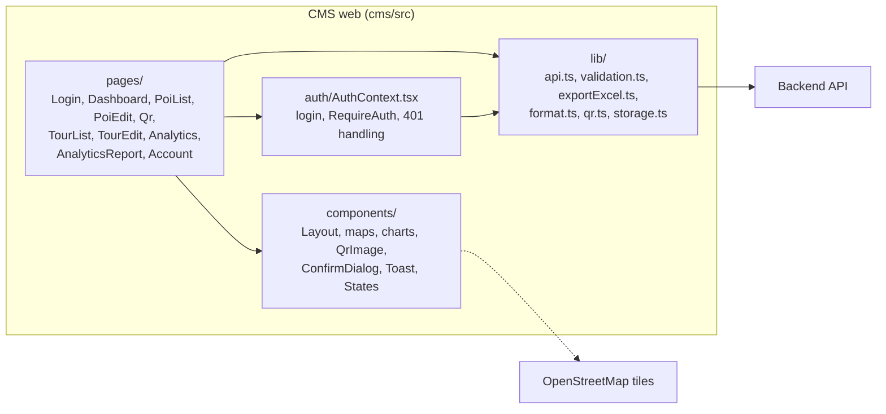

| Module (file) | Design as implemented |
|---|---|
| Routing (`App.tsx`, react-router) | `/login`; protected layout with `/` (dashboard), `/pois`, `/pois/:id` (`new` for creation), `/tours`, `/tours/:id`, `/qr`, `/analytics`, `/account`; `/analytics/report` is a protected print layout without the sidebar. |
| API client (`lib/api.ts`) | Base URL from `VITE_API_URL` (empty = same origin; in dev Vite proxies `/api` and `/uploads`). Adds `Authorization: Bearer`, converts errors to `ApiError` with field `details`, calls `onUnauthorized` on 401 from admin APIs (not from login), maps network failures to `NETWORK_ERROR`. `fileUrl` prefixes `/uploads/...` with the backend origin. |
| Auth (`auth/AuthContext.tsx`, `lib/storage.ts`) | Token stored through a safe localStorage wrapper (in-memory fallback). On 401 the user is sent to `/login?next=<current page>`. |
| Validation (`lib/validation.ts`) | Mirrors backend rules (coordinates, radius 0–5000, priority 0–100, Vietnamese text required, secondary language with title but no text is an error, tour not empty) and maps server `details` to form fields (`mapServerErrors`). |
| POI editor (`pages/PoiEditPage.tsx`, `components/maps.tsx`) | react-leaflet map: click to place, draggable pin, radius circle, other POIs dimmed; manual lat/lng inputs; image upload; six language tabs with "Translate from Vietnamese" and "Translate all empty languages"; per-language audio: upload file, "Create voice" (TTS, asks to save first because TTS uses saved text), preview, remove; QR section (create with label, download PNG, print, delete). Unsaved-changes warning (`useUnsavedWarning`). |
| QR (`pages/QrPage.tsx`, `components/QrImage.tsx`, `lib/qr.ts`) | Lists all codes with POI filter; select codes and print an A4 sheet (4 per page) with stop label, POI name and "scan to listen" text. Images are generated in the browser with `qrcode` from `content` (`NARR:<payload>`). |
| Tours (`pages/TourEditPage.tsx`) | Add POIs, reorder by drag-and-drop or up/down buttons (keyboard accessible, screen-reader announcements), numbered route polyline; empty tour blocked (E1). |
| Analytics (`pages/AnalyticsPage.tsx`, `components/charts.tsx`) | Date presets (7/30/90 days, default 30) and tour filter; KPIs; Chart.js charts (top POIs, average listening time per POI, daily, trigger method, language, hourly converted from UTC to Vietnam time); `leaflet.heat` heatmap with toggle for anonymous routes; "No data" state when `has_data=false`. |
| Export (`lib/exportExcel.ts`, `pages/AnalyticsReportPage.tsx`) | "Export Excel": multi-sheet workbook with SheetJS (`xlsx` 0.20.3). "Export PDF": opens the print-optimised report page and the browser's print dialog ("Save as PDF"), because jsPDF cannot render Vietnamese diacritics without embedding a font. |
| Dashboard / Account | Counts of POIs, tours, QR codes; last-7-days figures; to-do list (POIs missing audio, languages or QR). Account page shows the admin and changes the password. |

## 2. Class diagram (backend services and repositories)

The backend uses factory functions returning objects rather than ES classes; each factory is modelled as a class below. Only the main public operations are shown.

```mermaid
classDiagram
    class AuthService {
        +login(username, password) TokenResult
        +verify(token) Admin
        +changePassword(userId, current, next)
        +hashPassword(pw)
    }
    class PoiService {
        +list(q) PoiSummary[]
        +get(id) Poi
        +create(body, adminId) Poi
        +update(id, body) Poi
        +delete(id)
        +attachAudio(id, lang, file, source) Poi
        +removeAudio(id, lang) Poi
    }
    class TourService {
        +list() TourSummary[]
        +get(id) Tour
        +create(body, adminId) Tour
        +update(id, body) Tour
        +delete(id)
    }
    class QrService {
        +listAll() QrCode[]
        +listForPoi(poiId) QrCode[]
        +create(poiId, label) QrCode
        +delete(id)
        +resolve(raw) QrResolution
    }
    class SyncService {
        +version() int
        +snapshot() Snapshot
    }
    class LogService {
        +recordUsage(body) int
        +recordLocations(body) int
    }
    class AnalyticsService {
        +report(query) Report
    }
    class Translator {
        +provider
        +translate(text, source, target) string
    }
    class Tts {
        +provider
        +synthesize(text, lang) Buffer
    }

    class AdminRepository {
        +findByUsername(username)
        +findById(id)
        +create(data)
        +updatePassword(id, hash)
    }
    class PoiRepository {
        +list(q)
        +findById(id)
        +listWithTranslations()
        +create(data, adminId)
        +update(id, data)
        +delete(id)
        +touch(id)
    }
    class TranslationRepository {
        +listForPoi(poiId)
        +find(poiId, lang)
        +upsertText(poiId, t)
        +deleteExcept(poiId, codes)
        +setAudio(poiId, lang, url, source)
        +clearAudio(poiId, lang)
    }
    class QrRepository {
        +listAll()
        +listForPoi(poiId)
        +findByPayload(payload)
        +create(poiId, payload, label)
        +delete(id)
    }
    class TourRepository {
        +list()
        +listWithPois()
        +findById(id)
        +create(data, adminId)
        +update(id, data)
        +setPois(id, poiIds)
        +delete(id)
    }
    class LogRepository {
        +insertUsage(rows)
        +insertLocations(rows)
    }
    class MetaRepository {
        +getContentVersion() int
        +bumpContentVersion() int
    }
    class AnalyticsRepository {
        +summary(f)
        +byMethod(f)
        +byLanguage(f)
        +perPoi(f)
        +daily(f)
        +hourly(f)
        +heatmap(f)
        +routes(f)
    }

    AuthService --> AdminRepository
    PoiService --> PoiRepository
    PoiService --> TranslationRepository
    PoiService --> QrRepository
    PoiService --> MetaRepository
    TourService --> TourRepository
    TourService --> PoiRepository
    TourService --> MetaRepository
    QrService --> QrRepository
    QrService --> PoiRepository
    SyncService --> PoiRepository
    SyncService --> TourRepository
    SyncService --> MetaRepository
    LogService --> LogRepository
    LogService --> PoiRepository
    AnalyticsService --> AnalyticsRepository
    AnalyticsService --> TourRepository
```

`Translator` and `Tts` are used by `poiController` (`/admin/translate`, `/admin/pois/:id/tts/:lang`); the TTS result is then stored through `PoiService.attachAudio`.

---

## 3. Activity diagrams

### 3.1 UC1: Trigger automatic narration via geofence

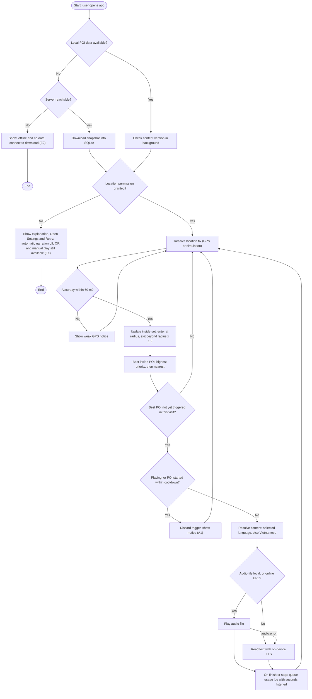

The app syncs before asking for location permission, so E2 is checked first; this does not change the outcome of either exception path.

### 3.2 UC2: Trigger content via QR code scan

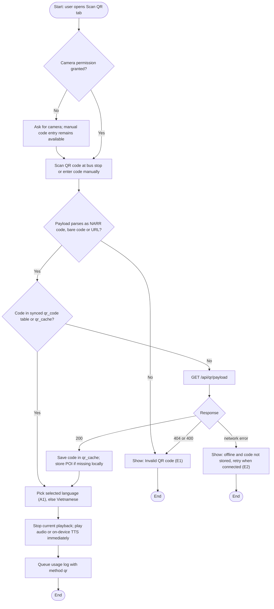

### 3.3 UC3: Manage POIs and narration content

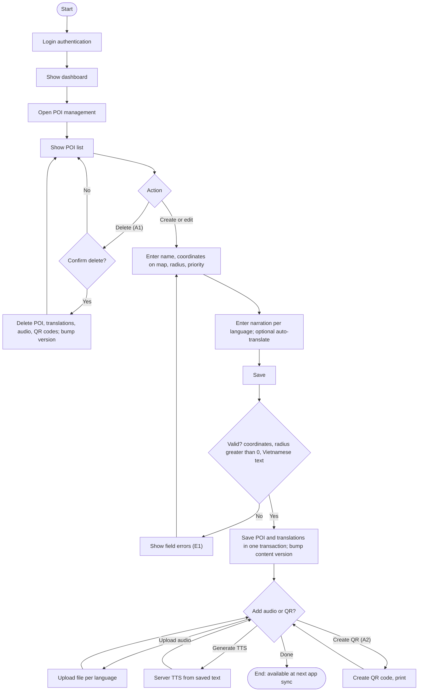

### 3.4 UC4: Manage tours

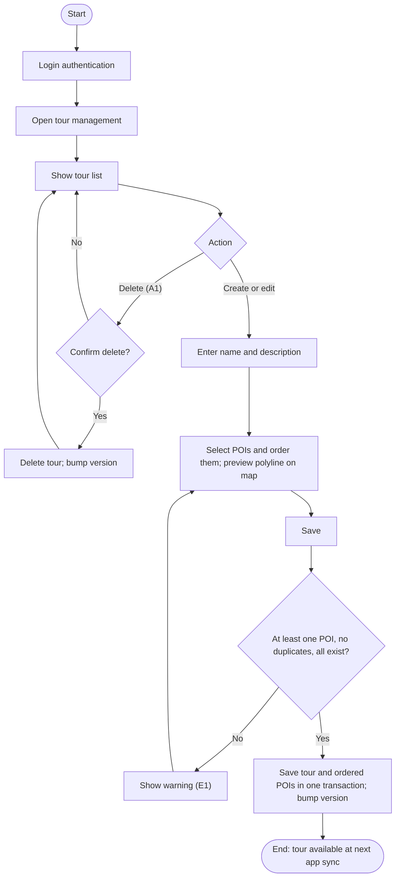

### 3.5 UC5: View usage analytics

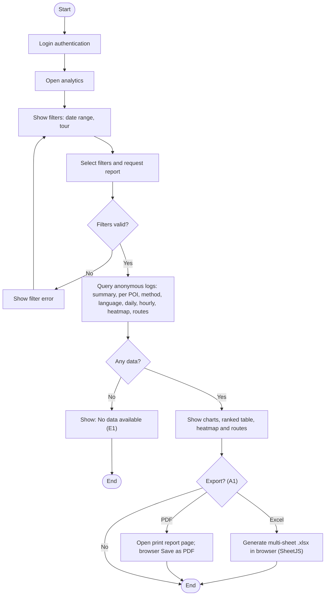

---

## 4. Sequence diagrams

### 4.1 UC1: Geofence trigger

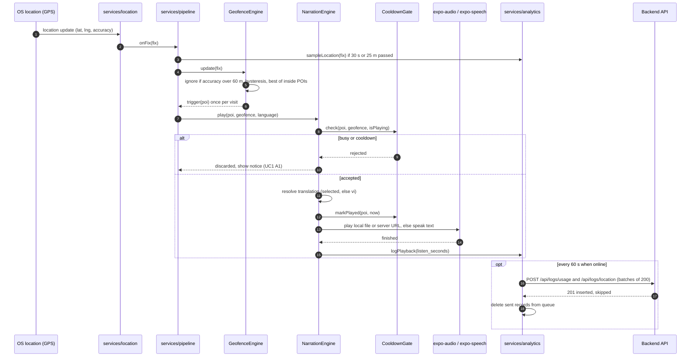

### 4.2 UC2: QR scan

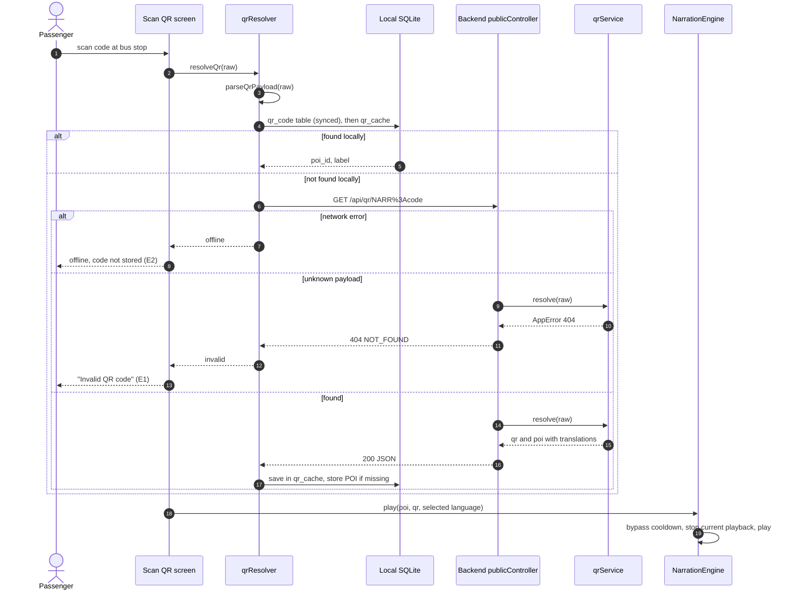

### 4.3 UC3: Save POI and generate TTS audio

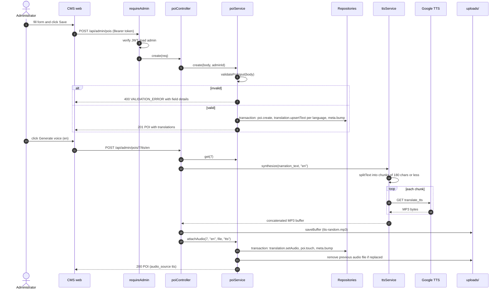

### 4.4 Data sync

Triggered on launch, every 5 minutes, when the app returns to the foreground and when connectivity returns (`services/bootstrap.ts`), or by "Sync now" in Settings.

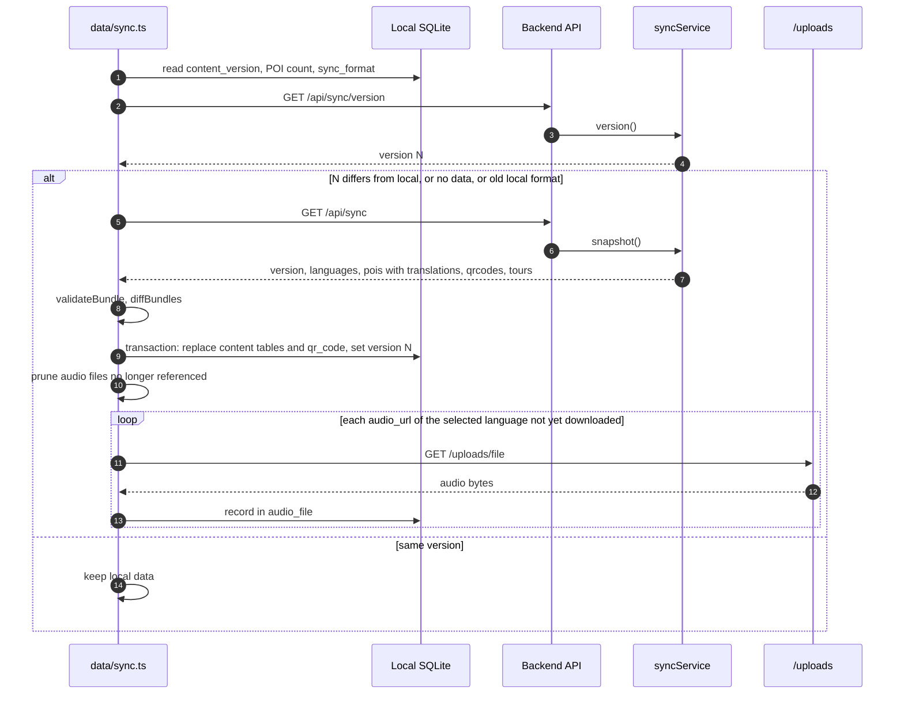

### 4.5 UC5: Analytics report

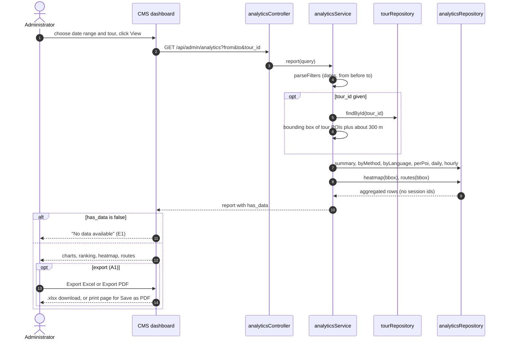

---

## 5. State diagrams: narration engine

The engine has one global playback state (`NarrationEngine`) and a per-POI state combining the geofence visit (`GeofenceEngine`) and the cooldown (`CooldownGate`). The cooldown is measured from the moment a POI **starts** playing (`markPlayed` is called when playback begins).

Engine playback state:

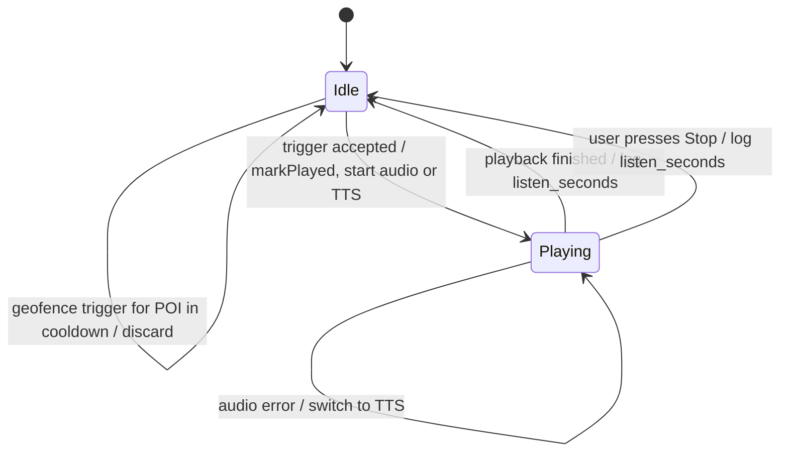

Per-POI state (geofence triggers only; manual and QR plays ignore it):

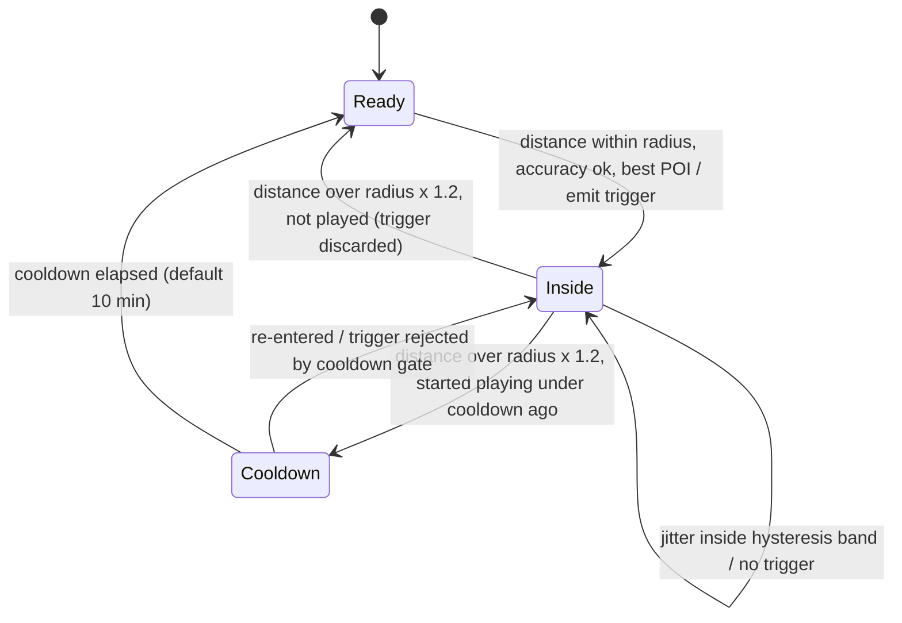

A POI cannot re-trigger while the user stays inside its hysteresis band, so standing at the boundary produces at most one trigger; the cooldown additionally covers walking out and back in.

---

## 6. Data design

### 6.1 Server ERD (actual schema, `backend/src/db/database.js`)

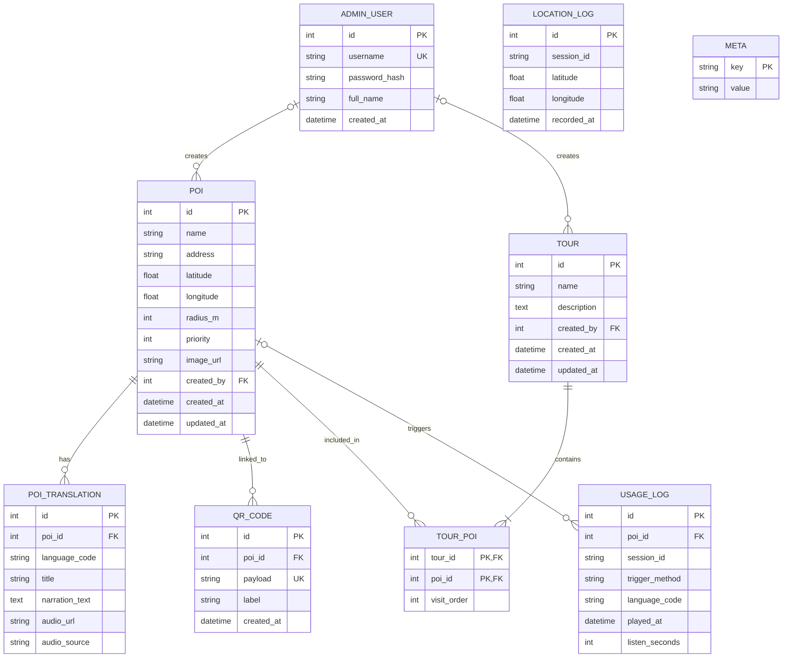

Constraints and indexes:
- `poi.latitude` CHECK −90..90, `poi.longitude` CHECK −180..180, `poi.radius_m` CHECK > 0.
- `poi_translation` UNIQUE (`poi_id`, `language_code`); `audio_source` CHECK IN (`upload`, `tts`).
- `usage_log.trigger_method` CHECK IN (`geofence`, `qr`, `manual`).
- ON DELETE: translations, QR codes and tour links CASCADE with the POI; `usage_log.poi_id` and `created_by` SET NULL.
- Indexes: `usage_log(played_at)`, `usage_log(poi_id)`, `location_log(recorded_at)`.
- `PRAGMA foreign_keys = ON`; WAL journal mode for file databases.
- Timestamps: `created_at`/`updated_at` are SQLite `datetime('now')` (UTC, `YYYY-MM-DD HH:MM:SS`); log timestamps are ISO-8601 UTC strings.

Differences from the team's original ERD (README §6):

| Change | Reason |
|---|---|
| `poi.address`, `poi.image_url` added | Shown in the CMS list and app detail screen |
| `poi.created_by`, `tour.created_by` (FK to `admin_user`, nullable) | Realise the "manages" relationship; SET NULL so deleting an admin keeps content |
| `created_at` / `updated_at` on `poi`, `tour`; `created_at` on `admin_user`, `qr_code` | Auditing; `updated_at` is included in the snapshot |
| `admin_user.full_name` added | Display name in the CMS |
| `poi_translation.title` added | Per-language display name of the POI |
| `poi_translation.audio_source` (`upload` / `tts`) added | CMS shows whether audio is recorded or synthesised |
| `qr_code.label`, UNIQUE `payload` | Identify the bus stop where the code is installed; payload lookup must be unambiguous |
| `meta` table with `content_version` | Drives version-based sync (§8, D1) |
| `usage_log.poi_id` nullable | Keep history when a POI is deleted |
| `location_log` is not related to any table | Anonymous by design; linking only via random `session_id` |

### 6.2 Mobile local database (`mobile/src/data/db.ts`)

| Table | Purpose |
|---|---|
| `poi`, `poi_translation`, `tour`, `tour_poi` | Copy of the snapshot; replaced in one transaction on each sync |
| `qr_code(payload, poi_id, label)` | QR codes from the snapshot, for offline resolution |
| `qr_cache(code, poi_id, label, resolved_at)` | Codes resolved online that were not in the snapshot |
| `audio_file(url, local_uri, bytes, downloaded_at)` | Audio files downloaded for offline playback |
| `usage_queue`, `location_queue` | Pending anonymous log records (JSON payload) until uploaded |
| `kv(key, value)` | Settings (language, auto narration, cooldown, server URL, anonymous data, background, simulation), `content_version`, `last_sync_at`, `sync_format` |

The schema version is tracked with `PRAGMA user_version`.

---

## 7. Deployment

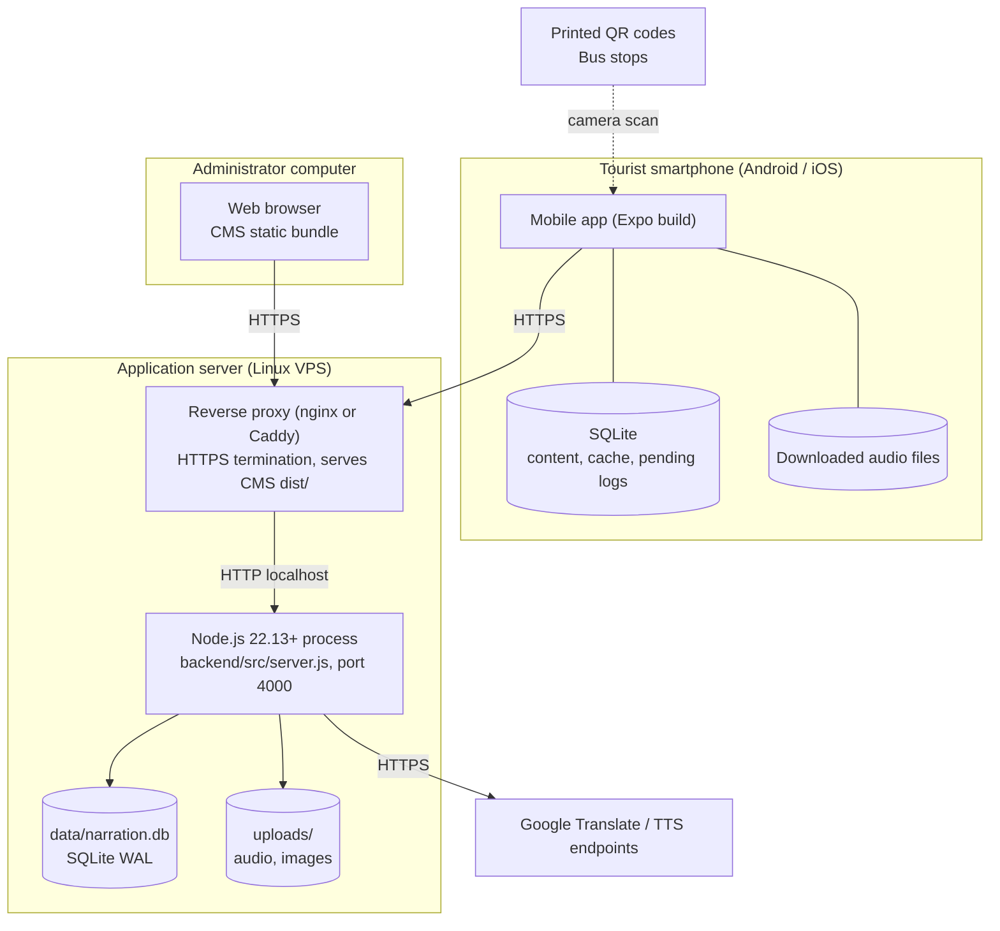

The database server and file storage of the original deployment diagram are realised on the same host as the API (embedded SQLite, local directory). This is adequate for the expected load of a ward-level pilot; §8 D5 discusses the trade-off.

---

## 8. Key design decisions

| ID | Decision | Rationale | Consequences |
|---|---|---|---|
| D1 | **Full-snapshot, version-based sync.** One integer `content_version` is bumped inside the same transaction as every content change; the app compares versions and downloads the complete snapshot when it differs. | Content is small (tens of POIs, a few KB of text each). A full snapshot avoids delta bookkeeping, tombstones for deletions and clock problems. The check request is tiny, so it runs on launch, every 5 minutes and on reconnect. | Each change triggers a full re-download (acceptable at this size). Audio files are fetched separately by URL so the JSON stays small. If the data set grows to thousands of POIs, a delta endpoint by `updated_at` would be needed. |
| D2 | **Discard, do not queue, concurrent triggers** (UC1 A1). | UC1 A1 states the trigger is discarded. Queuing would play stale content after the user has walked past a POI, and could chain several narrations. | A POI passed during another narration is not narrated automatically; the user can open it from the map and press "Play narration" (`trigger_method = manual`). Manual and QR plays are explicit user actions and therefore interrupt the current narration instead of being discarded. |
| D3 | **Accuracy filter (60 m) and exit hysteresis (radius × 1.2)** in addition to cooldown. | Urban GPS fixes jitter by tens of metres; without hysteresis a user standing at the boundary would enter and exit repeatedly. Cooldown alone would hide but not fix this. | Slight delay in detecting exits; narration may not start when accuracy is poor (e.g. under tall buildings). Thresholds are configurable and must be tuned in field tests. |
| D4 | **Privacy by design.** No tourist accounts; random session ID per launch; coordinates rounded to 4 decimals at ingestion; heatmap aggregated in ~11 m cells; routes returned without session IDs. | UC5 business rule requires anonymous processing. Rounding at the server boundary guarantees that precise positions are never stored even if a client sends them. | Routes cannot be linked across days or app launches; analytics count sessions, not unique people. |
| D5 | **Embedded SQLite via `node:sqlite`, no ORM.** | No separate database server to install for the team or the lecturer; transactions and foreign keys are sufficient; zero native build dependencies. | Single-writer model and single-host deployment. Backups must copy the DB file safely (see `04-installation.md`). Migration to PostgreSQL would require rewriting repositories only. |
| D6 | **Two TTS paths.** Server-side TTS produces MP3 files stored with the content; the app falls back to on-device TTS (`expo-speech`) when no audio exists. | Pre-generated MP3 gives consistent voice quality and works offline after download; on-device TTS guarantees narration even when no audio was produced or the free TTS service is unavailable. | Voice quality differs between POIs with and without audio. Device voices for some languages may be missing on some phones. |
| D7 | **Pluggable free translate/TTS providers** (`TRANSLATE_PROVIDER`, `TTS_PROVIDER`, including `none`). | Free endpoints have no SLA and may be rate-limited. Providers are injected so they can be swapped (LibreTranslate) or disabled, and replaced by fakes in tests. | Machine translation is a draft; administrators must review text. Failures surface as 502 `UPSTREAM_ERROR` and never block saving a POI. |
| D8 | **Random, opaque QR payloads** (`NARR:` + 12-char base64url from 9 random bytes) instead of POI IDs. | Codes cannot be enumerated or guessed; a printed code can be revoked (deleted) and re-issued without changing the POI. A POI can have one code per bus stop. | The mapping lives on the server; the `/sync` snapshot carries `qrcodes: [{payload, poi_id, label}]` so the app resolves codes offline. |
| D9 | **Stateless JWT for the CMS** (8 h expiry), bcrypt password hashes, login rate limit. | Simple for a single-role admin system; no session store needed. | Tokens cannot be revoked before expiry except by rotating `JWT_SECRET`. Acceptable for a small admin group. |
| D10 | **Validation in the service layer, mirrored in the CMS.** | The backend is the authority (BR-02, BR-03); CMS checks give immediate feedback. Field-keyed `details` let the CMS place errors next to inputs. | Rules must be kept consistent in two places; backend tests are the reference. |

### 8.1 Open design issues
1. **Offline QR resolution (resolved).** `GET /sync` now includes `qrcodes: [{payload, poi_id, label}]` and QR create/delete bumps `content_version`, so codes resolve offline from SQLite; the online `/qr/:payload` lookup remains as a fallback.
2. **QR scan during playback (decided).** UC2 does not specify this case. The implementation lets QR and manual plays bypass the cooldown and stop the current narration, because they are explicit user requests; UC1 A1 (discard) applies only to geofence triggers.
3. **Background location limits.** iOS and Android may throttle or stop background updates; background mode also requires a development or store build (not Expo Go). The design keeps foreground operation as the reference behaviour (see risks in `06-project-management.md`).
4. **Device verification.** The mobile app has been verified by unit tests, live-backend tests, type checking and bundle export, but not yet on a phone, emulator or simulator; map, camera, audio, permissions and background location still need device testing (`03-test-plan.md`).
