# Kế hoạch kiểm thử và ca kiểm thử

**Dự án:** Hệ thống thuyết minh tự động đa ngôn ngữ
**Phiên bản tài liệu:** 1.0 (18/10/2026)
**Tài liệu liên quan:** `01-SRS.md` (mã FR/NFR), `02-design.md`

---

## 1. Phạm vi và mục tiêu
- Kiểm chứng rằng mọi yêu cầu chức năng từ FR-01 đến FR-39 đều được ít nhất một ca kiểm thử (test case) bao phủ.
- Tự động hoá toàn bộ quy tắc nghiệp vụ phía backend (kiểm tra dữ liệu nhập, đánh phiên bản đồng bộ, phân giải QR, ẩn danh hoá, thống kê).
- Kiểm chứng trên thiết bị thật, tại các điểm tham quan (POI) thật, những hành vi phía client không tự động hoá được (GPS, chạy nền, camera, audio).

Không kiểm thử: tải/hiệu năng ở quy mô production, kiểm thử xâm nhập, tính sẵn sàng của các endpoint dịch/TTS miễn phí của Google.

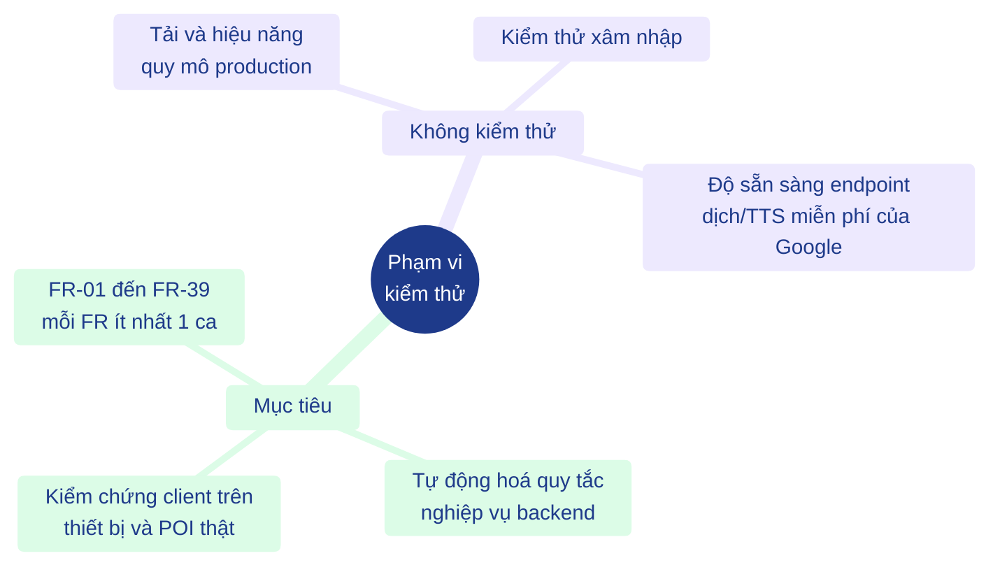
*Hình: phạm vi và mục tiêu kiểm thử, kèm những gì nằm ngoài phạm vi*

## 2. Chiến lược

| Mức | Đối tượng | Công cụ | Cách làm |
|---|---|---|---|
| Kiểm thử đơn vị (unit test) | Các hàm thuần của backend: `splitText`, `extractPayload`, `validatePoiInput`, adapter dịch | `node:test`, `node:assert` | Gọi trực tiếp; mạng được thay bằng `fetchImpl` tiêm vào |
| Kiểm thử đơn vị | Các module thuần của mobile: geofence, thời gian chờ phát lại (cooldown), thuyết minh (narration), ngôn ngữ, phân tích QR, logic đồng bộ, chính sách thống kê | Jest (`jest-expo`) | Vị trí tổng hợp, đồng hồ giả, adapter audio/giọng nói tiêm vào; không cần thiết bị |
| Kiểm thử đơn vị | Thư viện CMS: API client, kiểm tra dữ liệu nhập, định dạng, xuất Excel | Vitest | `fetch` giả lập; không cần trình duyệt |
| Tích hợp (mobile ↔ backend) | Đồng bộ, phân giải QR, kiểm tra nhật ký, đi bộ mô phỏng theo tour | Jest `backend.live.test.ts` với `LIVE_API` | Chỉ gọi đọc tới một backend đang chạy đã nạp dữ liệu seed |
| Tích hợp (API) | Mọi endpoint REST qua ứng dụng Express thật | `node:test` + `fetch` | Mỗi file kiểm thử khởi động ứng dụng trên một cổng ngẫu nhiên với cơ sở dữ liệu SQLite trong bộ nhớ đã nạp dữ liệu mẫu; dịch/TTS được thay bằng bản giả (`tests/helpers.js`) |
| Hệ thống / E2E | CMS chạy với một backend đang chạy | Chạy kịch bản trên Chrome headless | TC-73 đến TC-92 |
| Hệ thống (thiết bị) | Ứng dụng di động trên emulator/simulator hoặc điện thoại, nối với backend | Thủ công | Các ca đánh dấu "Chờ thiết bị" ở §5.2 |
| Kiểm thử thực địa (field test) | Ứng dụng di động trên điện thoại thật tại Khánh Hội, Vĩnh Hội, Xóm Chiếu | Danh sách kiểm tra thủ công (§6) | FT-01 đến FT-09 |
| Nghiệm thu | Luồng cơ bản, luồng thay thế và luồng ngoại lệ của UC1–UC5 | Trình diễn với giảng viên | Dùng dữ liệu seed và chế độ mô phỏng vị trí |

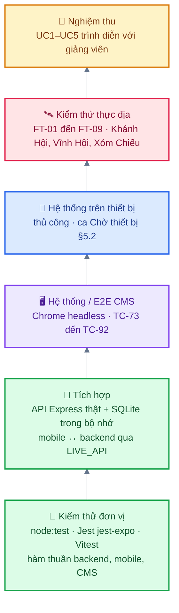
*Hình: tháp kiểm thử, từ mức thấp (đơn vị, tự động, nhiều kiểm thử nhất) tới mức cao (nghiệm thu, thủ công, sát thực tế)*

Điều kiện bắt đầu: kiểm thử backend đạt; đã nạp dữ liệu seed; các client build không lỗi.
Điều kiện kết thúc: mọi kiểm thử tự động đều đạt; mọi ca phía client có độ ưu tiên M đều Đạt hoặc có lỗi đã được chấp nhận; hoàn thành danh sách kiểm tra thực địa tại ít nhất 3 điểm tham quan.

Lỗi được ghi thành GitHub issue, kèm mã TC/FT, các bước, kết quả mong đợi và kết quả thực tế, thiết bị/hệ điều hành và mức độ nghiêm trọng (blocker, major, minor).

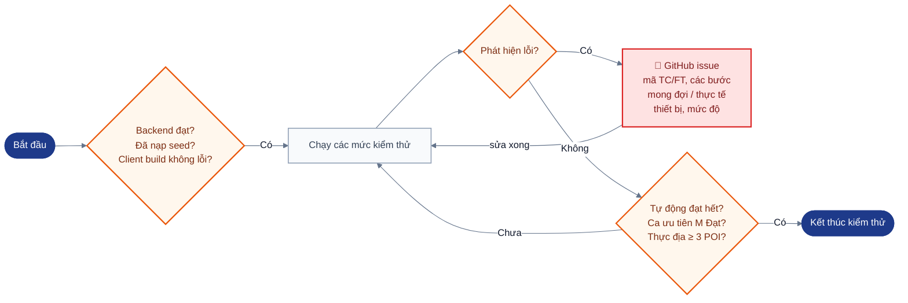
*Hình: điều kiện bắt đầu, điều kiện kết thúc và vòng ghi nhận lỗi*

## 3. Môi trường kiểm thử

| Hạng mục | Giá trị |
|---|---|
| Runtime backend | Node.js ≥ 22.13 (kết quả bên dưới chạy bằng Node v26.11.1 trên macOS) |
| Cơ sở dữ liệu cho kiểm thử tự động | SQLite `:memory:`, nạp bằng `db/seed.js` (8 điểm tham quan, 2 tour, 5 mã QR, quản trị viên `admin` / `admin123`) |
| Dịch vụ bên ngoài trong kiểm thử tự động | Bộ dịch giả (`[src->dst] text`) và TTS giả (byte cố định); tắt giới hạn tần suất |
| CMS | Đơn vị: Vitest trên Node; E2E: Chrome headless chạy với backend thật đã nạp seed (Cần bổ sung: ghi phiên bản trình duyệt) |
| Mobile | Kiểm thử đơn vị và kiểm thử live trên Node (jest-expo). Kiểm thử trên thiết bị: ít nhất một máy Android và một máy iOS có GPS (Cần bổ sung: ghi model và phiên bản hệ điều hành); ngày 18/10/2026 chưa có thiết bị hay emulator nào |
| Khu vực thực địa | Các điểm tham quan Quận 4 trong dữ liệu seed. Toạ độ seed chỉ gần đúng và phải được kiểm tra trên bản đồ trước khi kiểm thử thực địa |

Lệnh: `cd backend && npm test`; `cd cms && npm test`; `cd mobile && npm test`; `cd mobile && LIVE_API=http://localhost:4000 npx jest backend.live` (backend đang chạy với dữ liệu seed).

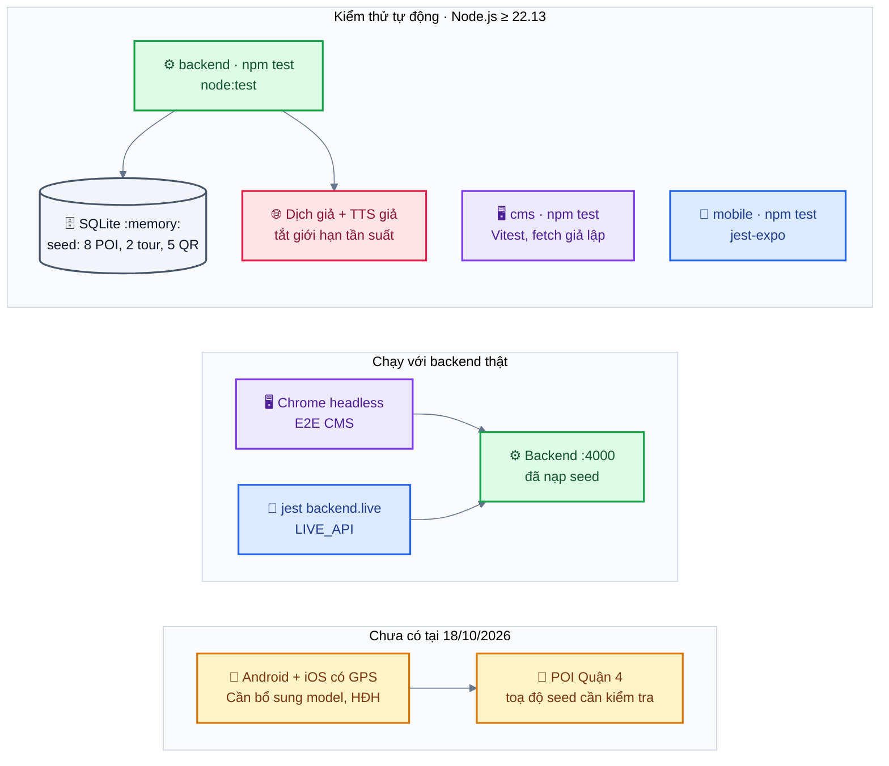
*Hình: ba nhóm môi trường kiểm thử: tự động, chạy với backend thật, và thiết bị/thực địa chưa có*

## 4. Kết quả kiểm thử tự động

Tất cả chạy ngày 18/10/2026.

| Bộ kiểm thử | Lệnh | Kết quả |
|---|---|---|
| Backend (`backend/tests`) | `npm test` | **43 đạt, 0 không đạt** (≈ 1,1 giây) |
| Đơn vị CMS (`cms/src/lib/*.test.ts`) | `npm test` | **36 đạt, 0 không đạt** (3 file) |
| Đơn vị mobile (`mobile/src/__tests__`) | `npm test` | **62 đạt, 0 không đạt** (5 bộ, không gồm bộ live) |
| Mobile với backend thật | `LIVE_API=… npx jest backend.live` | **5 đạt, 0 không đạt** (với backend vừa nạp lại seed) |

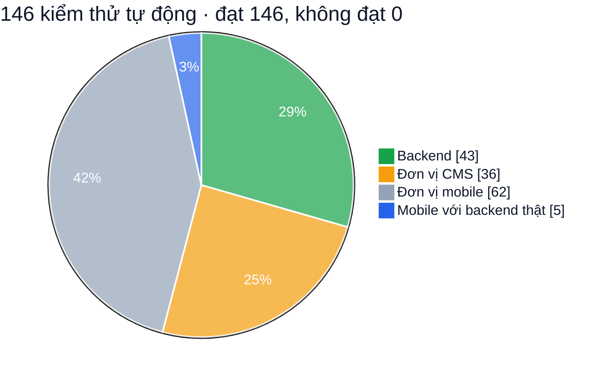
*Hình: số kiểm thử tự động theo bộ, chạy ngày 18/10/2026; mọi bộ đều đạt 100%*

Kiểm thử backend theo từng file:

| File kiểm thử | Số kiểm thử | Đạt |
|---|---|---|
| `tests/auth.test.js` | 6 | 6 |
| `tests/poi.test.js` | 14 | 14 |
| `tests/qr-tour.test.js` | 10 | 10 |
| `tests/analytics.test.js` | 9 | 9 |
| `tests/services.test.js` | 4 | 4 |

## 5. Ca kiểm thử

Các giá trị trạng thái: **Đạt**, **Không đạt**, **Đạt một phần**, **Chưa thực hiện**, **Chờ thiết bị** (cần điện thoại hoặc emulator), **Bị chặn**. Tên kiểm thử backend trong mã nguồn viết bằng tiếng Việt; bảng dưới đây ghi tiêu đề kèm tên file tham chiếu.

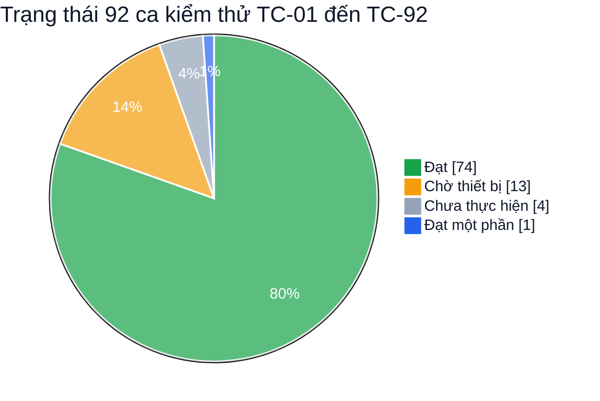
*Hình: trạng thái các ca TC đếm từ bảng §5.1–§5.3; ngoài ra 9 ca thực địa FT-01 đến FT-09 ở §6 đều Chờ thiết bị*

### 5.1 Ca kiểm thử tự động phía backend

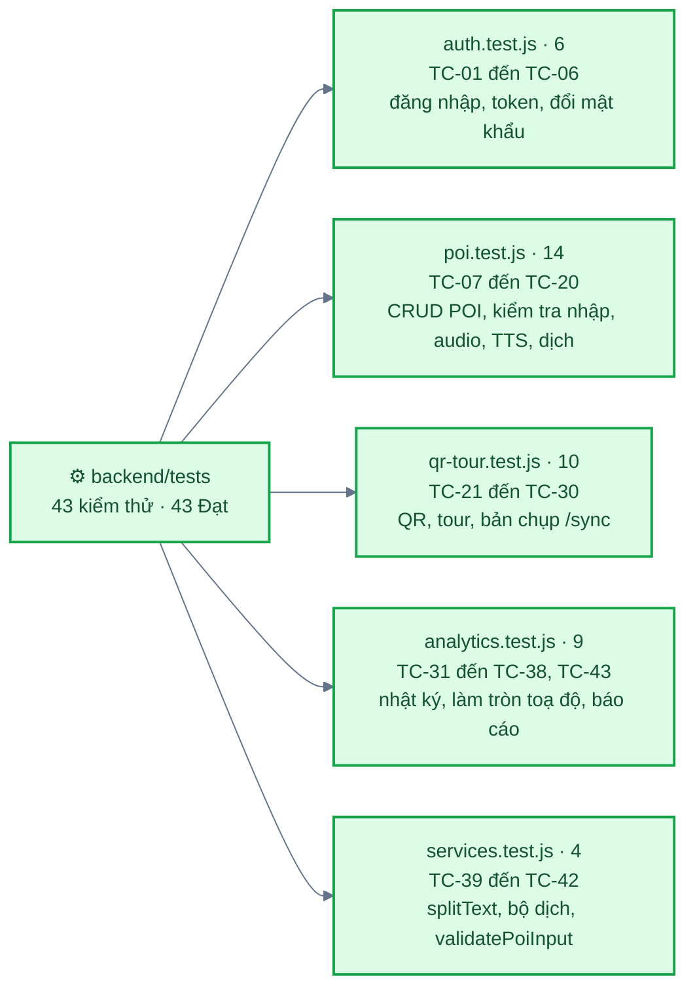
*Hình: 43 ca backend chia theo file kiểm thử, tất cả Đạt*

| ID | Tiêu đề (file) | Các bước / đầu vào | Kết quả mong đợi | UC | FR | Trạng thái |
|---|---|---|---|---|---|---|
| TC-01 | Đăng nhập với thông tin hợp lệ (auth) | POST `/auth/login` admin/admin123 | 200, trả về token, user không có `password_hash` | UC3 | FR-20 | Đạt |
| TC-02 | Đăng nhập sai mật khẩu (auth) | POST `/auth/login` admin/wrong | 401 | UC3 | FR-20 | Đạt |
| TC-03 | Đăng nhập thiếu trường (auth) | POST `/auth/login` `{}` | 400 | UC3 | FR-20 | Đạt |
| TC-04 | Gọi API quản trị không có token (auth) | GET `/admin/pois` không có header | 401 | UC3 | FR-20 | Đạt |
| TC-05 | Gọi API quản trị với token giả mạo (auth) | GET `/admin/pois` với `Bearer abc.def.ghi` | 401 | UC3 | FR-20 | Đạt |
| TC-06 | Đổi mật khẩu (auth) | Sai mật khẩu hiện tại; mật khẩu mới 4 ký tự; đổi hợp lệ; đăng nhập bằng mật khẩu mới | 400, 400, 204, 200 | UC3 | FR-20 | Đạt |
| TC-07 | Liệt kê điểm tham quan mẫu (poi) | GET `/admin/pois` | 200, 8 phần tử, ngôn ngữ có `vi` | UC3 | FR-21 | Đạt |
| TC-08 | Tìm điểm tham quan theo tên (poi) | GET `/admin/pois?q=Vĩnh Khánh` | Đúng 1 phần tử | UC3 | FR-21 | Đạt |
| TC-09 | Tạo điểm tham quan hợp lệ làm tăng phiên bản đồng bộ (poi) | Đọc `/sync/version`; POST điểm hợp lệ; đọc lại phiên bản | 201, 1 bản dịch; phiên bản mới > phiên bản cũ | UC3 | FR-22, FR-28, FR-03 | Đạt |
| TC-10 | Từ chối bán kính 0, thiếu vĩ độ, không có nội dung (poi) | POST với `radius_m:0, latitude:'', translations:[]` | 400 kèm `details.radius_m`, `details.latitude`, `details.translations` | UC3 E1 | FR-25 | Đạt |
| TC-11 | Từ chối toạ độ ngoài phạm vi (poi) | POST với lat 91, lng 200 | 400 kèm `details.latitude` và `details.longitude` | UC3 E1 | FR-25 | Đạt |
| TC-12 | Từ chối điểm tham quan không có ngôn ngữ mặc định (poi) | POST chỉ có văn bản tiếng Anh | 400 | UC3 E1 | FR-25 | Đạt |
| TC-13 | Từ chối ngôn ngữ không hỗ trợ hoặc trùng lặp (poi) | POST với `xx`; POST với `vi` hai lần | 400, 400 | UC3 E1 | FR-25 | Đạt |
| TC-14 | Sửa điểm tham quan và bỏ một ngôn ngữ (poi) | Tạo điểm có vi+en; PUT với tên mới, bán kính 75, chỉ vi | 200, tên và bán kính được cập nhật, translations = [vi] | UC3 | FR-22 | Đạt |
| TC-15 | Xoá điểm tham quan (poi) | DELETE; GET; DELETE lần nữa | 204, 404, 404 | UC3 A1 | FR-26 | Đạt |
| TC-16 | Tham số id không hợp lệ (poi) | GET `/admin/pois/abc` | 400 | UC3 | FR-25 | Đạt |
| TC-17 | Tải lên audio, phục vụ file, xoá audio (poi) | POST multipart `audio` (audio/mpeg) cho POI 1 `vi`; GET URL file; DELETE audio | 200, `audio_url` `/uploads/audio-*.mp3`, `audio_source` upload; file trả 200; `audio_url` null sau khi xoá | UC3 | FR-24 | Đạt |
| TC-18 | Từ chối file tải lên không phải audio (poi) | POST multipart `application/x-php` | 400 | UC3 | FR-24, NFR-10 | Đạt |
| TC-19 | Tạo audio TTS từ văn bản đã lưu (poi) | POST `/admin/pois/2/tts/en` | 200, bản dịch `en` có `audio_source` tts | UC3 | FR-24 | Đạt |
| TC-20 | Dịch tự động (poi) | POST `/admin/translate` vi→en "Xin chào"; sau đó văn bản rỗng | 200 kèm văn bản đã dịch; 400 | UC3 | FR-23 | Đạt |
| TC-21 | Tạo QR cho điểm tham quan và phân giải (qr-tour) | POST `/admin/pois/3/qrcodes`; GET `/qr/<content>` không xác thực | 201, nội dung bắt đầu bằng `NARR:`; 200, `poi.id` = 3 kèm bản dịch | UC2, UC3 A2 | FR-14, FR-27 | Đạt |
| TC-22 | Mã QR không tồn tại (qr-tour) | GET `/qr/NARR:khongtontai` | 404 | UC2 E1 | FR-16 | Đạt |
| TC-23 | Tách payload từ URL và tiền tố (qr-tour) | `extractPayload('https://example.com/q/abcDEF123')`, `extractPayload('NARR:xyz12345')` | `abcDEF123`, `xyz12345` | UC2 | FR-14 | Đạt |
| TC-24 | Xoá mã QR (qr-tour) | Tạo QR; DELETE; phân giải payload | 204; 404 | UC3 A2 | FR-27 | Đạt |
| TC-25 | Tạo tour theo thứ tự cho trước (qr-tour) | POST tour `poi_ids [3,1,2]` | 201, POI [3,1,2], visit_order [1,2,3] | UC4 | FR-29, FR-30 | Đạt |
| TC-26 | Từ chối tour rỗng (qr-tour) | POST tour `poi_ids []` | 400 kèm `details.poi_ids` | UC4 E1 | FR-31 | Đạt |
| TC-27 | Từ chối điểm trùng lặp hoặc không tồn tại trong tour (qr-tour) | `poi_ids [1,1]`; `poi_ids [999]` | 400, 400 | UC4 E1 | FR-31 | Đạt |
| TC-28 | Sửa và xoá tour (qr-tour) | Tạo; PUT tên B, `[2,1]`; DELETE; GET | Thứ tự cập nhật [2,1]; 204; 404 | UC4 A1 | FR-30, FR-32 | Đạt |
| TC-29 | Nội dung bản chụp đồng bộ (qr-tour) | GET `/sync` không xác thực | version ≥ 1, ≥ 8 POI kèm bản dịch, ≥ 2 tour có `poi_ids`, ≥ 5 `qrcodes` có payload và `poi_id`, ngôn ngữ mặc định `vi` | UC1, UC2, UC4 | FR-02, FR-14, FR-33 | Đạt |
| TC-30 | Xoá điểm tham quan thì điểm đó bị gỡ khỏi tour (qr-tour) | Tạo POI; tour [1, mới]; xoá POI; GET tour | POI của tour = [1] | UC3 A1 | FR-26 | Đạt |
| TC-31 | Ghi nhật ký sử dụng, đơn lẻ và theo lô (analytics) | POST một object; POST mảng 2 phần tử (qr, manual) | 201; `inserted` = 2 | UC1, UC2 | FR-10, FR-18 | Đạt |
| TC-32 | Từ chối nhật ký sử dụng không hợp lệ (analytics) | Bản ghi đơn có POI không tồn tại; session id `x`; method `bay` | 400 cho mỗi trường hợp | UC1 | FR-10 | Đạt |
| TC-33 | Mẫu vị trí được làm tròn (analytics) | POST lat 10.761234567, lng 106.703987654 | 201; lưu thành 10.7612, 106.704 | UC5 | FR-34, NFR-07 | Đạt |
| TC-34 | Báo cáo thống kê (analytics) | GET `/admin/analytics?from=2020-01-01` sau TC-31 đến TC-33 | `has_data` true; 3 lượt phát; 1 phiên; POI đứng đầu là 2 với 2 lượt phát, trung bình 25 giây; bản đồ nhiệt (heatmap) không rỗng; 1 lộ trình không có `session_id` | UC5 | FR-36, NFR-07 | Đạt |
| TC-35 | Lọc báo cáo theo tour (analytics) | GET `?tour_id=2&from=2020-01-01` | Lượt phát = 2 (chỉ các POI của tour 2) | UC5 | FR-35, FR-36 | Đạt |
| TC-36 | Không có dữ liệu trong khoảng ngày (analytics) | GET `?from=2000-01-01&to=2000-01-31` | 200, `has_data` false, 0 lượt phát | UC5 E1 | FR-37 | Đạt |
| TC-37 | Bộ lọc không hợp lệ (analytics) | `from=abc`; `from` sau `to`; `tour_id=999` | 400 cho mỗi trường hợp | UC5 | FR-35 | Đạt |
| TC-38 | Dữ liệu demo cung cấp cho biểu đồ (analytics) | Khởi động máy chủ với seed `--demo`; GET báo cáo | Lượt phát > 300; chuỗi theo ngày > 10 ngày | UC5 | FR-36 | Đạt |
| TC-39 | Chia nhỏ văn bản cho TTS (services) | `splitText` với văn bản tiếng Việt dài + một từ 400 ký tự | Mọi đoạn ≤ 180 ký tự; không mất ký tự nào | UC3 | FR-24 | Đạt |
| TC-40 | Bộ dịch ghép các đoạn, ánh xạ `zh` (services) | Fetch giả trả về hai đoạn | URL chứa `tl=zh-CN`; kết quả `你好世界` | UC3 | FR-23 | Đạt |
| TC-41 | Bộ dịch lỗi mạng (services) | Fetch giả ném lỗi | Bị từ chối với mã trạng thái 502 | UC3 | FR-23 | Đạt |
| TC-42 | Chuẩn hoá trong `validatePoiInput` (services) | Tên có khoảng trắng, số ở dạng chuỗi, bán kính 30.6, dòng `en` rỗng | Tên được cắt khoảng trắng; bán kính 31; độ ưu tiên 1; giữ 1 bản dịch | UC3 | FR-25 | Đạt |
| TC-43 | Lô có điểm tham quan đã xoá được chấp nhận một phần (analytics) | POST lô: một bản ghi có POI 999, một bản ghi hợp lệ | 201, `{inserted: 1, skipped: 1}` | UC1, UC5 | FR-10 | Đạt |

### 5.2 Ca kiểm thử ứng dụng di động

Bằng chứng: **unit** = kiểm thử jest trong `mobile/src/__tests__/` (62 kiểm thử, chạy 18/10/2026); **live** = `backend.live.test.ts` chạy với backend thật đã nạp seed (5 kiểm thử). **Chờ thiết bị** = cần điện thoại, emulator hoặc simulator; ứng dụng chưa được chạy trên bất kỳ thiết bị nào.

```mermaid
%%{init: {"theme":"base","fontFamily":"Helvetica Neue, Arial, sans-serif","themeVariables":{"fontFamily":"Helvetica Neue, Arial, sans-serif","fontSize":"15px","primaryColor":"#EFF6FF","primaryBorderColor":"#3B82F6","primaryTextColor":"#0F172A","lineColor":"#64748B","secondaryColor":"#F0FDF4","tertiaryColor":"#FFFFFF","clusterBkg":"#F8FAFC","clusterBorder":"#CBD5E1","edgeLabelBackground":"#FFFFFF","noteBkgColor":"#FEF9C3","noteBorderColor":"#EAB308","actorBkg":"#DBEAFE","actorBorder":"#2563EB","actorTextColor":"#1E3A8A","signalColor":"#475569","signalTextColor":"#0F172A","labelBoxBkgColor":"#F1F5F9","labelBoxBorderColor":"#94A3B8","activationBkgColor":"#E0F2FE","activationBorderColor":"#0284C7","sequenceNumberColor":"#FFFFFF","pie1":"#16A34A","pie2":"#F59E0B","pie3":"#94A3B8","pie4":"#DC2626","pie5":"#2563EB","pie6":"#7C3AED","pieStrokeColor":"#FFFFFF","pieSectionTextColor":"#FFFFFF","quadrant1Fill":"#FEE2E2","quadrant2Fill":"#FEF3C7","quadrant3Fill":"#DCFCE7","quadrant4Fill":"#FEF3C7","quadrantPointFill":"#1E3A8A","quadrantPointTextFill":"#0F172A","git0":"#1E3A8A","gitBranchLabel0":"#FFFFFF","cScale0":"#DBEAFE","cScale1":"#DCFCE7","cScale2":"#EDE9FE","cScale3":"#FEF3C7","cScale4":"#FFE4E6","cScale5":"#E0F2FE","cScale6":"#F1F5F9"},"flowchart":{"curve":"basis","padding":16,"nodeSpacing":40,"rankSpacing":50},"sequence":{"showSequenceNumbers":true,"mirrorActors":false}}}%%
flowchart LR
  M["📱 28 ca mobile<br/>TC-44 đến TC-71"]:::mobile
  M --> U["unit jest · 11 ca<br/>TC-45, TC-63<br/>TC-49 đến TC-57<br/>geofence, cooldown, ngôn ngữ, QR"]:::ok
  M --> L["live backend · 3 ca<br/>TC-47, TC-61, TC-64"]:::ok
  M --> UL["unit + live · 1 ca<br/>TC-58"]:::ok
  M --> W["Chờ thiết bị · 13 ca<br/>TC-44, 46, 48, 59, 60, 62<br/>TC-65 đến TC-71<br/>quyền, GPS nền, camera, audio, bản đồ"]:::warn
  U --> D(["15 ca Đạt"]):::ok
  L --> D
  UL --> D
  classDef mobile fill:#DBEAFE,stroke:#2563EB,stroke-width:2px,color:#1E3A8A
  classDef ok fill:#DCFCE7,stroke:#16A34A,stroke-width:2px,color:#14532D
  classDef warn fill:#FEF3C7,stroke:#D97706,stroke-width:2px,color:#78350F
```
*Hình: ca kiểm thử mobile theo loại bằng chứng: 15 Đạt nhờ unit/live, 13 cần thiết bị thật*

| ID | Tiêu đề | Các bước | Kết quả mong đợi | UC | FR | Bằng chứng | Trạng thái |
|---|---|---|---|---|---|---|---|
| TC-44 | Từ chối quyền vị trí | Cài mới; từ chối quyền vị trí | Có lời giải thích kèm nút "Mở Cài đặt" và "Thử lại"; tắt thuyết minh tự động; vẫn dùng được QR và phát thủ công | UC1 E1 | FR-01 | – | Chờ thiết bị |
| TC-45 | Quyết định đồng bộ và kiểm tra gói dữ liệu | `planSync`, `validateBundle`, `diffBundles` với dữ liệu tổng hợp | Tải về khi chưa có dữ liệu, khác phiên bản hoặc định dạng cục bộ cũ; bỏ qua khi bằng nhau; loại bỏ POI sai định dạng và tham chiếu tour/QR treo; chấp nhận gói không có `qrcodes` | UC1 | FR-02, FR-03 | unit (`sync-qr.test.ts`) | Đạt |
| TC-46 | Đồng bộ lần đầu trên thiết bị | Cài mới, có mạng; mở ứng dụng | Bản chụp được lưu vào SQLite; POI hiện trên bản đồ; màn hình Cài đặt hiển thị phiên bản nội dung | UC1 | FR-02 | – | Chờ thiết bị |
| TC-47 | Kiểm tra phiên bản khớp máy chủ | Live: `/api/sync/version` so với `/api/sync` | Cùng số phiên bản | UC1 | FR-03 | live | Đạt |
| TC-48 | Định vị nền | Bản dev build; bật "Tiếp tục khi chạy nền"; cấp quyền "Luôn luôn"; khoá màn hình và di chuyển | Vị trí tiếp tục cập nhật; thuyết minh khi đi vào vùng; Android hiển thị thông báo foreground service | UC1 | FR-04 | – | Chờ thiết bị |
| TC-49 | Đi vào vùng kích hoạt một lần mỗi lượt ghé | Các vị trí tiến lại gần POI, rồi vào bên trong; đúng bằng bán kính | Kích hoạt một lần; khoảng cách = bán kính được tính là bên trong | UC1 | FR-05 | unit (`geofence.test.ts`) | Đạt |
| TC-50 | Lọc theo độ chính xác | Vị trí trong bán kính với độ chính xác 80 m; độ chính xác không xác định | Vị trí thứ nhất bị bỏ qua; độ chính xác null vẫn được xử lý | UC1 | FR-05 | unit | Đạt |
| TC-51 | Độ ưu tiên, khoảng cách, phá thế hoà | Các POI chồng lấn có độ ưu tiên khác nhau và bằng nhau; rời POI ưu tiên cao trong khi vẫn ở trong POI ưu tiên thấp hơn | Chọn độ ưu tiên cao nhất; rồi gần nhất; rồi id nhỏ hơn; POI thấp hơn được kích hoạt sau khi rời POI cao hơn | UC1 | FR-06 | unit | Đạt |
| TC-52 | Trễ khi ra và dao động tại biên | Dao động quanh biên; ra ngoài quá 1.2 × bán kính rồi vào lại | Không kích hoạt lặp khi dao động; lượt ghé mới kích hoạt lại sau khi thật sự ra ngoài | UC1 | FR-07 | unit | Đạt |
| TC-53 | Huỷ bỏ khi đang phát | Kích hoạt geofence trong lúc đang phát | Bị từ chối với lý do `busy`, không xếp hàng | UC1 A1 | FR-08 | unit (`cooldown.test.ts`) | Đạt |
| TC-54 | Khoảng thời gian chờ phát lại | Phát POI A; kích hoạt A trong và sau khoảng chờ; POI khác; số phút cấu hình; giá trị không hợp lệ | Bị từ chối trong khoảng chờ, được phép sau đó; POI khác không bị ảnh hưởng; giá trị không hợp lệ trở về 10 phút | UC1 A1 | FR-08 | unit | Đạt |
| TC-55 | Chọn nguồn phát và lỗi audio | POI có file đã tải; có URL máy chủ khi online; offline không có file; lỗi audio | File cục bộ; nếu không thì URL máy chủ; nếu không thì TTS đúng ngôn ngữ; lỗi audio chuyển sang TTS và ghi đúng một nhật ký | UC1 | FR-09, FR-10 | unit | Đạt |
| TC-56 | Ngôn ngữ dự phòng | Thiếu ngôn ngữ được chọn; bản dịch rỗng; chỉ có audio; không có tiếng Việt | Dùng tiếng Việt và có đánh dấu; bỏ qua dòng rỗng; chỉ có audio vẫn hợp lệ; nếu không thì dùng bất kỳ ngôn ngữ nào có nội dung; có locale TTS cho cả 6 ngôn ngữ | UC1, UC2 A1 | FR-09 | unit (`language.test.ts`) | Đạt |
| TC-57 | Phát thủ công và QR ngắt thuyết minh đang phát | Phát thủ công trong lúc đang thuyết minh | Thuyết minh trước bị dừng và được ghi nhật ký; thuyết minh mới phát không qua thời gian chờ phát lại | UC2 | FR-15 | unit | Đạt |
| TC-58 | Chính sách ghi nhật ký ẩn danh | Mẫu vị trí theo khoảng thời gian/khoảng cách; định dạng session ID; chia lô | Giữ mẫu đầu tiên; ~30 giây khi đứng yên; ≥ 25 m nhưng cách nhau ≥ 5 giây khi di chuyển; session ID khớp quy tắc của máy chủ; lô ≤ kích thước quy định; máy chủ từ chối session ID sai | UC5 | FR-10, FR-34 | unit, live | Đạt |
| TC-59 | Gửi hàng đợi nhật ký ngoại tuyến | Chế độ máy bay; phát 3 thuyết minh; kết nối lại | Bản ghi được xếp hàng, gửi lên trong ~60 giây, bị xoá sau khi nhận 201, hiển thị trên CMS | UC1, UC5 | FR-10, FR-34 | – | Chờ thiết bị |
| TC-60 | Không có dữ liệu và ngoại tuyến | Cài mới khi đang bật chế độ máy bay | "Bạn đang ngoại tuyến và máy chưa có dữ liệu…" | UC1 E2 | FR-11 | – | Chờ thiết bị |
| TC-61 | Đi bộ mô phỏng theo tour kích hoạt POI đúng thứ tự | Live: chạy lộ trình mô phỏng của mọi tour trong seed qua bộ máy geofence | Mọi điểm dừng được kích hoạt theo thứ tự của tour | UC1 | FR-12 | live | Đạt |
| TC-62 | Chế độ mô phỏng vị trí trên màn hình | Cài đặt → Mô phỏng vị trí; chạm vào bản đồ bên trong một vòng tròn; "Mô phỏng đi bộ theo tour" | Thuyết minh bắt đầu; điểm đánh dấu đi theo tour và tạm dừng khi đang phát | UC1 | FR-12 | – | Chờ thiết bị |
| TC-63 | Phân tích payload QR | `NARR:<code>`, URL `.../q/<code>`, mã trần, chuỗi rác | Tách được mã; chuỗi rác bị từ chối (E1); đường dẫn API được mã hoá URL | UC2 | FR-14, FR-16 | unit | Đạt |
| TC-64 | Mã QR phân giải nhất quán | Live: phân giải mọi QR đã đồng bộ qua `/api/qr`; mã không hợp lệ | Cùng POI với bản chụp; 404 với mã không hợp lệ | UC2 | FR-14, FR-16 | live | Đạt |
| TC-65 | Quét bằng camera | Tab Quét QR; cho phép camera; quét mã đã in; thử cả "Nhập mã thủ công" | Mã được giải và phân giải | UC2 | FR-13 | – | Chờ thiết bị |
| TC-66 | QR phát ngay bằng ngôn ngữ được chọn | Chọn tiếng Anh; tắt GPS; quét mã trong seed | Thuyết minh tiếng Anh bắt đầu ngay; nhật ký có method `qr` | UC2, A1 | FR-15, FR-18 | – | Chờ thiết bị |
| TC-67 | QR không hợp lệ trên màn hình | Quét một QR chứa văn bản bất kỳ | "Mã QR không hợp lệ" | UC2 E1 | FR-16 | – | Chờ thiết bị |
| TC-68 | QR khi ngoại tuyến | Bật chế độ máy bay sau khi đồng bộ: quét một mã đã đồng bộ; quét một mã chưa biết | Mã đã đồng bộ được phát ("Dùng dữ liệu đã lưu (ngoại tuyến)"); mã chưa biết hiển thị thông báo ngoại tuyến (E2) | UC2 E2 | FR-14, FR-17 | – | Chờ thiết bị |
| TC-69 | Cài đặt ngôn ngữ | Đổi ngôn ngữ thuyết minh; khởi động lại ứng dụng | Cài đặt được lưu trong SQLite; giao diện chuyển tiếng Việt/tiếng Anh | UC2 A1 | FR-19 | – | Chờ thiết bị |
| TC-70 | Tour trong ứng dụng | Tab Tour → chọn tour → "Đi theo tour này" | Các điểm dừng theo thứ tự kèm khoảng cách tới điểm kế tiếp; thông báo hoàn thành | UC4 | FR-33 | – | Chờ thiết bị |
| TC-71 | Hiển thị bản đồ | Tab Bản đồ khi có mạng và ngoại tuyến | Bản đồ Leaflet có vòng tròn POI và chú giải; ngoại tuyến: có vòng tròn nhưng không có lớp nền bản đồ | UC1 | FR-04 | unit (chỉ cú pháp HTML) | Chờ thiết bị |

Các kiểm tra tĩnh cũng đạt ngày 18/10/2026 (do lập trình viên mobile báo cáo): `tsc --noEmit` không lỗi, `expo-doctor` 20/20, `expo export` cho Android và iOS thành công.

### 5.3 Ca kiểm thử CMS

Bằng chứng: **unit** = vitest trong `cms/src/lib/*.test.ts` (36 kiểm thử, chạy 18/10/2026); **browser E2E** = chạy kịch bản trên Chrome headless với backend thật có dữ liệu seed, do lập trình viên CMS thực hiện ngày 18/10/2026.

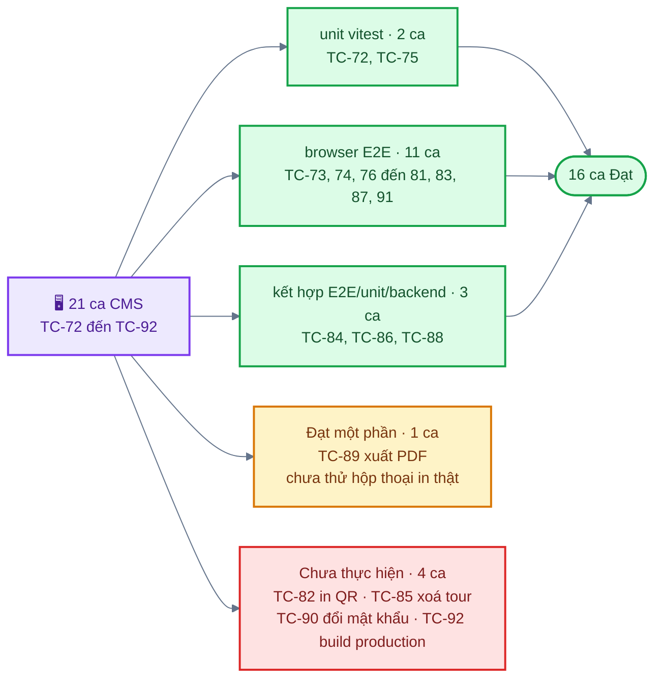
*Hình: ca kiểm thử CMS theo bằng chứng và trạng thái*

| ID | Tiêu đề | Các bước | Kết quả mong đợi | UC | FR | Bằng chứng | Trạng thái |
|---|---|---|---|---|---|---|---|
| TC-72 | Hành vi của API client | Kiểm thử đơn vị `lib/api.ts` | Gửi Bearer token; xử lý được JSON và multipart; 400 → `ApiError` kèm chi tiết theo trường; 401 từ API quản trị gọi `onUnauthorized`, 401 từ đăng nhập thì không; lỗi mạng được ánh xạ | UC3–UC5 | FR-20, FR-25 | unit (`api.test.ts`) | Đạt |
| TC-73 | Đăng nhập, đăng xuất, chuyển hướng khi 401 | Đăng nhập; mở trang được bảo vệ với token không hợp lệ | Vào trang Tổng quan sau khi đăng nhập; chuyển hướng tới `/login?next=…` rồi quay lại sau khi đăng nhập | UC3 | FR-20 | browser E2E | Đạt |
| TC-74 | Tạo/sửa điểm tham quan với bản đồ | "Thêm điểm"; nhấp bản đồ, kéo ghim; điền các trường; lưu; sửa | Toạ độ lấy từ bản đồ; điểm được lưu, hiển thị trong danh sách và sửa được | UC3 | FR-21, FR-22 | browser E2E | Đạt |
| TC-75 | Kiểm tra phía client và lỗi từ máy chủ | Kiểm thử đơn vị `lib/validation.ts` | Báo lỗi phạm vi cho toạ độ, bán kính, độ ưu tiên; bắt buộc văn bản tiếng Việt; `details` từ máy chủ được ánh xạ vào các trường | UC3 E1 | FR-25 | unit (`validation.test.ts`) | Đạt |
| TC-76 | Dịch tự động | "Dịch tự động từ tiếng Việt" và "Dịch tất cả ngôn ngữ còn trống" | Các tab được điền bằng bản dịch máy thật, sửa được | UC3 | FR-23 | browser E2E | Đạt |
| TC-77 | Tải lên audio, TTS, xoá | Tải file lên; "Tạo giọng đọc (TTS)"; nghe thử; xoá audio | Audio phát được; hiển thị nguồn audio; việc xoá được phản ánh | UC3 | FR-24 | browser E2E | Đạt |
| TC-78 | Tải lên ảnh | Tải ảnh lên trong biểu mẫu điểm tham quan; lưu | Ảnh hiển thị và được lưu vào `image_url` | UC3 | FR-22 | browser E2E | Đạt |
| TC-79 | Xoá điểm tham quan có xác nhận | Xoá; huỷ; xoá và xác nhận | Huỷ thì giữ điểm; xác nhận thì xoá | UC3 A1 | FR-26 | browser E2E (CRUD điểm tham quan) | Đạt |
| TC-80 | Cảnh báo thay đổi chưa lưu | Sửa biểu mẫu; rời trang | Hiển thị hộp thoại xác nhận | UC3 | NFR-13 | browser E2E | Đạt |
| TC-81 | Tạo và tải về QR | Trong trang điểm tham quan, tạo QR có nhãn; tải PNG | QR hiển thị trong danh sách kèm nhãn; tải được PNG | UC3 A2 | FR-27 | browser E2E | Đạt |
| TC-82 | Trang in QR | Trang Mã QR; chọn các mã; "In bảng mã"; in | Trang A4, 4 mã mỗi trang kèm nhãn | UC3 A2 | FR-27 | – (chưa kiểm chứng hộp thoại in) | Chưa thực hiện |
| TC-83 | Tạo tour và sắp xếp lại | Tour mới; thêm điểm; sắp xếp lại bằng kéo thả và bằng bàn phím; lưu | Đường nối có đánh số theo đúng thứ tự; thứ tự đã lưu khớp | UC4 | FR-29, FR-30 | browser E2E | Đạt |
| TC-84 | Chặn tour rỗng | Lưu tour không có điểm nào | Hiển thị lỗi, không lưu | UC4 E1 | FR-31 | unit + backend TC-26 | Đạt |
| TC-85 | Xoá tour có xác nhận | Xoá tour; xác nhận | Chỉ bị xoá sau khi xác nhận | UC4 A1 | FR-32 | – | Chưa thực hiện |
| TC-86 | Bảng điều khiển thống kê | Seed `--demo`; mở Thống kê; đổi mốc ngày định sẵn và bộ lọc tour; bật/tắt lộ trình | KPI, biểu đồ, bản đồ nhiệt và lộ trình được cập nhật; biểu đồ theo giờ dùng giờ Việt Nam | UC5 | FR-35 đến FR-37 | browser E2E; unit (`format.test.ts`) | Đạt |
| TC-87 | Trạng thái không có dữ liệu | Lọc một khoảng ngày trống | Thông báo "Không có dữ liệu" (UC5 E1) | UC5 E1 | FR-37 | browser E2E | Đạt |
| TC-88 | Xuất Excel | "Xuất Excel" | Tải về file .xlsx nhiều sheet | UC5 A1 | FR-38 | browser E2E; unit (`reportSheets`) | Đạt |
| TC-89 | Xuất PDF | "Xuất PDF" → trang báo cáo → "In / Lưu PDF" | Trang báo cáo tối ưu cho in hiển thị đúng; trình duyệt lưu được PDF | UC5 A1 | FR-38 | browser E2E (chỉ trang báo cáo) | Đạt một phần: trang báo cáo Đạt, hộp thoại in thật Chưa thực hiện |
| TC-90 | Đổi mật khẩu trên CMS | Tài khoản → đổi mật khẩu với mật khẩu hiện tại sai và đúng | Lỗi theo trường khi nhập sai; thông báo thành công; mật khẩu mới dùng được | UC3 | FR-20 | unit (quy tắc biểu mẫu); backend TC-06 | Chưa thực hiện |
| TC-91 | Bố cục responsive | Khung nhìn rộng 375 px trên mọi trang | Trang không cuộn ngang; menu thu gọn | – | NFR-12 | browser E2E | Đạt |
| TC-92 | Bản build production sau proxy | `npm run build` với `VITE_API_URL`; phục vụ `dist/` sau reverse proxy | Các trang tải được; API và `/uploads` tới được backend | – | – | – | Chưa thực hiện |

Những mục CMS chưa được kiểm chứng: hộp thoại in thật, đổi mật khẩu thành công qua giao diện, dùng với trình đọc màn hình, bản build production với `VITE_API_URL`.

## 6. Danh sách kiểm tra thực địa thủ công (GPS tại điểm tham quan thật)

Chưa thực hiện lần kiểm thử thực địa nào. Mỗi lần chạy cần ghi ngày, thiết bị, hệ điều hành, thời tiết và người kiểm thử.

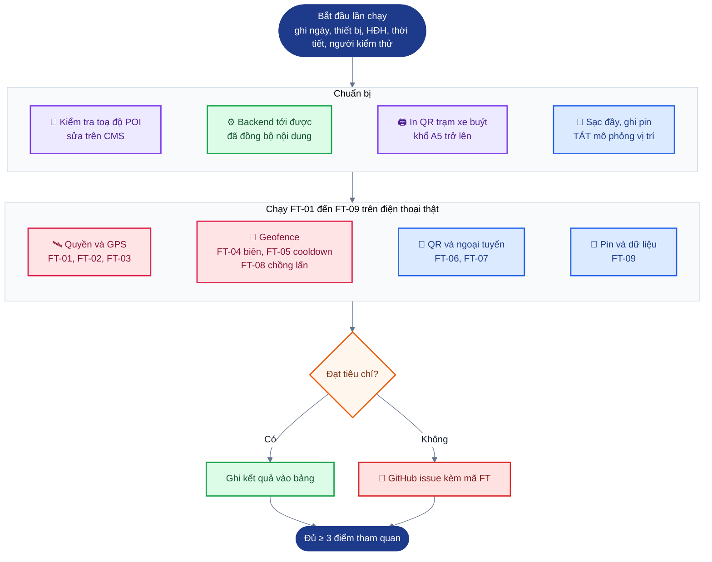
*Hình: quy trình một lần kiểm thử thực địa; hiện cả 9 hạng mục FT đều Chờ thiết bị*

Chuẩn bị:
- [ ] Kiểm tra toạ độ từng điểm tham quan seed trên bản đồ (giá trị seed chỉ gần đúng) và sửa lại trên CMS.
- [ ] Backend production hoặc trong mạng LAN mà điện thoại truy cập được; nội dung đã đồng bộ trên mọi thiết bị kiểm thử.
- [ ] In mã QR trạm xe buýt từ CMS (khổ A5 trở lên) và mang ra các trạm.
- [ ] Sạc đầy thiết bị; ghi mức pin lúc bắt đầu.
- [ ] TẮT chế độ mô phỏng vị trí.

| ID | Hạng mục kiểm tra | Cách thực hiện | Tiêu chí đạt | FR / NFR | Kết quả |
|---|---|---|---|---|---|
| FT-01 | Quyền trên thiết bị thật | Cài mới trên Android và iOS; cấp quyền vị trí "khi đang dùng" rồi "luôn luôn"; camera | Hộp thoại xin quyền hiện ra với mô tả mục đích rõ ràng; ứng dụng hoạt động ở cả hai chế độ | FR-01, FR-04, FR-13 | Chờ thiết bị |
| FT-02 | Khoảng cách kích hoạt khi đi vào | Đi bộ với tốc độ bình thường tới ít nhất 3 điểm tham quan, bắt đầu từ cách 200 m; ghi khoảng cách GPS lúc thuyết minh bắt đầu | Thuyết minh bắt đầu trong bán kính và trong vòng 2 giây kể từ khi ứng dụng phát hiện đi vào; ghi lại khoảng cách kích hoạt thực tế | FR-05, NFR-01, NFR-02 | Chờ thiết bị |
| FT-03 | Chạy nền và khoá màn hình | Lặp lại FT-02 khi ứng dụng chạy nền và màn hình đã khoá | Thuyết minh vẫn phát (nếu không, ghi lại giới hạn riêng của hệ điều hành) | FR-04 | Chờ thiết bị |
| FT-04 | Dao động tại biên | Đứng tại biên bán kính trong 3 phút | Nhiều nhất một lần thuyết minh | FR-07 | Chờ thiết bị |
| FT-05 | Thời gian chờ phát lại | Rời một điểm tham quan rồi quay lại trong vòng 10 phút; quay lại lần nữa sau 10 phút | Không phát lại; sau đó phát lại | FR-08 | Chờ thiết bị |
| FT-06 | QR tại trạm xe buýt | Quét các mã đã lắp tại trạm Khánh Hội, Vĩnh Hội và Xóm Chiếu vào ban ngày và buổi tối | Thuyết minh bắt đầu ngay; cách kích hoạt được ghi là `qr` | FR-15, FR-18 | Chờ thiết bị |
| FT-07 | Hoạt động ngoại tuyến | Đồng bộ, bật chế độ máy bay, đi bộ tới hai điểm tham quan, rồi kết nối lại | Thuyết minh hoạt động khi ngoại tuyến; nhật ký xuất hiện trên CMS sau khi kết nối lại | NFR-04, FR-10 | Chờ thiết bị |
| FT-08 | Điểm tham quan chồng lấn | Đi tới nơi hai vùng kích hoạt chồng lên nhau (ví dụ phố ẩm thực Vĩnh Khánh và trạm xe buýt Vĩnh Hội, nếu vẫn chồng lấn sau khi kiểm tra toạ độ) | Điểm có độ ưu tiên cao hơn được phát; điểm còn lại không bị xếp hàng | FR-06, FR-08 | Chờ thiết bị |
| FT-09 | Mức dùng pin và dữ liệu | Chạy ứng dụng trong 1 giờ đi bộ | Ghi mức sụt pin và lượng dữ liệu di động đã dùng; không bị crash | NFR (tính dễ dùng) | Chờ thiết bị |

## 7. Tóm tắt truy vết

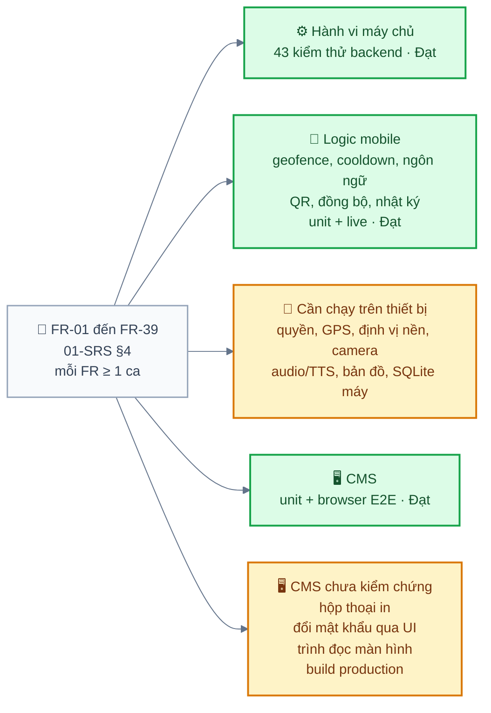
*Hình: truy vết yêu cầu tới bằng chứng kiểm thử; xanh là đã Đạt, vàng là Chờ thiết bị hoặc chưa kiểm chứng*
Mọi FR trong `01-SRS.md` §4 đều có ít nhất một ca kiểm thử. Hành vi phía máy chủ được bao phủ bởi 43 kiểm thử backend đều đạt. Logic mobile (geofence, thời gian chờ phát lại, thuyết minh, ngôn ngữ dự phòng, phân tích QR, quyết định đồng bộ, chính sách ghi nhật ký) được bao phủ bởi các kiểm thử unit và live đều đạt; mọi thứ cần môi trường chạy trên thiết bị (quyền, GPS, định vị nền, camera, phát audio/TTS, bản đồ, SQLite trên thiết bị) đều ở trạng thái Chờ thiết bị. Hành vi CMS được bao phủ bởi kiểm thử đơn vị và một lần chạy browser E2E, trừ các mục liệt kê ở cuối §5.3.
