# Hướng dẫn cài đặt và triển khai

**Dự án:** Hệ thống thuyết minh tự động đa ngôn ngữ
**Phiên bản tài liệu:** 1.0 (18/10/2026)

Cấu trúc kho mã nguồn:

```text
narration-system/
├── backend/   REST API Express 5 + SQLite (hoàn chỉnh)
├── cms/       Web quản trị (Vite 8 + React 19 + TypeScript)
├── mobile/    Ứng dụng cho khách du lịch (Expo SDK 58, React Native 0.88, TypeScript)
└── docs/      Tài liệu dự án
```

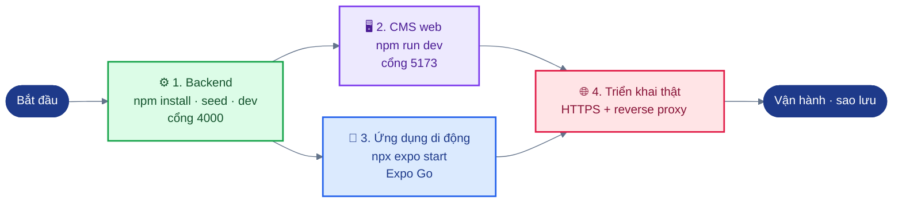

*Hình: Thứ tự cài đặt ba phần của hệ thống: backend trước, sau đó CMS và ứng dụng di động, cuối cùng là triển khai thật.*

---

## 1. Backend

### 1.1 Yêu cầu
- Node.js **22.13 trở lên** (backend dùng module có sẵn `node:sqlite`; kiểm tra bằng `node --version`).
- npm (đi kèm Node.js).
- Máy chủ chỉ cần truy cập Internet nếu dùng dịch máy và chuyển văn bản thành giọng nói (TTS) phía máy chủ.

Không cần máy chủ cơ sở dữ liệu riêng: cơ sở dữ liệu là một file SQLite duy nhất, được tạo ở lần khởi động đầu tiên.

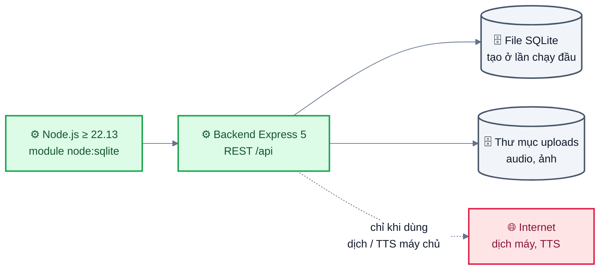

*Hình: Thành phần backend cần có: Node.js, một file SQLite, thư mục uploads; Internet chỉ cần cho dịch và TTS phía máy chủ.*

### 1.2 Cài đặt và chạy trên máy cục bộ

```bash
cd backend
npm install
npm run seed        # nội dung mẫu: tài khoản admin, 8 điểm tham quan (POI) ở Quận 4, 2 tour, 5 mã QR trạm xe buýt
npm run dev         # chạy với chế độ tự nạp lại khi sửa mã (hoặc: npm start)
```

Sau đó API có tại `http://localhost:4000/api` (kiểm tra: `curl http://localhost:4000/api/health`).

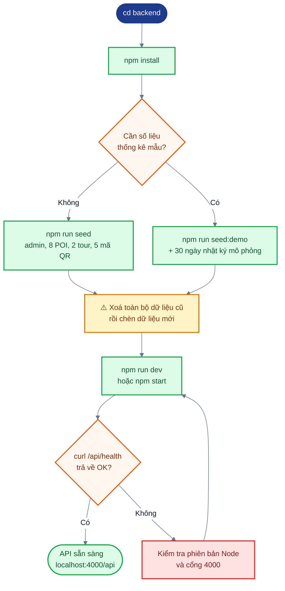

*Hình: Luồng cài đặt và chạy backend trên máy cục bộ, có bước chọn lệnh seed.*

Các lệnh seed **xoá toàn bộ dữ liệu hiện có** trong cơ sở dữ liệu đang cấu hình trước khi chèn dữ liệu mới:

| Lệnh | Tác dụng |
|---|---|
| `npm run seed` | Tài khoản quản trị `admin` (mật khẩu `admin123`, hoặc giá trị của `ADMIN_PASSWORD`), các điểm tham quan mẫu có thuyết minh tiếng Việt và tiếng Anh, tour và mã QR |
| `npm run seed:demo` | Như trên, cộng thêm 30 ngày nhật ký sử dụng và nhật ký vị trí **mô phỏng** để trình diễn trang thống kê. Không dùng trên cơ sở dữ liệu thật |

Toạ độ các điểm tham quan mẫu chỉ là gần đúng; hãy kiểm tra lại trên bản đồ trước khi dùng thật.

### 1.3 Chạy kiểm thử

```bash
cd backend
npm test            # node --test tests/ ; 43 kiểm thử, cơ sở dữ liệu trong bộ nhớ, không cần mạng
```

### 1.4 Biến môi trường
Khi phát triển trên máy cục bộ, mọi biến đều không bắt buộc. Các biến được đọc trong `backend/src/config.js`.

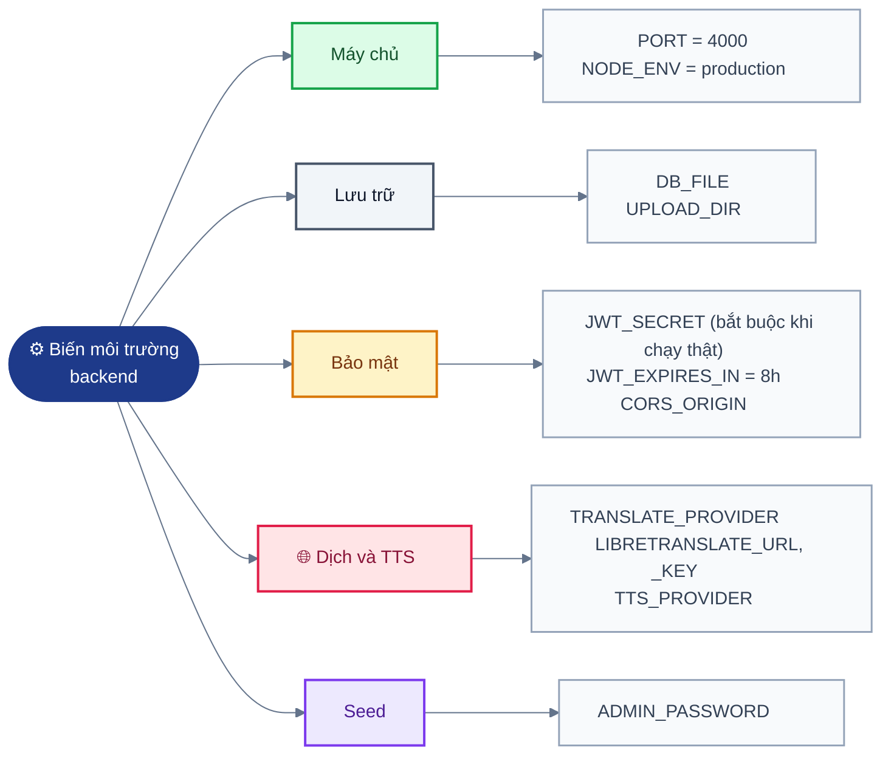

*Hình: Nhóm các biến môi trường của backend theo chức năng (đọc trong backend/src/config.js).*

| Biến | Mặc định | Mô tả |
|---|---|---|
| `PORT` | `4000` | Cổng HTTP (máy chủ lắng nghe trên `0.0.0.0`) |
| `DB_FILE` | `backend/data/narration.db` | Đường dẫn file cơ sở dữ liệu SQLite (thư mục được tạo nếu chưa có) |
| `UPLOAD_DIR` | `backend/uploads` | Thư mục chứa audio và ảnh được tải lên hoặc được tạo ra, phục vụ tại `/uploads` |
| `JWT_SECRET` | `dev-only-secret-change-me` | Khoá bí mật để ký token quản trị. **Bắt buộc khi chạy thật**: với `NODE_ENV=production`, máy chủ dừng nếu chưa đặt biến này |
| `JWT_EXPIRES_IN` | `8h` | Thời hạn token quản trị (định dạng jsonwebtoken, ví dụ `2h`, `1d`) |
| `CORS_ORIGIN` | `*` | Các origin trình duyệt được phép; danh sách phân tách bằng dấu phẩy (ví dụ `https://cms.example.org`) |
| `TRANSLATE_PROVIDER` | `google-free` | `google-free` (endpoint Google Translate không chính thức), `libretranslate`, hoặc `none` (tắt dịch tự động) |
| `LIBRETRANSLATE_URL` | `https://libretranslate.com` | Máy chủ LibreTranslate khi `TRANSLATE_PROVIDER=libretranslate` |
| `LIBRETRANSLATE_KEY` | trống | API key cho LibreTranslate, nếu máy chủ đó yêu cầu |
| `TTS_PROVIDER` | `google-free` | `google-free` (endpoint TTS của Google Translate) hoặc `none` (tắt TTS phía máy chủ; ứng dụng vẫn dùng TTS trên thiết bị) |
| `NODE_ENV` | không đặt | Đặt `production` trên máy chủ để bắt buộc kiểm tra `JWT_SECRET` |
| `ADMIN_PASSWORD` | `admin123` | Chỉ dùng cho `npm run seed` / `seed:demo` để đặt mật khẩu quản trị ban đầu |

Cố định trong mã (không phải biến môi trường): các ngôn ngữ hỗ trợ `vi, en, zh, ko, ja, fr`, ngôn ngữ mặc định `vi`, giới hạn tải lên 15 MB, giới hạn thân JSON 1 MB, giới hạn đăng nhập 20 lần / 15 phút / IP, các endpoint ghi nhật ký 120 yêu cầu / phút / IP.

Ví dụ trong một phiên shell:

```bash
export JWT_SECRET="$(openssl rand -hex 32)"
export CORS_ORIGIN="http://localhost:5173"
npm start
```

---

## 2. CMS web

### 2.1 Yêu cầu
- Node.js **22.22 trở lên** (`engines` trong `cms/package.json`).
- Backend đang chạy (mặc định `http://localhost:4000`) và đã có dữ liệu seed.

### 2.2 Chạy ở chế độ phát triển

```bash
cd cms
npm install
npm run dev          # http://localhost:5173 ; đăng nhập bằng admin / admin123 (dữ liệu seed)
```

Ở chế độ phát triển, Vite chuyển tiếp (proxy) `/api` và `/uploads` tới backend nên không cần cấu hình CORS.

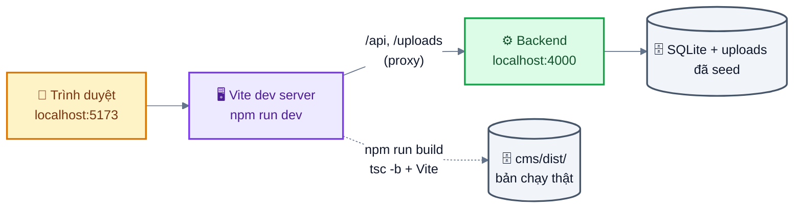

*Hình: CMS ở chế độ phát triển: Vite proxy /api và /uploads sang backend, lệnh build tạo cms/dist.*

| Lệnh | Mục đích |
|---|---|
| `npm run dev` | Máy chủ phát triển có proxy |
| `npm run build` | Kiểm tra kiểu (`tsc -b`) và build bản chạy thật vào `cms/dist/` |
| `npm run preview` | Phục vụ bản build chạy thật trên máy cục bộ (cũng có proxy) |
| `npm test` | Kiểm thử đơn vị (unit test) bằng Vitest: API client, kiểm tra dữ liệu nhập, định dạng, xuất Excel (36 kiểm thử) |
| `npm run typecheck` | Chỉ kiểm tra kiểu |

### 2.3 Biến môi trường
Sao chép `cms/.env.example` thành `cms/.env` khi cần.

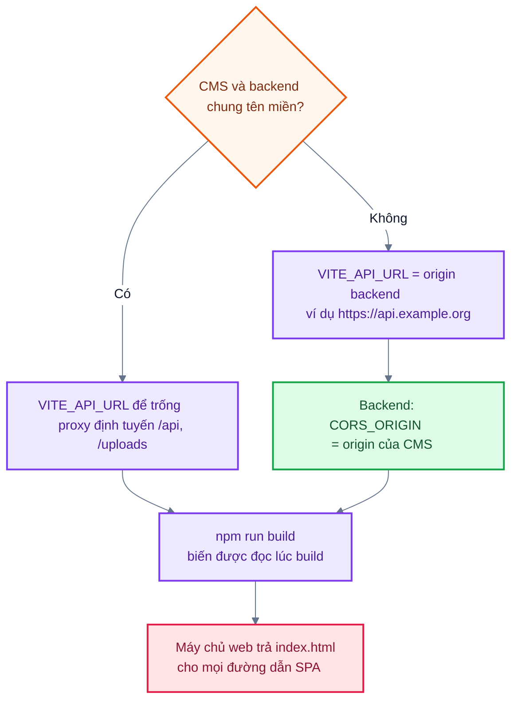

*Hình: Chọn cấu hình VITE_API_URL và CORS_ORIGIN theo cách đặt tên miền.*

| Biến | Dùng bởi | Mô tả |
|---|---|---|
| `VITE_API_URL` | `npm run build` | Origin của backend, không kèm `/api`, ví dụ `https://api.example.org`. Để trống khi CMS và backend dùng chung một tên miền (reverse proxy định tuyến `/api` và `/uploads`). URL audio/ảnh (`/uploads/...`) được ghép origin này vào phía trước. Biến được đọc lúc build |
| `DEV_PROXY_TARGET` | `npm run dev`, `npm run preview` | Backend mà proxy chuyển tiếp tới; mặc định `http://localhost:4000` |

Nếu CMS được phục vụ từ tên miền khác backend, hãy đặt `CORS_ORIGIN` của backend bằng origin của CMS. `cms/dist/` là ứng dụng một trang (SPA): máy chủ web phải trả về `index.html` cho mọi đường dẫn không phải là file (xem ví dụ nginx ở §4).

---

## 3. Ứng dụng di động

### 3.1 Yêu cầu
- Node.js 20 trở lên; backend đang chạy và điện thoại truy cập được (mở cổng 4000 trên tường lửa).
- Điện thoại cài **Expo Go** (SDK 58), dùng chung mạng Wi-Fi với máy tính, hoặc Android emulator / iOS simulator.

### 3.2 Chạy bằng Expo Go

```bash
cd mobile
npm install            # nếu npm báo lỗi ERESOLVE về react-dom, dùng: npm install --legacy-peer-deps
cp .env.example .env   # sau đó đặt EXPO_PUBLIC_API_URL (xem bên dưới)
npx expo start         # quét mã QR hiện trên terminal bằng Expo Go
```

Ghi chú về `--legacy-peer-deps` xuất phát từ việc phụ thuộc ngang hàng (peer dependency) không khớp giữa `react-dom` (peer tuỳ chọn của `@expo/router-server`) và phiên bản `react` mà SDK 58 cố định; ứng dụng không dùng nền tảng web.

```mermaid
%%{init: {"theme":"base","fontFamily":"Helvetica Neue, Arial, sans-serif","themeVariables":{"fontFamily":"Helvetica Neue, Arial, sans-serif","fontSize":"15px","primaryColor":"#EFF6FF","primaryBorderColor":"#3B82F6","primaryTextColor":"#0F172A","lineColor":"#64748B","secondaryColor":"#F0FDF4","tertiaryColor":"#FFFFFF","clusterBkg":"#F8FAFC","clusterBorder":"#CBD5E1","edgeLabelBackground":"#FFFFFF","noteBkgColor":"#FEF9C3","noteBorderColor":"#EAB308","actorBkg":"#DBEAFE","actorBorder":"#2563EB","actorTextColor":"#1E3A8A","signalColor":"#475569","signalTextColor":"#0F172A","labelBoxBkgColor":"#F1F5F9","labelBoxBorderColor":"#94A3B8","activationBkgColor":"#E0F2FE","activationBorderColor":"#0284C7","sequenceNumberColor":"#FFFFFF","pie1":"#16A34A","pie2":"#F59E0B","pie3":"#94A3B8","pie4":"#DC2626","pie5":"#2563EB","pie6":"#7C3AED","pieStrokeColor":"#FFFFFF","pieSectionTextColor":"#FFFFFF","quadrant1Fill":"#FEE2E2","quadrant2Fill":"#FEF3C7","quadrant3Fill":"#DCFCE7","quadrant4Fill":"#FEF3C7","quadrantPointFill":"#1E3A8A","quadrantPointTextFill":"#0F172A","git0":"#1E3A8A","gitBranchLabel0":"#FFFFFF","cScale0":"#DBEAFE","cScale1":"#DCFCE7","cScale2":"#EDE9FE","cScale3":"#FEF3C7","cScale4":"#FFE4E6","cScale5":"#E0F2FE","cScale6":"#F1F5F9"},"flowchart":{"curve":"basis","padding":16,"nodeSpacing":40,"rankSpacing":50},"sequence":{"showSequenceNumbers":true,"mirrorActors":false}}}%%
flowchart LR
    A(["cd mobile"]):::startend --> B["npm install<br/>lỗi ERESOLVE thì&emsp;&emsp;<br/>--legacy-peer-deps"]:::mobile
    B --> C["cp .env.example .env<br/>đặt EXPO_PUBLIC_API_URL&emsp;&emsp;&emsp;"]:::mobile
    C --> D["npx expo start<br/>Metro in mã QR&emsp;"]:::mobile
    D --> E["📱 Expo Go quét mã<br/>trên điện thoại"]:::actor
    E --> F(["App chạy,<br/>đồng bộ từ backend"]):::ok
    classDef actor fill:#FEF3C7,stroke:#D97706,stroke-width:2px,color:#78350F
    classDef mobile fill:#DBEAFE,stroke:#2563EB,stroke-width:2px,color:#1E3A8A
    classDef startend fill:#1E3A8A,stroke:#1E3A8A,stroke-width:2px,color:#FFFFFF
    classDef ok fill:#DCFCE7,stroke:#16A34A,stroke-width:2px,color:#14532D
```

*Hình: Các bước chạy ứng dụng di động bằng Expo Go.*

### 3.3 Địa chỉ backend
Trên điện thoại, `localhost` là chính điện thoại. Ứng dụng chọn địa chỉ backend theo thứ tự sau (`mobile/src/config.ts`):

1. URL nhập trong ứng dụng tại **Cài đặt → Máy chủ → Địa chỉ máy chủ** (lưu trên thiết bị).
2. `EXPO_PUBLIC_API_URL` trong `mobile/.env` (khởi động lại `expo start` sau khi sửa), ví dụ `http://192.168.1.10:4000`, không kèm `/api`.
3. Tự động: IP LAN của máy tính đang chạy Metro (lấy từ `hostUri` của Expo) cộng cổng 4000. Khi điện thoại và laptop dùng chung Wi-Fi, thường không cần cấu hình gì.
4. Mặc định: `http://10.0.2.2:4000` trên Android emulator, `http://localhost:4000` trên iOS simulator.

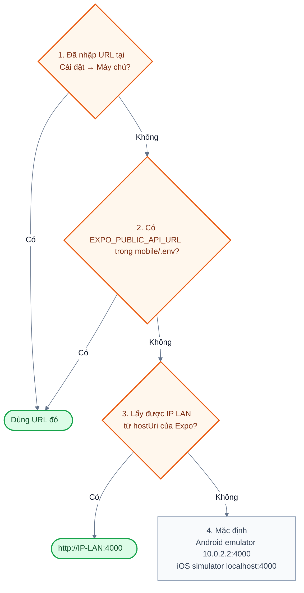

*Hình: Thứ tự ứng dụng chọn địa chỉ backend (mobile/src/config.ts).*

Trên macOS, xem IP LAN bằng `ipconfig getifaddr en0`. Backend đã lắng nghe trên `0.0.0.0`. Wi-Fi ở trường học thường chặn kết nối giữa các thiết bị (client isolation); khi đó hãy dùng điểm phát Wi-Fi từ điện thoại. Kết nối `http://` thuần tới IP LAN được cho phép (`usesCleartextTraffic` trên Android, ngoại lệ ATS trên iOS trong `app.json`); bản build chạy thật nên dùng URL backend HTTPS.

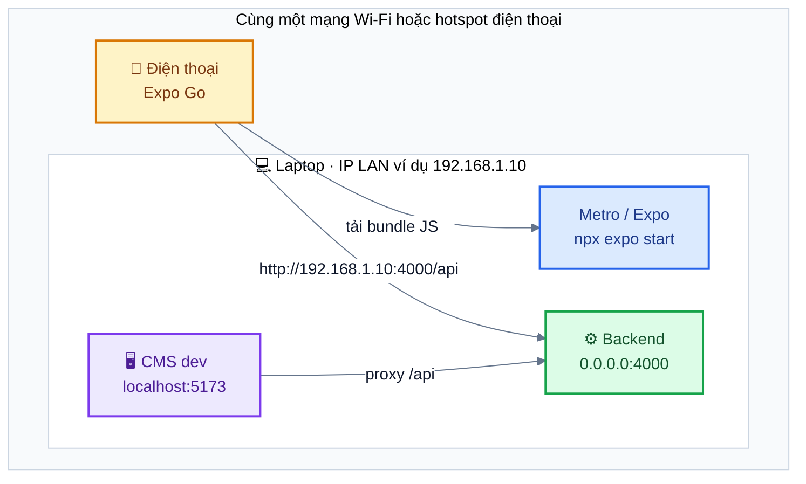

*Hình: Sơ đồ mạng LAN khi demo: điện thoại và laptop chung Wi-Fi; điện thoại gọi backend qua IP LAN cổng 4000. Wi-Fi trường chặn kết nối giữa thiết bị thì dùng hotspot.*

### 3.4 Expo Go so với development build

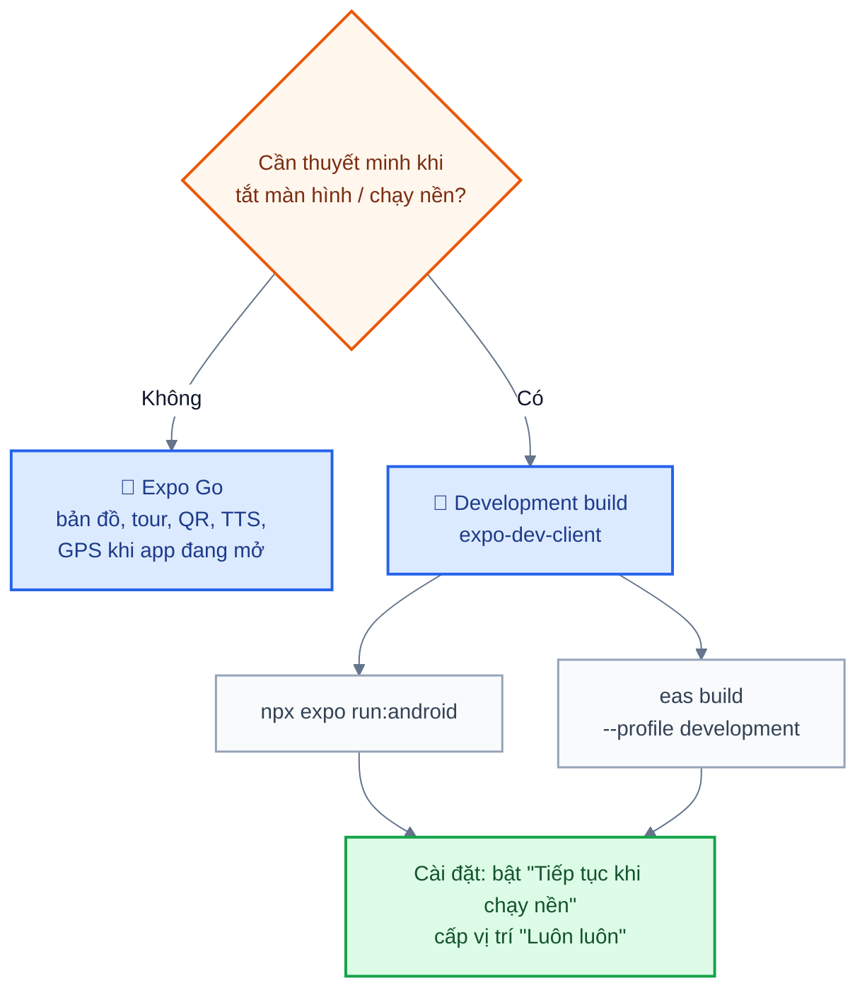

*Hình: Chọn Expo Go hay development build theo nhu cầu định vị nền.*

| Tính năng | Expo Go | Development build hoặc bản phát hành trên store |
|---|---|---|
| Bản đồ, tour, QR, TTS, audio, SQLite, đồng bộ (sync) | Có | Có |
| GPS khi ứng dụng đang mở trên màn hình | Có | Có |
| Định vị nền (background location) / khi tắt màn hình | Không (ứng dụng chuyển về GPS khi đang mở và Cài đặt hiện ghi chú) | Có, bật "Tiếp tục khi chạy nền" trong Cài đặt và cấp quyền vị trí "Luôn luôn" |

Development build:

```bash
npx expo install expo-dev-client
npx expo run:android                       # cần Android Studio / SDK
# hoặc
npx eas-cli@latest build --profile development --platform android
```

### 3.5 Kiểm thử và kiểm tra

```bash
npm test                                              # kiểm thử đơn vị (62)
LIVE_API=http://localhost:4000 npx jest backend.live  # 5 kiểm thử chỉ đọc với backend đang chạy, đã seed
npm run typecheck                                     # tsc --noEmit
npm run doctor                                        # expo-doctor
npm run export:android                                # bundle biên dịch được (kết quả trong dist-android/)
npm run gen:leaflet                                   # tạo lại Leaflet nhúng sau khi nâng cấp leaflet
```

### 3.6 Trình diễn trên lớp không cần GPS hoặc camera

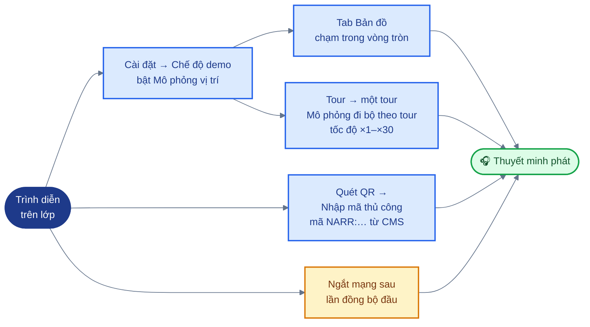

*Hình: Các cách trình diễn không cần GPS hoặc camera.*

1. **Cài đặt → Chế độ demo → Mô phỏng vị trí**: bật (bỏ qua GPS thật).
2. Ở tab **Bản đồ**, chạm vào bên trong vòng tròn của một điểm tham quan; thuyết minh bắt đầu phát. Hoặc mở **Tour → một tour → Mô phỏng đi bộ theo tour**; tốc độ ×1–×30 chỉnh trong Cài đặt.
3. QR không cần camera: **Quét QR → Nhập mã thủ công** rồi dán một mã lấy từ trang **Mã QR** của CMS (ví dụ `NARR:…`).
4. Ngoại tuyến (offline): ngắt mạng sau lần đồng bộ đầu tiên; vòng tròn trên bản đồ, tour, mã QR đã đồng bộ và TTS vẫn hoạt động, nhật ký sẽ được gửi lên sau.

Emulator cũng có thể giả lập GPS: Android Emulator → Extended controls → Location; iOS Simulator → Features → Location.

---

## 4. Ghi chú triển khai thật

### 4.1 Mô hình triển khai
Một máy chủ Linux chạy backend Node.js phía sau reverse proxy; CMS là gói file tĩnh do chính proxy đó phục vụ. Xem sơ đồ triển khai trong `02-design.md` §7.

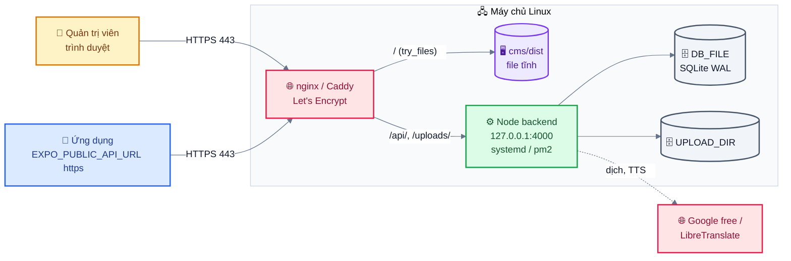

*Hình: Mô hình triển khai: reverse proxy HTTPS phục vụ CMS tĩnh và chuyển /api, /uploads tới backend chỉ nghe localhost.*

### 4.2 Danh sách kiểm tra

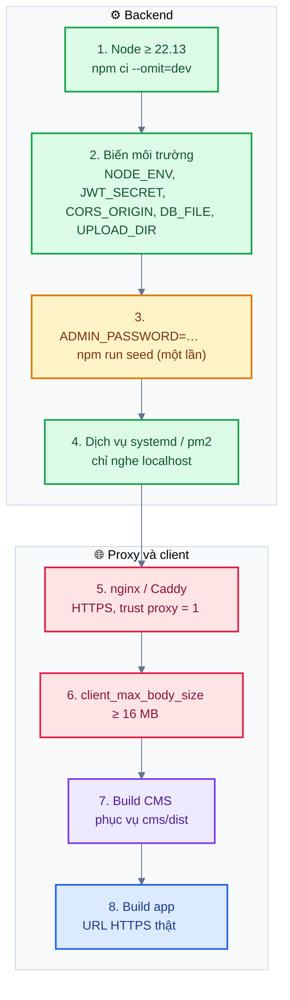

*Hình: Tám bước triển khai thật, chia phần backend và phần proxy, client.*

1. Cài Node.js ≥ 22.13. Sao chép `backend/` và chạy `npm ci --omit=dev`.
2. Đặt biến môi trường: `NODE_ENV=production`, `JWT_SECRET` ngẫu nhiên (ít nhất 32 byte), `CORS_ORIGIN` giới hạn ở origin của CMS, và `DB_FILE` / `UPLOAD_DIR` trỏ tới một thư mục dữ liệu lâu dài nằm ngoài thư mục mã nguồn.
3. Tạo tài khoản quản trị đầu tiên bằng `ADMIN_PASSWORD=<mật khẩu mạnh> npm run seed`, rồi thay nội dung mẫu trong CMS; hoặc chuẩn bị cơ sở dữ liệu nội dung ở nơi khác rồi sao chép vào. Đổi mật khẩu sau lần đăng nhập đầu tiên. Không bao giờ chạy lại `seed` trên cơ sở dữ liệu thật (lệnh này xoá toàn bộ dữ liệu).
4. Chạy backend dưới dạng dịch vụ (systemd hoặc pm2), chỉ lắng nghe trên localhost (chặn cổng 4000 bằng tường lửa), tự khởi động lại khi lỗi.
5. Đặt reverse proxy (nginx hoặc Caddy) phía trước, có HTTPS (ví dụ Let's Encrypt). Ứng dụng đặt `trust proxy = 1`, nên bộ giới hạn tần suất dùng IP của client lấy từ header `X-Forwarded-For` của proxy; giả định có đúng một tầng proxy.
6. Đặt kích thước thân yêu cầu tối đa của proxy ít nhất 16 MB để proxy không từ chối file audio tải lên (≤ 15 MB).
7. Build CMS với `VITE_API_URL` để trống (cùng tên miền) hoặc đặt bằng origin của API, rồi phục vụ `cms/dist/` dưới dạng file tĩnh; định tuyến `/api` và `/uploads` tới backend.
8. Build ứng dụng di động với `EXPO_PUBLIC_API_URL` là origin HTTPS chạy thật (EAS build hoặc `expo run`), để có định vị nền.

Ví dụ khối server nginx (điều chỉnh đường dẫn và tên miền):

```nginx
server {
    listen 443 ssl;
    server_name narration.example.org;
    # ssl_certificate / ssl_certificate_key managed by certbot
    client_max_body_size 16m;

    root /srv/narration/cms/dist;
    location / { try_files $uri /index.html; }

    location /api/     { proxy_pass http://127.0.0.1:4000; proxy_set_header X-Forwarded-For $proxy_add_x_forwarded_for; proxy_set_header Host $host; }
    location /uploads/ { proxy_pass http://127.0.0.1:4000; }
}
```

### 4.3 Sao lưu
Dữ liệu cần sao lưu: cơ sở dữ liệu SQLite (`DB_FILE`) và thư mục tải lên (`UPLOAD_DIR`). Cần cả hai: cơ sở dữ liệu lưu đường dẫn audio, còn thư mục lưu chính các file.

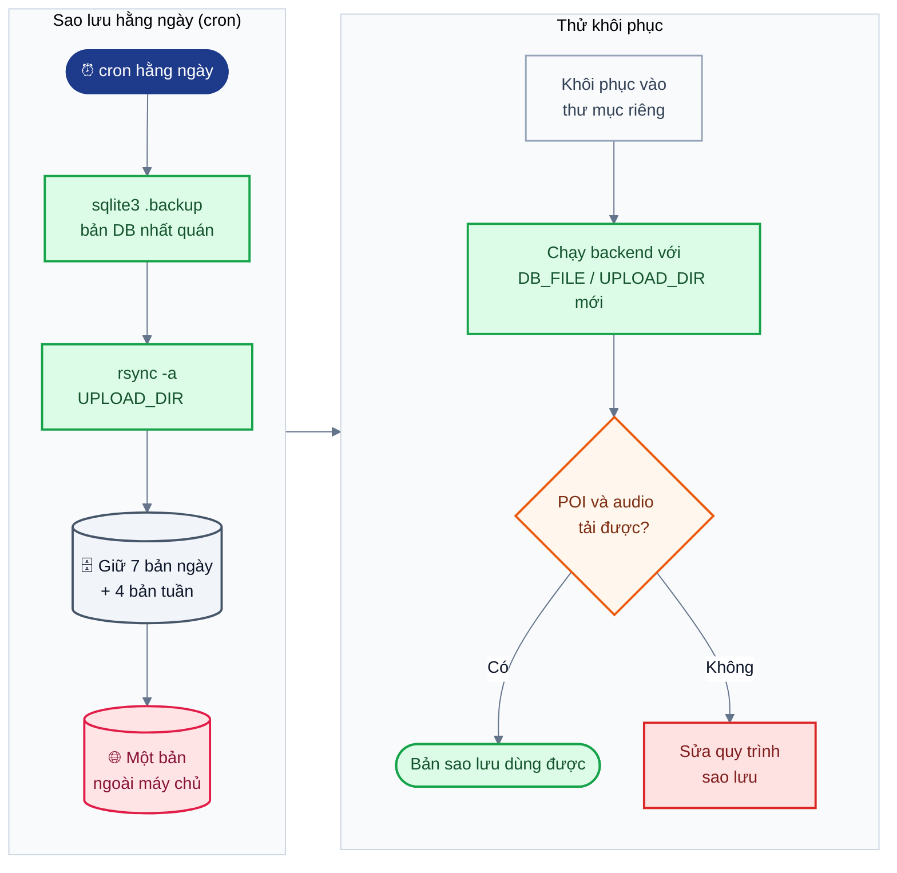

*Hình: Quy trình sao lưu hằng ngày và thử khôi phục cơ sở dữ liệu cùng thư mục tải lên.*

- Cơ sở dữ liệu chạy ở chế độ WAL, nên nếu chỉ sao chép `narration.db` trong lúc máy chủ đang ghi thì bản sao có thể không nhất quán. Hãy dùng cơ chế sao lưu trực tuyến của SQLite, ví dụ `sqlite3 /srv/narration/data/narration.db ".backup '/backup/narration-$(date +%F).db'"`, hoặc dừng dịch vụ trong chốc lát rồi sao chép cùng lúc `narration.db`, `narration.db-wal` và `narration.db-shm`.
- Sao chép thư mục tải lên bằng `rsync -a` sau khi sao lưu cơ sở dữ liệu.
- Lên lịch sao lưu hằng ngày (cron), giữ ít nhất 7 bản hằng ngày và 4 bản hằng tuần, và lưu một bản ở ngoài máy chủ.
- Thử khôi phục một lần: khôi phục vào một thư mục riêng, khởi động backend với `DB_FILE`/`UPLOAD_DIR` trỏ tới đó, rồi kiểm tra điểm tham quan và audio có tải được không.

### 4.4 Vận hành

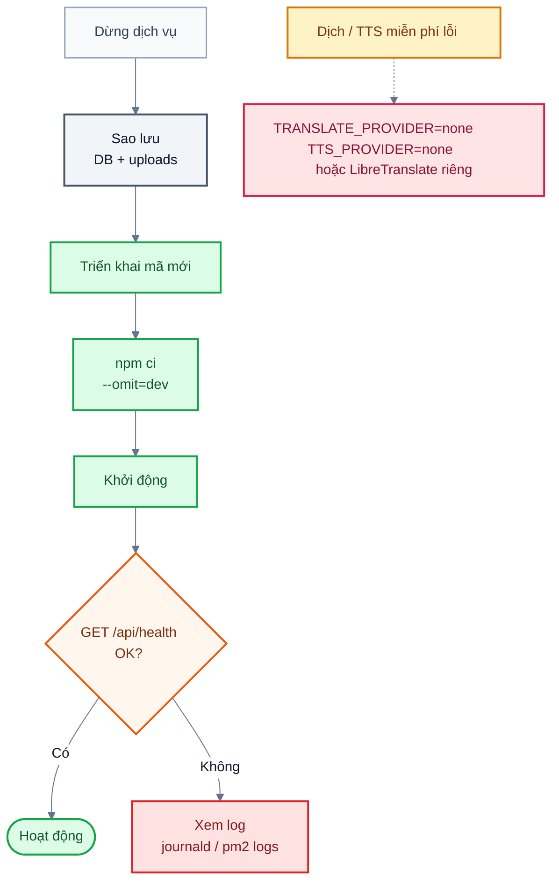

*Hình: Quy trình nâng cấp và phương án khi dịch vụ dịch/TTS miễn phí lỗi.*

- Nhật ký: backend in lỗi ra stdout/stderr; thu thập bằng journald hoặc pm2 logs.
- Kiểm tra tình trạng: `GET /api/health`.
- Nâng cấp: dừng dịch vụ, sao lưu, triển khai mã mới, `npm ci --omit=dev`, khởi động. Lược đồ dùng `CREATE TABLE IF NOT EXISTS`; thay đổi bảng đã có sẽ cần script migration (hiện chưa có).
- Nếu các endpoint dịch/TTS miễn phí lỗi hoặc bị chặn, đặt `TRANSLATE_PROVIDER=none` / `TTS_PROVIDER=none`, hoặc chuyển sang LibreTranslate tự lưu trữ. Việc soạn nội dung và ứng dụng vẫn hoạt động bình thường.
