# Hướng dẫn sử dụng

**Dự án:** Hệ thống thuyết minh tự động đa ngôn ngữ
**Phiên bản tài liệu:** 1.0 (18/10/2026)

Hướng dẫn này đi theo các ca sử dụng (use case) UC1–UC5. Giao diện CMS bằng tiếng Việt; các nhãn được trích đúng như trên màn hình. Ứng dụng di động hiển thị giao diện tiếng Việt khi ngôn ngữ thuyết minh là tiếng Việt và giao diện tiếng Anh với các ngôn ngữ khác; tài liệu trích nhãn theo giao diện tiếng Việt. Các vị trí cần ảnh chụp màn hình được đánh dấu **Cần bổ sung**.

---

## Phần A. Quản trị viên nội dung (content administrator) – CMS web

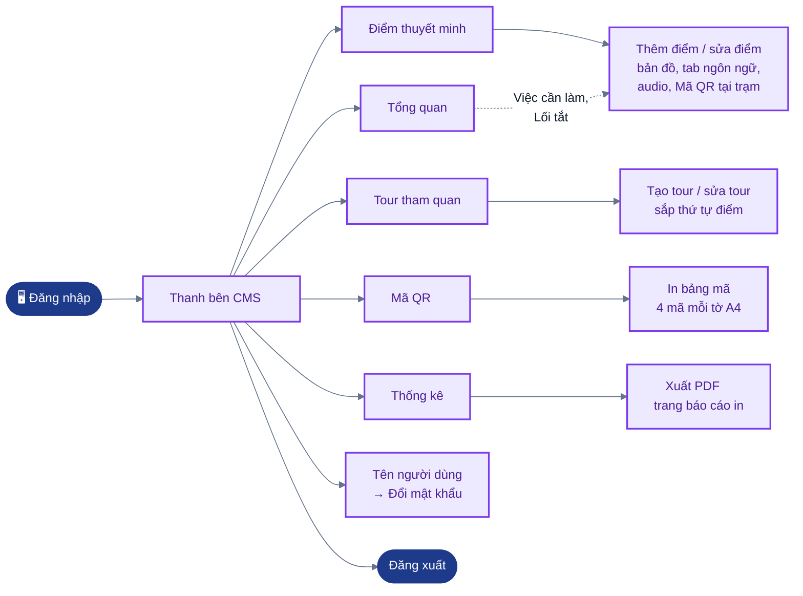

*Hình: Bản đồ điều hướng CMS: các mục trên thanh bên và trang con của từng mục (cms/src/App.tsx, Layout.tsx).*

### A.1 Đăng nhập và đăng xuất
1. Mở địa chỉ CMS trên trình duyệt (ví dụ `https://<server>/`; khi phát triển là `http://localhost:5173`).
2. Nhập "Tên đăng nhập" và "Mật khẩu", rồi bấm "Đăng nhập".
3. Sau 20 lần đăng nhập sai trong 15 phút, mạng đó bị chặn đăng nhập trong 15 phút.
4. Một phiên làm việc kéo dài 8 giờ. Khi phiên hết hạn, CMS quay về trang đăng nhập; sau khi đăng nhập lại, CMS mở lại trang bạn đang dùng.
5. Nút "Đăng xuất" nằm ở cuối thanh bên. Bấm vào tên của bạn trên thanh bên để mở trang tài khoản; tại đây, "Đổi mật khẩu" yêu cầu nhập mật khẩu hiện tại và mật khẩu mới dài ít nhất 8 ký tự.

Thanh bên gồm "Tổng quan", "Điểm thuyết minh", "Tour tham quan", "Mã QR" và "Thống kê". Trên màn hình cỡ điện thoại, thanh bên thu gọn thành một nút menu.

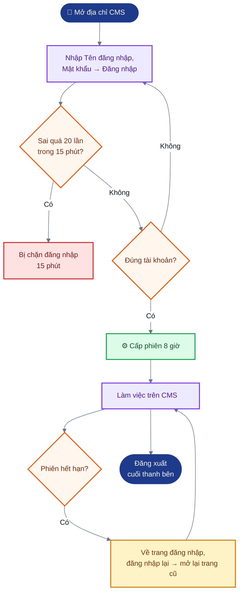

*Hình: Luồng đăng nhập, khoá tạm khi sai nhiều lần, phiên 8 giờ và đăng xuất.*

> Cần bổ sung ảnh chụp: trang đăng nhập, thanh bên.

### A.2 Tổng quan
Trang "Tổng quan" hiển thị số điểm tham quan (POI), số tour và số mã QR, số liệu 7 ngày gần nhất, cùng danh sách "Việc cần làm" gồm các điểm còn thiếu audio, thiếu ngôn ngữ hoặc chưa có mã QR, kèm các lối tắt như "Thêm điểm thuyết minh".

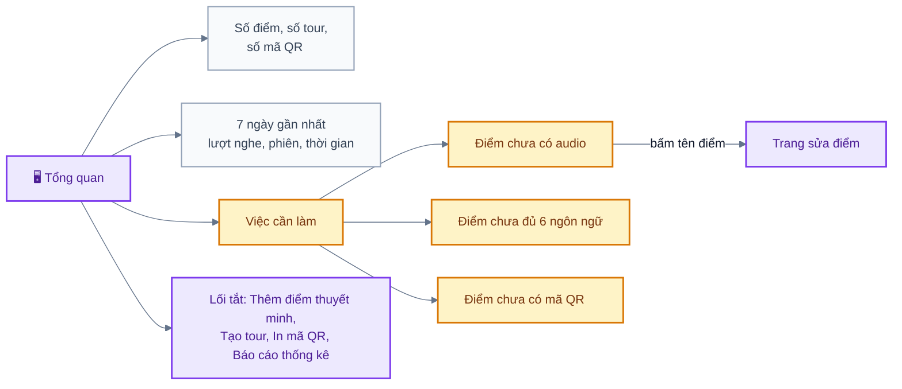

*Hình: Nội dung trang Tổng quan và lối đi tới trang sửa điểm từ Việc cần làm.*

> Cần bổ sung ảnh chụp: trang tổng quan.

### A.3 Quản lý điểm tham quan (UC3)
**Xem và tìm kiếm.** Mở "Điểm thuyết minh". Danh sách hiển thị tên, địa chỉ, bán kính (radius), độ ưu tiên (priority), các ngôn ngữ đã có nội dung, các ngôn ngữ đã có audio và số mã QR của từng điểm. Gõ vào ô "Tìm theo tên hoặc địa chỉ…" để lọc.

**Tạo hoặc sửa một điểm.**
1. Bấm "Thêm điểm", hoặc bấm vào một điểm đã có.
2. Nhập "Tên điểm" và (không bắt buộc) "Địa chỉ".
3. Đặt vị trí: bấm lên bản đồ để cắm ghim, hoặc kéo ghim; cũng có thể gõ "Vĩ độ" và "Kinh độ". Các điểm khác hiện mờ để dễ thấy chỗ chồng lấn.
4. Đặt "Bán kính kích hoạt (m)" (lớn hơn 0, tối đa 5000 m). Vòng tròn trên bản đồ thể hiện vùng mà trong đó ứng dụng bắt đầu phát thuyết minh. Giá trị thường dùng: 50–150 m.
5. Đặt "Mức ưu tiên" (0–100). Khi khách đứng trong nhiều vùng cùng lúc, điểm có độ ưu tiên cao hơn được phát.
6. Có thể tải ảnh lên (JPG, PNG hoặc WebP, tối đa 15 MB) bằng nút "Tải ảnh lên".
7. Trong tab tiếng Việt, nhập "Tiêu đề hiển thị" và "Nội dung thuyết minh". Tiếng Việt là bắt buộc và được phát khi ngôn ngữ của khách chưa có nội dung.
8. Với các ngôn ngữ khác, mở tab ngôn ngữ đó và gõ nội dung, hoặc bấm "Dịch tự động từ tiếng Việt"; nút "Dịch tất cả ngôn ngữ còn trống" điền mọi tab còn trống cùng lúc. Bản dịch máy chỉ là bản nháp: hãy đọc lại và sửa.
9. Bấm "Tạo điểm" với điểm mới, hoặc "Lưu thay đổi". Các trường không hợp lệ (thiếu toạ độ, bán kính bằng 0, thiếu nội dung tiếng Việt) được báo lỗi ngay dưới trường và không có gì được lưu.

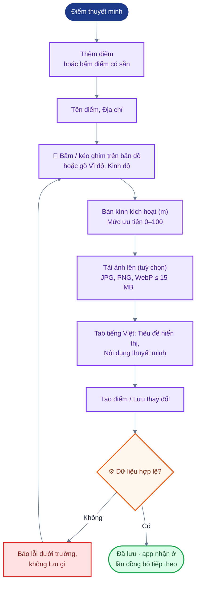

*Hình: Luồng tạo hoặc sửa một điểm thuyết minh, có bước kiểm tra dữ liệu.*

Nếu bạn rời trang khi còn thay đổi chưa lưu, CMS sẽ hỏi xác nhận.

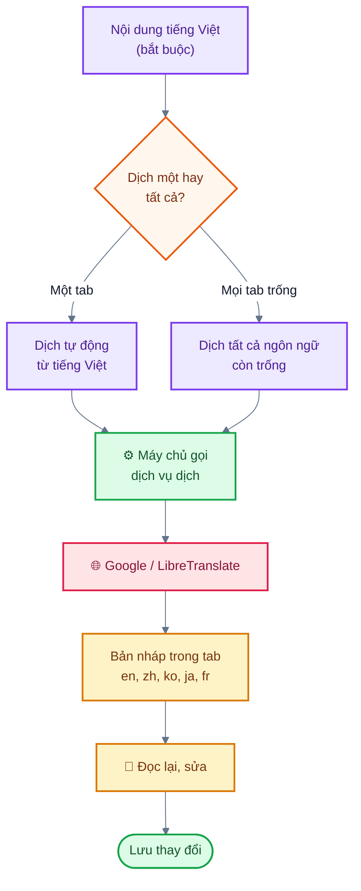

*Hình: Luồng dịch nội dung sang các ngôn ngữ khác; bản dịch máy là bản nháp cần đọc lại.*

**Audio cho từng ngôn ngữ.** Trong mỗi tab ngôn ngữ:
- "Tải file audio": mp3, m4a, aac, wav, ogg hoặc webm, tối đa 15 MB, ví dụ bản thu giọng của hướng dẫn viên;
- "Tạo giọng đọc (TTS)": tạo file MP3 từ nội dung đã lưu bằng chức năng chuyển văn bản thành giọng nói (TTS) của máy chủ. Nếu biểu mẫu còn thay đổi chưa lưu, CMS đề xuất "Lưu và tạo giọng đọc";
- nghe audio bằng trình phát có sẵn, hoặc bấm "Gỡ audio".

Nếu không có audio, ứng dụng đọc nội dung bằng giọng đọc có sẵn của điện thoại.

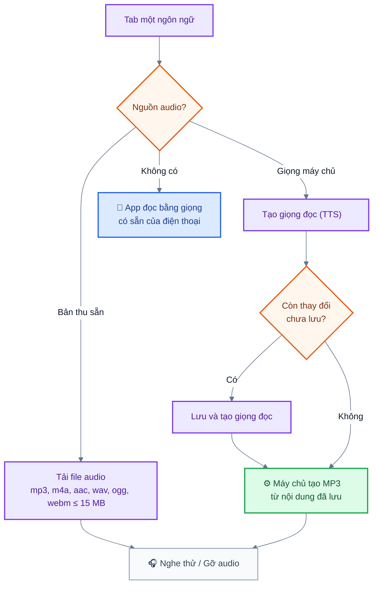

*Hình: Ba nguồn âm thanh cho một ngôn ngữ: file thu sẵn, giọng TTS do máy chủ tạo, hoặc giọng đọc của điện thoại.*

**Xoá một điểm.** Bấm "Xoá điểm" và xác nhận. Thao tác này xoá luôn bản dịch, audio, ảnh và mã QR của điểm, đồng thời gỡ điểm khỏi các tour. Số liệu thống kê cũ được giữ lại.

Thay đổi đến được điện thoại của khách ở lần đồng bộ tiếp theo (khi mở ứng dụng, cứ 5 phút một lần khi ứng dụng đang mở, hoặc khi có mạng trở lại).

> Cần bổ sung ảnh chụp: danh sách điểm, biểu mẫu điểm có bản đồ, các tab ngôn ngữ, khu vực audio.

### A.4 Mã QR cho trạm xe buýt (UC3 A2, dùng cho UC2)

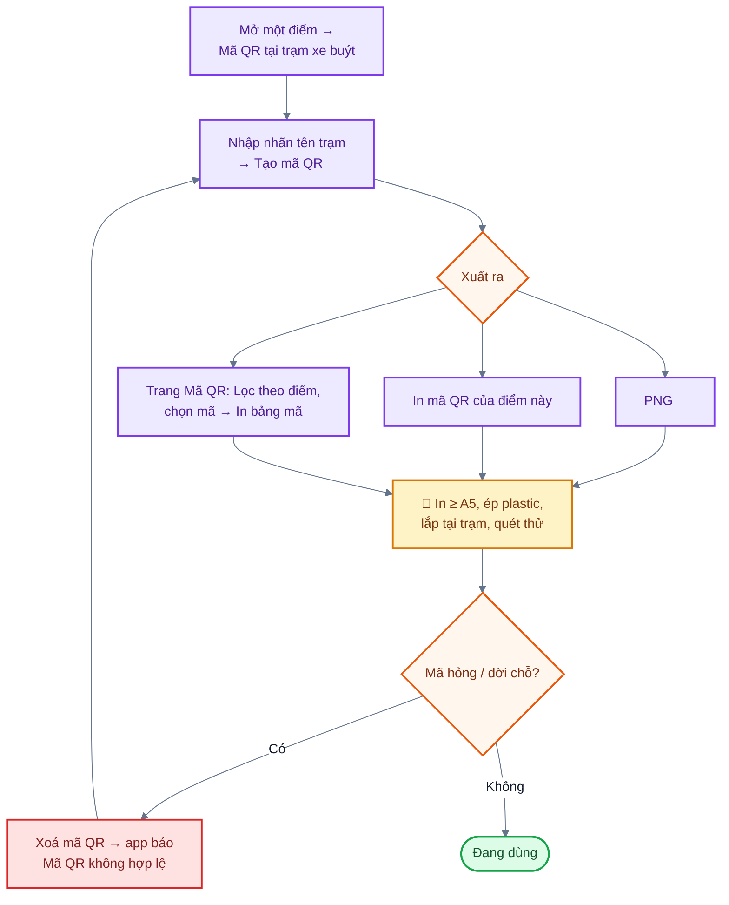

*Hình: Vòng đời mã QR trạm xe buýt: tạo, in, lắp đặt, thu hồi.*

1. Mở một điểm và cuộn tới mục "Mã QR tại trạm xe buýt".
2. Nhập nhãn ghi tên trạm (ví dụ "Trạm xe buýt Khánh Hội") rồi bấm "Tạo mã QR".
3. Bấm "PNG" để tải ảnh mã về, hoặc bấm "In mã QR của điểm này".
4. Trang "Mã QR" liệt kê mọi mã và có thể lọc theo điểm ("Lọc theo điểm"). Chọn các mã rồi bấm "In bảng mã" để in tờ A4, mỗi trang bốn mã, mỗi mã kèm nhãn trạm, tên điểm và hướng dẫn quét.
5. In khổ tối thiểu A5 và ép plastic nếu dùng ngoài trời. Lắp tại trạm và thử quét bằng ứng dụng.
6. Để thu hồi một mã bị hỏng hoặc đã dời chỗ, hãy xoá mã đó ("Xoá mã QR"); sau lần đồng bộ tiếp theo, ứng dụng báo "Mã QR không hợp lệ" khi quét mã này. Tạo mã mới nếu cần.

> Cần bổ sung ảnh chụp: mục QR của một điểm, trang Mã QR, tờ in.

### A.5 Quản lý tour (UC4)

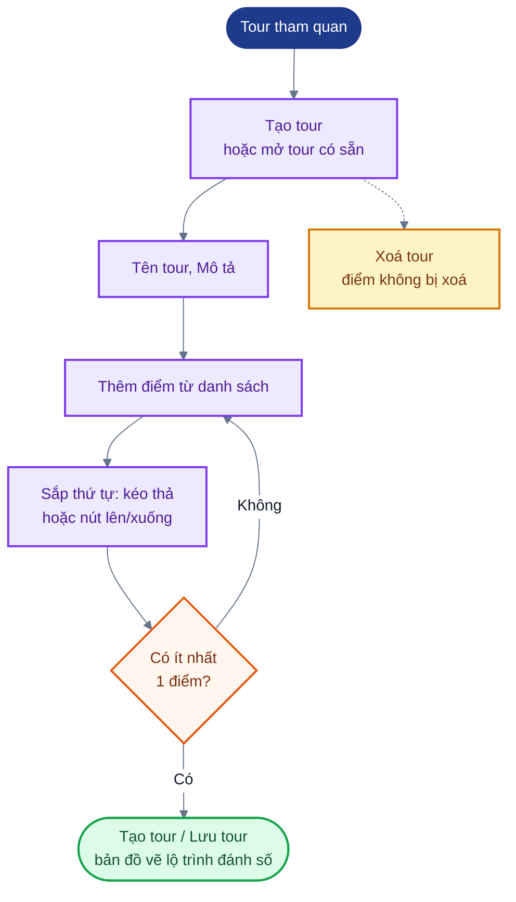

*Hình: Luồng tạo và lưu tour trên CMS.*

1. Mở "Tour tham quan" và bấm "Tạo tour", hoặc mở một tour đã có.
2. Nhập "Tên tour" và "Mô tả".
3. Thêm các điểm từ danh sách, rồi sắp thứ tự bằng cách kéo thả hoặc bằng nút lên/xuống (dùng được cả bằng bàn phím). Bản đồ vẽ lộ trình có đánh số.
4. Bấm "Tạo tour" (tour mới) hoặc "Lưu tour". Một tour phải có ít nhất một điểm.
5. Để xoá tour, bấm "Xoá tour" và xác nhận. Bản thân các điểm không bị xoá.

> Cần bổ sung ảnh chụp: trình soạn tour có bản đồ.

### A.6 Thống kê sử dụng (UC5)

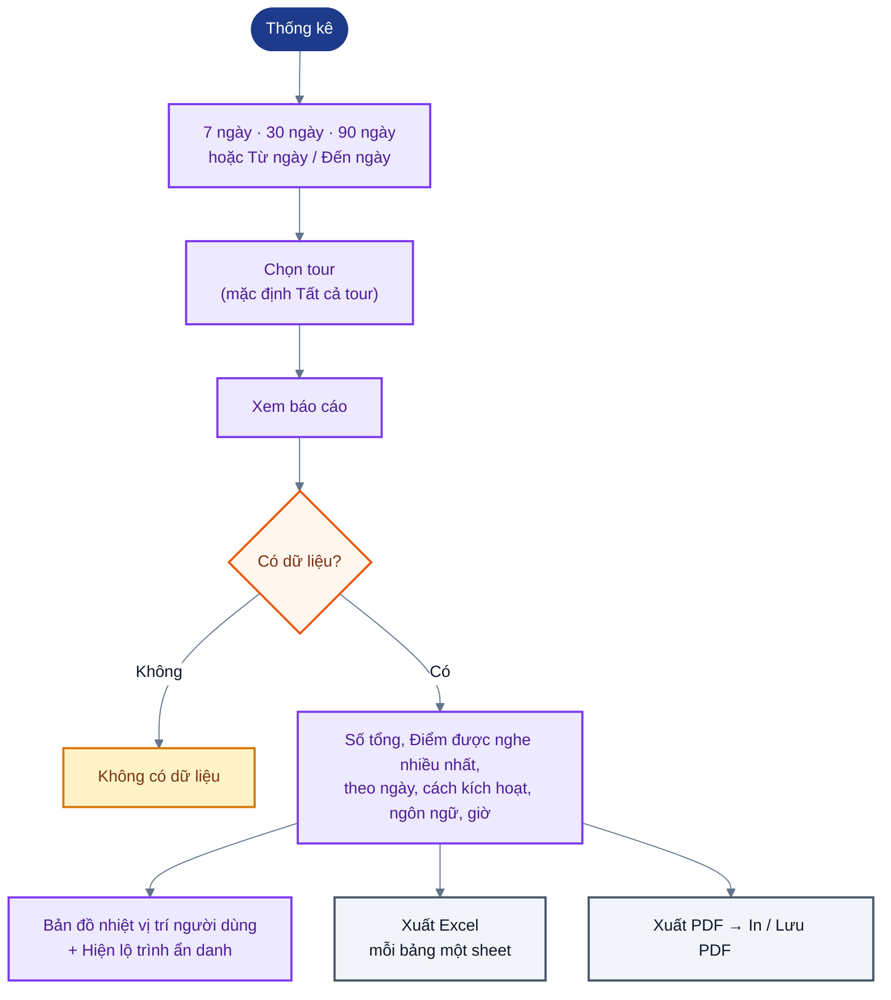

*Hình: Luồng xem và xuất báo cáo thống kê.*

1. Mở "Thống kê".
2. Chọn khoảng thời gian bằng các nút chọn nhanh "7 ngày", "30 ngày" (mặc định) hoặc "90 ngày", hoặc bằng "Từ ngày" / "Đến ngày", và có thể chọn một tour (mặc định "Tất cả tour"); bấm "Xem báo cáo".
3. Báo cáo gồm:
   - số tổng: lượt phát, số phiên (số lần mở ứng dụng), thời gian nghe trung bình và tổng thời gian nghe;
   - "Điểm được nghe nhiều nhất" và thời gian nghe trung bình theo từng điểm, kèm bảng chi tiết;
   - lượt phát theo ngày (ngày theo UTC), theo cách kích hoạt (tự động bằng GPS, QR, thủ công), theo ngôn ngữ và theo giờ trong ngày (giờ Việt Nam);
   - "Bản đồ nhiệt vị trí người dùng"; đánh dấu "Hiện lộ trình ẩn danh" để vẽ một số lộ trình mẫu.
4. Nếu không có dữ liệu nào khớp bộ lọc, trang hiển thị "Không có dữ liệu".
5. "Xuất Excel" tải về một workbook, mỗi bảng một sheet. "Xuất PDF" mở báo cáo sẵn để in; bấm "In / Lưu PDF" rồi chọn "Save as PDF" (Lưu dưới dạng PDF) trong hộp thoại in của trình duyệt.

Mọi dữ liệu đều ẩn danh: khách không có tài khoản, mỗi lần mở ứng dụng dùng một mã phiên ngẫu nhiên mới, và vị trí được lưu với độ chính xác khoảng 11 m.

> Cần bổ sung ảnh chụp: trang thống kê, bản đồ nhiệt, báo cáo in.

---

## Phần B. Khách du lịch và hành khách xe buýt (ứng dụng di động)

Ứng dụng có bốn tab: **Bản đồ**, **Tour**, **Quét QR** và **Cài đặt**.

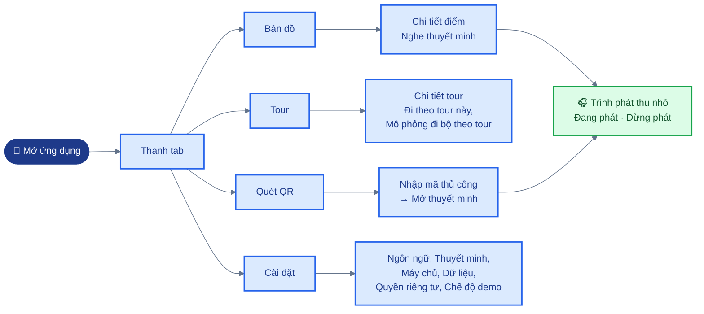

*Hình: Bản đồ điều hướng ứng dụng di động: bốn tab và màn hình chi tiết điểm, chi tiết tour.*

### B.1 Lần khởi động đầu tiên

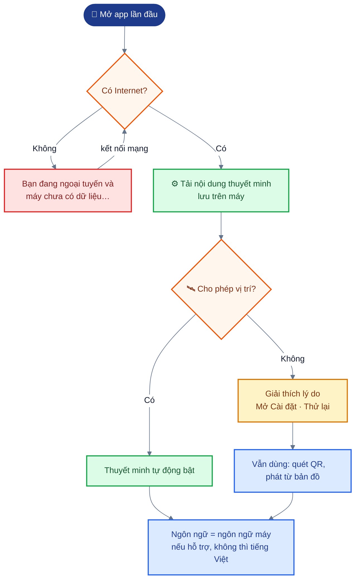

*Hình: Lần khởi động đầu tiên: tải dữ liệu, xin quyền vị trí, chọn ngôn ngữ.*

1. Mở ứng dụng khi đang có kết nối Internet. Ứng dụng tải nội dung thuyết minh (narration) của khu vực; sau đó dùng được khi ngoại tuyến (offline).
2. Cho phép truy cập **vị trí** để thuyết minh tự động bắt đầu. Nếu bạn từ chối, ứng dụng giải thích lý do cần quyền này và đưa ra các nút "Mở Cài đặt" và "Thử lại"; quét QR và phát từ bản đồ vẫn dùng được.
3. Ngôn ngữ thuyết minh ban đầu là ngôn ngữ của điện thoại nếu được hỗ trợ, nếu không thì là tiếng Việt. Đổi ngôn ngữ tại **Cài đặt → Ngôn ngữ thuyết minh** (Tiếng Việt, English, 中文, 한국어, 日本語, Français). Nếu một điểm chưa có nội dung bằng ngôn ngữ của bạn, bạn sẽ nghe bản tiếng Việt và có thông báo cho biết điều đó.
4. Nếu lần khởi động đầu tiên không có Internet, bản đồ hiển thị "Bạn đang ngoại tuyến và máy chưa có dữ liệu…"; hãy kết nối mạng một lần để tải nội dung.

> Cần bổ sung ảnh chụp: màn hình xin quyền, màn hình cài đặt.

### B.2 Thuyết minh tự động khi di chuyển (UC1)

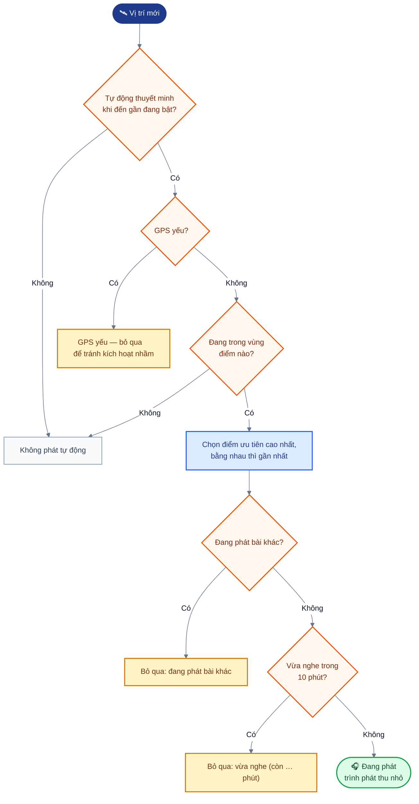

*Hình: Các bước app quyết định có tự phát thuyết minh khi vị trí thay đổi hay không.*

- Cứ đi bộ hoặc đi xe như bình thường. Khi bạn đến gần một điểm tham quan, thuyết minh của điểm đó tự bắt đầu và trình phát thu nhỏ ở cuối màn hình hiển thị "Đang phát" kèm nút "Dừng phát".
- Bản đồ tô màu từng vòng tròn theo trạng thái: "Đang ở trong", "Đang phát", "Vừa nghe", "Điểm kế tiếp" của tour đang đi theo.
- Nếu đang phát một bài thuyết minh khác, điểm mới bị bỏ qua ("Bỏ qua “…”: đang phát bài khác"). Chạm vào điểm đó trên bản đồ và bấm "Nghe thuyết minh" để nghe.
- Cùng một điểm không được phát lại trong vòng 10 phút ("Bỏ qua “…”: vừa nghe (còn … phút)"). Có thể đổi thời gian chờ phát lại (cooldown) này trong Cài đặt ("Không phát lại cùng một điểm trong (phút)"); đặt 0 để bỏ giới hạn.
- Khi GPS yếu, bản đồ hiển thị "GPS yếu (±… m) — bỏ qua để tránh kích hoạt nhầm"; thuyết minh có thể bắt đầu muộn. Khi đó hãy dùng bản đồ hoặc mã QR.
- Mục "Tự động thuyết minh khi đến gần" trong Cài đặt dùng để bật hoặc tắt thuyết minh tự động.
- Để thuyết minh tiếp tục chạy khi tắt màn hình, bật "Tiếp tục khi chạy nền" và cấp quyền vị trí "Luôn luôn". Tính năng này cần bản ứng dụng đã cài đặt; không dùng được trong Expo Go.

> Cần bổ sung ảnh chụp: bản đồ có các vòng tròn và trình phát thu nhỏ.

### B.3 Quét mã QR tại trạm xe buýt (UC2)

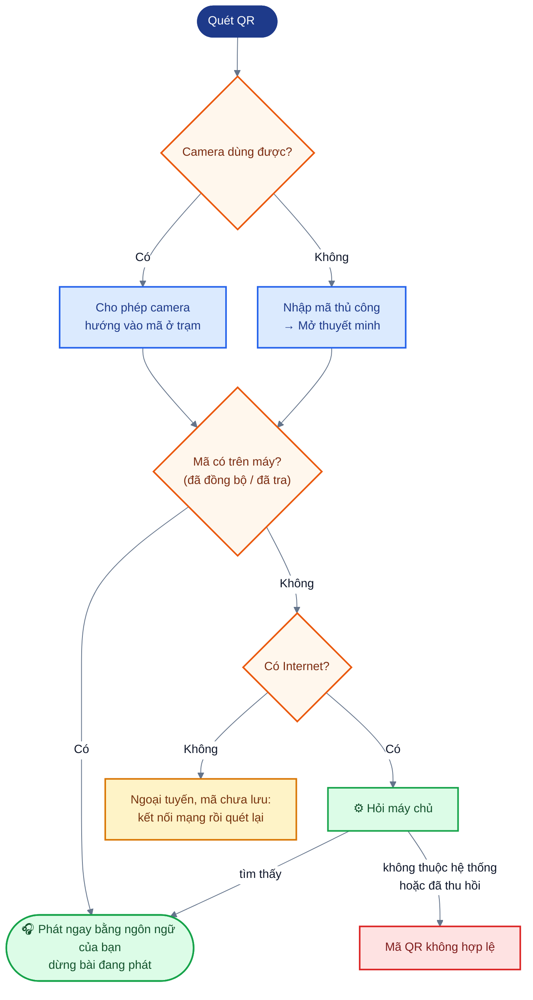

*Hình: Luồng quét hoặc nhập mã QR và các kết quả có thể xảy ra.*

1. Mở **Quét QR** và cho phép dùng camera ("Cho phép camera"). Camera chỉ dùng để đọc mã QR.
2. Hướng camera vào mã trên biển trạm xe buýt. Nếu không dùng được camera, gõ mã in trên biển vào ô "Nhập mã thủ công" rồi bấm "Mở thuyết minh".
3. Thuyết minh bắt đầu ngay bằng ngôn ngữ của bạn và dừng bài đang phát (nếu có); không cần GPS. Bạn có thể chọn ngôn ngữ khác để nghe lại.
4. "Mã QR không hợp lệ" nghĩa là mã không thuộc hệ thống hoặc đã bị thu hồi.
5. Các mã được lưu trên điện thoại ở mỗi lần đồng bộ nên vẫn dùng được khi ngoại tuyến. Mã chưa được lưu thì không kiểm tra được khi không có Internet; hãy kết nối mạng rồi quét lại.

> Cần bổ sung ảnh chụp: màn hình quét mã.

### B.4 Tour
Mở **Tour** để xem các lộ trình gợi ý. Mở một tour để xem các điểm dừng theo thứ tự và bấm "Đi theo tour này": ứng dụng hiển thị điểm kế tiếp và khoảng cách tới đó, và hiển thị "Hoàn thành tour “…”" khi kết thúc. "Bỏ qua điểm này" chuyển sang điểm tiếp theo.

```mermaid
%%{init: {"theme":"base","fontFamily":"Helvetica Neue, Arial, sans-serif","themeVariables":{"fontFamily":"Helvetica Neue, Arial, sans-serif","fontSize":"15px","primaryColor":"#EFF6FF","primaryBorderColor":"#3B82F6","primaryTextColor":"#0F172A","lineColor":"#64748B","secondaryColor":"#F0FDF4","tertiaryColor":"#FFFFFF","clusterBkg":"#F8FAFC","clusterBorder":"#CBD5E1","edgeLabelBackground":"#FFFFFF","noteBkgColor":"#FEF9C3","noteBorderColor":"#EAB308","actorBkg":"#DBEAFE","actorBorder":"#2563EB","actorTextColor":"#1E3A8A","signalColor":"#475569","signalTextColor":"#0F172A","labelBoxBkgColor":"#F1F5F9","labelBoxBorderColor":"#94A3B8","activationBkgColor":"#E0F2FE","activationBorderColor":"#0284C7","sequenceNumberColor":"#FFFFFF","pie1":"#16A34A","pie2":"#F59E0B","pie3":"#94A3B8","pie4":"#DC2626","pie5":"#2563EB","pie6":"#7C3AED","pieStrokeColor":"#FFFFFF","pieSectionTextColor":"#FFFFFF","quadrant1Fill":"#FEE2E2","quadrant2Fill":"#FEF3C7","quadrant3Fill":"#DCFCE7","quadrant4Fill":"#FEF3C7","quadrantPointFill":"#1E3A8A","quadrantPointTextFill":"#0F172A","git0":"#1E3A8A","gitBranchLabel0":"#FFFFFF","cScale0":"#DBEAFE","cScale1":"#DCFCE7","cScale2":"#EDE9FE","cScale3":"#FEF3C7","cScale4":"#FFE4E6","cScale5":"#E0F2FE","cScale6":"#F1F5F9"},"flowchart":{"curve":"basis","padding":16,"nodeSpacing":40,"rankSpacing":50},"sequence":{"showSequenceNumbers":true,"mirrorActors":false}}}%%
stateDiagram-v2
    direction LR
    [*] --> XemTour: Mở tab Tour
    XemTour --> DangDi: Đi theo tour này
    DangDi --> DangDi: Tới điểm / Bỏ qua điểm này
    DangDi --> HoanThanh: Hết điểm dừng
    DangDi --> XemTour: Ngừng đi theo
    HoanThanh --> [*]
    XemTour: Chi tiết tour<br/>điểm dừng theo thứ tự
    DangDi: Đang đi theo tour<br/>Điểm kế tiếp · khoảng cách
    HoanThanh: Hoàn thành tour “…”
    classDef mobile fill:#DBEAFE,stroke:#2563EB,stroke-width:2px,color:#1E3A8A
    classDef ok fill:#DCFCE7,stroke:#16A34A,stroke-width:2px,color:#14532D
    class XemTour,DangDi mobile
    class HoanThanh ok
    classDef mobile fill:#DBEAFE,stroke:#2563EB,stroke-width:2px,color:#1E3A8A
    classDef ok fill:#DCFCE7,stroke:#16A34A,stroke-width:2px,color:#14532D
```

*Hình: Trạng thái khi đi theo một tour trong ứng dụng.*

> Cần bổ sung ảnh chụp: màn hình tour.

### B.5 Cài đặt và dùng ngoại tuyến

```mermaid
%%{init: {"theme":"base","fontFamily":"Helvetica Neue, Arial, sans-serif","themeVariables":{"fontFamily":"Helvetica Neue, Arial, sans-serif","fontSize":"15px","primaryColor":"#EFF6FF","primaryBorderColor":"#3B82F6","primaryTextColor":"#0F172A","lineColor":"#64748B","secondaryColor":"#F0FDF4","tertiaryColor":"#FFFFFF","clusterBkg":"#F8FAFC","clusterBorder":"#CBD5E1","edgeLabelBackground":"#FFFFFF","noteBkgColor":"#FEF9C3","noteBorderColor":"#EAB308","actorBkg":"#DBEAFE","actorBorder":"#2563EB","actorTextColor":"#1E3A8A","signalColor":"#475569","signalTextColor":"#0F172A","labelBoxBkgColor":"#F1F5F9","labelBoxBorderColor":"#94A3B8","activationBkgColor":"#E0F2FE","activationBorderColor":"#0284C7","sequenceNumberColor":"#FFFFFF","pie1":"#16A34A","pie2":"#F59E0B","pie3":"#94A3B8","pie4":"#DC2626","pie5":"#2563EB","pie6":"#7C3AED","pieStrokeColor":"#FFFFFF","pieSectionTextColor":"#FFFFFF","quadrant1Fill":"#FEE2E2","quadrant2Fill":"#FEF3C7","quadrant3Fill":"#DCFCE7","quadrant4Fill":"#FEF3C7","quadrantPointFill":"#1E3A8A","quadrantPointTextFill":"#0F172A","git0":"#1E3A8A","gitBranchLabel0":"#FFFFFF","cScale0":"#DBEAFE","cScale1":"#DCFCE7","cScale2":"#EDE9FE","cScale3":"#FEF3C7","cScale4":"#FFE4E6","cScale5":"#E0F2FE","cScale6":"#F1F5F9"},"flowchart":{"curve":"basis","padding":16,"nodeSpacing":40,"rankSpacing":50},"sequence":{"showSequenceNumbers":true,"mirrorActors":false}}}%%
flowchart TB
    C(["⚙ Cài đặt"]):::startend --> L["Ngôn ngữ thuyết minh<br/>6 ngôn ngữ"]:::mobile
    C --> N["Thuyết minh<br/>Tự động · thời gian chờ<br/>chạy nền"]:::mobile
    C --> M["Máy chủ<br/>Địa chỉ máy chủ"]:::mobile
    C --> P["Quyền riêng tư<br/>Gửi dữ liệu ẩn danh · Mã phiên"]:::mobile
    C --> S["Chế độ demo<br/>Mô phỏng vị trí"]:::ext
    C --> D["Dữ liệu"]:::data
    D --> D1["Đồng bộ ngay<br/>Lần đồng bộ cuối · Phiên bản nội dung"]:::data
    D --> D2["Tải tất cả audio<br/>để nghe offline"]:::data
    D --> D3["Xoá bộ nhớ đệm"]:::warn
    classDef mobile fill:#DBEAFE,stroke:#2563EB,stroke-width:2px,color:#1E3A8A
    classDef ext fill:#FFE4E6,stroke:#E11D48,stroke-width:2px,color:#881337
    classDef data fill:#F1F5F9,stroke:#475569,stroke-width:2px,color:#0F172A
    classDef startend fill:#1E3A8A,stroke:#1E3A8A,stroke-width:2px,color:#FFFFFF
    classDef warn fill:#FEF3C7,stroke:#D97706,stroke-width:2px,color:#78350F
```

*Hình: Các nhóm mục trong màn hình Cài đặt.*

- **Dữ liệu**: "Đồng bộ ngay", "Lần đồng bộ cuối", "Phiên bản nội dung", "Tải tất cả audio để nghe offline", "Xoá bộ nhớ đệm".
- **Máy chủ**: địa chỉ backend (chỉ cần khi trình diễn trong mạng nội bộ).
- **Quyền riêng tư**: bật/tắt "Gửi dữ liệu ẩn danh", số bản ghi đang chờ gửi, "Mã phiên hiện tại".
- **Chế độ demo**: "Mô phỏng vị trí" bỏ qua GPS thật; chạm vào bản đồ để đặt vị trí, hoặc mở một tour và dùng "Mô phỏng đi bộ theo tour".

```mermaid
%%{init: {"theme":"base","fontFamily":"Helvetica Neue, Arial, sans-serif","themeVariables":{"fontFamily":"Helvetica Neue, Arial, sans-serif","fontSize":"15px","primaryColor":"#EFF6FF","primaryBorderColor":"#3B82F6","primaryTextColor":"#0F172A","lineColor":"#64748B","secondaryColor":"#F0FDF4","tertiaryColor":"#FFFFFF","clusterBkg":"#F8FAFC","clusterBorder":"#CBD5E1","edgeLabelBackground":"#FFFFFF","noteBkgColor":"#FEF9C3","noteBorderColor":"#EAB308","actorBkg":"#DBEAFE","actorBorder":"#2563EB","actorTextColor":"#1E3A8A","signalColor":"#475569","signalTextColor":"#0F172A","labelBoxBkgColor":"#F1F5F9","labelBoxBorderColor":"#94A3B8","activationBkgColor":"#E0F2FE","activationBorderColor":"#0284C7","sequenceNumberColor":"#FFFFFF","pie1":"#16A34A","pie2":"#F59E0B","pie3":"#94A3B8","pie4":"#DC2626","pie5":"#2563EB","pie6":"#7C3AED","pieStrokeColor":"#FFFFFF","pieSectionTextColor":"#FFFFFF","quadrant1Fill":"#FEE2E2","quadrant2Fill":"#FEF3C7","quadrant3Fill":"#DCFCE7","quadrant4Fill":"#FEF3C7","quadrantPointFill":"#1E3A8A","quadrantPointTextFill":"#0F172A","git0":"#1E3A8A","gitBranchLabel0":"#FFFFFF","cScale0":"#DBEAFE","cScale1":"#DCFCE7","cScale2":"#EDE9FE","cScale3":"#FEF3C7","cScale4":"#FFE4E6","cScale5":"#E0F2FE","cScale6":"#F1F5F9"},"flowchart":{"curve":"basis","padding":16,"nodeSpacing":40,"rankSpacing":50},"sequence":{"showSequenceNumbers":true,"mirrorActors":false}}}%%
flowchart LR
    A["Chế độ demo →<br/>bật Mô phỏng vị trí"]:::ext --> B{"Cách đặt vị trí"}:::decision
    B -->|chạm| C["Bản đồ: chạm để<br/>đặt vị trí"]:::mobile
    B -->|tour| D["Mở một tour →<br/>Mô phỏng đi bộ theo tour"]:::mobile
    D --> E["Tốc độ đi bộ<br/>mô phỏng (×)"]:::neutral
    C --> F(["🎧 Phát như khi<br/>đi thật"]):::ok
    E --> F
    classDef mobile fill:#DBEAFE,stroke:#2563EB,stroke-width:2px,color:#1E3A8A
    classDef ext fill:#FFE4E6,stroke:#E11D48,stroke-width:2px,color:#881337
    classDef decision fill:#FFF7ED,stroke:#EA580C,stroke-width:2px,color:#7C2D12
    classDef ok fill:#DCFCE7,stroke:#16A34A,stroke-width:2px,color:#14532D
    classDef neutral fill:#F8FAFC,stroke:#94A3B8,stroke-width:1.5px,color:#334155
```

*Hình: Hai cách dùng chế độ mô phỏng vị trí khi trình diễn.*

### B.6 Quyền riêng tư
Ứng dụng không hỏi tên, số điện thoại hay tài khoản. Ứng dụng gửi dữ liệu sử dụng ẩn danh (điểm nào được phát, bằng ngôn ngữ nào, trong bao lâu, được kích hoạt bằng cách nào) và thỉnh thoảng gửi vị trí gần đúng, chỉ gắn với một mã ngẫu nhiên thay đổi mỗi lần bạn mở ứng dụng. Bạn có thể tắt việc này trong Cài đặt.

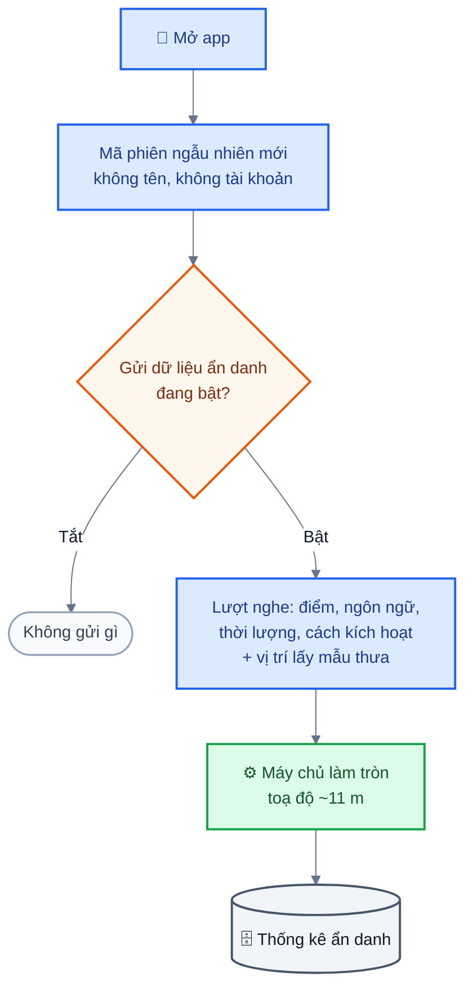

*Hình: Dữ liệu ẩn danh app gửi lên và cách tắt.*

### B.7 Xử lý sự cố

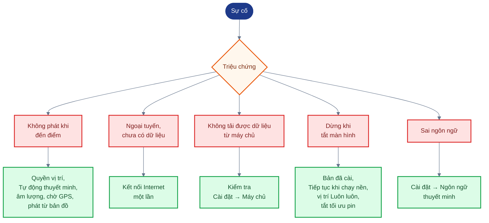

*Hình: Tra nhanh triệu chứng và cách xử lý.*

| Sự cố | Cách xử lý |
|---|---|
| Không có thuyết minh khi đến một điểm | Kiểm tra đã cho phép vị trí, đã bật "Tự động thuyết minh khi đến gần" và âm lượng đã mở; chờ tín hiệu GPS tốt hơn; phát từ bản đồ |
| "Bạn đang ngoại tuyến và máy chưa có dữ liệu" | Kết nối Internet một lần để ứng dụng tải nội dung |
| "Không tải được dữ liệu từ máy chủ …" | Địa chỉ backend sai hoặc không truy cập được; kiểm tra **Cài đặt → Máy chủ** |
| Thuyết minh dừng khi tắt màn hình | Dùng bản ứng dụng đã cài đặt, bật "Tiếp tục khi chạy nền", cấp quyền vị trí "Luôn luôn" và tắt tối ưu hoá pin cho ứng dụng (Android) |
| Sai ngôn ngữ | Đổi tại **Cài đặt → Ngôn ngữ thuyết minh** |
