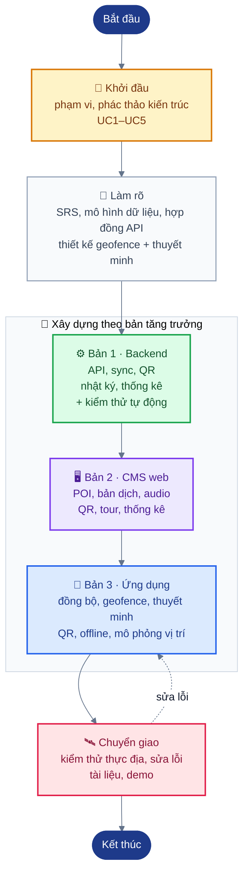
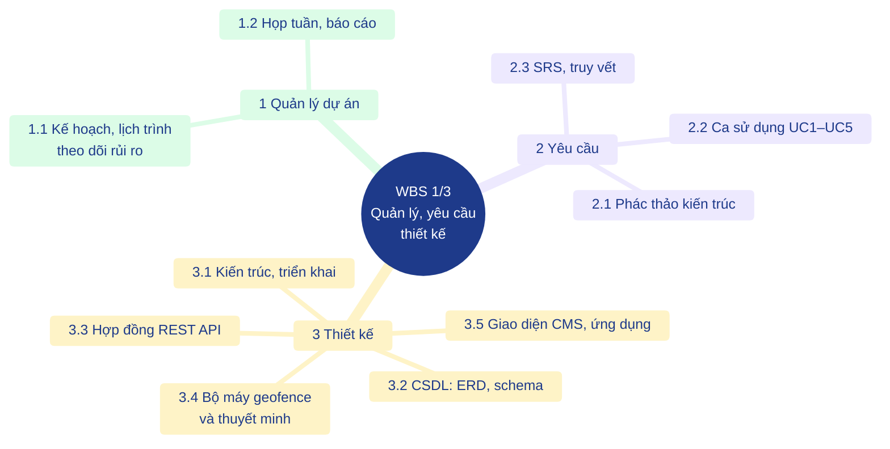
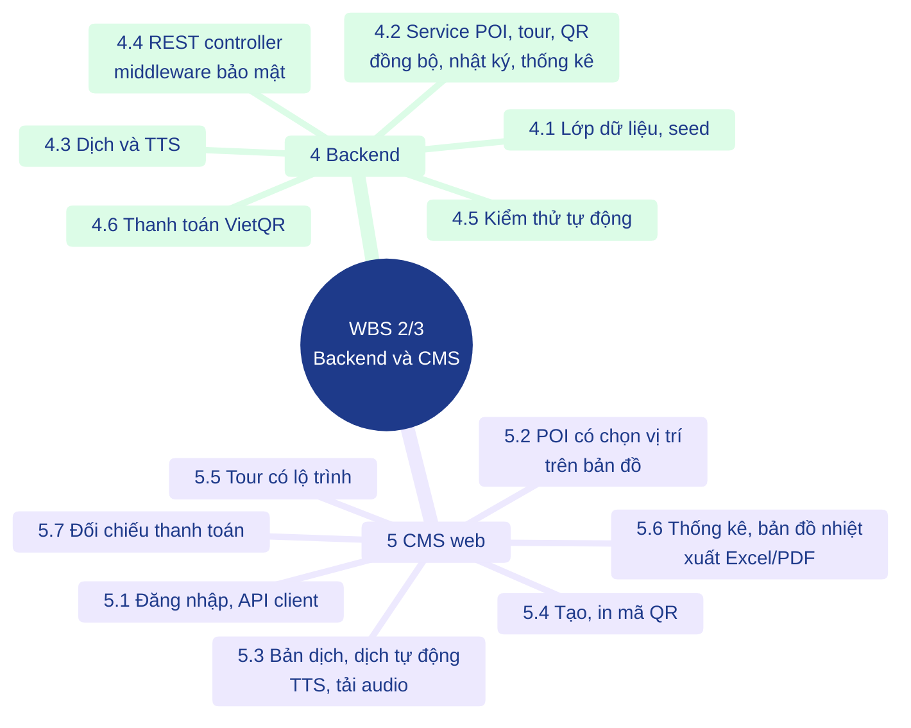
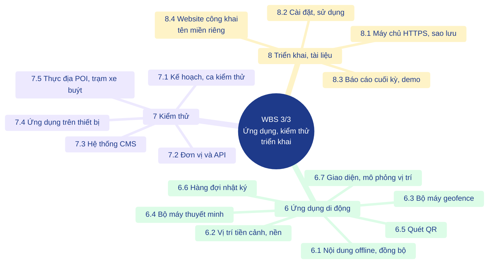
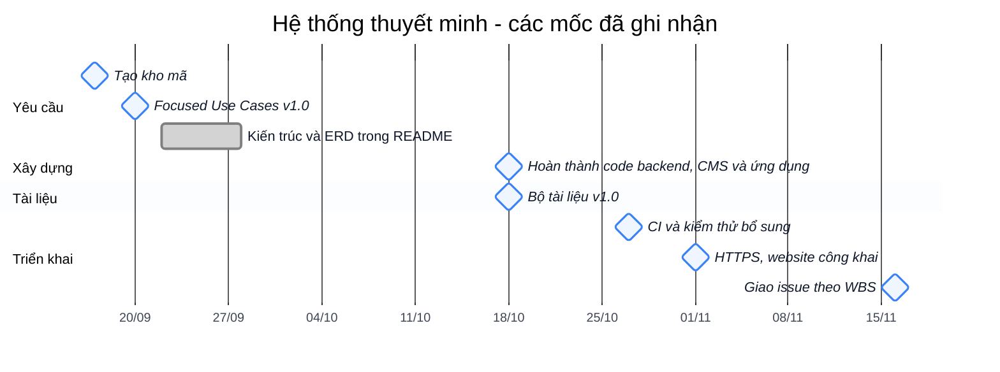
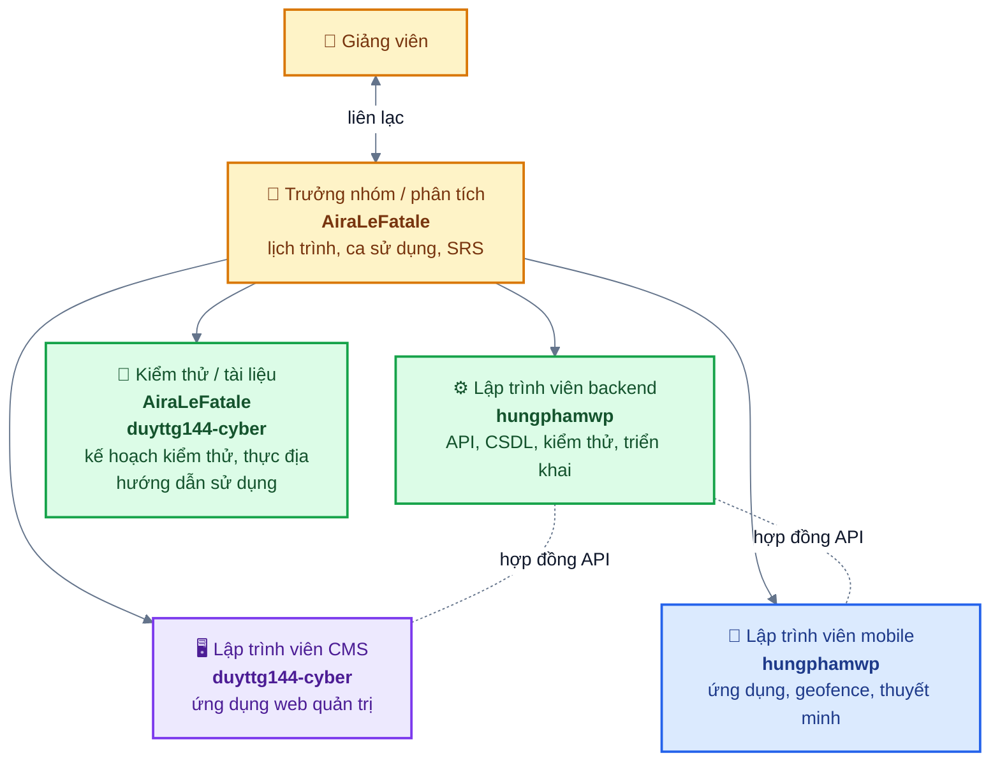
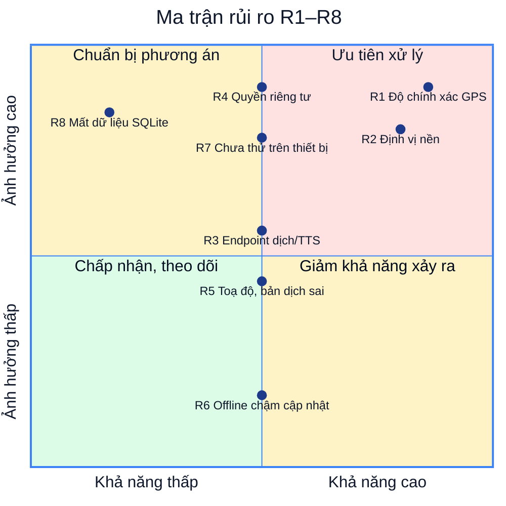
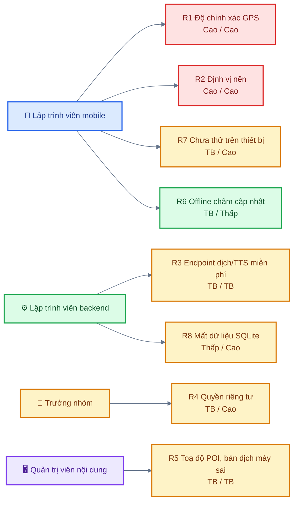

# Quản lý dự án

**Dự án:** Hệ thống thuyết minh tự động đa ngôn ngữ
**Phiên bản tài liệu:** 1.0 (18/10/2026)

## 1. Mô hình quy trình
Nhóm áp dụng quy trình **lặp và tăng trưởng, hướng ca sử dụng (use case)**:

1. **Khởi đầu (Inception)**: xác định phạm vi và phác thảo kiến trúc (các sơ đồ trong README), các ca sử dụng trọng tâm UC1–UC5.
2. **Làm rõ (Elaboration)**: SRS, mô hình dữ liệu, hợp đồng API, thiết kế bộ máy geofence (geofence engine) và bộ máy thuyết minh (narration engine).
3. **Xây dựng (Construction)** theo từng bản tăng trưởng (increment); mỗi bản kết thúc bằng phần mềm chạy được và đã kiểm thử:
   - Bản tăng trưởng 1: backend (dữ liệu, API cho CMS, đồng bộ (sync), QR, nhật ký, thống kê (analytics)) kèm kiểm thử tự động.
   - Bản tăng trưởng 2: CMS web (POI, bản dịch, audio, QR, tour, thống kê).
   - Bản tăng trưởng 3: ứng dụng di động (đồng bộ, geofence, thuyết minh, QR, nhật ký ngoại tuyến (offline), chế độ mô phỏng vị trí).
4. **Chuyển giao (Transition)**: kiểm thử thực địa (field test) tại các điểm tham quan (POI) thật, sửa lỗi, hoàn thiện tài liệu, demo.


*Hình: bốn pha của quy trình lặp và tăng trưởng; pha Xây dựng gồm ba bản tăng trưởng nối tiếp*

Lý do lựa chọn: yêu cầu đã rõ ở mức ca sử dụng, nhưng hành vi của GPS và giới hạn của các dịch vụ miễn phí chỉ biết được khi xây dựng và kiểm thử. Phát triển theo bản tăng trưởng cho phép kiểm thử sớm phần rủi ro nhất (geofence trên thiết bị) trên máy thật, trong khi hợp đồng API của backend vẫn giữ ổn định.

Thực hành: kho mã Git/GitHub, mỗi tính năng một nhánh và được review trước khi gộp, hợp đồng API (`docs/api.md`) là thoả thuận giữa backend và các client, kiểm thử tự động của backend chạy trước mỗi lần gộp.

```mermaid
%%{init: {"theme":"base","fontFamily":"Helvetica Neue, Arial, sans-serif","themeVariables":{"fontFamily":"Helvetica Neue, Arial, sans-serif","fontSize":"15px","primaryColor":"#EFF6FF","primaryBorderColor":"#3B82F6","primaryTextColor":"#0F172A","lineColor":"#64748B","secondaryColor":"#F0FDF4","tertiaryColor":"#FFFFFF","clusterBkg":"#F8FAFC","clusterBorder":"#CBD5E1","edgeLabelBackground":"#FFFFFF","noteBkgColor":"#FEF9C3","noteBorderColor":"#EAB308","actorBkg":"#DBEAFE","actorBorder":"#2563EB","actorTextColor":"#1E3A8A","signalColor":"#475569","signalTextColor":"#0F172A","labelBoxBkgColor":"#F1F5F9","labelBoxBorderColor":"#94A3B8","activationBkgColor":"#E0F2FE","activationBorderColor":"#0284C7","sequenceNumberColor":"#FFFFFF","pie1":"#16A34A","pie2":"#F59E0B","pie3":"#94A3B8","pie4":"#DC2626","pie5":"#2563EB","pie6":"#7C3AED","pieStrokeColor":"#FFFFFF","pieSectionTextColor":"#FFFFFF","quadrant1Fill":"#FEE2E2","quadrant2Fill":"#FEF3C7","quadrant3Fill":"#DCFCE7","quadrant4Fill":"#FEF3C7","quadrantPointFill":"#1E3A8A","quadrantPointTextFill":"#0F172A","git0":"#1E3A8A","gitBranchLabel0":"#FFFFFF","cScale0":"#DBEAFE","cScale1":"#DCFCE7","cScale2":"#EDE9FE","cScale3":"#FEF3C7","cScale4":"#FFE4E6","cScale5":"#E0F2FE","cScale6":"#F1F5F9"},"flowchart":{"curve":"basis","padding":16,"nodeSpacing":40,"rankSpacing":50},"sequence":{"showSequenceNumbers":true,"mirrorActors":false}}}%%
flowchart LR
  A["🌿 Nhánh tính năng<br/>trên GitHub"]:::neutral --> B["💻 Viết code<br/>bám hợp đồng docs/api.md"]:::backend
  B --> K["🧪 Chạy kiểm thử<br/>tự động backend"]:::ok
  K --> R{"Review<br/>đạt?"}:::decision
  R -- Chưa --> B
  R -- Đạt --> M["🔀 Gộp nhánh"]:::backend
  M --> P(["Phần mềm chạy được<br/>đã kiểm thử"]):::startend
  P -. "bản kế tiếp" .-> A
  classDef backend fill:#DCFCE7,stroke:#16A34A,stroke-width:2px,color:#14532D
  classDef decision fill:#FFF7ED,stroke:#EA580C,stroke-width:2px,color:#7C2D12
  classDef startend fill:#1E3A8A,stroke:#1E3A8A,stroke-width:2px,color:#FFFFFF
  classDef ok fill:#DCFCE7,stroke:#16A34A,stroke-width:2px,color:#14532D
  classDef neutral fill:#F8FAFC,stroke:#94A3B8,stroke-width:1.5px,color:#334155
```


*Hình: vòng lặp làm một tính năng trong mỗi bản tăng trưởng*

## 2. Cấu trúc phân rã công việc (WBS)


*Hình: WBS phần 1, nhánh 1 đến 3*


*Hình: WBS phần 2, nhánh 4 và 5*


*Hình: WBS phần 3, nhánh 6 đến 8*

```text
1  Quản lý dự án
   1.1 Lập kế hoạch, lịch trình, theo dõi rủi ro
   1.2 Họp hằng tuần và báo cáo tiến độ
2  Yêu cầu
   2.1 Phác thảo kiến trúc (README)
   2.2 Các ca sử dụng trọng tâm UC1–UC5
   2.3 SRS (FR/NFR, quy tắc nghiệp vụ, truy vết)
3  Thiết kế
   3.1 Kiến trúc và triển khai
   3.2 Cơ sở dữ liệu (ERD, schema)
   3.3 Hợp đồng REST API
   3.4 Thiết kế bộ máy geofence và bộ máy thuyết minh
   3.5 Thiết kế giao diện (màn hình CMS, màn hình ứng dụng)
4  Backend
   4.1 Lớp dữ liệu (schema, repository, dữ liệu mẫu)
   4.2 Service (POI, tour, QR, đồng bộ, nhật ký, thống kê, xác thực)
   4.3 Nhà cung cấp dịch và TTS
   4.4 REST controller, middleware bảo mật
   4.5 Kiểm thử tự động
   4.6 Thanh toán VietQR cho điểm có phí
5  CMS web
   5.1 Đăng nhập và API client
   5.2 Quản lý POI có chọn vị trí trên bản đồ
   5.3 Tab bản dịch, dịch tự động, TTS, tải lên audio
   5.4 Tạo và in mã QR
   5.5 Quản lý tour có đường lộ trình trên bản đồ
   5.6 Bảng thống kê, bản đồ nhiệt, xuất Excel/PDF
   5.7 Trang đối chiếu thanh toán
6  Ứng dụng di động
   6.1 Lớp nội dung ngoại tuyến và đồng bộ
   6.2 Dịch vụ vị trí (tiền cảnh và nền)
   6.3 Bộ máy geofence
   6.4 Bộ máy thuyết minh (audio, TTS trên máy, thời gian chờ phát lại)
   6.5 Trình quét QR
   6.6 Hàng đợi nhật ký và gửi lên máy chủ
   6.7 Giao diện: bản đồ, danh sách, tour, cài đặt; chế độ mô phỏng vị trí
7  Kiểm thử
   7.1 Kế hoạch kiểm thử và ca kiểm thử
   7.2 Kiểm thử đơn vị và kiểm thử API
   7.3 Kiểm thử hệ thống CMS
   7.4 Kiểm thử ứng dụng trên thiết bị Android và iOS
   7.5 Kiểm thử thực địa tại POI và trạm xe buýt
8  Triển khai và tài liệu
   8.1 Triển khai lên máy chủ (HTTPS, sao lưu)
   8.2 Hướng dẫn cài đặt, hướng dẫn sử dụng
   8.3 Báo cáo cuối kỳ và demo
   8.4 Website công khai và tên miền riêng (QR mở /q/<mã>)
```

### Phân công theo hạng mục WBS

Mỗi hạng mục WBS là 1 issue trên GitHub, gắn người phụ trách (assignee), nhãn theo phần việc và milestone M1–M5. Hạng mục xong thì issue được đóng kèm commit/PR làm bằng chứng. Hiện có 39 hạng mục: 33 hoàn thành, 6 đang làm.

| WBS | Hạng mục | Người phụ trách | Issue | Trạng thái |
|---|---|---|---|---|
| 1.1 | Lập kế hoạch, lịch trình, theo dõi rủi ro | AiraLeFatale | [#10](https://github.com/AiraLeFatale/CongNghePhanMem_Project/issues/10) | Hoàn thành |
| 1.2 | Họp hằng tuần và báo cáo tiến độ | AiraLeFatale | [#11](https://github.com/AiraLeFatale/CongNghePhanMem_Project/issues/11) | Đang làm |
| 2.1 | Phác thảo kiến trúc (README) | AiraLeFatale | [#12](https://github.com/AiraLeFatale/CongNghePhanMem_Project/issues/12) | Hoàn thành |
| 2.2 | Các ca sử dụng trọng tâm UC1–UC5 | AiraLeFatale | [#13](https://github.com/AiraLeFatale/CongNghePhanMem_Project/issues/13) | Hoàn thành |
| 2.3 | SRS (FR/NFR, quy tắc nghiệp vụ, truy vết) | AiraLeFatale | [#14](https://github.com/AiraLeFatale/CongNghePhanMem_Project/issues/14) | Hoàn thành |
| 3.1 | Thiết kế kiến trúc và triển khai | hungphamwp | [#15](https://github.com/AiraLeFatale/CongNghePhanMem_Project/issues/15) | Hoàn thành |
| 3.2 | Thiết kế cơ sở dữ liệu (ERD, schema) | hungphamwp | [#16](https://github.com/AiraLeFatale/CongNghePhanMem_Project/issues/16) | Hoàn thành |
| 3.3 | Hợp đồng REST API | hungphamwp | [#17](https://github.com/AiraLeFatale/CongNghePhanMem_Project/issues/17) | Hoàn thành |
| 3.4 | Thiết kế bộ máy geofence và bộ máy thuyết minh | hungphamwp | [#18](https://github.com/AiraLeFatale/CongNghePhanMem_Project/issues/18) | Hoàn thành |
| 3.5 | Thiết kế giao diện (màn hình CMS, màn hình ứng dụng) | duyttg144-cyber, hungphamwp | [#19](https://github.com/AiraLeFatale/CongNghePhanMem_Project/issues/19) | Hoàn thành |
| 4.1 | Backend: lớp dữ liệu (schema, repository, dữ liệu mẫu) | hungphamwp | [#20](https://github.com/AiraLeFatale/CongNghePhanMem_Project/issues/20) | Hoàn thành |
| 4.2 | Backend: service (POI, tour, QR, đồng bộ, nhật ký, thống kê, xác thực) | hungphamwp | [#21](https://github.com/AiraLeFatale/CongNghePhanMem_Project/issues/21) | Hoàn thành |
| 4.3 | Backend: nhà cung cấp dịch và TTS | hungphamwp | [#22](https://github.com/AiraLeFatale/CongNghePhanMem_Project/issues/22) | Hoàn thành |
| 4.4 | Backend: REST controller, middleware bảo mật | hungphamwp | [#23](https://github.com/AiraLeFatale/CongNghePhanMem_Project/issues/23) | Hoàn thành |
| 4.5 | Backend: kiểm thử tự động | hungphamwp, AiraLeFatale | [#24](https://github.com/AiraLeFatale/CongNghePhanMem_Project/issues/24) | Hoàn thành |
| 4.6 | Backend: thanh toán VietQR cho điểm có phí | hungphamwp | [#25](https://github.com/AiraLeFatale/CongNghePhanMem_Project/issues/25) | Hoàn thành |
| 5.1 | CMS: đăng nhập và API client | duyttg144-cyber | [#26](https://github.com/AiraLeFatale/CongNghePhanMem_Project/issues/26) | Hoàn thành |
| 5.2 | CMS: quản lý POI có chọn vị trí trên bản đồ | duyttg144-cyber | [#27](https://github.com/AiraLeFatale/CongNghePhanMem_Project/issues/27) | Hoàn thành |
| 5.3 | CMS: tab bản dịch, dịch tự động, TTS, tải lên audio | duyttg144-cyber | [#28](https://github.com/AiraLeFatale/CongNghePhanMem_Project/issues/28) | Hoàn thành |
| 5.4 | CMS: tạo và in mã QR | duyttg144-cyber | [#29](https://github.com/AiraLeFatale/CongNghePhanMem_Project/issues/29) | Hoàn thành |
| 5.5 | CMS: quản lý tour có đường lộ trình trên bản đồ | duyttg144-cyber | [#30](https://github.com/AiraLeFatale/CongNghePhanMem_Project/issues/30) | Hoàn thành |
| 5.6 | CMS: bảng thống kê, bản đồ nhiệt, xuất Excel/PDF | duyttg144-cyber | [#31](https://github.com/AiraLeFatale/CongNghePhanMem_Project/issues/31) | Hoàn thành |
| 5.7 | CMS: trang đối chiếu thanh toán | duyttg144-cyber | [#32](https://github.com/AiraLeFatale/CongNghePhanMem_Project/issues/32) | Hoàn thành |
| 6.1 | Mobile: lớp nội dung ngoại tuyến và đồng bộ | hungphamwp | [#33](https://github.com/AiraLeFatale/CongNghePhanMem_Project/issues/33) | Hoàn thành |
| 6.2 | Mobile: dịch vụ vị trí (tiền cảnh và nền) | hungphamwp | [#34](https://github.com/AiraLeFatale/CongNghePhanMem_Project/issues/34) | Hoàn thành |
| 6.3 | Mobile: bộ máy geofence | hungphamwp | [#35](https://github.com/AiraLeFatale/CongNghePhanMem_Project/issues/35) | Hoàn thành |
| 6.4 | Mobile: bộ máy thuyết minh (audio, TTS trên máy, thời gian chờ phát lại) | hungphamwp | [#36](https://github.com/AiraLeFatale/CongNghePhanMem_Project/issues/36) | Hoàn thành |
| 6.5 | Mobile: trình quét QR | hungphamwp | [#37](https://github.com/AiraLeFatale/CongNghePhanMem_Project/issues/37) | Hoàn thành |
| 6.6 | Mobile: hàng đợi nhật ký và gửi lên máy chủ | hungphamwp | [#38](https://github.com/AiraLeFatale/CongNghePhanMem_Project/issues/38) | Hoàn thành |
| 6.7 | Mobile: giao diện bản đồ, danh sách, tour, cài đặt; chế độ mô phỏng vị trí | hungphamwp | [#39](https://github.com/AiraLeFatale/CongNghePhanMem_Project/issues/39) | Hoàn thành |
| 7.1 | Kế hoạch kiểm thử và ca kiểm thử | AiraLeFatale | [#40](https://github.com/AiraLeFatale/CongNghePhanMem_Project/issues/40) | Hoàn thành |
| 7.2 | Kiểm thử đơn vị và kiểm thử API | AiraLeFatale, hungphamwp | [#41](https://github.com/AiraLeFatale/CongNghePhanMem_Project/issues/41) | Hoàn thành |
| 7.3 | Kiểm thử hệ thống CMS | duyttg144-cyber | [#42](https://github.com/AiraLeFatale/CongNghePhanMem_Project/issues/42) | Đang làm |
| 7.4 | Kiểm thử ứng dụng trên thiết bị Android và iOS | duyttg144-cyber, hungphamwp | [#43](https://github.com/AiraLeFatale/CongNghePhanMem_Project/issues/43) | Đang làm |
| 7.5 | Kiểm thử thực địa tại POI và trạm xe buýt | AiraLeFatale, duyttg144-cyber | [#44](https://github.com/AiraLeFatale/CongNghePhanMem_Project/issues/44) | Đang làm |
| 8.1 | Triển khai lên máy chủ (HTTPS, sao lưu) | hungphamwp | [#45](https://github.com/AiraLeFatale/CongNghePhanMem_Project/issues/45) | Đang làm |
| 8.2 | Hướng dẫn cài đặt, hướng dẫn sử dụng | duyttg144-cyber | [#46](https://github.com/AiraLeFatale/CongNghePhanMem_Project/issues/46) | Hoàn thành |
| 8.3 | Báo cáo cuối kỳ và demo | AiraLeFatale, hungphamwp, duyttg144-cyber | [#47](https://github.com/AiraLeFatale/CongNghePhanMem_Project/issues/47) | Đang làm |
| 8.4 | Website công khai và tên miền riêng (QR mở /q/<mã>) | hungphamwp | [#48](https://github.com/AiraLeFatale/CongNghePhanMem_Project/issues/48) | Hoàn thành |

Số hạng mục theo người phụ trách (1 hạng mục có thể nhiều người):

| Thành viên | Số hạng mục | Phần chính |
|---|---|---|
| AiraLeFatale | 10 | Quản lý dự án, yêu cầu, kế hoạch kiểm thử, kiểm thử thực địa, báo cáo |
| hungphamwp | 23 | Thiết kế, backend, ứng dụng di động, triển khai |
| duyttg144-cyber | 13 | Giao diện và chức năng CMS, kiểm thử hệ thống CMS, kiểm thử thiết bị, hướng dẫn sử dụng |

## 3. Tiến độ và các mốc

| Ngày | Mốc (milestone) | Trạng thái |
|---|---|---|
| 17/09/2026 | Tạo kho mã của nhóm | Hoàn thành |
| 20/09/2026 | Focused Use Cases v1.0 (UC1–UC5) | Hoàn thành |
| 22/09–28/09/2026 | Sơ đồ kiến trúc và ERD trong README | Hoàn thành |
| đến 18/10/2026 | Bản tăng trưởng backend: API 3 lớp, schema SQLite, dữ liệu mẫu, 43 kiểm thử tự động Đạt | Hoàn thành |
| 18/10/2026 | SRS, thiết kế, kế hoạch kiểm thử (test plan), hướng dẫn cài đặt và hướng dẫn sử dụng (bộ tài liệu này), đã đối chiếu với code | Hoàn thành |
| đến 18/10/2026 | Bản tăng trưởng CMS: đủ các trang, 36 kiểm thử đơn vị Đạt, chạy E2E trên trình duyệt với backend thật | Hoàn thành (còn phải kiểm tra hộp thoại in, giao diện đổi mật khẩu và bản build production) |
| đến 18/10/2026 | Bản tăng trưởng mobile: đủ các mô-đun, 62 kiểm thử đơn vị + 5 kiểm thử với backend thật Đạt, kiểm tra kiểu, expo-doctor và xuất bundle không lỗi | Hoàn thành về code; chưa chạy trên thiết bị |
| 27/10/2026 | CI GitHub Actions chạy test backend và CMS, bổ sung kiểm thử dịch vụ dịch, QR, lưu trữ CMS (PR #8, #9) | Hoàn thành |
| 01/11/2026 | Triển khai lên máy chủ có HTTPS (https://thuyetminh.hmarketing.vn), website công khai, thanh toán VietQR | Hoàn thành (còn xác nhận sao lưu hằng ngày, đổi mật khẩu admin: #45) |
| 16/11/2026 | Phân công vai trò và giao issue theo từng hạng mục WBS (#10–#48) | Hoàn thành |
| Chưa xác định | Kiểm thử ứng dụng trên thiết bị Android và iOS (các ca Chờ thiết bị trong kế hoạch kiểm thử): #43 | Chưa bắt đầu |
| Chưa xác định | Kiểm thử thực địa FT-01 đến FT-09 tại POI và trạm xe buýt thật: #44 | Chưa bắt đầu |
| Chưa xác định | Báo cáo cuối kỳ và demo: #47 | Chưa bắt đầu |

Các ngày "Chưa xác định" sẽ do nhóm ấn định dựa theo hạn nộp đồ án.

Trên GitHub, các mốc được gom thành 5 milestone: M1 Yêu cầu và thiết kế (28/09), M2 Bản tăng trưởng backend, CMS, mobile (18/10), M3 Triển khai và website công khai (01/11), M4 Kiểm thử thiết bị và thực địa, M5 Báo cáo cuối kỳ và demo.



Biểu đồ chỉ thể hiện các ngày có ghi nhận trong lịch sử kho mã hoặc trong tài liệu. Ngày bắt đầu làm backend không được ghi nhận trong kho mã chung nên không đưa vào.

*Hình: các mốc đã ghi nhận trên trục thời gian (gantt); các mốc "Chưa xác định" không đưa vào biểu đồ*

## 4. Vai trò

| Vai trò | Trách nhiệm | Thành viên |
|---|---|---|
| Trưởng nhóm / phân tích | Lịch trình, ca sử dụng, SRS, liên lạc với giảng viên | AiraLeFatale |
| Lập trình viên backend | API, cơ sở dữ liệu, kiểm thử, triển khai | hungphamwp |
| Lập trình viên CMS | Ứng dụng web quản trị | duyttg144-cyber |
| Lập trình viên mobile | Ứng dụng, bộ máy geofence và bộ máy thuyết minh | hungphamwp |
| Kiểm thử / tài liệu | Thực hiện kế hoạch kiểm thử, kiểm thử thực địa, hướng dẫn sử dụng | AiraLeFatale, duyttg144-cyber |

Nhóm có 3 thành viên, mỗi người đảm nhận 2 vai trò:

| Thành viên | Vai trò |
|---|---|
| AiraLeFatale | Trưởng nhóm / phân tích; kiểm thử / tài liệu |
| hungphamwp | Lập trình viên backend; lập trình viên mobile |
| duyttg144-cyber | Lập trình viên CMS; kiểm thử / tài liệu |


*Hình: 5 vai trò trong nhóm, chia đều cho 3 thành viên (mỗi người 2 vai trò)*

## 5. Rủi ro và biện pháp giảm thiểu


*Hình: ma trận rủi ro theo bảng dưới; trục ngang là Khả năng xảy ra, trục dọc là Mức ảnh hưởng (Thấp ≈ 0,17, Trung bình ≈ 0,5, Cao ≈ 0,83; các điểm cùng mức được tách nhẹ để không chồng nhau)*

| ID | Rủi ro (risk) | Khả năng xảy ra | Mức ảnh hưởng | Biện pháp giảm thiểu (mitigation) | Phụ trách |
|---|---|---|---|---|---|
| R1 | **Độ chính xác GPS** ở phố đông và gần nhà cao tầng gây kích hoạt (trigger) muộn, bỏ sót hoặc kích hoạt sai | Cao | Cao | Bỏ qua các lần định vị có độ chính xác kém hơn 60 m; ngưỡng trễ khi ra vùng là 1,2 × bán kính (radius); thời gian chờ phát lại (cooldown); tinh chỉnh bán kính và độ ưu tiên (priority) cho từng POI trong CMS sau kiểm thử thực địa; dùng mã QR và phát thủ công từ danh sách làm phương án thay thế | Lập trình viên mobile |
| R2 | **Giới hạn định vị nền (background location)** của iOS/Android (tối ưu pin, Doze, người dùng từ chối quyền "luôn luôn"; không có trong Expo Go) làm dừng thuyết minh khi tắt màn hình | Cao | Cao | Dùng `expo-task-manager` cập nhật vị trí nền kèm thông báo dịch vụ tiền cảnh trên Android, trong bản development/store build; giải thích lý do cần quyền "luôn luôn"; giữ chế độ tiền cảnh làm phương án chắc chắn chạy được; ghi lại hành vi theo từng thiết bị từ FT-03 | Lập trình viên mobile |
| R3 | **Endpoint dịch/TTS miễn phí** (endpoint không chính thức của Google) bị giới hạn tần suất, thay đổi hoặc bị chặn | Trung bình | Trung bình | Chỉ gọi từ CMS khi quản trị viên yêu cầu, ứng dụng không bao giờ gọi; nhà cung cấp có thể cấu hình (`libretranslate`, `none`); audio chỉ tạo một lần và lưu lại; ứng dụng có TTS trên máy làm phương án dự phòng; lỗi trả về 502 nhưng không chặn việc lưu | Lập trình viên backend |
| R4 | **Quyền riêng tư**: dữ liệu vị trí có thể làm lộ danh tính khách tham quan | Trung bình | Cao | Không có tài khoản người dùng; session ID ngẫu nhiên cho mỗi lần mở ứng dụng; máy chủ làm tròn toạ độ còn 4 chữ số thập phân; bản đồ nhiệt (heatmap) chỉ hiển thị dữ liệu gộp; lộ trình không kèm session ID; không thu thập định danh thiết bị; chính sách lưu giữ dữ liệu sẽ thống nhất với bên sở hữu nội dung | Trưởng nhóm |
| R5 | Toạ độ POI sai hoặc văn bản dịch máy đến tay khách tham quan | Trung bình | Trung bình | Kiểm tra toạ độ tại chỗ trước khi đưa vào sử dụng; duyệt bản dịch trước khi lưu; tiếng Việt là bắt buộc để làm bản dự phòng | Quản trị viên nội dung |
| R6 | Thiết bị ngoại tuyến không nhận được cập nhật nội dung | Trung bình | Thấp | Kiểm tra phiên bản khi mở ứng dụng và khi có mạng lại; nội dung vẫn dùng được ngoại tuyến với phiên bản gần nhất | Lập trình viên mobile |
| R7 | Ứng dụng chưa được kiểm chứng trên thiết bị; lỗi lúc chạy (WebView bản đồ, camera, phiên audio, quyền truy cập) phát hiện muộn | Trung bình | Cao | Chạy các ca Chờ thiết bị trên emulator và một điện thoại thật trước; chế độ mô phỏng vị trí và nhập mã QR thủ công cho phép demo UC1/UC2 mà không cần điều kiện thực địa | Lập trình viên mobile |
| R8 | Mất dữ liệu SQLite do chỉ có một máy chủ | Thấp | Cao | Sao lưu trực tuyến cơ sở dữ liệu và thư mục uploads hằng ngày, có bản sao ngoài máy chủ, thử khôi phục (xem `04-installation.md` §4.3) | Lập trình viên backend |


*Hình: người phụ trách từng rủi ro, ghi kèm Khả năng xảy ra / Mức ảnh hưởng; đỏ là Cao/Cao, vàng có ít nhất một mức Trung bình hoặc Cao, xanh là rủi ro nhẹ*
