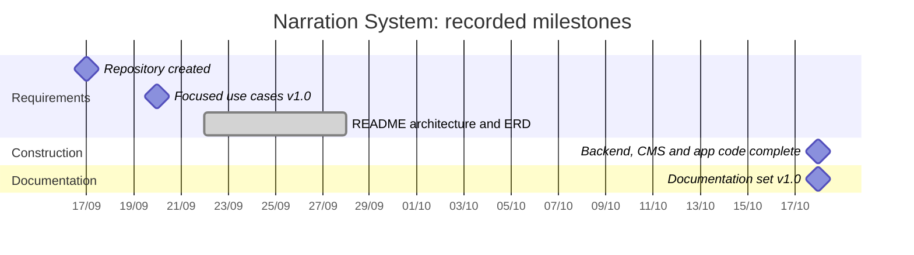

# Project Management

**Project:** Multilingual Automatic Narration System
**Document version:** 1.0 (18/10/2026)

## 1. Process model
The team uses an **iterative and incremental, use-case-driven** process:

1. **Inception**: scope and architecture sketches (README diagrams), focused use cases UC1–UC5.
2. **Elaboration**: SRS, data model, API contract, design of the geofence and narration engines.
3. **Construction** in increments, each ending with working, tested software:
   - Increment 1: backend (data, CMS API, sync, QR, logs, analytics) with automated tests.
   - Increment 2: CMS web (POI, translation, audio, QR, tours, analytics).
   - Increment 3: mobile app (sync, geofence, narration, QR, offline logs, simulation mode).
4. **Transition**: field tests at real POIs, defect fixing, documentation, demo.

Rationale: requirements are known at use-case level, but GPS behaviour and free-service limits can only be learned by building and testing; increments let the riskiest part (on-device geofencing) be tested early on real devices while the backend contract stays stable.

Practices: Git/GitHub repository, one branch per feature with review before merge, the API contract (`docs/api.md`) as the agreement between backend and clients, automated backend tests run before each merge.

## 2. Work breakdown structure

```text
1  Project management
   1.1 Planning, schedule, risk tracking
   1.2 Weekly meetings and progress reports
2  Requirements
   2.1 Architecture sketches (README)
   2.2 Focused use cases UC1–UC5
   2.3 SRS (FR/NFR, business rules, traceability)
3  Design
   3.1 Architecture and deployment
   3.2 Database (ERD, schema)
   3.3 REST API contract
   3.4 Geofence and narration engine design
   3.5 UI design (CMS screens, app screens)
4  Backend
   4.1 Data layer (schema, repositories, seed data)
   4.2 Services (POI, tour, QR, sync, logs, analytics, auth)
   4.3 Translate and TTS providers
   4.4 REST controllers, security middleware
   4.5 Automated tests
5  CMS web
   5.1 Login and API client
   5.2 POI manager with map picker
   5.3 Translation tabs, auto-translate, TTS, audio upload
   5.4 QR generator and print
   5.5 Tour manager with map polyline
   5.6 Analytics dashboard, heatmap, Excel/PDF export
6  Mobile app
   6.1 Offline content layer and sync
   6.2 Location service (foreground and background)
   6.3 Geofence engine
   6.4 Narration engine (audio, on-device TTS, cooldown)
   6.5 QR scanner
   6.6 Log queue and upload
   6.7 UI: map, list, tours, settings; simulation mode
7  Testing
   7.1 Test plan and test cases
   7.2 Unit and API tests
   7.3 System tests (CMS, app)
   7.4 Field tests at POIs and bus stops
8  Deployment and documentation
   8.1 Server deployment (HTTPS, backups)
   8.2 Installation guide, user guide
   8.3 Final report and demo
```

## 3. Timeline and milestones

| Date | Milestone | Status |
|---|---|---|
| 17/09/2026 | Team repository created | Done |
| 20/09/2026 | Focused Use Cases v1.0 (UC1–UC5) | Done |
| 22/09–28/09/2026 | Architecture diagrams and ERD in README | Done |
| by 18/10/2026 | Backend increment: 3-layer API, SQLite schema, seed data, 43 automated tests passing | Done |
| 18/10/2026 | SRS, design, test plan, installation and user guide (this document set), reconciled with the code | Done |
| by 18/10/2026 | CMS increment: all pages implemented, 36 unit tests passing, browser E2E run against the live backend | Done (print dialog, password change UI and production build still to verify) |
| by 18/10/2026 | Mobile increment: all modules implemented, 62 unit + 5 live-backend tests passing, type check, expo-doctor and bundle export clean | Done in code; not yet run on a device |
| TBD | Device testing of the app (Pending (device) cases in the test plan) on Android and iOS | Not started |
| TBD | Field tests FT-01 to FT-09 at real POIs and bus stops | Not started |
| TBD | Deployment to a server with HTTPS | Not started |
| TBD | Final report and demo | Not started |

TBD dates are to be set by the team against the capstone submission deadline.



Only dates recorded in the repository history or in the documents are shown; the backend start date is not recorded in the shared repository and is therefore omitted.

## 4. Roles

| Role | Responsibilities | Member |
|---|---|---|
| Project lead / analyst | Schedule, use cases, SRS, communication with the lecturer | TODO: name |
| Backend developer | API, database, tests, deployment | TODO: name |
| CMS developer | Admin web application | TODO: name |
| Mobile developer | App, geofence and narration engines | TODO: name |
| Tester / documentation | Test plan execution, field tests, user guide | TODO: name |

One person may hold several roles.

## 5. Risks and mitigations

| ID | Risk | Likelihood | Impact | Mitigation | Owner |
|---|---|---|---|---|---|
| R1 | **GPS accuracy** in dense streets and near tall buildings causes late, missed or false triggers | High | High | Ignore fixes with accuracy over 60 m; exit hysteresis at 1.2 × radius; cooldown; radius and priority tuned per POI in the CMS after field tests; QR codes and manual play from the list as alternatives | Mobile dev |
| R2 | **Background location limits** of iOS/Android (battery optimisation, Doze, permission "always" refused; not available in Expo Go) stop narration when the screen is off | High | High | `expo-task-manager` background updates with a foreground-service notification on Android, in a development/store build; explain the "always" permission; keep foreground mode as the guaranteed path; document device-specific behaviour from FT-03 | Mobile dev |
| R3 | **Free translate/TTS endpoints** (unofficial Google endpoints) are rate-limited, change or are blocked | Medium | Medium | Called only from the CMS when an admin requests it, never by the app; provider is configurable (`libretranslate`, `none`); audio is generated once and stored; on-device TTS fallback in the app; errors reported as 502 without blocking saves | Backend dev |
| R4 | **Privacy**: location data could identify visitors | Medium | High | No accounts; random session ID per launch; server-side rounding to 4 decimals; aggregated heatmap; routes without session IDs; no device identifiers collected; retention policy to be agreed with the content owner | Project lead |
| R5 | Inaccurate POI coordinates or machine-translated text reach visitors | Medium | Medium | Verify coordinates on site before go-live; review translations before saving; Vietnamese mandatory as fallback | Content admin |
| R6 | Offline devices miss content updates | Medium | Low | Version check at launch and on reconnect; content keeps working offline with the last version | Mobile dev |
| R7 | App not yet verified on a device; runtime issues (map WebView, camera, audio session, permissions) found late | Medium | High | Run the Pending (device) cases on an emulator and one real phone first; simulation mode and manual QR entry allow a UC1/UC2 demo without field conditions | Mobile dev |
| R8 | Single-server SQLite data loss | Low | High | Daily online backups of database and uploads, off-server copy, restore test (see `04-installation.md` §4.3) | Backend dev |
