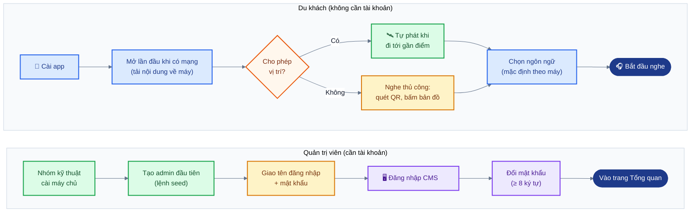
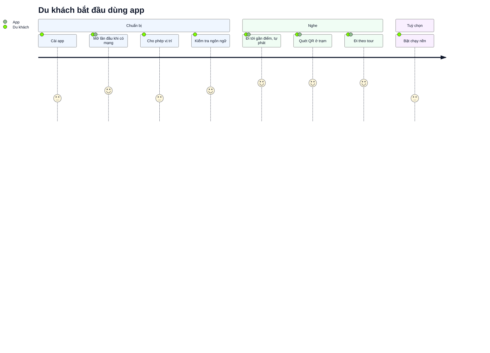
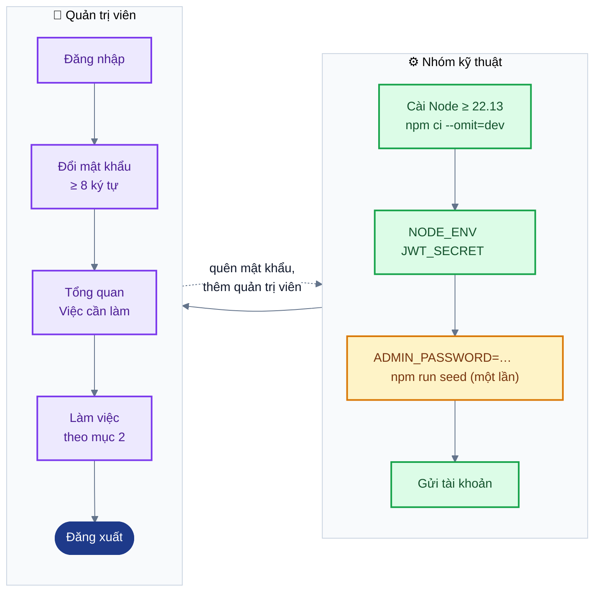
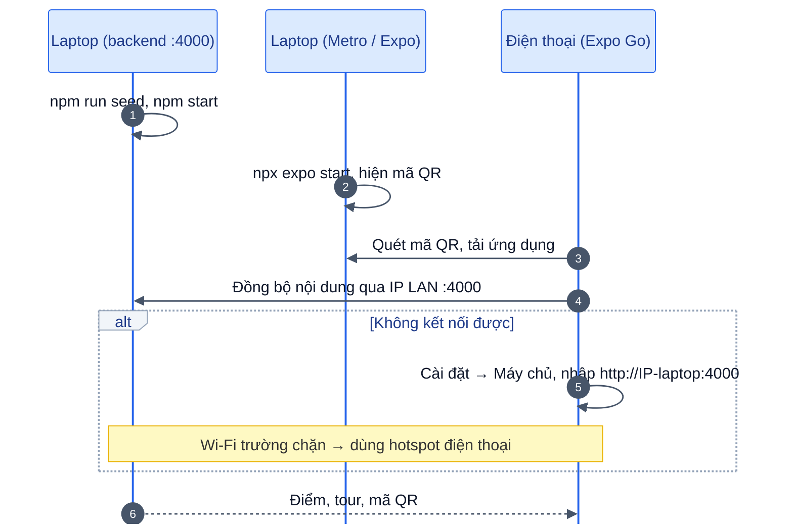
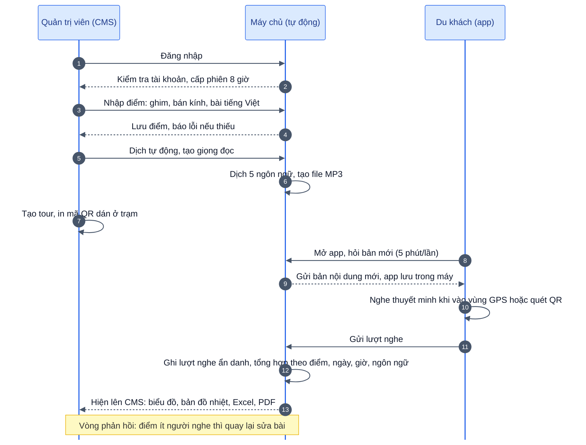
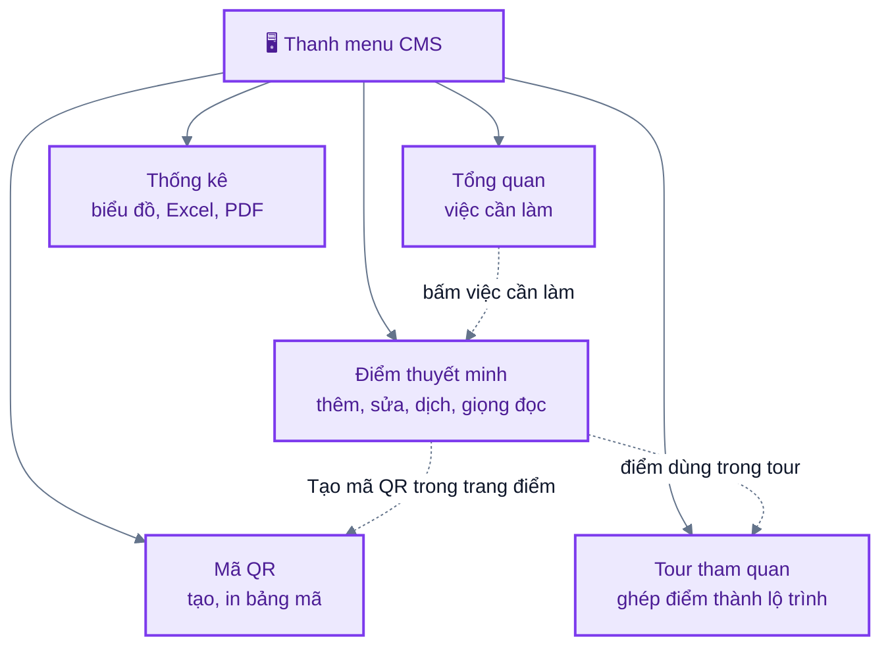
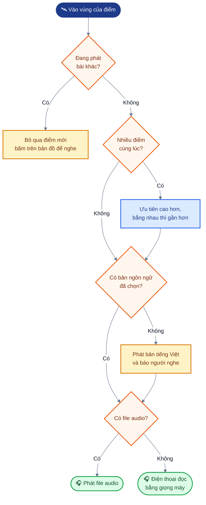

# Sơ đồ vận hành và hướng dẫn tham gia hệ thống

**Phiên bản tài liệu:** 1.0 (20/10/2026)
**Tài liệu liên quan:** `00-PRD.md`, `05-user-guide.md` (hướng dẫn sử dụng đầy đủ), `04-installation.md` (cài đặt)

Tài liệu này dành cho người mới: hệ thống chạy thế nào, ai làm việc gì, và muốn bắt đầu dùng thì làm những bước nào. Bản ảnh của hai sơ đồ chính nằm trong `diagrams/` để dán vào báo cáo Word.

---

## 1. Tham gia hệ thống

Có hai loại người dùng và cách tham gia khác nhau:

- **Du khách, hành khách xe buýt:** chỉ cần cài app. Không đăng ký, không đăng nhập.
- **Quản trị viên:** phải được nhóm kỹ thuật cấp tài khoản. Không có trang tự đăng ký.

*Hình: Hai cách tham gia hệ thống: quản trị viên cần tài khoản do nhóm kỹ thuật cấp, du khách chỉ cần cài app.*

### 1.1 Du khách, hành khách xe buýt

| Bước | Việc cần làm | Ghi chú |
|---|---|---|
| 1 | Cài app lên điện thoại | App chưa có trên Google Play, App Store. Khi demo, cài theo mục 1.3 |
| 2 | Mở app lần đầu khi có mạng | App tải toàn bộ bài thuyết minh về máy, sau đó mất mạng vẫn nghe được. Mở khi chưa có mạng thì app báo chưa có dữ liệu, chỉ cần bật mạng một lần |
| 3 | Cho phép truy cập vị trí | Đồng ý: app tự phát khi tới gần điểm. Từ chối: app giải thích lý do, có nút *Mở Cài đặt* và *Thử lại*; vẫn quét QR và bấm nghe trên bản đồ được |
| 4 | Kiểm tra ngôn ngữ | Mặc định theo ngôn ngữ điện thoại nếu hỗ trợ, không thì tiếng Việt. Đổi ở *Cài đặt → Ngôn ngữ thuyết minh* (Việt, Anh, Trung, Hàn, Nhật, Pháp) |
| 5 | Bắt đầu nghe | Đi bộ qua các điểm để app tự phát; hoặc mở tab *Quét QR* quét mã ở trạm; hoặc mở tab *Tour*, chọn tour, bấm *Đi theo tour này* |
| 6 | (Tuỳ chọn) Nghe khi tắt màn hình | Bật *Tiếp tục khi chạy nền*, cho vị trí ở chế độ *Luôn luôn*; Android nên tắt tối ưu pin cho app. Cần bản cài riêng, Expo Go không hỗ trợ |

**Quyền riêng tư:** app chỉ gửi lượt nghe ẩn danh (điểm nào, ngôn ngữ gì, nghe bao lâu, mở bằng cách nào) kèm một mã phiên ngẫu nhiên đổi mỗi lần mở app. Vị trí làm tròn khoảng 11 m. Tắt hẳn ở *Cài đặt → Gửi dữ liệu ẩn danh*.

*Hình: Hành trình du khách từ lúc cài app đến lúc nghe (điểm 1–5: mức thuận tiện).*

### 1.2 Quản trị viên nội dung

*Hình: Phân việc giữa nhóm kỹ thuật và quản trị viên khi tham gia hệ thống.*

| Bước | Việc cần làm | Ghi chú |
|---|---|---|
| 1 | Nhận tài khoản | Nhóm kỹ thuật gửi địa chỉ trang web, tên đăng nhập, mật khẩu ban đầu |
| 2 | Đăng nhập | Nhập *Tên đăng nhập*, *Mật khẩu*, bấm *Đăng nhập*. Chạy thử trên máy: `http://localhost:5173`, tài khoản mẫu `admin` / `admin123` |
| 3 | Đổi mật khẩu ngay | Bấm tên mình ở cuối thanh menu → *Đổi mật khẩu*; mật khẩu mới từ 8 ký tự |
| 4 | Xem trang Tổng quan | Danh sách *Việc cần làm* cho biết điểm thiếu audio, thiếu ngôn ngữ, chưa có mã QR |
| 5 | Làm việc theo sơ đồ ở mục 2 | Nhập điểm, dịch, tạo giọng đọc, tạo tour và mã QR, theo dõi thống kê |
| 6 | Đăng xuất khi xong | Nút *Đăng xuất* cuối thanh menu. Phiên tự hết sau 8 giờ, đăng nhập lại sẽ quay về đúng trang đang làm |

**Gặp sự cố:**

- Sai mật khẩu 20 lần trong 15 phút thì bị khoá đăng nhập 15 phút.
- Quên mật khẩu: CMS chưa có chức năng lấy lại, nhờ nhóm kỹ thuật đặt lại.
- Cần thêm quản trị viên thứ hai: CMS chưa có trang thêm tài khoản, hiện phải nhờ nhóm kỹ thuật thêm vào cơ sở dữ liệu. Chức năng này nằm trong kế hoạch bản 2 (`00-PRD.md` §11).

**Dành cho nhóm kỹ thuật, tạo tài khoản đầu tiên** (chi tiết ở `04-installation.md` §4.2):

1. Cài Node.js ≥ 22.13, chép thư mục `backend/`, chạy `npm ci --omit=dev`.
2. Đặt biến môi trường `NODE_ENV=production` và `JWT_SECRET` ngẫu nhiên dài ít nhất 32 byte.
3. Tạo admin: `ADMIN_PASSWORD=<mật khẩu mạnh> npm run seed`. Tên đăng nhập là `admin`.
4. Gửi tài khoản cho quản trị viên, nhắc đổi mật khẩu ở lần đăng nhập đầu.

> **Cảnh báo:** `npm run seed` xoá sạch dữ liệu cũ rồi mới tạo lại. Chỉ chạy một lần lúc cài, không bao giờ chạy lại trên máy chủ đang dùng thật.

### 1.3 Cài app để demo ở lớp

1. Điện thoại cài **Expo Go** (bản cho SDK 58), dùng chung Wi-Fi với laptop.
2. Chạy máy chủ trên laptop: `cd backend && npm install && npm run seed && npm start`
3. Mở cửa sổ terminal khác: `cd mobile && npm install && npx expo start`
4. Dùng Expo Go quét mã QR hiện trong terminal.
5. App không kết nối được máy chủ thì vào *Cài đặt → Máy chủ*, nhập `http://<IP laptop>:4000`. Xem IP trên macOS bằng `ipconfig getifaddr en0`.

Wi-Fi trường thường chặn các máy nói chuyện với nhau; gặp vậy thì phát hotspot từ điện thoại. Expo Go không chạy GPS nền, muốn có thì làm bản cài riêng (`04-installation.md` §3.4).

*Hình: Trình tự dựng demo trên lớp giữa laptop và điện thoại.*

---

## 2. Sơ đồ vận hành

Ba làn tương ứng ba bên: quản trị viên làm việc trên CMS, máy chủ chạy tự động, du khách dùng app. Đường nét đứt là vòng phản hồi: xem thống kê, thấy điểm nào ít người nghe thì quay lại sửa bài.

*Hình: Sơ đồ vận hành theo trình tự giữa ba bên: quản trị viên (CMS), máy chủ, du khách (app); ghi chú cuối là vòng phản hồi từ thống kê về sửa bài.*

| Giai đoạn | Bước | Ai làm | Diễn giải |
|---|---|---|---|
| 1. Chuẩn bị nội dung | Đăng nhập | Quản trị viên, máy chủ | Máy chủ kiểm tra mật khẩu, cấp phiên làm việc 8 giờ |
| | Nhập điểm | Quản trị viên | Cắm ghim trên bản đồ, đặt bán kính kích hoạt (thường 50–150 m), mức ưu tiên 0–100, viết bài tiếng Việt |
| | Lưu | Máy chủ | Kiểm tra dữ liệu; thiếu toạ độ, bán kính bằng 0 hoặc chưa có bài tiếng Việt thì báo lỗi ngay dưới ô nhập |
| | Dịch, tạo giọng | Quản trị viên, máy chủ | Bấm *Dịch tự động từ tiếng Việt*, đọc lại bản dịch; bấm *Tạo giọng đọc* để máy chủ tạo file MP3, hoặc tải file ghi âm lên |
| | Tour, mã QR | Quản trị viên | Ghép điểm thành tour; tạo mã QR cho từng trạm, in khổ A5 trở lên, ép plastic, dán ở trạm |
| 2. Du khách sử dụng | Đồng bộ | App, máy chủ | App hỏi phiên bản nội dung khi mở, mỗi 5 phút, khi có mạng lại; chỉ tải lại khi có bản mới |
| | Nghe | Du khách | Vào vùng của điểm thì tự phát; quét QR thì phát ngay. Cùng một điểm không phát lại trong 10 phút |
| | Ghi lượt nghe | App, máy chủ | App lưu lượt nghe trong máy, có mạng thì gửi lên theo đợt |
| 3. Đánh giá | Tổng hợp, xem thống kê | Máy chủ, quản trị viên | Xem điểm được nghe nhiều nhất, thời gian nghe trung bình, ngôn ngữ, giờ cao điểm, bản đồ nhiệt; xuất Excel hoặc PDF |
| | Sửa nội dung | Quản trị viên | Điểm ít người nghe hoặc nghe rất ngắn thì sửa bài, chỉnh bán kính, thêm mã QR |

---

## 3. Các mục trên thanh menu CMS

*Hình: Năm mục trên thanh menu CMS và liên hệ giữa chúng.*

| Mục | Dùng để | Thao tác chính |
|---|---|---|
| Tổng quan | Xem nhanh việc cần làm | Số điểm, tour, mã QR; số liệu 7 ngày; danh sách *Việc cần làm* (bấm vào là tới thẳng điểm cần sửa) |
| Điểm thuyết minh | Thêm, sửa, xoá địa điểm và bài thuyết minh | *Thêm điểm* → cắm ghim → viết bài tiếng Việt → *Dịch tự động từ tiếng Việt* → lưu → *Tạo giọng đọc* hoặc tải file ghi âm |
| Mã QR | Mã dán ở trạm xe buýt | Trong trang điểm: nhập tên trạm, *Tạo mã QR*. Ở mục Mã QR: chọn mã, *In bảng mã* (4 mã mỗi tờ A4). Quét thử trước khi dán |
| Tour tham quan | Ghép nhiều điểm thành lộ trình | *Tạo tour*, chọn điểm, kéo thả để sắp thứ tự; tour phải có ít nhất 1 điểm |
| Thống kê | Biết điểm nào được nghe, nghe bao lâu | Chọn 7, 30 hoặc 90 ngày, lọc theo tour; xem biểu đồ, bản đồ nhiệt; xuất Excel hoặc PDF |

## 4. Câu hỏi thường gặp

*Hình: Cách app chọn điểm và nguồn âm thanh, tóm tắt các câu hỏi thường gặp.*

- **Sửa xong sao điện thoại chưa thấy?** App lấy bản mới khi mở, mỗi 5 phút một lần, hoặc khi có mạng trở lại.
- **Chưa dịch ngôn ngữ đó thì sao?** App phát bản tiếng Việt và báo cho người nghe. Chưa có file audio thì điện thoại tự đọc bằng giọng máy.
- **Hai điểm gần nhau thì phát cái nào?** Điểm có mức ưu tiên cao hơn; bằng nhau thì điểm gần hơn.
- **Đang phát mà đi vào điểm khác?** Điểm mới bị bỏ qua để không cắt ngang. Muốn nghe thì bấm vào điểm đó trên bản đồ.
