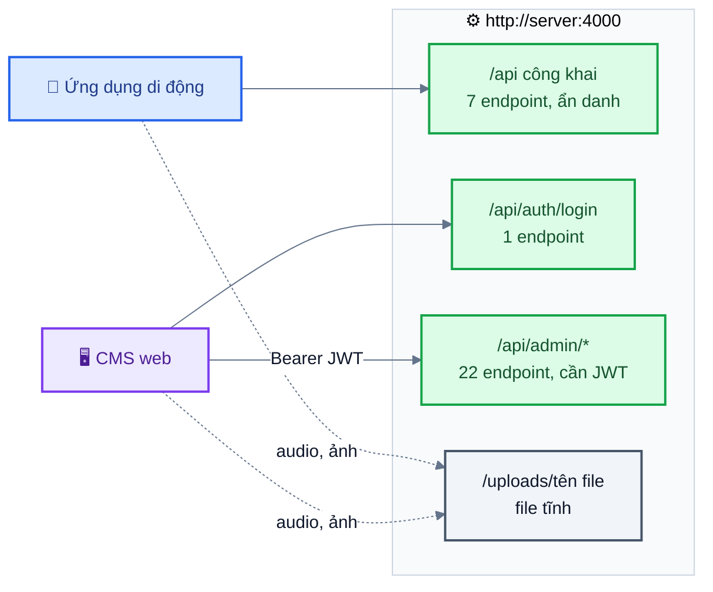
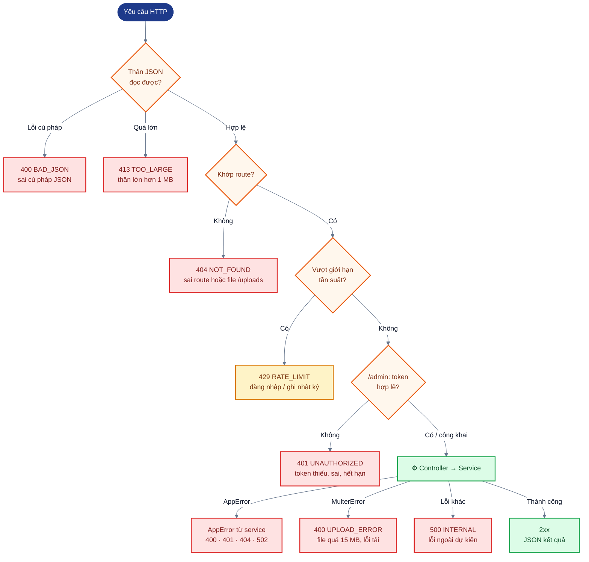
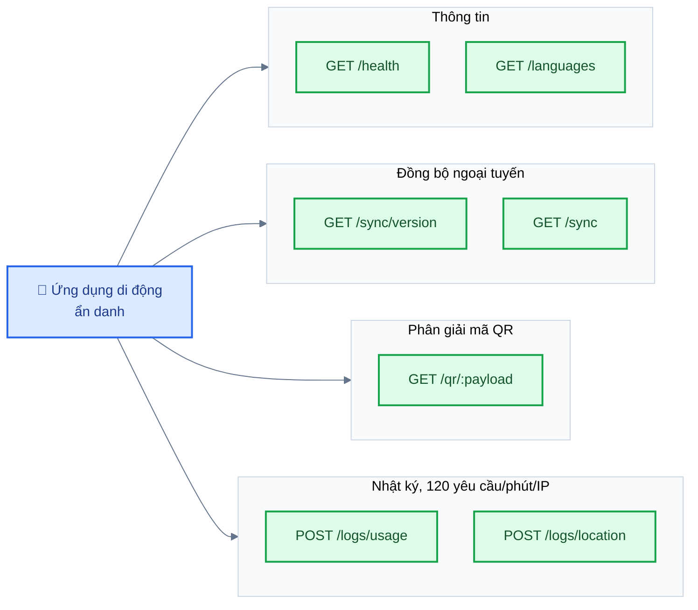
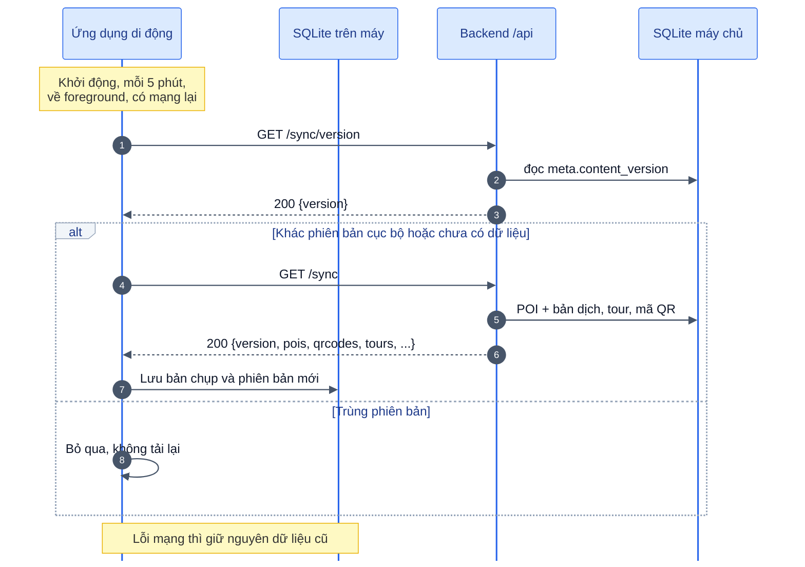
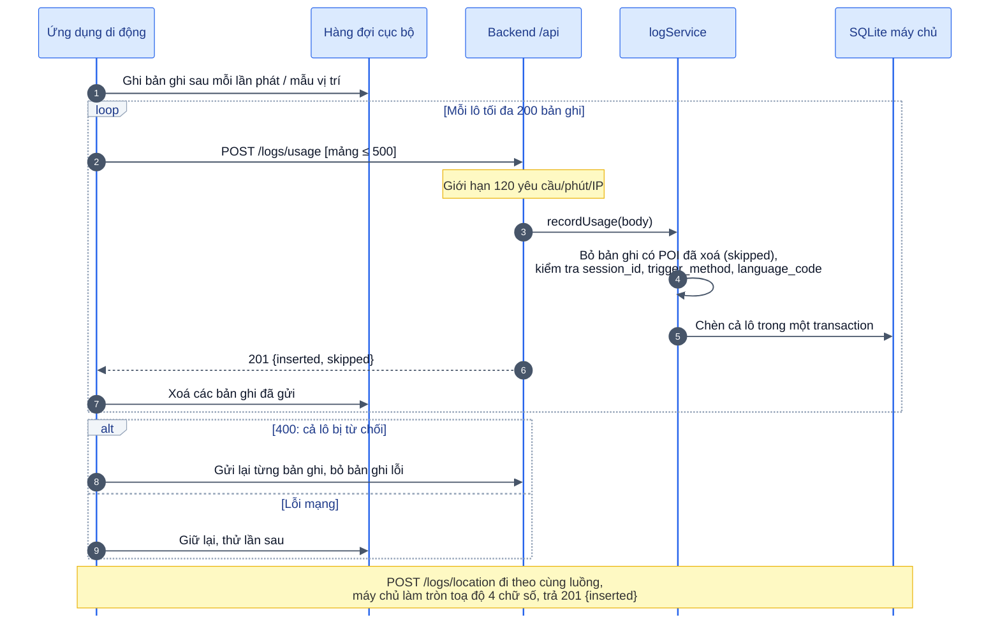
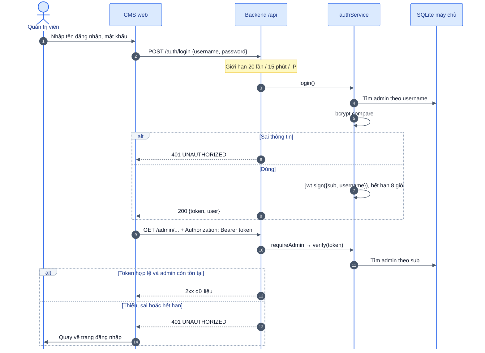
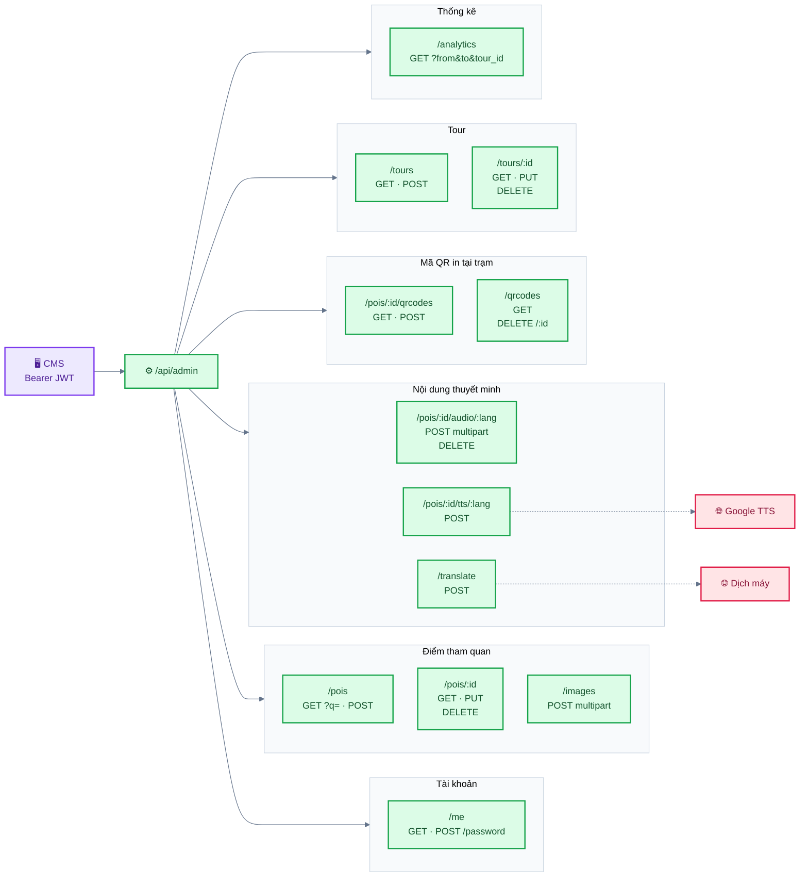
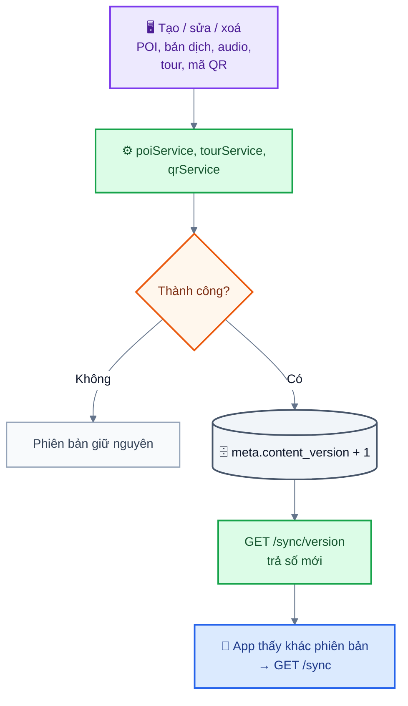
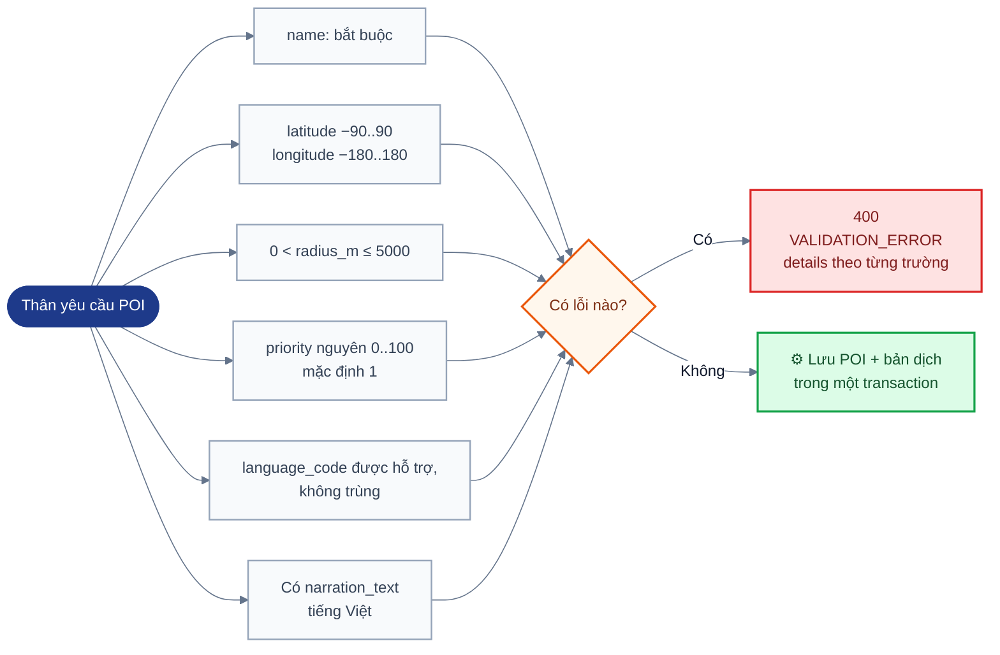
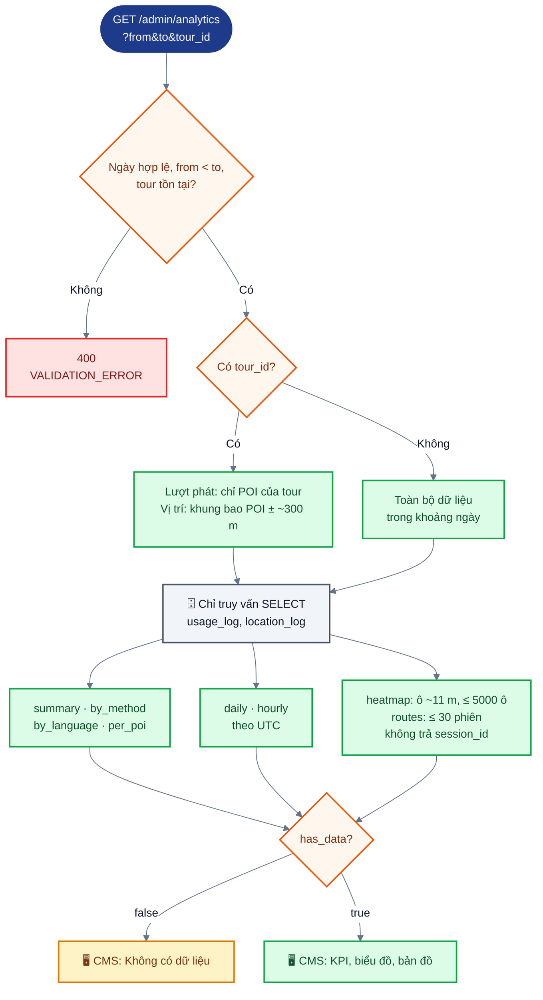

# Tài liệu tham chiếu API (backend 3 lớp)



*Hình: Ba nhóm endpoint REST dưới /api và thư mục file tĩnh /uploads, theo backend/src/routes/index.js và app.js*


URL gốc: `http://<server>:4000/api`. Mọi phản hồi đều ở dạng JSON. Lỗi có dạng:

```json
{ "error": { "code": "VALIDATION_ERROR", "message": "Thông điệp dễ đọc (tiếng Việt)", "details": { "radius_m": "Bán kính kích hoạt phải lớn hơn 0" } } }
```

Máy chủ trả giá trị `message` và `details` bằng tiếng Việt; client nên rẽ nhánh theo `code` và theo tên trường trong `details`, không dựa vào nội dung thông điệp.



*Hình: Mô hình lỗi: các điểm trong chuỗi middleware của Express có thể sinh mã lỗi, tất cả đi qua errorHandler và trả về dạng {error:{code, message, details}}*


| Mã | HTTP | Ý nghĩa |
|---|---|---|
| `VALIDATION_ERROR` | 400 | Dữ liệu đầu vào không hợp lệ; `details` có khoá là tên trường |
| `BAD_JSON` | 400 | Thân yêu cầu không phải JSON hợp lệ |
| `UPLOAD_ERROR` | 400 | Tải lên multipart thất bại (ví dụ file lớn hơn 15 MB) |
| `UNAUTHORIZED` | 401 | Thiếu token, token không hợp lệ hoặc đã hết hạn; sai thông tin đăng nhập |
| `NOT_FOUND` | 404 | Không tìm thấy tài nguyên, route hoặc file đã tải lên |
| `TOO_LARGE` | 413 | Thân JSON lớn hơn 1 MB |
| `RATE_LIMIT` | 429 | Đăng nhập sai quá nhiều lần. Các endpoint ghi nhật ký cũng trả 429 khi vượt giới hạn (với thân phản hồi mặc định của bộ giới hạn, không theo dạng JSON này) |
| `UPSTREAM_ERROR` | 502 | Dịch vụ dịch/TTS bên ngoài lỗi hoặc không truy cập được |
| `INTERNAL` | 500 | Lỗi máy chủ ngoài dự kiến |

File audio và ảnh được phục vụ tại `http://<server>:4000/uploads/<tên file>`. Các trường `audio_url` và `image_url` lưu đường dẫn tương đối `/uploads/...`; client tự ghép origin của máy chủ vào phía trước.

Ngôn ngữ hỗ trợ: `vi` (mặc định), `en`, `zh`, `ko`, `ja`, `fr`.

## 1. API công khai (ứng dụng di động, ẩn danh)



*Hình: Bảy endpoint công khai chia theo mục đích; chỉ hai endpoint ghi nhật ký bị giới hạn tần suất*


| Phương thức | Đường dẫn | Mô tả |
|---|---|---|
| GET | `/health` | `{status:"ok", time}` |
| GET | `/languages` | `{default:"vi", languages:[{code,name}]}` |
| GET | `/sync/version` | `{version: 12}`. Số này tăng mỗi khi quản trị viên thay đổi nội dung |
| GET | `/sync` | Toàn bộ ảnh chụp nội dung để lưu ngoại tuyến (offline) (xem bên dưới) |
| GET | `/qr/:payload` | Tra một mã QR → `{qr:{id,label}, poi:{...,translations}}`; 404 nếu không biết mã. `payload` nhận `NARR:<code>`, `<code>` hoặc URL kết thúc bằng `/q/<code>` (áp dụng `encodeURIComponent`) |
| POST | `/logs/usage` | Ghi sự kiện phát thuyết minh. Thân là một đối tượng hoặc một mảng (≤ 500 phần tử) |
| POST | `/logs/location` | Ghi mẫu vị trí ẩn danh. Thân là một đối tượng hoặc một mảng (≤ 500 phần tử) |

Hai endpoint ghi nhật ký bị giới hạn 120 yêu cầu mỗi phút cho mỗi IP.

`GET /sync`:
```json
{
  "version": 12, "generated_at": "2026-10-18T03:00:00.000Z", "default_language": "vi",
  "languages": [{ "code": "vi", "name": "Tiếng Việt" }],
  "pois": [{
    "id": 1, "name": "Bến Nhà Rồng – Bảo tàng Hồ Chí Minh", "address": "...", "latitude": 10.7681, "longitude": 106.7068,
    "radius_m": 80, "priority": 10, "image_url": null, "updated_at": "2026-10-18 03:00:00",
    "translations": [{ "language_code": "vi", "title": "Bến Nhà Rồng", "narration_text": "...", "audio_url": "/uploads/tts-....mp3", "audio_source": "tts" }]
  }],
  "qrcodes": [{ "payload": "rgKYmfihPDB4", "poi_id": 4, "label": "Cau Khanh Hoi bus stop" }],
  "tours": [{ "id": 1, "name": "Di sản ven sông Quận 4", "description": "...", "updated_at": "...", "poi_ids": [5, 1, 6, 4] }]
}
```
Các điểm tham quan (POI) được sắp theo `priority` giảm dần; `poi_ids` trong một tour theo đúng thứ tự tham quan. `qrcodes` liệt kê mọi payload QR cùng POI tương ứng, để ứng dụng tra được mã in sẵn khi ngoại tuyến; `GET /qr/:payload` vẫn được giữ làm phương án dự phòng khi có mạng.



*Hình: Luồng đồng bộ: kiểm tra phiên bản trước, chỉ tải toàn bộ bản chụp khi phiên bản trên máy chủ thay đổi*


`POST /logs/usage` (mỗi phần tử):
```json
{ "poi_id": 1, "session_id": "a1b2c3d4e5f6a7b8", "trigger_method": "geofence|qr|manual", "language_code": "vi", "played_at": "ISO-8601", "listen_seconds": 42 }
```
`POST /logs/location` (mỗi phần tử): `{ "session_id": "...", "latitude": 10.76, "longitude": 106.70, "recorded_at": "ISO-8601" }`

- `session_id`: chuỗi ngẫu nhiên 8–64 ký tự `[A-Za-z0-9_-]`, do ứng dụng tạo ở mỗi lần khởi động và không gắn với danh tính nào.
- `language_code` phải là một ngôn ngữ được hỗ trợ.
- `played_at` / `recorded_at` không bắt buộc; nếu thiếu hoặc không hợp lệ, máy chủ dùng giờ của máy chủ.
- `listen_seconds` được làm tròn và giới hạn trong khoảng 0..3600.
- Máy chủ làm tròn toạ độ tới 4 chữ số thập phân (~11 m) trước khi lưu.
- Một lô được chèn trong một giao dịch. Bản ghi sử dụng có POI không còn tồn tại (bị xoá sau khi ứng dụng ghi nhật ký lúc ngoại tuyến) bị bỏ qua và được đếm vào `skipped`; nếu không bản ghi nào trong lô trỏ tới POI còn tồn tại, yêu cầu thất bại với mã 400. Mọi phần tử không hợp lệ khác làm cả lô bị từ chối với mã 400 (thông điệp nêu chỉ số của phần tử).

Phản hồi: `201 {inserted, skipped}` cho nhật ký sử dụng, `201 {inserted}` cho vị trí.



*Hình: Luồng gửi nhật ký: ứng dụng xếp hàng cục bộ, gửi theo lô, máy chủ kiểm tra và chèn trong một giao dịch*


## 2. Đăng nhập CMS

`POST /auth/login` `{username, password}` → `{token, user:{id,username,full_name}}`. Giới hạn 20 lần thử mỗi 15 phút cho mỗi IP.

Mọi endpoint `/admin/*` yêu cầu header `Authorization: Bearer <token>`. Mặc định token hết hạn sau 8 giờ (`JWT_EXPIRES_IN`); token hết hạn trả về 401 và CMS quay về trang đăng nhập.



*Hình: Luồng xác thực JWT: đăng nhập lấy token, mọi lệnh gọi /admin được middleware requireAdmin kiểm tra*


## 3. API quản trị (`/admin`)



*Hình: Bản đồ 22 endpoint quản trị theo tài nguyên; ô gộp các phương thức trên cùng một đường dẫn*


| Phương thức | Đường dẫn | Mô tả |
|---|---|---|
| GET | `/admin/me` | Quản trị viên đang đăng nhập |
| POST | `/admin/me/password` | `{current_password,new_password}` (mật khẩu mới ≥ 8 ký tự) → 204. Lỗi trả 400 kèm `details.current_password` hoặc `details.new_password` |
| GET | `/admin/pois?q=` | `{items:[{id,name,address,latitude,longitude,radius_m,priority,image_url,created_at,updated_at,languages:["vi","en"],audio_languages:["vi"],qr_count}]}`. `q` tìm theo tên và địa chỉ |
| POST | `/admin/pois` | Tạo POI (thân yêu cầu ở bên dưới) → 201 + POI đầy đủ |
| GET | `/admin/pois/:id` | POI + `translations[]` + `qrcodes[]` (mỗi mã có `content` = `NARR:<payload>`) |
| PUT | `/admin/pois/:id` | Cập nhật POI (cùng dạng thân yêu cầu). Ngôn ngữ không có trong thân yêu cầu sẽ bị xoá cùng audio của nó. File `image_url` nằm trong `/uploads` bị thay thế hoặc bị xoá trống sẽ bị xoá |
| DELETE | `/admin/pois/:id` | 204. Xoá luôn các bản dịch, file audio, file ảnh và mã QR của POI, và gỡ POI khỏi các tour. Nhật ký sử dụng đã có được giữ lại với `poi_id = NULL` |
| POST | `/admin/pois/:id/audio/:lang` | multipart, trường `audio` (mp3/m4a/aac/wav/ogg/webm, ≤ 15 MB) → POI. Thay thế audio cũ của ngôn ngữ đó (nếu có) |
| DELETE | `/admin/pois/:id/audio/:lang` | Gỡ audio → POI |
| POST | `/admin/pois/:id/tts/:lang` | Tạo file MP3 từ `narration_text` ĐÃ LƯU của ngôn ngữ đó (hoặc từ thân yêu cầu `{text}`) → POI với `audio_source:"tts"` |
| GET | `/admin/pois/:id/qrcodes` | `{items:[{id,poi_id,payload,label,content,created_at}]}` |
| POST | `/admin/pois/:id/qrcodes` | `{label?}` → 201 QR. `content` là chuỗi cần mã hoá vào mã QR in ra (`NARR:<payload>`) |
| GET | `/admin/qrcodes` | Mọi mã QR kèm `poi_name` |
| DELETE | `/admin/qrcodes/:id` | 204 |
| POST | `/admin/images` | multipart, trường `image` (jpg/png/webp) → 201 `{url}` để dùng làm `image_url` |
| POST | `/admin/translate` | `{text, source, target}` (văn bản ≤ 5000 ký tự) → `{text, provider}` |
| GET | `/admin/tours` | `{items:[{id,name,description,poi_count,created_at,updated_at}]}` |
| POST | `/admin/tours` | `{name, description?, poi_ids:[3,1,2]}` (thứ tự mảng = thứ tự tham quan, ≥ 1 POI, không trùng lặp, mọi POI phải tồn tại) → 201 |
| GET | `/admin/tours/:id` | `{id,name,description,created_at,updated_at,pois:[{id,name,latitude,longitude,visit_order}]}` |
| PUT | `/admin/tours/:id` | Cùng dạng thân yêu cầu với POST |
| DELETE | `/admin/tours/:id` | 204 |
| GET | `/admin/analytics?from=YYYY-MM-DD&to=YYYY-MM-DD&tour_id=` | Báo cáo thống kê (analytics) (xem bên dưới). Mọi tham số đều không bắt buộc |

Mỗi thao tác tạo/cập nhật/xoá thành công đối với POI, bản dịch, audio, tour hoặc mã QR đều làm tăng `content_version`.



*Hình: Mọi thao tác ghi nội dung thành công làm tăng content_version, nhờ đó ứng dụng biết cần đồng bộ lại*


Thân yêu cầu tạo/cập nhật POI:
```json
{
  "name": "Bến Nhà Rồng", "address": "1 Nguyễn Tất Thành", "latitude": 10.7681, "longitude": 106.7068,
  "radius_m": 80, "priority": 10, "image_url": null,
  "translations": [
    { "language_code": "vi", "title": "Bến Nhà Rồng", "narration_text": "..." },
    { "language_code": "en", "title": "Nha Rong Wharf", "narration_text": "..." }
  ]
}
```
Quy tắc kiểm tra dữ liệu (UC3 E1): bắt buộc có tên; vĩ độ −90..90; kinh độ −180..180; `0 < radius_m ≤ 5000` (làm tròn thành số nguyên); `priority` là số nguyên 0..100 (mặc định 1); mỗi `language_code` phải được hỗ trợ và không trùng lặp; bắt buộc có `narration_text` tiếng Việt (`vi`). Các dòng bản dịch không có cả tiêu đề lẫn nội dung sẽ bị bỏ qua. Lỗi trả về `details` có khoá theo trường: `name`, `latitude`, `longitude`, `radius_m`, `priority`, `translations`, `translations.<i>.language_code`.



*Hình: Kiểm tra dữ liệu POI (UC3 E1): mọi quy tắc được kiểm tra cùng lúc, lỗi gom vào details rồi trả một lần*


Báo cáo thống kê `GET /admin/analytics`:
```json
{
  "filters": { "from": "...", "to": "...", "tour_id": null },
  "has_data": true,
  "summary": { "plays": 1000, "sessions": 400, "avg_listen_seconds": 51.3, "total_listen_seconds": 51300 },
  "by_method": [{ "method": "geofence", "plays": 650 }],
  "by_language": [{ "language": "vi", "plays": 380 }],
  "per_poi": [{ "poi_id": 1, "name": "...", "latitude": 10.7, "longitude": 106.7, "plays": 210, "avg_listen_seconds": 50.2, "sessions": 190 }],
  "daily": [{ "date": "2026-10-01", "plays": 30 }],
  "hourly": [{ "hour": 18, "plays": 80 }],
  "heatmap": [{ "lat": 10.7605, "lng": 106.7036, "weight": 12 }],
  "routes": [{ "route": 1, "points": [[10.76, 106.70], [10.761, 106.701]] }]
}
```
- `to` truyền dạng ngày (`YYYY-MM-DD`) thì bao gồm trọn ngày đó. `from` phải sớm hơn `to`; ngày không hợp lệ hoặc `tour_id` không tồn tại trả về 400.
- Khi có `tour_id`, thống kê lượt phát chỉ tính các POI thuộc tour đó; bản đồ nhiệt (heatmap) và lộ trình dùng khung bao các POI của tour, nới rộng khoảng 300 m (mẫu vị trí không gắn với POI).
- `per_poi` được sắp theo số lượt phát (giảm dần), tức là danh sách các điểm được nghe nhiều nhất.
- `heatmap` gộp các mẫu vào ô ~11 m (tối đa 5000 ô). `routes` trả về tối đa 30 phiên gần nhất có ít nhất hai mẫu, được đánh số tuần tự; không bao giờ trả về `session_id`.
- `has_data=false` → CMS hiển thị "Không có dữ liệu" (UC5 E1). Ngày và giờ trong `daily`/`hourly` tính theo UTC.



*Hình: Cách backend dựng báo cáo thống kê từ bộ lọc tới các khối dữ liệu trả về*

