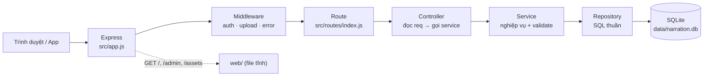

# Bản đồ mã nguồn & hướng dẫn chỉnh sửa

Tài liệu này trả lời hai câu hỏi khi mở dự án lên:

1. **Chức năng X nằm ở file/hàm nào?**
2. **Muốn đổi X thì sửa ở đâu, có làm hỏng chỗ khác không?**

Code backend, CMS và mobile đều đã có chú thích tiếng Việt ngay trong file (xem
[mục 7](#7-quy-ước-chú-thích-trong-code)). Tài liệu này là bản đồ tổng thể, còn chi
tiết từng dòng nằm cạnh code.

---

## 1. Thư mục nào là gì?

| Thư mục | Vai trò | Có sửa trực tiếp được không? |
|---|---|---|
| [`backend/`](../backend/) | API Express + SQLite, phục vụ luôn website và CMS | **Có** — đây là nguồn chính, có chú thích |
| [`cms/`](../cms/) | Mã nguồn React/TypeScript của CMS | **Có** — sửa rồi build lại (xem mục 6) |
| [`mobile/`](../mobile/) | Ứng dụng Expo/React Native | **Có** — chạy bằng Expo |
| [`web/`](../web/) | **Bản build** của website công khai và CMS đang chạy | **Không** — đã minify, chỉ phục vụ nguyên trạng |
| [`docs/`](.) | Tài liệu báo cáo, API, bản đồ code | Có |

> `web/assets/*.js` là bundle đã build/minify — không có chú thích và không nên sửa tay.
> Muốn đổi giao diện CMS thì sửa `cms/src/**`, đổi giao diện website công khai thì cần
> mã nguồn gốc của website (trong repo này chỉ có bản build).

Các file `.bat` ở thư mục gốc chỉ là "vỏ" gọi lệnh, không chứa nghiệp vụ:

| File | Việc |
|---|---|
| `CHAY-WEBSITE.bat` | Chạy local: cài thư viện, nạp dữ liệu nếu thiếu, mở server cổng 4000 |
| `TAT-WEBSITE.bat` | Tắt server local |
| `CHAY-CONG-KHAI.bat` | Bật server + Cloudflare Tunnel (đọc `cloudflare/config.yml`, không hỏi token) |
| `TAT-CONG-KHAI.bat` | Tắt cả tunnel và server cổng 4000 |
| `KHOI-DONG-LAI-SERVER.bat` | Chỉ khởi động lại server cổng 4000, **giữ nguyên tunnel** |

---

## 2. Một request đi qua những lớp nào?



Quy ước chung của cả backend:

- **Controller** không chứa nghiệp vụ, chỉ lấy tham số và trả JSON.
- **Service** kiểm tra dữ liệu, quyết định luồng, ném lỗi `AppError`.
- **Repository** chỉ có câu SQL, không biết HTTP là gì.

---

## 3. Backend — từng file làm gì?

```
backend/src/
├── server.js          # entrypoint: mở DB, bật upload, listen cổng 4000
├── app.js             # lắp repos → services → routes; phục vụ web/ + web/admin/
├── config.js          # đọc biến môi trường, hằng số (ngôn ngữ, thanh toán, live, TTS)
├── db/
│   ├── database.js    # schema toàn bộ bảng + migrate() cột mới
│   ├── seed.js        # nạp dữ liệu (snapshot website / 8 POI mẫu / dữ liệu demo)
│   └── deployed-snapshot.json  # nội dung thật tải từ website đang chạy
├── routes/index.js    # khai báo mọi endpoint /api và /api/admin
├── middleware/
│   ├── auth.js        # requireAdmin: kiểm tra Bearer token
│   ├── upload.js      # multer cho audio/ảnh + saveBuffer() cho TTS
│   └── error.js       # biến AppError thành JSON lỗi thống nhất
├── controllers/       # public, auth, poi, tour, analytics, order, live
├── services/          # nghiệp vụ (xem bảng dưới)
├── repositories/      # SQL theo bảng (xem bảng dưới)
└── utils/             # errors, validate, locked (ẩn nội dung trả phí)
```

### 3.1 Service — “bộ não” của hệ thống

| File | Chịu trách nhiệm | Hàm đáng chú ý |
|---|---|---|
| `services/index.js` | Khởi tạo service, chọn provider dịch/TTS, bật/tắt tự dịch khi lưu | `createServices()` |
| `authService.js` | Đăng nhập, phát/kiểm tra JWT, đổi mật khẩu | `login`, `changePassword`, `verify` |
| `poiService.js` | CRUD điểm thuyết minh, validate toạ độ/bán kính/giá, giữ `is_auto` | `validatePoiInput`, `create`, `update` |
| `tourService.js` | CRUD tour + thứ tự POI | `create`, `update`, `delete` |
| `qrService.js` | Sinh payload QR, giải mã QR → POI | `create`, `resolve` |
| `syncService.js` | Gói dữ liệu offline cho app, ẩn audio điểm có phí | `version`, `snapshot` |
| `logService.js` | Ghi lượt nghe/vị trí (ẩn danh) | `usage`, `locations` |
| `analyticsService.js` | Tính báo cáo, lọc theo ngày/tour | `report` |
| `translateService.js` | Gọi Google free / LibreTranslate | `createTranslator`, `checkTranslateInput` |
| `ttsService.js` | Sinh file MP3 từ văn bản | `createTts` |
| `autoService.js` | Chạy nền: dịch 5 ngôn ngữ + tạo audio, báo tiến trình | `schedule`, `status` |
| `orderService.js` | Tạo đơn, khách báo đã chuyển khoản, admin xác nhận/huỷ, mở khoá bài | `create`, `claim`, `full` |
| `liveService.js` | Đếm phiên đang hoạt động trong RAM, nhân hệ số demo, SSE | `ping`, `snapshot`, `stream` |

### 3.2 Repository — bảng nào ở file nào

| File | Bảng |
|---|---|
| `adminRepository.js` | `admin_user` |
| `poiRepository.js` | `poi` (+ đếm ngôn ngữ, số QR) |
| `translationRepository.js` | `poi_translation` (text, audio, `is_auto`) |
| `qrRepository.js` | `qr_code` |
| `tourRepository.js` | `tour`, `tour_poi` |
| `logRepository.js` | `usage_log`, `location_log` |
| `analyticsRepository.js` | truy vấn tổng hợp cho báo cáo |
| `paymentRepository.js` | `payment_order` (đơn, token, quyền nghe) |
| `metaRepository.js` | `meta` — `content_version` |
| `repositories/index.js` | lắp tất cả repository trên cùng một connection |

### 3.3 Bảng dữ liệu (SQLite)

`admin_user`, `poi`, `poi_translation`, `qr_code`, `tour`, `tour_poi`,
`usage_log`, `location_log`, `payment_order`, `meta`.

Schema nằm trong `db/database.js`. Khi thêm cột cho DB đã có dữ liệu, phải thêm cả
vào `SCHEMA` **và** hàm `migrate()` (dùng `ALTER TABLE`), nếu không máy đang chạy sẽ
không có cột mới.

---

## 4. Các luồng nghiệp vụ chính

### 4.1 Đồng bộ nội dung cho app (`/api/sync`)

1. `routes/index.js` → `publicController.sync`
2. `syncService.snapshot()`
3. `poiRepository.listWithTranslations()` + `tourRepository.listWithPois()` + `qrRepository.listAll()`
4. `utils/locked.js` → `maskLockedAudio()`: điểm có `price > 0` chỉ trả **câu đầu**, bỏ audio.
5. Tăng `content_version` mỗi lần admin sửa nội dung (`metaRepository.bumpContentVersion`).

### 4.2 Quét mã QR (`/api/qr/:payload`)

1. `qrService.resolve(raw)` tách payload khỏi `NARR:...` hoặc URL.
2. `qrRepository.findByPayload()` → `poiRepository.findById()`.
3. Trả `{ qr, poi }` đã che nội dung nếu là điểm có phí.

### 4.3 Ghi lượt nghe & thống kê

1. App gọi `POST /api/logs/usage` (hoặc `/logs/location`).
2. `logService` kiểm tra rồi `logRepository` ghi `usage_log` / `location_log`.
3. CMS gọi `GET /api/admin/analytics` → `analyticsService.report()` →
   `analyticsRepository` tổng hợp theo ngày, tour, ngôn ngữ, cách kích hoạt.

### 4.4 Thanh toán & mở khoá bài có phí

1. `POST /api/orders` → `orderService.create()` sinh `code` (TMxxxxxx) + `token` bí mật,
   lưu `payment_order` trạng thái `pending`, trả thông tin VietQR.
2. Khách bấm “Tôi đã chuyển khoản” → `POST /api/orders/:code/claim` →
   `paymentRepository.markClaimed()` (vẫn `pending`, nhưng có `claimed_at`).
3. `GET /api/pois/:id/full` với header `x-access-token` →
   `paymentRepository.hasAccess()`: đơn `paid` **hoặc** `pending + claimed_at` thì trả
   toàn bộ nội dung + audio; ngược lại `402 PAYMENT_REQUIRED`.
4. CMS **Thanh toán** → `POST /api/admin/orders/:id/confirm` (→ `paid`) hoặc
   `/cancel` (→ `cancelled`, quyền nghe bị thu hồi ngay).

### 4.5 Đếm người đang dùng

1. Website/app gọi `POST /api/live/ping` mỗi 15 giây (`state`: `browsing` / `listening` / `left`).
2. `liveService` giữ phiên trong `Map` (không ghi DB), xoá khi quá `LIVE_TTL_MS` (mặc định 45s)
   hoặc khi nhận `state: "left"`.
3. CMS lấy số qua SSE `GET /api/admin/live/stream` (mặc định đẩy mỗi **1 giây**, đổi bằng
   `LIVE_SSE_INTERVAL_MS`); nếu SSE lỗi thì tự chuyển sang `GET /api/admin/live` (polling 3 giây).
4. `LIVE_DEMO_FACTOR` nhân số liệu ở `snapshot()` (mã mặc định `2`; `.env` hiện đặt `1` = số thật).

### 4.6 Tự dịch + tạo giọng đọc sau khi lưu POI

1. `poiService.create/update()` gọi `autoService.schedule(id)` (chạy nền, không chặn lưu).
2. `autoService.run()`: dịch tiếng Việt → en/zh/ko/ja/fr, rồi gọi TTS từng ngôn ngữ.
3. Chỉ ghi đè bản dịch `is_auto = 1`; bản admin tự sửa và audio admin upload được giữ nguyên.
4. Tiến trình xem ở `GET /api/admin/pois/:id/auto`; chạy lại bằng `POST` cùng URL.
5. Tắt hoàn toàn bằng `AUTO_TRANSLATE_ON_SAVE=0` hoặc `TTS_PROVIDER=none`.

### 4.7 Nạp dữ liệu

- `npm run seed` — nội dung snapshot (9 POI, 3 tour, 6 QR), không có log giả.
- `npm run seed:demo` — thêm lượt nghe/vị trí + 3 đơn thanh toán mẫu để CMS có dữ liệu.
- `npm run seed:sample` — 8 POI tối giản trong `seed.js` (dùng khi không có snapshot).
- `node scripts/fetch-deployed.mjs` — tải lại snapshot + audio + asset từ website đang chạy.

`seedFromSnapshot()` giữ nguyên `id` của POI/QR và `version`, nhờ vậy `/api/sync` và các
đường dẫn QR đang in không thay đổi.

---

## 5. Muốn đổi X thì sửa ở đâu?

| Muốn đổi | Sửa ở |
|---|---|
| Giá một điểm / miễn phí hoá | CMS → Điểm thuyết minh → “Phí nghe”; lưu ở cột `poi.price` |
| Tài khoản nhận tiền VietQR | `backend/.env`: `PAYMENT_BANK_BIN`, `PAYMENT_BANK_NAME`, `PAYMENT_ACCOUNT`, `PAYMENT_ACCOUNT_NAME`; tắt bằng `PAYMENT_ACCOUNT=` |
| Quy tắc ẩn bài trả phí | `backend/src/utils/locked.js` (câu xem trước, bỏ audio) + `orderService.full()` |
| Số người trực tuyến bị nhân đôi | `LIVE_DEMO_FACTOR` trong `.env` (`1` = số thật) |
| Tự chuyển HTTP → HTTPS cho tên miền công khai | `PUBLIC_HOST` trong `.env` (để trống khi chỉ chạy localhost) |
| Thời gian một phiên được coi là “đã rời” | `LIVE_TTL_MS` (mặc định 45000) |
| Nhịp đẩy số liệu SSE | `LIVE_SSE_INTERVAL_MS` (đang đặt 1000 = 1 giây; mặc định trong mã là 3000) |
| Thêm/bớt ngôn ngữ | `backend/src/config.js` → `config.languages`; đồng bộ nhãn ở `cms/src/lib/languages.ts`, mobile `src/config.ts` và dữ liệu seed |
| Đổi câu xem trước của bài trả phí | `firstSentence()` trong `backend/src/utils/locked.js` |
| Tiền tố nội dung QR (`NARR:`) | `QR_PREFIX` trong `backend/src/services/qrService.js` |
| Số byte/payload QR | `qrService.create()` (`crypto.randomBytes(9)`) |
| Giới hạn dung lượng audio | `config.maxAudioBytes` (mặc định 15 MB) |
| Rate limit đăng nhập / ghi log | `backend/src/routes/index.js` (`loginLimiter`, `logLimiter`) |
| Giao diện CMS | `cms/src/pages/**`, `cms/src/components/**` rồi build lại (mục 6) |
| Giao diện website công khai | Cần mã nguồn gốc của website; `web/` chỉ là bản build |
| Ứng dụng di động | `mobile/src/**`; địa chỉ API qua `EXPO_PUBLIC_API_URL` hoặc màn Cài đặt |
| Thêm endpoint mới | `routes/index.js` → thêm hàm vào controller → viết service |
| Thêm cột/bảng DB | `db/database.js` (`SCHEMA` + `migrate`) → repository → service |
| Dữ liệu mẫu / demo | `db/seed.js` (`SAMPLE_POIS`, `TOURS`, `QR_STOPS`, `seedDemoPayments`) |
| Nội dung thật của website | `db/deployed-snapshot.json` (tải lại bằng `scripts/fetch-deployed.mjs`) |
| Câu chữ giao diện CMS | `cms/src/pages/**` (chuỗi tiếng Việt nằm ngay trong JSX) |
| Câu chữ website | Bundle `web/assets/index-*.js` — cần mã nguồn gốc để sửa |

---

## 6. Build lại CMS (khi sửa `cms/src`)

CMS được phục vụ tại `/admin/`, nên khi build phải đặt `base` tương ứng, nếu không
đường dẫn asset sẽ thành `/assets/...` và đè lên website công khai:

```bash
cd cms
npm install
npx vite build --base=/admin/
# rồi chép toàn bộ cms/dist/* vào web/admin/
```

Kiểm tra: mở <http://localhost:4000/admin/> và xem tab Network không có file 404.
Nhớ **sao lưu `web/admin/`** trước khi chép, vì đây là bản build đang chạy.

Sau khi sửa **backend** (không phải CMS) thì không cần build, chỉ cần khởi động lại server:
bấm đúp `KHOI-DONG-LAI-SERVER.bat` (giữ tunnel, gián đoạn ~3 giây) hoặc `CHAY-CONG-KHAI.bat`.
Lý do: `npm start` chạy `node src/server.js` không có `--watch`, nên code đã nằm trong RAM —
sửa file trên đĩa mà không khởi động lại thì không có tác dụng.

---

## 7. Quy ước chú thích trong code

Code dùng chú thích tiếng Việt, chia làm ba loại:

1. **Đầu file** — mục đích của module và luồng tổng quát:
   ```js
   /**
    * Tầng nghiệp vụ: đơn thanh toán VietQR cho điểm thuyết minh có phí.
    * Luồng: tạo đơn → khách báo đã chuyển khoản → admin xác nhận → mở khoá bài.
    */
   ```
2. **Đầu hàm** — làm gì, tham số/trả về khi không hiển nhiên:
   ```js
   /** POST /api/orders — tạo đơn cho một POI có phí. */
   create(poiId) { ... }
   ```
3. **Trong thân hàm** — giải thích **vì sao** làm vậy (nghiệp vụ, bẫy dữ liệu), không
   kể lại code:
   ```js
   // Giữ nguyên bản dịch admin tự sửa; chỉ ghi đè bản do máy tạo.
   if (existing?.narration_text && !existing.is_auto) continue;
   ```

Khi thêm code mới, giữ đúng ba mức này. Không cần chú thích những dòng quá hiển nhiên
(`i++`), nhưng nên chú thích mọi `if` có quy tắc nghiệp vụ.

---

## 8. Đọc code theo thứ tự nào?

Nếu lần đầu mở dự án, đọc theo thứ tự sau là nhanh hiểu nhất:

1. `backend/src/config.js` — biết hệ thống có những cấu hình gì.
2. `backend/src/db/database.js` — nhìn schema là hiểu 80% mô hình dữ liệu.
3. `backend/src/routes/index.js` — xem có những API nào.
4. `backend/src/services/poiService.js` và `syncService.js` — luồng nội dung cơ bản.
5. `backend/src/services/orderService.js` + `liveService.js` — hai tính năng mới.
6. `backend/src/app.js` — cách ghép tất cả lại và phục vụ web/CMS.
7. CMS: `cms/src/lib/api.ts` (gọi API) → `cms/src/pages/PoiEditPage.tsx` (màn phức tạp nhất).

---

## 9. Kiểm thử và gỡ lỗi

| Lệnh | Việc |
|---|---|
| `cd backend && npm test` | 43 ca backend (DB trong RAM, không cần mạng) |
| `cd backend && npm run dev` | chạy kèm tự nạp lại khi sửa code |
| `KHOI-DONG-LAI-SERVER.bat` | khởi động lại server cổng 4000, giữ tunnel (dùng sau khi sửa `backend/**` hoặc `.env`) |
| `cd cms && npm test` | kiểm thử đơn vị CMS |
| `cd cms && npm run typecheck` | kiểm tra TypeScript |
| `cd mobile && npm test` | kiểm thử đơn vị mobile |

Gỡ lỗi nhanh:

- `GET /api/health` — kiểm tra server sống.
- Log lỗi: mọi lỗi nghiệp vụ đi qua `middleware/error.js`, trả `{ error: { code, message, details } }`.
- DB: mở `backend/data/narration.db` bằng DB Browser for SQLite để xem bảng.
- Audio/ảnh: file nằm trong `backend/uploads/`, URL trả về dạng `/uploads/<tên file>`.
- Nếu `npm start` không thấy biến trong `.env`: kiểm tra file nằm đúng `backend/.env`
  (script đã dùng `--env-file-if-exists`).

| File test | Bao phủ |
|---|---|
| `tests/auth.test.js` | đăng nhập, token, đổi mật khẩu |
| `tests/poi.test.js` | CRUD POI, validate, upload audio, xoá file |
| `tests/qr-tour.test.js` | QR, tour, đồng bộ |
| `tests/analytics.test.js` | ghi log, báo cáo, dữ liệu demo |
| `tests/services.test.js` | dịch/TTS giả lập, tự dịch khi lưu |
